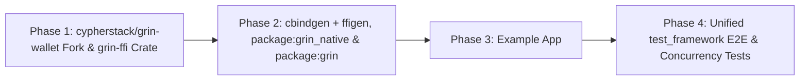

# Grin Rust FFI (`grin-ffi`), Pure Dart Contract (`grin`), & Native Backend (`grin_native`) Architecture Plan

## 1. Executive Summary & Architectural Decisions

This document defines the clean-room architecture and implementation plan (**Phases 1–4**) for **Grin** in `/home/user/src/grin`, incorporating all review resolutions from Rounds 1 and 2:

1. **Single Monorepo at `/home/user/src/grin`**:
   - Combines a Cargo workspace (`packages/grin_native/rust`) and a **native Dart pub workspace** (`workspace: [packages/grin, packages/grin_native, packages/grin_native/example, packages/grin_native/test_consumer]`, **no Melos**).
   - All `pubspec.yaml` files declare `publish_to: none`.
2. **Thin `cypherstack/grin-wallet` Fork (`v5.5.1`) with `HttpSlateSender` Split, `tor` Gating, and `ring`+`webpki-roots` `rustls`**:
   - Rather than copying ~2,000 lines of `node_clients/http.rs` (455 lines), `client_utils/` (595 lines), and `lifecycle/` (873 lines) into `grin-ffi` and owning seed encryption forever, we maintain a minimal fork `cypherstack/grin-wallet` (branched from `mimblewimble/grin-wallet` `v5.5.1`, commit `f097811ee953fc81be4e70435d6ef845b6b2e8c9`, on branch `optional-tor-rustls`, fork commits `64d361f2` and `b5d756bd`, the latter pinned). The fork is a separate repository checked out locally at `/home/user/src/grin-wallet` (outside the monorepo; remote `cypherstack` = `ssh://git@git.cypherstack.com:222/sneurlax/grin-wallet.git`), and `grin-ffi` consumes it as a git dependency pinned by `rev`.
   - **Ungated `HttpSlateSender` Split**: In upstream `v5.5.1`, `TorSlateSender` ([tor.rs](file:///home/user/src/grin-wallet/impls/src/adapters/tor.rs)) was the only `SlateSender`, so gating all of `adapters/tor.rs` would remove HTTP/SOCKS5 slate sending. The fork extracts the `arti`/process-free logic (`check_other_version`, `post` via `Client` with optional `(SocketAddr, "socks5h://")` proxy, and `impl SlateSender`) into an ungated [`HttpSlateSender`](file:///home/user/src/grin-wallet/impls/src/adapters/http.rs) re-exported from `grin_wallet_impls`, while `TorSlateSender` (gated behind `#[cfg(feature = "tor")]`) delegates its HTTP/JSON-RPC logic to `HttpSlateSender`.
   - **Intentional TLS Stack (`reqwest/rustls-no-provider` + `ring` + `webpki-roots`)**: `reqwest` 0.13.4's default `rustls` feature pulls in `aws-lc-rs` (`aws-lc-sys` C/CMake build step on every target) and `rustls-platform-verifier` (which requires Android JNI initialization and bundled Java components); see `reqwest-0.13.4/Cargo.toml` L169-177 in the cargo registry (`rustls = ["__rustls-aws-lc-rs", "dep:rustls-platform-verifier", "__rustls"]`, `rustls-no-provider = ["dep:rustls-platform-verifier", "__rustls"]`). The fork's `rustls` feature enables `reqwest/rustls-no-provider`, `rustls` (`0.23`, `features = ["ring", "std", "tls12"]`), and `webpki-roots` (`1.0`), wired via `ClientBuilder::tls_backend_preconfigured(tls_config)` (`reqwest-0.13.4/src/async_impl/client.rs` L2192) in [`Client::configure_tls`](file:///home/user/src/grin-wallet/impls/src/client_utils/client.rs#L72-L90). Precisely: this drops `aws-lc-rs` from the graph, but `rustls-no-provider` still links `rustls-platform-verifier`; the preconfigured `ClientConfig` means the verifier is never constructed at runtime, which is what matters on Android (comment at `client.rs` L66-70).
   - **Complete `tor` Dependency Gating**: All `tor/`-only dependencies (`arti-client`, `tor-*`, `fs-mistrust`, `fslock-guard`, `sysinfo`, `timer`, `hyper`, `hyper-util`, `http-body-util`, `bytes`, `ed25519-dalek`, `regex`, `base64`, `url`, `sha2`) are gated under the `tor` feature (which stays in `default = ["tor", "native-tls"]` for upstream compatibility).
3. **Single Native-Assets Build Hook in `packages/grin_native` Using `hooks.user_defines.grin_native`**:
   - In Dart Native Assets (`code_assets` + `@ffi.Native`), a `@Native` asset (`assetId: 'package:grin_native/src/ffi/bindings.g.dart'`) **must** be emitted by the `hook/build.dart` of the package that declares it (`input.packageName == 'grin_native'`).
   - Therefore, **intentionally differing from the original prompt's framing where the Flutter package provides the native build**, the single `hook/build.dart` lives in the native Dart package, `packages/grin_native` (first built inside `packages/grin`; D12 moved it).
   - The hook is a plain `native_toolchain_rust` `RustBuilder` build of `rust/` with the host toolchain (D1, D11). It reads one user-define under `hooks.user_defines.grin_native`: `test_utils` (bool), which adds `--features test-utils` for this repository's tests and must stay unset in an app. Prebuilt, hash-verified release artifacts are a later step, planned on [dnix](https://github.com/cypherstack/dnix) rather than native-build-kit (D11). The plan's earlier kit-based design (a `build` user-define with prebuilt, Nix source, Nix dev and cargo modes) was built, verified and then removed on 2026-11-02 at the user's direction.
   - `packages/grin` is the backend-neutral contract in pure Dart: models, exceptions, units, events and the `GrinWalletApi` and `GrinWalletBackend` interfaces. `grin_native` depends on it and re-exports it in full, so an app lists `grin_native` alone. There is no Flutter package; Flutter apps depend on `grin_native` directly (section 6, D12).
4. **v1 Transport Scope (Outbound HTTP/Tor + Offline Slatepacks; No Inbound Listener)**:
   - Stack Wallet's `tor_ffi_plugin` (pinned at `e30ed0d386a40ee4a999aeaf57aafd32921d601e` in its pubspec L68-71; `rust/Cargo.toml` L18 at that ref: `arti-client = { version = "0.47.0", features = ["static", "onion-service-client"] }`) enables only the client side of onion services, not `onion-service-service`, so it cannot host an inbound v3 `.onion` hidden service.
   - Therefore, **inbound synchronous Tor/HTTP receive is out of scope for v1** (no `listener.rs` in `grin-ffi`).
   - v1 supports **outbound synchronous HTTP/Tor send** (`grin_tx_send_http` using `HttpSlateSender` over Stack Wallet's SOCKS5 proxy `socks5h://127.0.0.1:<port>` to `http://<56-char>.onion/v2/foreign` or `http(s)://...`) plus **asynchronous Slatepack send/receive/finalize (`S1 -> S2 -> S3` and `I1 -> I2 -> I3`)**. Inbound `.onion` hidden-service hosting (passing the wallet's `ed25519` Slatepack key to an upgraded `tor_ffi_plugin`) is tracked as a future v2 item.
5. **Implementation Scope**:
   - **Phases 1–4 only** (inside `/home/user/src/grin`). Phase 5 (`stack_wallet` integration) is documented as the target API contract and will be executed later on a separate `stack_wallet` branch.

---

## 2. Summary of Legacy Antipatterns Eliminated by This Design

| # | Legacy Antipattern in `flutter_libepiccash` / `flutter_libmwc` | Evidence | Replacement Design in `grin` |
|---|---|---|---|
| **1** | **Raw Pointer + Plaintext `SecretKey` Serialized in a JSON String Handle** | [ffi.rs](file:///home/user/src/stack_wallet/flutter_libepiccash-claude/rust/src/ffi.rs#L192-L200) (checkout `ceb9738`), [lib.rs](file:///home/user/src/stack_wallet/flutter_libmwc-codex/rust/src/lib.rs#L365) and [L402](file:///home/user/src/stack_wallet/flutter_libmwc-codex/rust/src/lib.rs#L402) (checkout `8acf950`; L98-105 is the related `ensure_wallet!` raw-pointer deref macro) | Monotonic `u64` opaque registry handle (`LazyLock<Mutex<HashMap<u64, Arc<WalletSession>>>>`). `SecretKey` keychain mask stays inside Rust memory (`Drop` zeroizes & closes `WalletBackend`). |
| **2** | **Process-Global `ChainTypes` Mutation Race** | [lib.rs](file:///home/user/src/stack_wallet/flutter_libmwc-codex/rust/src/lib.rs#L1376-L1380), [lib.rs](file:///home/user/src/stack_wallet/flutter_libmwc-codex/rust/src/lib.rs#L1985-L1989) | Per-thread `grin_core::global::set_local_chain_type` on every handle-based FFI entry, on `create`/`open` before `DefaultLCProvider`, on spawned HTTP helper threads, and via explicit `network: u8` on stateless FFI entries. |
| **3** | **Quadruple-Encoded JSON & Stringly-Typed Primitives** | [wallet.rs](file:///home/user/src/stack_wallet/flutter_libepiccash-claude/rust/src/wallet.rs#L195-L206), [lib.dart](file:///home/user/src/stack_wallet/flutter_libmwc-codex/lib/lib.dart#L287-L290) | Native `u64`/`u32`/`i64`/`u8`/`bool` C ABI arguments and flat JSON payloads decoded into strongly typed Dart models inside `package:grin`. |
| **4** | **String-Matched Errors & Uncaught Panics Across `extern "C"`** | [ffi.rs](file:///home/user/src/stack_wallet/flutter_libepiccash-claude/rust/src/ffi.rs), [lib.dart](file:///home/user/src/stack_wallet/flutter_libmwc-codex/lib/lib.dart#L476-L503) | Every `extern "C"` entrypoint wraps its body in `catch_unwind(AssertUnwindSafe(...))` and returns `#[repr(C)] GrinFfiResult { code, data, error }`. |
| **5** | **`CString` Allocator Mismatches & Memory Leaks** | [mwc.dart](file:///home/user/src/stack_wallet/flutter_libmwc-codex/lib/mwc.dart#L121-L474) | Rust exports `grin_ffi_result_free`, `grin_string_free`, and `grin_wallet_close_finalizer`. Dart uses `using((arena) { ... })` and a zeroing arena for secrets. |
| **6** | **IEEE-754 `double` Coin Balances** | [wallet.rs](file:///home/user/src/stack_wallet/flutter_libepiccash-claude/rust/src/wallet.rs#L608-L613) via `nano_to_deci(amount: u64) -> f64` at [wallet.rs L302-306](file:///home/user/src/stack_wallet/flutter_libepiccash-claude/rust/src/wallet.rs#L302-L306) | All monetary values across Rust (`u64`) and Dart (`BigInt` nanogrin, $1\text{ GRIN} = 10^9\text{ nanogrin}$) are exact integers. |
| **7** | **Manual Slate JSON Inspection in `stack_wallet`** | `analyzeSlatepack`: on `cypherstack/main` (`a156253bf`) in `lib/wallets/wallet/impl/mimblewimblecoin_wallet.dart` L397-494; on branch `security/rbf-history-authentication` (`b778525f0`) also in [epiccash_wallet.dart L328-411](file:///home/user/src/stack_wallet/stack_wallet/lib/wallets/wallet/impl/epiccash_wallet.dart#L328-L411) | `grin-ffi` inspects `slate.state` (`S1`/`S2`/`S3`/`I1`/`I2`/`I3`), `amount`, `fee`, `id`, `kernel_excess`, and `Slatepack` addresses in Rust. |
| **8** | **Blocked Worker Isolate Deadlock During Scan** | [epic_wallet.dart](file:///home/user/src/stack_wallet/flutter_libepiccash/flutter_libepiccash/lib/src/wallet/epic_wallet.dart#L392-L439) (checkout `43ff116`, branch `main`: `scanOutputs` polls `_worker.getScanProgress()` on a 500 ms timer) | Lock-free per-wallet `ScanProgressState` atomics in `WalletSession` read via `grin_wallet_scan_progress` while `grin_wallet_scan` runs in `Isolate.run`. |

---

## 3. Repository & Workspace Layout (`/home/user/src/grin`)

```text
/home/user/src/grin/                     (as built; D6 put the Cargo workspace under packages/grin/rust, D12 moved it to packages/grin_native/rust)
├── pubspec.yaml                        # Root pub workspace (publish_to: none; workspace: [...]; no Melos)
│                                       # hooks.user_defines.grin_native: test_utils: true for in-repo builds
├── pubspec.lock
├── analysis_options.yaml               # Shared strict lint rules
├── README.md                           # Layout, gates, how the fork is fetched
├── docs/
│   ├── architecture.md                 # This file
│   └── ffi-json.md                     # JSON contract between grin-ffi and package:grin_native
├── tool/
│   ├── ci.dart                         # Every gate in one command (rust, android, bindings, dart, web-smoke, consumer, flutter, nm gate)
│   ├── regen_bindings.dart             # cargo build with GRIN_FFI_WRITE_HEADER=1 -> ffigen -> dart format; --check
│   ├── regtest.sh, socks5_test_proxy.py # private chain run (section 13)
│   └── verify-apple.sh, verify-windows.ps1 # host release builds and the symbol gate on a Mac or on Windows
└── packages/
    ├── grin/                           # Pure Dart contract (name: grin, publish_to: none)
    │   ├── pubspec.yaml                # no runtime dependencies, no flutter sdk, no hook
    │   ├── lib/
    │   │   ├── grin.dart               # models, exceptions, units, events, GrinWalletApi, GrinWalletBackend
    │   │   ├── codec.dart              # JSON helpers for backend packages; not exported by grin.dart
    │   │   └── src/{errors,internal,models,wallet}/
    │   ├── test/                       # models, tx_models, wallet_interface (fakes of both interfaces)
    │   ├── tool/web_smoke.dart         # compiled to JS by the web-smoke stage of tool/ci.dart
    │   └── README.md
    └── grin_native/                    # Native backend (name: grin_native, publish_to: none)
        ├── pubspec.yaml                # depends on grin; native_toolchain_rust 1.0.6; no flutter sdk
        ├── ffigen.yaml                 # @ffi.Native bindings, asset id package:grin_native/src/ffi/bindings.g.dart
        ├── hook/
        │   └── build.dart              # RustBuilder build of rust/ (test_utils -> --features test-utils)
        ├── rust/                       # The grin-ffi crate, a single-crate Cargo workspace
        │   ├── Cargo.toml, Cargo.lock, rust-toolchain.toml, .cargo/config.toml
        │   ├── build.rs, cbindgen.toml # Header generation
        │   ├── include/grin_ffi.h      # The committed C header (the ABI contract)
        │   ├── src/                    # lib, error, handle, logging, config, lifecycle, address, balance,
        │   │                           # scan, sidecar, slatepack, transaction, proof, test_support
        │   └── tests/                  # header_test, ffi_e2e_test, ffi_tx_test
        ├── lib/
        │   ├── grin_native.dart        # export 'package:grin/grin.dart' plus GrinWalletClient, GrinNativeBackend
        │   ├── testing.dart            # GrinTestChain
        │   └── src/{ffi,wallet,testing}/
        ├── test/                       # mnemonic_address, bounds_and_panic, wallet_lifecycle, test_chain,
        │                               # slatepack_e2e, memory, arguments, live_node, regtest
        ├── example/                    # Flutter app (grin_native_example) + integration_test/app_test.dart
        │   └── lib/src/{wallet_paths,lifecycle_observer}.dart  # example code to copy
        ├── test_consumer/              # pure Dart app shape (grin_native_test_consumer): depends on grin_native alone
        └── README.md
```

The `cypherstack/grin-wallet` fork (`v5.5.1` + submodule `grin` `v5.5.2`) is not part of this tree. It lives in its own repository (`ssh://git@git.cypherstack.com:222/sneurlax/grin-wallet.git`, branch `hardening`, commit `bf0e4db1`, which is `optional-tor-rustls` at `b5d756bd` plus seven fix commits, with the `grin` submodule on `sneurlax/grin` branch `hardening`; checked out locally at `/home/user/src/grin-wallet`) and is pulled in by `packages/grin_native/rust/Cargo.toml` as a `rev`-pinned git dependency (see 4.1).

### 3.1 Why `packages/grin_native` Owns `hook/build.dart`

> [!IMPORTANT]
> Dart Native Assets (`code_assets` + `@ffi.Native`) requires the package that declares the `@Native` bindings to own `hook/build.dart`, because a build hook can only emit a `CodeAsset` for its own `input.packageName`. The asset id is `package:grin_native/src/ffi/bindings.g.dart`, so the hook, the bindings and the Rust crate live in `packages/grin_native`.
>
> Placing `hook/build.dart` in `packages/grin_native`:
> - Makes native assets work in `dart test`, `dart run` and in Flutter (`flutter test`, `flutter run`, `flutter build` in `packages/grin_native/example` or `stack_wallet`) without any Flutter plugin package: the hooks runner invokes the hook of every package in the dependency graph and bundles `libgrin_ffi`.
> - Keeps `packages/grin` pure Dart. It has no hook, no `dart:ffi`, no `dart:isolate` and no runtime dependencies, so it compiles to JavaScript (the `web-smoke` stage, which compiles it and also checks `lib/` for `dart:io` and `dart:isolate` imports, since those compile and fail only at run time) and the contract can be implemented by another backend (5.2).
> - Keeps the build to one hook: a `native_toolchain_rust` `RustBuilder` build of `rust/`, with one `grin_native`-specific user-define:
>   ```yaml
>   hooks:
>     user_defines:
>       grin_native:
>         test_utils: false  # true only in this workspace's root pubspec so dart test gets --features test-utils
>   ```
> - Needs no Flutter package. The first build put the hook in `grin` and Flutter glue in a separate package; D12 moved the hook into `grin_native` and removed the Flutter package (section 6).

---

## 4. Layer 1: Rust Wrapper Crate (`grin-ffi`) Detailed Design

### 4.1 Thin `cypherstack/grin-wallet` Fork (`v5.5.1`) & Direct Dependencies

We fork `mimblewimble/grin-wallet` (`v5.5.1`, commit `f097811ee953fc81be4e70435d6ef845b6b2e8c9`, with submodule `grin` at `v5.5.2`, commit `dbaff34f7751ee23316fbbfe5806b47c546776ca`) into `cypherstack/grin-wallet`, a separate repository checked out at `/home/user/src/grin-wallet` on branch `optional-tor-rustls` (remote `cypherstack` = `ssh://git@git.cypherstack.com:222/sneurlax/grin-wallet.git`), with a clean, upstreamable diff in `impls/`:

1. **[`impls/Cargo.toml`](file:///home/user/src/grin-wallet/impls/Cargo.toml) (`tor` Feature Gating & Intentional TLS Stack)**:
   - `reqwest` 0.13.4's `rustls` feature pulls in `aws-lc-rs` (`aws-lc-sys` C/CMake cross-compile step) and configures `rustls-platform-verifier` by default (which on Android requires JNI initialization and bundling its Android Java component).
   - Instead, we use `reqwest/rustls-no-provider` combined with `rustls` (`0.23`, `features = ["ring", "std", "tls12"]`—reusing `ring 0.17` already in the dependency graph) and `webpki-roots` (`1.0`), and gate all `tor/`-only dependencies under `tor`:
     ```toml
     [features]
     default = ["tor", "native-tls"]
     native-tls = ["reqwest/native-tls"]
     rustls = ["reqwest/rustls-no-provider", "dep:rustls", "dep:webpki-roots"]
     tor = [
         "dep:ed25519-dalek",
         "dep:regex",
         "dep:timer",
         "dep:sysinfo",
         "dep:base64",
         "dep:url",
         "dep:arti-client",
         "dep:tor-rtcompat",
         "dep:fs-mistrust",
         "dep:fslock-guard",
         "dep:tor-hsservice",
         "dep:tor-hsrproxy",
         "dep:tor-keymgr",
         "dep:tor-llcrypto",
         "dep:tor-hscrypto",
         "dep:sha2",
         "dep:hyper",
         "dep:hyper-util",
         "dep:http-body-util",
         "dep:bytes",
     ]
     ```
2. **Preconfigured `rustls` in [`impls/src/client_utils/client.rs`](file:///home/user/src/grin-wallet/impls/src/client_utils/client.rs#L72-L90)**:
   - When `#[cfg(all(feature = "rustls", not(feature = "native-tls")))]` is active, `Client::configure_tls` constructs a `rustls::ClientConfig` backed by `rustls::crypto::ring::default_provider()` and `webpki_roots::TLS_SERVER_ROOTS`, passing it to `builder.tls_backend_preconfigured(tls_config)`. In `reqwest` 0.13.4, `tls_backend_preconfigured` selects `TlsBackend::BuiltRustls` directly, completely bypassing `rustls_platform_verifier` at runtime on Android/iOS/desktop.
3. **Splitting [`HttpSlateSender`](file:///home/user/src/grin-wallet/impls/src/adapters/http.rs) from [`TorSlateSender`](file:///home/user/src/grin-wallet/impls/src/adapters/tor.rs)**:
   - [`impls/src/adapters/http.rs`](file:///home/user/src/grin-wallet/impls/src/adapters/http.rs) defines the ungated `HttpSlateSender` (`HttpSlateSender::new`, `HttpSlateSender::with_socks_proxy`, `check_other_version`, `post`, and `impl SlateSender for HttpSlateSender`).
   - [`impls/src/adapters/tor.rs`](file:///home/user/src/grin-wallet/impls/src/adapters/tor.rs) (gated behind `#[cfg(feature = "tor")]` in [`adapters/mod.rs`](file:///home/user/src/grin-wallet/impls/src/adapters/mod.rs) and [`lib.rs`](file:///home/user/src/grin-wallet/impls/src/lib.rs)) keeps the `arti` / external Tor process management and delegates its HTTP/JSON-RPC methods to `HttpSlateSender`.
4. **Direct Dependencies in `packages/grin_native/rust/Cargo.toml` (No `grin_wallet_controller` Dev-Dependency)**:
   - Because `use grin_core as core;` etc. in [`impls/src/lib.rs`](file:///home/user/src/grin-wallet/impls/src/lib.rs#L27-L31) are private aliases rather than `pub use` re-exports, `packages/grin_native/rust/Cargo.toml` depends directly on `grin_wallet_impls` (`default-features = false, features = ["rustls"]`), `grin_wallet_libwallet`, `grin_wallet_config`, `grin_wallet_util`, `grin_core`, `grin_keychain`, `grin_chain`, `grin_store`, and `grin_util` from the exact same fork via one git source pinned by `rev` (Cargo fetches the fork's `grin` submodule for the `grin_*` node crates):
     ```toml
     grin_wallet_impls = { git = "ssh://git@git.cypherstack.com:222/sneurlax/grin-wallet.git", rev = "b5d756bdae51c71b1b2ec06dbf0695b37d50a850", default-features = false, features = ["rustls"] }
     grin_wallet_libwallet = { git = "ssh://git@git.cypherstack.com:222/sneurlax/grin-wallet.git", rev = "b5d756bdae51c71b1b2ec06dbf0695b37d50a850" }
     # ... same git + rev for grin_wallet_config, grin_wallet_util, grin_core, grin_keychain, grin_chain, grin_store, grin_util
     ```
   - No `path` dependencies on the fork are committed, and no local wiring is needed: the fork is pushed to that URL and `Cargo.lock` records the pinned `rev` (D2 records the wiring used before the push). Cargo fetches it with the git command line (`rust/.cargo/config.toml`, and `CARGO_NET_GIT_FETCH_WITH_CLI` from the hook), so a machine whose cargo git database does not hold the rev yet needs ssh read access to git.cypherstack.com.
   - **No `grin_wallet_controller` dev-dependency**: `grin_wallet_controller` depends on `grin_wallet_impls` with default features, which in `cargo test` would re-enable `tor` and `native-tls` via Cargo feature unification. Because `pub mod test_framework;` is already public in `grin_wallet_impls`, `grin-ffi` needs no wallet dev-dependencies at all.
   - **CI Duplicate Crate Gate (`cargo tree -d`)**: `tool/ci.dart` runs `cargo tree -d` and asserts that zero `grin_*` or `grin_secp256k1zkp` crates are duplicated.

### 4.2 Per-Thread Chain Type Isolation (`set_local_chain_type`)

> [!WARNING]
> In `grin_core::global` ([global.rs](file:///home/user/src/grin-wallet/grin/core/src/global.rs#L165-L207)), `get_chain_type()` checks the thread-local `CHAIN_TYPE: Cell<Option<ChainTypes>>` **first**, falling back to the set-once `GLOBAL_CHAIN_TYPE` only if the thread-local `CHAIN_TYPE` is `None`.
> Because Dart's `Isolate.run` executes closures on arbitrary Dart VM worker-pool threads, and because Stack Wallet can have `Mainnet` and `Floonet` (`Testnet`) wallets open simultaneously in the same process, **`grin-ffi` MUST NOT rely on process-global `GLOBAL_CHAIN_TYPE`**.
>
> Three source facts shape the rules below. `get_chain_type()` panics when neither the thread-local nor the global is set (`global.rs` L198-200), so every FFI entry that can reach consensus code must set the thread-local first. `is_testnet()` is true only for `ChainTypes::Testnet` (`global.rs` L472-477), so `UserTesting` and `AutomatedTesting` derive Mainnet-style keychains. The Slatepack HRP is `grin` for `Mainnet` and `tgrin` for every other chain type (`libwallet/src/slatepack/address.rs` L44-49), and `SlatepackAddress` parsing rejects the other network's HRP (L99-116, L263-265). The `ChainTypes` enum order is `AutomatedTesting, UserTesting, Testnet, Mainnet` (`global.rs` L114-123); the FFI `network: u8` mapping below is our own and does not depend on it.

1. **No Global Chain Type Init in `lib.rs`**:
   - `lib.rs` performs no global chain initialization.
2. **Wallet Creation & Opening Set Thread-Local `CHAIN_TYPE` Before `DefaultLCProvider`**:
   - `grin_wallet_create` and `grin_wallet_open` do not take an existing session handle, and [`DefaultLCProvider::open_wallet`](file:///home/user/src/grin-wallet/impls/src/lifecycle/default.rs#L253-L255) calls `wallet_seed.derive_keychain(global::is_testnet())`.
   - Therefore, both `grin_wallet_create` and `grin_wallet_open` parse `config.network` from `config_json` and call `grin_core::global::set_local_chain_type(chain_type)` **immediately at the start of the function**, before constructing or invoking `DefaultLCProvider`.
3. **Handle-Based Entrypoints Set Thread-Local `CHAIN_TYPE` via `get_session(handle)`**:
   - Every `WalletSession` stores its `pub chain_type: ChainTypes` (`Mainnet`, `Testnet`, `UserTesting`, or `AutomatedTesting`).
   - The registry lookup helper `get_session(handle: u64) -> Result<Arc<WalletSession>, GrinError>` calls `grin_core::global::set_local_chain_type(session.chain_type)` before returning the `Arc<WalletSession>`.
   - During UTXO scans, [`grin_wallet_libwallet::internal::scan::identify_utxo_outputs`](file:///home/user/src/grin-wallet/libwallet/src/internal/scan.rs#L71-L78) captures `let chain_type = global::get_chain_type();` on the caller thread and calls `global::set_local_chain_type(chain_type)` inside its `rayon::par_iter().map(...)` closure, propagating the wallet's `ChainTypes` to all Rayon worker threads.
4. **Spawned HTTP Helper Threads Propagate `CHAIN_TYPE`**:
   - Both [`Client::send_request`](file:///home/user/src/grin-wallet/impls/src/client_utils/client.rs#L292-L311) and [`HTTPNodeClient::get_outputs_from_node`](file:///home/user/src/grin-wallet/impls/src/node_clients/http.rs#L278-L289) spawn helper threads (`std::thread::spawn`) to run `RUNTIME.block_on(...)`. In our fork, both functions capture `let chain_type = crate::core::global::CHAIN_TYPE.with(|c| c.get());` on the calling thread and call `set_local_chain_type(ct)` inside the spawned thread before entering `rt.block_on(...)`.
5. **Stateless Entrypoints Take an Explicit `network: u8` Parameter**:
   - Stateless functions that depend on consensus/address parameters (`grin_address_validate`, `grin_slatepack_decode` when `handle == 0`) take `network: u8` (`0 = Mainnet`, `1 = Floonet/Testnet`, `2 = UserTesting`, `3 = AutomatedTesting`), validate the discriminant, and call `grin_core::global::set_local_chain_type(chain_type)` on the current thread before executing.

### 4.3 Outbound Synchronous HTTP / Tor Send (`grin_tx_send_http`) via `HttpSlateSender`

In v1, `grin_tx_send_http` uses `grin_wallet_impls::HttpSlateSender` (and the `SlateSender` trait) directly rather than hand-rolling JSON-RPC in `grin-ffi`:
1. If `recipient_address` is a `SlatepackAddress` (`grin1...` / `tgrin1...`), convert its Ed25519 public key into a v3 `.onion` URL via `OnionV3Address::from(&recipient_slatepack_addr).to_http_str()` (`"http://<56-char>.onion"`; `impl From<&SlatepackAddress> for OnionV3Address` at `libwallet/src/slatepack/address.rs` L128, `to_http_str` at `util/src/ov3.rs` L90). If it is already an `http://` or `https://` URL, use it directly.
2. Construct `HttpSlateSender`:
   - If the wallet session has `socks_proxy: Some(proxy_addr)`, call `HttpSlateSender::with_socks_proxy(&recipient_url, proxy_addr, timeout)?` (which routes via `socks5h://` so `.onion` resolution happens through Stack Wallet's Tor SOCKS5 proxy).
   - Otherwise (only allowed for clearnet `http(s)://`, never `.onion`), call `HttpSlateSender::new(&recipient_url, timeout)?`.
3. Call `owner::init_send_tx` (`S1`), call `sender.send_tx(&slate_s1, false)` to perform the `check_version` + `receive_tx` JSON-RPC handshake and receive the signed `S2` `Slate`, call `owner::tx_lock_outputs`, call `owner::finalize_tx` (`S3`), and broadcast via `owner::post_tx`.

### 4.4 Trimmed, Fault-Tolerant Sidecar (`packages/grin_native/rust/src/sidecar.rs`)

Because `grin_wallet_libwallet::TxLogEntry` already persists `kernel_excess: Option<Commitment>` and `payment_proof: Option<StoredProofInfo>` (which stores `receiver_address` and `sender_address`), the sidecar file `<wallet_dir>/wallet_data/tx_metadata.json` only stores what `TxLogEntry` lacks:
```rust
#[derive(Serialize, Deserialize, Clone, Default)]
pub struct TxSidecarEntry {
    /// Latest armored S1/S2 or I1/I2 Slatepack string so the user can view/re-share
    /// an unfinished interactive transaction from the transaction details screen.
    pub armored_slatepack: Option<String>,
    /// Counterparty address (`grin1...` or `http://...`) for transactions that do not
    /// carry a StoredProofInfo (`payment_proof`).
    pub counterparty_address: Option<String>,
}
```
- **Atomic Rename & Non-Fatal Writes**:
  - Saved by writing to `<wallet_dir>/wallet_data/tx_metadata.json.tmp` (`File::sync_all`) and atomically renaming (`std::fs::rename`) over `tx_metadata.json`.
  - Sidecar reads and writes are best-effort (`if let Err(e) = sidecar.upsert(...) { log::warn!("Sidecar write failed: {e}"); }`) and **never** fail a transaction init, send, receive, or finalize operation.
  - When `grin_txs_get` builds each `GrinTxLogEntry` JSON object, `counterparty_address` is populated from `tx.payment_proof` first, falling back to `sidecar.counterparty_address`.

### 4.5 Session Registry, `Drop`-Based Close & Per-Directory LMDB Guard (`packages/grin_native/rust/src/handle.rs`)

1. **Session Registry**:
   - `SESSION_REGISTRY: LazyLock<Mutex<HashMap<u64, Arc<WalletSession>>>>` maps non-zero monotonic `u64` handles (from an `AtomicU64` starting at 1, never reused) to sessions. `get_session(handle)` clones the `Arc<WalletSession>` out of the map, releases the lock, and sets the thread-local `CHAIN_TYPE` (4.2).
   - `grin_wallet_close` / `grin_wallet_close_finalizer` set `cancel_requested`, remove the `Arc` from the map, release the registry lock, and only then drop their `Arc`. `impl Drop for WalletSession` closes the `WalletBackend` (`lc_provider.close_wallet(None)`) and zeroizes `keychain_mask` when the last `Arc` drops (see 5.1). No LMDB work ever runs while the registry lock is held.
2. **Why Close Alone Is Not Enough (LMDB Double-Open)**:
   - Because Dart `Isolate.run` closures do not capture `this`, an orphaned in-flight operation can still hold a cloned `Arc<WalletSession>` after `grin_wallet_close` or `grin_wallet_close_finalizer` returns, so the LMDB environment stays open until that operation finishes.
   - LMDB forbids opening the same environment twice in one process. A `grin_wallet_open`, `grin_wallet_create`, or `grin_wallet_delete` on that directory during this window is unsafe (a second `Environment` on the same files, or `remove_dir_all` under a live mapping).
3. **`OPEN_DIRS` Guard**:
   - `OPEN_DIRS: LazyLock<Mutex<HashSet<DirKey>>>` holds the identity of the wallet data directory (`<wallet_dir>/wallet_data`, which contains `wallet.seed` and the LMDB `db/`) of every wallet whose backend may still be open, whether its session is registered or closed but still draining.
   - Membership is owned by an RAII `DirLease { key: DirKey, path: PathBuf }`. `DirLease::acquire(dir)` reads the identity of `dir`, locks `OPEN_DIRS`, fails with `GrinErrorCode::WalletBusy` if that identity is already present, and otherwise inserts it. The lease is stored in `WalletSession`. At the end of `impl Drop for WalletSession`, after `close_wallet(None)` has returned and the backend's `Environment` has been dropped, the lease is released and the entry removed. If `open`/`create` fails after acquiring the lease (wrong password, corrupt seed, LMDB error), the lease drops on the error path after any partially opened backend.
   - `grin_wallet_open` and `grin_wallet_create` acquire the lease after `set_local_chain_type` and before constructing `DefaultLCProvider` or touching LMDB. `grin_test_create_wallet` (7.1) takes the same lease.
   - `grin_wallet_delete` first closes `handle` if non-zero (rejecting a handle whose session `data_dir` differs from `wallet_dir`), then acquires a lease on the directory itself for the duration of `remove_dir_all`. If the directory is still held (a draining orphaned operation), it returns `WalletBusy` and deletes nothing. Holding the lease during deletion means a concurrent `open`/`create` also gets `WalletBusy`, so there is no check-then-delete race.
   - `OPEN_DIRS` and `SESSION_REGISTRY` are never held at the same time, and both are locked with `lock().unwrap_or_else(PoisonError::into_inner)` because `Drop` may run during unwinding.
4. **Canonicalization**:
   - Paths are `std::fs::canonicalize`d first, and the key is the directory's identity: `(st_dev, st_ino)` from `std::os::unix::fs::MetadataExt` on unix, so `dir`, `dir/`, `dir/./`, symlinked paths, bind mounts and a directory renamed while open all map to one entry, and a directory removed and recreated at the same path is a new entry. On Windows the key is the canonical path (std's file-index API is not stable), which covers the path spellings and symlinks but not other mounts. The canonical path is kept in the lease for `WalletSession::data_dir` and for the `WalletBusy` error's `wallet_dir` detail; on Windows it is a `\\?\` verbatim path, so a Windows caller may see the verbatim form there.
   - `canonicalize` fails on a path that does not exist yet. `grin_wallet_create` therefore calls `std::fs::create_dir_all(<wallet_dir>/wallet_data)` before canonicalizing and acquiring the lease (`DefaultLCProvider` would create it anyway). `grin_wallet_open` maps a missing directory to its existing not-found error, and `grin_wallet_delete` treats a missing directory as already deleted.
5. **`GrinErrorCode::WalletBusy`**:
   - A new `GrinErrorCode` variant with a fresh discriminant appended after the existing codes (discriminants are append-only because Dart maps them by value). There is no separate `WalletAlreadyOpen` code: `WalletBusy` covers both "already open and registered by another client" and "closed but still draining", since in both cases the directory is held by a live `WalletSession` and the caller's only safe action is to wait or reuse the existing client. The error JSON carries `{"wallet_dir": "<canonical path>"}`.
   - Dart maps it to `GrinWalletBusyException` in the sealed `GrinException` hierarchy (5.1).

### 4.6 Complete `grin-ffi` Exported C ABI Surface (36 Standard Functions + 3 `test-utils` Functions)

Every FFI function (except the `void` destructors `grin_ffi_result_free`, `grin_string_free`, and `grin_wallet_close_finalizer`) returns `#[repr(C)] GrinFfiResult { code: i32, data: *mut c_char, error: *mut c_char }` and wraps its body in `ffi_guard!` (`std::panic::catch_unwind`).

| # | Category | C Function Signature | Description |
|---:|---|---|---|
| 1 | **Memory, Logging & Diagnostics** | `grin_ffi_result_free(res: GrinFfiResult)` | Frees `res.data` and `res.error` allocated via `CString::into_raw()`. |
| 2 | | `grin_string_free(ptr: *mut c_char)` | Frees a single Rust-allocated C string. |
| 3 | | `grin_init_logs(log_level: *const c_char) -> GrinFfiResult` | Idempotent (`Once`) Rust logger initialization (`trace`/`debug`/`info`/`warn`/`error`). |
| 4 | **Stateless Utilities** | `grin_mnemonic_generate(word_count: u32) -> GrinFfiResult` | Generates a 12, 15, 18, 21, or 24-word BIP39 mnemonic (`grin_keychain::mnemonic::from_entropy`). |
| 5 | | `grin_mnemonic_validate(mnemonic: *const c_char) -> GrinFfiResult` | Validates BIP39 mnemonic words & checksum (`grin_keychain::mnemonic::to_entropy`). |
| 6 | | `grin_address_validate(address: *const c_char, network: u8) -> GrinFfiResult` | Sets thread-local `ChainTypes` from `network`, validates `grin1...` / `tgrin1...` `SlatepackAddress` (or `.onion` / `http(s)://`), and returns normalized address + v3 `.onion` URL. |
| 7 | | `grin_node_test_connection(node_url: *const c_char, api_secret: *const c_char, socks_proxy: *const c_char) -> GrinFfiResult` | Queries `/v2/foreign` (`get_version` + `get_tip`) over optional `socks5h://host:port`. |
| 8 | **Wallet Lifecycle** | `grin_wallet_create(config_json: *const c_char, mnemonic: *const c_char, password: *const c_char, is_new_wallet: bool) -> GrinFfiResult` | Sets thread-local `ChainTypes` from `config_json` **before** `DefaultLCProvider`, creates and canonicalizes `<wallet_dir>/wallet_data`, acquires its `OPEN_DIRS` lease (`WalletBusy` if held, 4.5), creates encrypted `wallet.seed` and `WalletBackend`, with a mnemonic and `is_new_wallet` stores `InitNoScanning` (D14), registers session, returns `{"handle": u64}`. |
| 9 | | `grin_wallet_open(config_json: *const c_char, password: *const c_char) -> GrinFfiResult` | Sets thread-local `ChainTypes` from `config_json` **before** `DefaultLCProvider`, acquires the canonical data directory's `OPEN_DIRS` lease (`WalletBusy` if the directory is held by a registered or still-draining session, 4.5), opens wallet, stores `keychain_mask` in Rust session, returns `{"handle": u64}`. |
| 10 | | `grin_wallet_close(handle: u64) -> GrinFfiResult` | Sets `scan_state.cancel_requested = true` and removes `Arc<WalletSession>` from `SESSION_REGISTRY`. Actual `WalletBackend::close()`, mask zeroization, and release of the `OPEN_DIRS` lease occur in `impl Drop for WalletSession` when the last `Arc<WalletSession>` drops (immediately, on the normal Dart path where the op queue was drained first). |
| 11 | | `grin_wallet_close_finalizer(token: *mut c_void)` | `void (*)(void*)` callback for Dart's `NativeFinalizer`. Casts `token as usize as u64`, cancels any scan, and removes the session from `SESSION_REGISTRY` (dropping the last `Arc<WalletSession>` once no `Isolate.run` call holds it). Until then the directory stays in `OPEN_DIRS`, so a reopen gets `WalletBusy`. |
| 12 | | `grin_wallet_delete(wallet_dir: *const c_char, handle: u64) -> GrinFfiResult` | Closes `handle` if non-zero/open, then acquires the directory's `OPEN_DIRS` lease and deletes `<wallet_dir>/wallet_data` while holding it. Returns `WalletBusy` without deleting anything if an orphaned operation still holds the session. |
| 13 | | `grin_wallet_change_password(handle: u64, old_pw: *const c_char, new_pw: *const c_char) -> GrinFfiResult` | Re-encrypts `wallet.seed` via `DefaultLCProvider::change_password`. |
| 14 | | `grin_wallet_get_mnemonic(handle: u64, password: *const c_char) -> GrinFfiResult` | Decrypts `wallet.seed` and returns the BIP39 recovery phrase. |
| 15 | | `grin_wallet_update_network(handle: u64, node_url: *const c_char, api_secret: *const c_char, socks_proxy: *const c_char, network_enabled: bool) -> GrinFfiResult` | Updates the session's node client (`HTTPNodeClient` with the SOCKS5 proxy, or with `network_enabled` false one that refuses every request) without reopening LMDB (D14). |
| 16 | **Address & Chain** | `grin_wallet_get_address(handle: u64, derivation_index: u32) -> GrinFfiResult` | Returns `{"slatepack_address": "grin1...", "onion_v3_url": "http://...onion", "index": u32}`. |
| 17 | | `grin_wallet_get_chain_height(handle: u64) -> GrinFfiResult` | Queries node tip height via configured proxy, returns `{"height": u64}`. |
| 18 | **Sync, Scan & Balances** | `grin_wallet_get_balance(handle: u64, refresh_from_node: bool, min_confirms: u64) -> GrinFfiResult` | Calls `owner::retrieve_summary_info`, returns the `WalletInfo` fields as exact `u64` nanogrin under libwallet's own names (`total`, `amount_currently_spendable`, `amount_awaiting_confirmation`, `amount_awaiting_finalization`, `amount_immature`, `amount_locked`, `amount_reverted`, `last_confirmed_height`, `minimum_confirmations`) plus `refreshed_from_node` (docs/ffi-json.md section 8). |
| 19 | | `grin_wallet_scan(handle: u64, start_height: u64, delete_unconfirmed: bool) -> GrinFfiResult` | Runs chunked UTXO scan (`internal::scan::scan`) updating `ScanProgressState` atomics and checking `cancel_requested` between batches. Non-destructive to `TxLogEntry` history! |
| 20 | | `grin_wallet_scan_progress(handle: u64) -> GrinFfiResult` | **Lock-free**: reads `ScanProgressState` atomics (`is_scanning`, `scanned_height`, `tip_height`, `progress_pct`). |
| 21 | | `grin_wallet_scan_cancel(handle: u64) -> GrinFfiResult` | **Lock-free**: sets `scan_state.cancel_requested = true`. |
| 22 | **Transactions & Slatepacks** | `grin_tx_estimate_fee(handle: u64, amount: u64, min_confirms: u64, selection_strategy_is_all: bool, amount_includes_fee: bool) -> GrinFfiResult` | Returns `{"fee": u64, "net_amount": u64, "inputs_count": u32}` or `GrinErrorCode::InsufficientFunds` with structured `{"required": u64, "available": u64}`. |
| 23 | | `grin_txs_get(handle: u64, refresh_from_node: bool) -> GrinFfiResult` | Calls `owner::retrieve_txs` + joins sidecar `armored_slatepack` and fallback `counterparty_address`, and `confirmed_height` from the wallet's own outputs (`owner::retrieve_outputs`, max output height per `tx_log_entry`). |
| 24 | | `grin_slatepack_decode(handle: u64, network: u8, armored_slatepack: *const c_char, secret_index: u32) -> GrinFfiResult` | Decodes unencrypted or `age`-encrypted Slatepack, parses `Slate` V4 (`id`, `state`, `amount`, `fee` from `fee_fields`, `kernel_excess` computed with `Slate::calc_excess` (`slate.rs` L631) when the slate carries a kernel, else null, `sender`, `recipient`, `ttl_cutoff_height`). `SlateState` also has an `Unknown` variant for pre-V4 slates (`slate.rs` L138-152), which is reported as `"Unknown"`. Uses `network` when `handle == 0`. |
| 25 | | `grin_tx_init_send(handle: u64, args_json: *const c_char) -> GrinFfiResult` | Calls `owner::init_send_tx` + `owner::tx_lock_outputs` + `owner::create_slatepack_message`, saves sidecar metadata, returns `GrinSlatepack` JSON (`S1`). |
| 26 | | `grin_tx_send_http(handle: u64, args_json: *const c_char) -> GrinFfiResult` | Outbound synchronous send to `grin1...` (`.onion/v2/foreign`) or `http(s)://...` via `HttpSlateSender`: `init_send_tx` -> `HttpSlateSender::send_tx` (`check_version` + `receive_tx`) -> `tx_lock_outputs` -> `finalize_tx` -> `post_tx`. |
| 27 | | `grin_tx_receive_slatepack(handle: u64, armored_s1: *const c_char, message: *const c_char) -> GrinFfiResult` | Verifies `S1`, calls `foreign::receive_tx`, encodes `S2` Slatepack, updates sidecar, returns `GrinSlatepack` JSON (`S2`). |
| 28 | | `grin_tx_finalize_slatepack(handle: u64, armored_s2: *const c_char, broadcast: bool, fluff: bool) -> GrinFfiResult` | Verifies `S2`, calls `owner::finalize_tx` (`S3`), optionally broadcasts via `owner::post_tx`, updates sidecar, returns `GrinSlatepack` JSON (`S3`). |
| 29 | **Invoices, Repost, Cancel & Proofs** | `grin_tx_issue_invoice(handle: u64, args_json: *const c_char) -> GrinFfiResult` | Calls `owner::issue_invoice_tx` (`I1`) + `owner::create_slatepack_message`, saves sidecar, returns `GrinSlatepack` JSON (`I1`). |
| 30 | | `grin_tx_process_invoice(handle: u64, armored_i1: *const c_char, args_json: *const c_char) -> GrinFfiResult` | Verifies `I1`, calls `owner::process_invoice_tx` **followed immediately by `owner::tx_lock_outputs`** (since `process_invoice_tx` does not lock inputs itself) + `owner::create_slatepack_message`, returns `GrinSlatepack` JSON (`I2`). |
| 31 | | `grin_tx_finalize_invoice(handle: u64, armored_i2: *const c_char, broadcast: bool, fluff: bool) -> GrinFfiResult` | Verifies `I2`, calls `foreign::finalize_tx` (`I3`), optionally broadcasts via `owner::post_tx`, returns `GrinSlatepack` JSON (`I3`). |
| 32 | | `grin_tx_repost(handle: u64, tx_id: i64, slate_id: *const c_char, fluff: bool) -> GrinFfiResult` | Calls `owner::get_stored_tx` + `owner::post_tx` to re-broadcast a finalized transaction that hasn't confirmed. |
| 33 | | `grin_tx_cancel(handle: u64, tx_id: i64, slate_id: *const c_char) -> GrinFfiResult` | Calls `owner::cancel_tx` by `tx_id` or `slate_id`, unlocking inputs. |
| 34 | | `grin_payment_proof_export(handle: u64, tx_id: i64, slate_id: *const c_char) -> GrinFfiResult` | Calls `owner::retrieve_payment_proof` and returns `PaymentProof` JSON. |
| 35 | | `grin_payment_proof_verify(handle: u64, proof_json: *const c_char) -> GrinFfiResult` | Calls `owner::verify_payment_proof` and returns `{"is_sender": bool, "is_recipient": bool}`. |
| 36 | **Sync, Scan & Balances** (added in D14) | `grin_wallet_get_last_scanned_height(handle: u64) -> GrinFfiResult` | Returns `{"height": u64}` from the wallet's `last_scanned_block` record, 0 if it never scanned. |

*(Total standard exported C ABI functions: **36**. When compiled with `--features test-utils`, 3 additional test-only functions are exported: `grin_test_panic` (intentionally panics inside `ffi_guard!` so `dart test` can check `GrinErrorCode::InternalPanic`), `grin_test_create_wallet`, and `grin_test_mine_blocks`. They are exported for `dart test`, and the release pipeline verifies via `nm` that the Nix-built artifacts listed in the prebuilt manifest export zero `grin_test_*` symbols (7.2).)*

---

## 5. Layer 2: Pure Dart Packages (`packages/grin` contract and `packages/grin_native` -> `GrinWalletClient`)

### 5.1 Naming Convention (`GrinWalletClient`), `this`-Free `Isolate.run` Closures, & Safe Finalization

1. **Consistent Naming**:
   - Following Stack Wallet's convention where `<Coin>Wallet` (`GrinWallet`) is the `stack_wallet` subclass of `Wallet<Grin>`, the client class in `package:grin_native` is named **`GrinWalletClient`** everywhere (`packages/grin_native/lib/src/wallet/grin_wallet_client.dart`). It implements the backend-neutral `GrinWalletApi` of `package:grin` (5.2).
2. **Keeping `Isolate.run` Closures Strictly Free of `this`**:
   - `GrinWalletClient` implements `Finalizable` (with a `static final NativeFinalizer _finalizer = NativeFinalizer(bindings.addresses.grin_wallet_close_finalizer)`) and owns a `final StreamController<GrinWalletEvent> _events = StreamController.broadcast()`.
   - Because Dart `Isolate.run` rejects closures that capture a `Finalizable` instance or a `StreamController`, **every method on `GrinWalletClient` extracts `final int handle = _handle;` into a local variable before invoking a top-level static helper inside `Isolate.run`**:
     ```dart
     Future<GrinBalance> getBalance({bool refreshFromNode = false}) {
       _ensureOpen();
       final int handle = _handle;
       final int minConfirms = _config.minimumConfirmations;
       return _enqueueWalletOp(
         () => Isolate.run(() => _getBalanceInIsolate(handle, refreshFromNode, minConfirms)),
       );
     }

     static GrinBalance _getBalanceInIsolate(int handle, bool refreshFromNode, int minConfirms) {
       final jsonStr = unwrapFfiResult(
         bindings.grin_wallet_get_balance(handle, refreshFromNode, minConfirms),
       );
       return GrinBalance.fromJson(jsonDecode(jsonStr) as Map<String, dynamic>);
     }
     ```
3. **Zero-Allocation `NativeFinalizer` Token & `Drop`-Based Backend Cleanup**:
   - Because session handles are non-zero monotonic `u64`s (which fit in a 64-bit pointer address), no `Box<u64>` heap token is allocated. `GrinWalletClient` attaches `_finalizer.attach(this, Pointer<Void>.fromAddress(handle), detach: this)` directly, and `grin_wallet_close_finalizer(token: *mut c_void)` recovers `let handle = token as usize as u64;`.
   - Because `Isolate.run` closures do not capture `this`, if user code drops its last reference to `GrinWalletClient` without `await`ing an in-flight `Isolate.run` Future, GC could invoke `grin_wallet_close_finalizer` while the worker isolate still holds a cloned `Arc<WalletSession>`.
   - To make this completely race-free:
     - `grin_wallet_close(handle)` and `grin_wallet_close_finalizer(token)` **only** set `session.scan_state.cancel_requested.store(true, Ordering::SeqCst)` and remove the `Arc<WalletSession>` from `SESSION_REGISTRY`.
     - Closing the `WalletBackend` (`lc_provider.close_wallet(None)`) and zeroizing `keychain_mask` happen inside **`impl Drop for WalletSession`**, which runs deterministically when the **last** `Arc<WalletSession>` reference drops!
     - Because the backend can outlive `grin_wallet_close` on this path, the wallet's data directory stays in `OPEN_DIRS` until that `Drop` runs, and `open`/`create`/`delete` on it return `WalletBusy` in the meantime (4.5).
4. **Ordered `close()`: Reject, Drain, Detach, Close**:
   - `GrinWalletClient.close()` is idempotent (a second call returns the same pending `Future`) and runs in this order:
     1. Set `_closed = true`, so `_ensureOpen()` throws `StateError` and no new operation can be enqueued.
     2. Call `grin_wallet_scan_cancel(handle)` directly (lock-free, not queued) so a running scan stops at its next batch boundary.
     3. Await the tail of the serialized `_enqueueWalletOp` queue, ignoring its errors (each caller already received its own result).
     4. `_finalizer.detach(this)`.
     5. Call `grin_wallet_close(handle)` via `Isolate.run` with `handle` as a local (it may run the final `Drop`, which closes LMDB), then close `_events`.
   - Because the queue is drained before step 5, no operation from this client still holds an `Arc<WalletSession>`. The registry's `Arc` is the last one, `Drop` runs inside `grin_wallet_close`, and the `OPEN_DIRS` entry is gone before `close()` completes. A reopen of the same directory after `await client.close()` therefore never sees `WalletBusy`. Only the GC-finalizer path (a client dropped without `close()` while an operation is in flight) can reach the busy state.
5. **`WalletBusy` in Dart (Surfaced, Not Retried)**:
   - `GrinErrorCode::WalletBusy` maps to `GrinWalletBusyException` (carrying `walletDir`) in the sealed `GrinException` hierarchy (`packages/grin/lib/src/errors/grin_exception.dart`).
   - `GrinWalletClient.open`, `create`, and `delete` surface it to the caller without automatic retry. The orphaned operation that holds the directory may be a long HTTP send or a scan between batches, so a bounded retry would mostly hide a leaked client instead of fixing it. Callers such as `stack_wallet` decide whether to retry, reuse an existing client, or show an error.

### 5.2 The Contract (`package:grin`), the Backend (`package:grin_native`) and How to Test Against Them

1. **Dependency chain**: app -> `grin_native` -> `grin`. An app lists `grin_native` alone and imports only `package:grin_native/...`; `grin` is transitive. `lib/grin_native.dart` does `export 'package:grin/grin.dart';` in full, so one import gives the models, exceptions, units, events and both interfaces, plus `GrinWalletClient` and `GrinNativeBackend`.
2. **`grin` is pure Dart**: no build hook, no `dart:ffi`, no `dart:isolate` and no runtime dependencies (its pubspec has only `lints` and `test` as dev dependencies). The `web-smoke` stage of `tool/ci.dart` first rejects any `dart:ffi`, `dart:io` or `dart:isolate` import, or a package other than `grin`, in `packages/grin/lib`, then compiles `packages/grin/tool/web_smoke.dart` (which imports both `grin.dart` and `codec.dart`) to JavaScript and runs it with node when installed. The compile alone catches only `dart:ffi`.
3. **Two interfaces**:
   - `GrinWalletApi` (`packages/grin/lib/src/wallet/grin_wallet_api.dart`) is one open wallet: every instance operation of `GrinWalletClient` (`walletDir`, `network`, `isClosed`, `events`, `getAddress`, `getBalance`, `scan`, `scanProgress`, `cancelScan`, the send, receive, invoice and finalize operations, `repost`, `cancelTransaction`, `exportPaymentProof`, `close` and the rest).
   - `GrinWalletBackend` (`packages/grin/lib/src/wallet/grin_wallet_backend.dart`) is what needs no open wallet, and the way to get one: `generateMnemonic`, `validateMnemonic`, `validateAddress`, `validateAddressSync`, `testNodeConnection`, `create`, `open`, `delete` and `decodeSlatepackWithoutWallet`. `create` and `open` return a `GrinWalletApi`.
   - Native-only members stay off both interfaces: `GrinWalletClient.nativeHandle`, `runQueued`, `initLogs` and the `NativeFinalizer` and `Finalizer` machinery.
4. **Why `GrinWalletApi` and not `GrinWallet`**: Stack Wallet's own wallet class for Grin is `GrinWallet` (section 9, and 5.1 point 1), and that class will hold a `GrinWalletApi`. The same reasoning named the client `GrinWalletClient`.
5. **`GrinWalletClient` and `GrinNativeBackend`**: `GrinWalletClient implements GrinWalletApi, Finalizable` and keeps its name and all its static methods, so existing call sites do not change. `GrinNativeBackend` is a `const` `GrinWalletBackend` whose methods delegate to those statics, for code that should take the backend as a parameter.
6. **`package:grin/codec.dart`** is a separate public library that `grin.dart` does not export. It exposes the JSON helpers (`lib/src/internal/json_helpers.dart`) to backend packages, so `grin_native` decodes native output with the same rules as the models and needs no `implementation_imports` ignore. Apps do not use it.
7. **`package:grin_native/testing.dart`** exports `GrinTestChain`, the harness that creates wallets on the in-process test chain and mines blocks to them (7.1). It needs a library built with `test_utils`.
8. **Testing app code without the native library**: app code that takes a `GrinWalletBackend` or a `GrinWalletApi` runs in a unit test against a hand-written fake that `implements` the interface, with no Rust toolchain and no library load. `packages/grin/test/wallet_interface_test.dart` shows fakes of both interfaces. The opposite direction is covered by `packages/grin_native/test_consumer` (pub name `grin_native_test_consumer`, stage `consumer`): a pure Dart package that depends on `grin_native` alone, never imports `package:grin/`, and pays by Slatepack between two wallets on the in-process test chain through `GrinWalletApi`. It proves that the single import and the re-export are enough for an app.

---

## 6. Layer 3: Flutter Apps (No Flutter Package; `packages/grin_native/example`)

There is no Flutter package (D12). `packages/grin_native` is pure Dart plus a build hook, and native assets are built and bundled for `dart test`, `dart run`, `flutter test`, `flutter run` and `flutter build` alike, so a Flutter app lists `grin_native` in its pubspec and imports `package:grin_native/grin_native.dart`. Nothing else is needed for the library, and the app does not list `grin`.

1. **The example app is the Flutter bundling gate**: `packages/grin_native/example` (`name: grin_native_example`) depends on `grin_native` only. `tool/ci.dart` analyzes it (`flutter-analyze`), runs its unit tests (`flutter-test`) and builds it for Linux and for Android arm64 (`flutter-build`), which proves the hook output is bundled into a Flutter app.
2. **`WalletPaths` is example code to copy** (`packages/grin_native/example/lib/src/wallet_paths.dart`). `WalletPaths.defaultWalletDirectory(walletId)` uses `path_provider`'s `getApplicationSupportDirectory()` to return `<application support>/grin/<walletId>`, creates it and restricts it to the current user where the platform allows. Keeping the wallet id and recomputing the path on every open avoids persisting absolute iOS container paths. `GrinWalletConfig.walletDir` takes any directory, so an app with its own storage root (Stack Wallet, 9.3) does not need it.
3. **`GrinLifecycleObserver` is example code to copy** (`packages/grin_native/example/lib/src/lifecycle_observer.dart`). `GrinLifecycleObserver(wallet: ...)` takes a `GrinWalletApi`, wraps Flutter's `AppLifecycleListener` and calls `cancelScan()` when the app transitions to `AppLifecycleState.paused` or `detached`. Its tests are in `example/test/helpers_test.dart`.

The two helpers were part of a Flutter companion package in the first build. They are small, depend on `path_provider` and `flutter`, and an app's storage layout and lifecycle policy are its own decisions, so they are shown as example code and kept out of the library.

---

## 7. Layer 4: Unified End-to-End Testing Strategy (Phase 4)

A wallet with 0 balance cannot initiate an `S1` send (`init_send_tx` fails with `InsufficientFunds`). Rather than maintaining two separate test harnesses, **both Rust integration tests and Dart E2E tests use a single unified harness (`packages/grin_native/rust/src/test_support.rs`) built on `grin_wallet_impls::test_framework` (`LocalWalletClient` and `WalletProxy` over a real in-process `grin_chain`)**:

### 7.1 Single Test Harness (`impls::test_framework` Behind `test-utils`)
- `grin_wallet_impls` already exports `pub mod test_framework;` (`LocalWalletClient`, `WalletProxy`, `award_blocks_to_wallet`) as part of our normal dependency on `grin_wallet_impls`.
- In `packages/grin_native/rust/src/test_support.rs` (compiled under `#[cfg(feature = "test-utils")]` only; the crate's own unit tests do not need it), we manage an in-process `WalletProxy<DefaultLCProvider<LocalWalletClient, ExtKeychain>, LocalWalletClient, ExtKeychain>` backed by a real temporary `grin_chain::Chain` (`ChainTypes::AutomatedTesting`, where `COINBASE_MATURITY = 3` blocks).
- No `MockNodeClient` and no `mock://local` magic URL exist in production code. Instead, test wallets connected to the in-process `WalletProxy` are created exclusively via two `#[cfg(feature = "test-utils")]` FFI exports:
  1. `grin_test_create_wallet(chain_dir: *const c_char, wallet_dir: *const c_char, client_id: *const c_char, network: u8, mnemonic: *const c_char, password: *const c_char, is_new_wallet: bool) -> GrinFfiResult`: Initializes/attaches to the shared `WalletProxy` in `chain_dir`, registers a `LocalWalletClient` for `client_id`, creates/opens the wallet on the requested `network` (acquiring the same `OPEN_DIRS` lease as `grin_wallet_open`, 4.5), and returns `{"handle": u64}`.
  2. `grin_test_mine_blocks(handle: u64, count: u64) -> GrinFfiResult`: Calls `test_framework::award_blocks_to_wallet` to mine `count` real blocks (with Cuckatoo10 PoW and coinbase rewards) directly to `handle`'s wallet on the shared in-process `Chain`.
- `test_support.rs` also exposes a plain Rust (non-`extern "C"`, so not an exported symbol) helper `retain_session(handle: u64) -> Arc<WalletSession>` that clones a session's `Arc` out of `SESSION_REGISTRY`, letting Rust tests simulate an orphaned in-flight operation deterministically.

### 7.2 How `dart test` Enables `test-utils` & Release Binary Verification
- **Enabling `test-utils` in `dart test`**:
  - `packages/grin_native/hook/build.dart` reads `input.userDefines['test_utils']` (from `hooks.user_defines.grin_native.test_utils` in the root workspace `pubspec.yaml`).
  - When `test_utils: true` is set, `hook/build.dart` passes `--features test-utils` to `cargo build`.
  - Because `test_utils: true` is set in the workspace root `pubspec.yaml`, it applies to every package build resolved from this workspace, including `packages/grin_native/example` (`flutter run` / `flutter build`), so those binaries export `grin_test_*`. That is acceptable for development: example and workspace builds are never release artifacts. `stack_wallet` consumes `grin_native` from its own root `pubspec.yaml`, where `hooks.user_defines.grin_native.test_utils` is unset, so its source builds compile without `test-utils`.
- **Release Binary Symbol Verification (`nm` Gate)**:
  - `hook/build.dart` compiles `grin-ffi` **without** `test-utils` unless `test_utils: true` is set; apps never set it.
  - `tool/ci.dart` runs `llvm-nm` on the host release build and on the three Android release builds (`rust-release` and `android` stages) and asserts 36 `grin_` symbols (35 before D14) and **zero `grin_test_*`**; `tool/verify-apple.sh` and `tool/verify-windows.ps1` do the same on a Mac and on Windows.
  - When release artifacts exist (D11, dnix), the same check moves onto the exact files a release publishes, before their hashes are recorded.

### 7.3 Test Suites (Rust & Dart)
1. **C/C++ Header Verification (`packages/grin_native/rust/tests/header_test.rs`)**:
   - Compiles `target/include/grin_ffi.h` under both C11 and C++11 (`-Wall -Wextra -pedantic`).
2. **Funded `S1 -> S2 -> S3` & `I1 -> I2 -> I3` E2E Tests (`ffi_e2e_test.rs` & `slatepack_e2e_test.dart`)**:
   - Creates Alice and Bob via `grin_test_create_wallet`, mines 5 blocks to Alice via `grin_test_mine_blocks` (maturing coinbase outputs since `AUTOMATED_TESTING_COINBASE_MATURITY = 3`), and runs:
     - Encrypted Slatepack send (`S1 -> S2 -> S3`), broadcast (`post_tx` mines a block in `WalletProxy`), and scan confirmation.
     - Encrypted Invoice flow (`I1 -> I2 -> I3`), verifying that `grin_tx_process_invoice` locks Alice's inputs immediately (attempting a concurrent second spend of the same output before `I3` returns `InsufficientFunds`), followed by `grin_tx_finalize_invoice` and broadcast.
     - Transaction cancellation (`grin_tx_cancel`), repost (`grin_tx_repost`), and payment proof export/verification.
3. **Concurrent Mainnet + Testnet Multi-Wallet Isolation Test**:
   - Opens a `Mainnet` wallet and a `Testnet` (`Floonet`) wallet simultaneously in the same process and runs operations on both concurrently across worker threads / `Isolate.run` futures, verifying that:
     - The `Mainnet` wallet always derives `grin1...` addresses and Mainnet BIP32 keys (`is_testnet() == false`).
     - The `Testnet` wallet always derives `tgrin1...` addresses and Testnet BIP32 keys (`is_testnet() == true`).
     - Concurrent scans, balance refreshes, and Slatepack operations never cross-contaminate thread-local `CHAIN_TYPE`.
4. **LMDB Double-Open Guard (`WalletBusy`) Tests**:
   - Rust (`ffi_e2e_test.rs`): create and open a wallet, take `test_support::retain_session(handle)` to stand in for a long in-flight operation, then call `grin_wallet_close(handle)` (and, in a second case, `grin_wallet_close_finalizer`). Immediately afterwards, `grin_wallet_open`, `grin_wallet_create`, and `grin_wallet_delete` on the same directory (also via a non-normalized `dir/./` path and a symlink, to exercise canonicalization) all return `WalletBusy`, and `wallet_data` still exists. After the retained `Arc` drops, `grin_wallet_open` succeeds with a new handle and the wallet's data is intact, and `grin_wallet_delete` succeeds.
   - Rust: a second `grin_wallet_open` on a directory that is open and registered returns `WalletBusy`, and a failed open (wrong password) leaves no `OPEN_DIRS` entry behind.
   - Dart (`wallet_lifecycle_test.dart`): start a scan or `getBalance`, call `await client.close()` while it is in flight, and verify that `close()` completes only after the operation settles, that new calls throw `StateError`, and that an immediate `GrinWalletClient.open` on the same directory succeeds without `GrinWalletBusyException`.
5. **Contract, Purity and Consumer Gates (`packages/grin/test`, `web-smoke`, `consumer`)**:
   - `packages/grin/test` (`models_test.dart`, `tx_models_test.dart`, `wallet_interface_test.dart`) runs in pure Dart with no native library; the interface test uses hand-written fakes of `GrinWalletApi` and `GrinWalletBackend`.
   - `web-smoke` checks `packages/grin/lib` for `dart:ffi`, `dart:io` and `dart:isolate` imports and for packages other than `grin`, then compiles `packages/grin/tool/web_smoke.dart` to JavaScript and runs it with node.
   - `consumer` analyzes and tests `packages/grin_native/test_consumer`, which depends on `grin_native` alone and sends and receives on the in-process test chain through `GrinWalletApi` (5.2).

---

## 8. Phased Implementation Plan (Phases 1–4)



### Phase 1: `cypherstack/grin-wallet` Fork & `grin-ffi` Rust Crate
1. Apply and verify the thin `grin-wallet` `v5.5.1` fork diff in `/home/user/src/grin-wallet/impls` (separate repo, branch `optional-tor-rustls`, pushed to remote `cypherstack`):
   - Split ungated `HttpSlateSender` (`impls/src/adapters/http.rs`) from `#[cfg(feature = "tor")]` `TorSlateSender`.
   - Gate `tor/` and all 20 `tor`-only crates under the `tor` feature.
   - Add `rustls` (`reqwest/rustls-no-provider` + `ring` + `webpki-roots` via `tls_backend_preconfigured`) and propagate thread-local `CHAIN_TYPE` into `client_utils/client.rs` and `node_clients/http.rs` spawned threads.
2. Initialize `/home/user/src/grin` Cargo workspace (`Cargo.toml`, `rust-toolchain.toml`, `crates/grin-ffi/Cargo.toml`) depending directly on `grin_wallet_impls` (`default-features = false, features = ["rustls"]`), `grin_wallet_libwallet`, `grin_wallet_config`, `grin_wallet_util`, `grin_core`, `grin_keychain`, `grin_chain`, `grin_store`, and `grin_util`, all as git dependencies on `ssh://git@git.cypherstack.com:222/sneurlax/grin-wallet.git` pinned to `rev = "b5d756bdae51c71b1b2ec06dbf0695b37d50a850"`.
3. Implement `error.rs` (`GrinErrorCode` including the appended `WalletBusy` discriminant, `GrinFfiResult`, `ffi_guard!`), `handle.rs` (`SESSION_REGISTRY`, `OPEN_DIRS` + `DirLease` keyed by the canonical data directory, `WalletSession` with `Drop` closing `WalletBackend` and then releasing its lease, per-thread `set_local_chain_type`, lock-free `ScanProgressState`), `logging.rs`, and `sidecar.rs`.
4. Implement all **35** standard C ABI functions (plus the 3 `#[cfg(feature = "test-utils")]` exports, including `grin_test_panic`, in `test_support.rs` using `grin_wallet_impls::test_framework`).
5. Configure `build.rs` + `cbindgen.toml` to generate `target/include/grin_ffi.h`.

### Phase 2: Pure Dart Package & Build Hook (`packages/grin_native`; the contract in `packages/grin`)
Phase 2 was first built as one package named `grin`. D12 (2026-11-03) split it, and the steps below use the names as they stand now.
1. Create root `pubspec.yaml` (`workspace: [packages/grin, packages/grin_native, packages/grin_native/example, packages/grin_native/test_consumer]`, `publish_to: none`, `hooks.user_defines.grin_native`, no Melos).
2. Create `packages/grin_native/pubspec.yaml` (`name: grin_native`, `publish_to: none`, `resolution: workspace`) and `packages/grin_native/hook/build.dart` (as built: a `RustBuilder` build of `rust/` reading `hooks.user_defines.grin_native.test_utils`, with the Apple deployment floors and Android NDK API-level clang selection; D1, D11).
3. Configure `packages/grin_native/ffigen.yaml` (`ffi-native: asset-id: 'package:grin_native/src/ffi/bindings.g.dart'`) with `symbol-address` enabled for `grin_wallet_close_finalizer`, and generate `lib/src/ffi/bindings.g.dart`.
4. Implement `memory.dart` (`usingSecretArena`, `unwrapFfiResult`) and `GrinWalletClient` in `packages/grin_native` (with `this`-free static `Isolate.run` helpers, `Pointer<Void>.fromAddress(handle)` `NativeFinalizer`, ordered `close()` that rejects new ops, drains the op queue, detaches the finalizer, then calls `grin_wallet_close`, and `Stream<GrinWalletEvent>`). Implement `grin_exception.dart` (including `GrinWalletBusyException`), the typed `BigInt` nanogrin domain models, the events and the `GrinWalletApi` and `GrinWalletBackend` interfaces in `packages/grin` (5.2).

### Phase 3: Example App (the Flutter companion package of the first build was removed by D12)
1. Phase 3 first built a Flutter companion package holding a re-export of the Dart package, a default wallet directory helper (`path_provider`) and `GrinLifecycleObserver`, plus the example app. D12 removed that package.
2. `packages/grin_native/example` (`name: grin_native_example`) is a Flutter app exercising mnemonic generation, wallet creation, address display, and Slatepack encoding/decoding. It depends on `grin_native` only and carries the two helpers as example code (`lib/src/wallet_paths.dart`, `lib/src/lifecycle_observer.dart`).

### Phase 4: End-to-End Verification (Rust & Dart)
1. Implement `crates/grin-ffi/tests/header_test.rs` and `crates/grin-ffi/tests/ffi_e2e_test.rs` (testing `S1->S3`, `I1->I3` with invoice input-locking verification, Mainnet + Testnet concurrent execution, and the `WalletBusy` double-open guard with a retained session `Arc`).
2. Implement `packages/grin_native/test/` suites (`mnemonic_address_test.dart`, `bounds_and_panic_test.dart`, `wallet_lifecycle_test.dart` including close-while-in-flight then immediate reopen, and `slatepack_e2e_test.dart` using `grin_test_create_wallet` & `grin_test_mine_blocks`) and the contract tests in `packages/grin/test/`.
3. Run `cargo tree -d`, `cargo test`, `(cd packages/grin && dart test)`, `(cd packages/grin_native && dart test)`, `(cd packages/grin_native/example && flutter test)`, `dart analyze`, `flutter analyze`, the `web-smoke` and `consumer` stages, and the `tool/ci.dart` `nm` check on `hook/build.dart` output built without `test-utils`.
4. Release artifacts, and the `nm` gate on the exact files a release publishes, are deferred to the dnix pipeline (D11).

## 9. Stack Wallet integration design

Superseded on 2026-11-07 by `docs/stack-wallet-integration.md`, the implementation plan. The design that stood here was written against Stack Wallet staging 7ce7b34f2 and the unmerged `refactor/epic-mwc-unify` branch; section 12 of the plan lists what in it was stale, and the git history of this file keeps the text.

## 10. Epic/MWC migration foundation

This section decides how the grin monorepo becomes a foundation that Epic Cash and MWC can move onto later, with each coin isolated. It takes the settled decisions as given: one monorepo per coin with a Rust FFI crate, a pure Dart package that owns the single build hook, and a Flutter companion package ([PLAN] lines 7-19, 46-123; at those lines the Dart package was `grin` and the companion was a Flutter package, and D12 has since split `grin` into a pure contract and `grin_native`, which owns the hook, and removed the Flutter package); the C ABI conventions of `GrinFfiResult`, `ffi_guard!`, u64 handles, per-thread chain type and drop-based close with `OPEN_DIRS`/`DirLease` ([PLAN] lines 199-268, 270-312); and the native-build-kit hook at 85f7eb09 with the `build` user-define and a committed `hook/prebuilt_hashes.json` ([PLAN] line 18).

The plan records the kit contract at [PLAN] line 18, section 3.1 (lines 135-142) and decision D1 (lines 458-463). Only the tree comment at [PLAN] line 86 still names the pre-kit keys `native_build`/`prebuilt_*`, which the kit ports reject ([EP-kit] hook/build.dart:132-147). Every [PLAN] line number below is against commit dfb7f04 of that file.

### Citation keys

Every `path:line` below is prefixed with one of these keys. Git refs were read with `git show`/`git diff`/`git log` only; no worktree was changed.

| Key | Checkout | Ref |
|---|---|---|
| [PLAN] | /home/user/src/grin/docs/architecture.md | commit dfb7f04 on main (the 492-line version this section was written against; later commits add sections 9 to 11 above section 12, so numbers above 450 shift) |
| [EP] | /home/user/src/stack_wallet/wt/flutter_libepiccash (also present in flutter_libepiccash-claude-main) | d5cfb763fa62928a6e6265e1f4412738772151eb, the Stack Wallet pin, tag native-0.3.0-1 |
| [EP-kit] | /home/user/src/stack_wallet/wt/flutter_libepiccash working tree | feat/native-build-kit at 67df07760ba10005c87bffcf34fa55f3319c8c1f (clean) |
| [EP-main] | /home/user/src/grin/.research/flutter_libepiccash | origin/main at 3fb216a49d07a90dcacf97ba02d36ccd7e46a831 |
| [MW] | /home/user/src/stack_wallet/wt/flutter_libmwc | d8c5d5488cb00e21d0dc04ad306a65e2d54c4d3c, the Stack Wallet pin, tag native-0.1.7 |
| [MW-kit] | /home/user/src/stack_wallet/wt/flutter_libmwc working tree | feat/native-build-kit at 0fe2b1c4e50fc327b80bcba327a56e813d494847 (clean) |
| [MW-main] | /home/user/src/grin/.research/flutter_libmwc | origin/main at 8ce99d6e73d399189f7750a316d1631802b2593a |
| [EW] | ~/.cargo/git/checkouts/epic-wallet-8d7c6395dfbec4ef/56eabdd (cypherstack/epic-wallet) | 56eabddd34acba6ef3f4f360909242ed96f4e7ae, the rev locked in [EP] rust/Cargo.lock:1488-1490 |
| [EW-fix] | /home/user/src/stack_wallet/epic_wallet/epic-wallet | fix-listener-cancellation at 0cc9b2c7ca1e83c20881bcf325557450b30696b1 (equals local ref cypherstack/fix-listener-cancellation) |
| [EN] | ~/.cargo/git/checkouts/epic-283b1aeb3816429f/c592407 (cypherstack/epic, branch fix/randomx-v0.2.0-api) | c592407af7000c0105cf83a0bc7ec7849b9356f4, locked in [EP] rust/Cargo.lock:1269-1271 |
| [MWW] | ~/.cargo/git/checkouts/mwc-wallet-75eeacad364e57a8/651603d (cypherstack/mwc-wallet, branch silent) | 651603d4647fa46c9bf22f067afa0a0150e0048f, locked in [MW] rust/Cargo.lock:3888-3890 |
| [MN] | ~/.cargo/git/checkouts/mwc-node-3b54ed9982831964/0dae1d5 (cypherstack/mwc-node tag 5.3.7) | 0dae1d5a4a1a8665bad432f774ca0f0f5277ec7e, locked in [MW] rust/Cargo.lock:3653-3655 |
| [ESECP] | ~/.cargo/git/checkouts/rust-secp256k1-zkp-a579ae94bd3f266d/e5ee752 (EpicCash/rust-secp256k1-zkp) | e5ee7524f144b9d5fbc6c8a11c0f4967d474ec40 |
| [MSECP] | ~/.cargo/git/checkouts/rust-secp256k1-zkp-d7bf542edf5c80dc/d922c6f (mwcproject/rust-secp256k1-zkp tag 0.7.16) | d922c6fd88ac9af865b216ca7e7f2a97fe8d421d |
| [GSECP] | ~/.cargo/registry/src/index.crates.io-1949cf8c6b5b557f/grin_secp256k1zkp-0.8.0 | crates.io 0.8.0 |
| [KIT] | /home/user/src/stack_wallet/wt/native-build-kit | feat/native-build-kit at 85f7eb097604e5b99db3f90bccbcada3336836b8 |
| [TOR], [FROST] | /home/user/src/stack_wallet/wt/tor, /home/user/src/stack_wallet/wt/frostdart-kit | feat/native-build-kit at d8c0fd61b0d838dea9212a1fdb591d1565e1b3ba and 580f1ed595f69fb36e7836dbd07636c45ce57776 |
| [SW] | /home/user/src/stack_wallet/stack_wallet | security/rbf-history-authentication at b778525f0007268093e062be1a9075fbb3ef22f3 |
| [BUILT] | /home/user/src/stack_wallet/stack_wallet-pr1479-eth/build/native_assets/linux | build output of a worktree (bdee51e811be2f9b6afe52f2ec5aa8723e2c5055) whose pubspec.yaml:54-64 pins the same d5cfb763 and d8c5d548 |

### 10.1 Per-coin layout vs a shared core

#### 10.1.1 Which grin pieces are coin-neutral

Against the file list in [PLAN] lines 58-122:

| Plan file | Coin-neutral part | Coin-specific part | Reason |
|---|---|---|---|
| packages/grin_native/rust/src/error.rs ([PLAN] line 65) | `ffi_guard!` (catch_unwind, panic payload to message); the `{code, data, error}` result shape; CString ownership and free helpers; JSON error-body builder | `GrinErrorCode` variants and discriminants; the C type name `GrinFfiResult` and the exported `grin_ffi_result_free`/`grin_string_free` | cbindgen writes the type name into each coin's header and ffigen binds it per package, so each coin needs its own prefixed type and free symbols |
| handle.rs ([PLAN] lines 66, 249-268) | u64 registry (AtomicU64 from 1, `Mutex<HashMap<u64, Arc<S>>>`, clone-out then unlock, `PoisonError::into_inner`); `OPEN_DIRS` + `DirLease` with canonicalization | `WalletSession` contents; the `set_local_chain_type` call in `get_session` ([PLAN] line 214) | chain-type storage differs per fork (10.1.2) |
| logging.rs (line 67) | a `Once`-guarded init over the `log` crate | the backend | [PLAN] does not name the backend; treated as coin-side until written (assumption) |
| config.rs, lifecycle.rs, address.rs, balance.rs, slatepack.rs, transaction.rs, proof.rs, test_support.rs (lines 68-77) | none | all | each wraps its own wallet family's API |
| scan.rs (line 72) | the `ScanProgressState` atomics and cancel flag | the scanner | |
| sidecar.rs (line 73) | atomic tmp + `sync_all` + rename JSON file with best-effort writes ([PLAN] lines 244-246) | `TxSidecarEntry` schema and path | |
| build.rs, cbindgen.toml, tests/header_test.rs | the header-test template | prefixes, header names | |
| packages/grin_native/lib/src/ffi/memory.dart (line 92) | zeroing `SecretArena`, `usingSecretArena`, the unwrap algorithm | the ffigen-generated `GrinFfiResult` struct and the `grin_ffi_result_free` binding | ffigen emits the struct type into each package's bindings |
| errors/grin_exception.dart (line 94; now in `packages/grin`) | a non-sealed base class (code, message, details) | the sealed hierarchy | Dart only allows subtypes of a sealed class in the same library, so a shared sealed root cannot be extended by coin packages |
| models/*.dart (lines 95-103; now in `packages/grin`) | none | all | units differ: nanogrin 1e9 ([PLAN] line 38), `EPIC_BASE = 100_000_000` ([EN] core/src/consensus.rs:31), `MWC_BASE = 1_000_000_000` ([MN] core/src/consensus.rs:30) |
| wallet/grin_wallet_client.dart (line 105; now in `packages/grin_native`) | the serialized op queue and the ordered close algorithm ([PLAN] lines 349-356); the handle-as-finalizer-token technique ([PLAN] line 343) | the method surface and bindings | |
| bindings.g.dart, ffigen.yaml, hook/build.dart (now in `packages/grin_native`) | none | all | asset id rule (below) |
| the wallet directory and lifecycle helpers (first in a Flutter package, now example code: `wallet_paths.dart`, `lifecycle_observer.dart`) | generic logic | the wallet type | small enough to copy (assumption: sizes not yet known) |
| tool/ci.dart | the runner | crate names in the `cargo tree -d` gate ([PLAN] line 197), symbol prefix in the `nm` gate | |

The neutral set is roughly four Rust files' worth of mechanism (guard, result plumbing, registry, dir lease, plus two small helpers) and three small Dart helpers. Everything that touches a wallet crate is coin-specific.

#### 10.1.2 Facts that constrain the choice

1. The three families diverge below the API level. Chain type: [MN] core/src/global.rs:199-232 has grin's thread-local `CHAIN_TYPE` with `set_local_chain_type`, so MWC can follow [PLAN] 4.2 as written. [EN] core/src/global.rs:159-161 has only a process-global `RwLock<ChainTypes>` defaulting to Mainnet, set by `set_mining_mode` (:340-343). In [EW] only the CLI binary calls it outside test helpers ([EW] src/bin/epic-wallet.rs:163, src/cmd/wallet_args.rs:1292), and the plugin never does (grep of [EP] rust/src), so every Epic wallet in Stack Wallet runs on the Mainnet global and the parsed chain only reaches the config struct ([EP] rust/src/config.rs:35-47). Storage: Epic's `LMDBBackend` opens SQLite ([EW] impls/src/backends/lmdb.rs:128, impls/src/backends/db.rs:24,38-40). So the registry's "enter" hook and the dir lease's justification are per coin, while their mechanism is shared.
2. Crate names. The node crates differ (`grin_core`, `epic_core`, `mwc_core`), so they could coexist in one graph. The secp crates are the trap:

   | Coin | Package | Source | `[lib] name` | C archive and symbols |
   |---|---|---|---|---|
   | Epic | `grin_secp256k1zkp` 0.8.0 | git EpicCash/rust-secp256k1-zkp ([EP] rust/Cargo.lock:1945-1947) | `secp256k1zkp` ([ESECP] Cargo.toml:20-22) | `libsecp256k1.a` ([ESECP] build.rs:50), unprefixed `secp256k1_*` ([ESECP] src/ffi.rs:157) |
   | MWC | `mwc_secp256k1zkp` 0.7.16 | git mwcproject tag 0.7.16 ([MW] rust/Cargo.lock:3757-3759) | `secp256k1zkp` ([MSECP] Cargo.toml:20-22) | same ([MSECP] build.rs:50, src/ffi.rs:154) |
   | Grin | `grin_secp256k1zkp` 0.8.0 | crates.io (/home/user/src/grin/Cargo.lock:1428-1430, `source = "registry+https://github.com/rust-lang/crates.io-index"`) | `secp256k1zkp` ([GSECP] Cargo.toml:48) | same ([GSECP] build.rs:49, src/ffi.rs:145) |

   Epic's fork keeps the package name `grin_secp256k1zkp`. None of the three declares `links`. In one Cargo graph, Grin and Epic would resolve two packages with the same name from different sources, both compiling unprefixed `secp256k1_*` C symbols into one binary. That is a duplicate-symbol link failure at best and silent first-definition-wins at worst. The epic monorepo's duplicate gate therefore has to check `epic_*` and `grin_secp256k1zkp` (expecting exactly the EpicCash source), the MWC one `mwc_*` and `mwc_secp256k1zkp`.
3. Linking. Each coin ships its own cdylib, and the kit only ships dynamic libraries: `DynamicLoadingBundled()` for every target ([KIT] dart/native_prebuilt_hook/lib/src/hook.dart:192-197), refusal of static link requests in prebuilt/source/dev modes (hook.dart:308-320, dart/native_prebuilt_hook/README.md:58-66), and dynamic-only outputs in the plugin flakes ([MW-kit] flake.nix:38-46; [KIT] README.md:378-381). The pinned Epic hook already bundled a dylib on iOS ([EP] hook/build.dart:126-129, 283-296). The shipped Linux libraries keep their C internals local: `nm -D` on [BUILT] libepic_cash_wallet.so and libmwc_wallet.so shows 0 exported `secp256k1_*`, `mdb_*` or `sqlite3_*` symbols, while the full symbol tables contain 140/143 local `secp256k1_*` and 270 local `sqlite3_*`. Collisions between C internals only matter if someone static-links two coins (iOS static frameworks, or the `staticlib` crate type in [PLAN] line 60). Rust `#[no_mangle]` symbols from dependencies are exported, though: libmwc_wallet.so exports `rustsecp256k1_v0_2_0_*` and `rustsecp256k1_v0_4_1_*`, and libepic_cash_wallet.so exports unprefixed `wallet_init`, `get_mnemonic`, `listener_spawn`, `listener_poll` and friends (from `export_task!`, [EP] rust/src/listener.rs:65-74). Rule for any shared code: it exports no `#[no_mangle]` symbol; each coin writes its own prefixed exports as thin shims (10.1.5).
4. Native asset ids. A hook can only emit a `CodeAsset` for its own package ([KIT] hook.dart:294-301 uses `package: input.packageName`; [PLAN] lines 127-130). [BUILT] native_assets.json maps `package:flutter_libepiccash/src/epic_cash_wallet_bindings.g.dart` and `package:flutter_libmwc/mwc.dart` to separate libraries. Every kit plugin's hook is one spec naming its own package ([TOR] hook/build.dart:8-28, [FROST] hook/build.dart:14-27, [MW-kit] hook/build.dart:10-29). A shared Dart package cannot hold `@Native` bindings for any coin and must stay pure Dart; the pure contract package of D12 is the same shape, and each coin's native backend package owns its own asset id.
5. Resolution scope differs by language. Rust: each coin repo builds its own cdylib against its own committed Cargo.lock (`lockFile`, `--locked`, [KIT] README.md:88), so two coins can sit on different revs of a shared crate in the same app. Dart: pub resolves one version of each package for the whole app. If `grin`, `epic` and `mwc` each depended on a shared Dart package by git ref, Stack Wallet's pubspec would have to agree on one ref for all three, and a breaking change would force lockstep releases of every coin package before Stack Wallet could bump any of them.
6. Publishing. Everything is `publish_to: none` ([PLAN] line 9; [EP-kit] pubspec.yaml:7; [MW-kit] pubspec.yaml:5). Git dependencies work now; a shared Dart package would join native_prebuilt_hook on the list of things to publish before any coin package goes to pub.dev ([PLAN] line 17).

#### 10.1.3 Options

| Criterion | (A) copy per coin | (B) shared Rust crate + shared Dart package |
|---|---|---|
| Isolation at runtime | full | full (separate dylibs, statics per dylib, no exported shared symbols) |
| Release coupling | none | Rust: none (per-repo Cargo.lock). Dart: one ref per app (fact 5) |
| Fixes to subtle code (panic guard, close/drop ordering, canonicalized lease, poison handling) | applied three times | applied once |
| Generic API quality | n/a | designed against one consumer if extracted now; Epic's global chain type and MWC's listener singleton would reshape it |
| Cargo unification and duplicate crates | none | none, provided the core depends on nothing but std and serde_json; one coin dependency would reintroduce fact 2 |
| Dart sharing value | n/a | small: sealed roots cannot be shared, the result struct is per package, models are per coin |
| Repos to maintain | three | four |

#### 10.1.4 Recommendation

Defer extraction. v1 is grin only in layout (A), with the coin-neutral Rust and Dart code kept in marked directories under rules that make extraction mechanical. At the start of the Epic port (the moment a second consumer exists), extract the Rust core into its own git crate, and keep the Dart helpers as per-coin copies.

Justification: the Rust core holds the code where bugs are expensive and identical across coins, it can be generic over a session trait without touching any wallet crate, and Cargo lets each coin pin its own rev, so sharing it costs no runtime or release coupling. The Dart helpers are a few small files, Dart's sealed-class rule and ffigen's per-package struct types shrink what can be shared, and pub's single-version resolution would tie the coins' release cadence together inside Stack Wallet, which is the coupling the "each coin isolated" requirement exists to avoid. Extracting now would freeze a generic API designed against one consumer; Epic needs a network-conflict guard in the registry hook (fact 1) and both Epic and MWC need listener scaffolding (10.3), so the second consumer should shape it.

#### 10.1.5 What v1 does

The grin tree in [PLAN] section 3 gains two marked directories. Names are proposals.

```text
packages/grin_native/rust/src/ffi_core/      # coin-neutral, extracted later as the shared Rust crate
├── mod.rs
├── result.rs        # trait FfiResultRepr (from_parts); ok/err builders; free_result(), free_string() as plain Rust fns
├── guard.rs         # ffi_guard!; trait FfiError { code, message, details, panic(), busy(dir), invalid_handle(h) }
├── registry.rs      # Registry<S: Session>; Session::enter() (grin: set_local_chain_type), Session::request_cancel()
├── dir_lease.rs     # OPEN_DIRS + DirLease; acquire() returns E::busy(dir)
├── progress.rs      # ProgressState atomics + cancel flag (from scan.rs)
└── atomic_json.rs   # AtomicJsonFile<T>: tmp, sync_all, rename, best-effort (from sidecar.rs)

packages/grin_native/lib/src/ffi/core/    # coin-neutral, stays a per-coin copy
├── secret_arena.dart     # zeroing allocator, usingSecretArena
├── unwrap.dart           # unwrapResultParts(code, data, error, free: () => ..., mapError: ...)
├── op_queue.dart         # serialized op queue + drain used by close()
└── ffi_exception_base.dart  # abstract base class extended by the sealed GrinException
```

Anything cbindgen must see stays written out in the coin crate: the three-field `#[repr(C)] pub struct GrinFfiResult` and every `extern "C"` function, including `grin_ffi_result_free`/`grin_string_free` as two-line shims over `free_result()`/`free_string()`. cbindgen parses source without expanding `macro_rules!` unless `[parse.expand]` is configured, which needs a nightly rustc, so macro-generated ABI items would vanish from grin_ffi.h. `ffi_guard!` is fine because it only appears inside function bodies.

The coin side keeps the plan's files: error.rs holds `GrinErrorCode`, `impl FfiError`, the struct and its `impl FfiResultRepr`; handle.rs holds `WalletSession`, `impl Session`, and `static SESSIONS: Registry<WalletSession>`; sidecar.rs holds `TxSidecarEntry` on `AtomicJsonFile`; memory.dart wraps `unwrapResultParts` around the generated struct and `bindings.grin_ffi_result_free`. The 35-function ABI and every name in it are unchanged.

Rules, enforced by a `tool/ci.dart` check:

- `src/ffi_core/` contains no `grin_`, no `crate::` path (only `super::`/`self::`), no `#[no_mangle]`, no `extern "C"`, no `#[repr(C)]`. Macros refer to `$crate::ffi_core::` so extraction is a single path rewrite.
- Unit tests for `ffi_core` sit in the same files under `#[cfg(test)]`, so they move with it. The `WalletBusy` end-to-end tests ([PLAN] lines 409-412) stay in grin.
- `ffi_core` uses only std and serde_json. It must never gain a wallet or node crate dependency (fact 2).
- `lib/src/ffi/core/` imports only `dart:` libraries, `package:ffi`, and its own siblings; never `bindings.g.dart`.

#### 10.1.6 Extraction steps (first task of the Epic port)

1. Split history: `git filter-repo --path packages/grin_native/rust/src/ffi_core` into a new repository holding one crate (name placeholder `mw-ffi-core`, `publish = false`).
2. In grin: delete `src/ffi_core/`, add the crate as a git dependency pinned by `rev`, rewrite `crate::ffi_core::` and `$crate::ffi_core::` to the crate name, and run the unchanged tests, the `cargo tree -d` gate and the `nm` gate. The export list must not change, since the core exports nothing.
3. epic-ffi and mwc-ffi depend on the same crate at whatever rev each needs.
4. Copy `packages/grin_native/lib/src/ffi/core/` into each coin's native Dart package. Revisit a shared Dart package only if those files stop changing.

#### 10.1.7 Package split for a later coin

The Epic and MWC packages would follow the split of D12: a pure contract package (models, exceptions, units, events and the wallet and backend interfaces) and a native backend package that depends on it, owns the hook, the bindings and the Rust crate, and re-exports the contract so an app lists the backend package alone. The contract stays per coin for the reasons above: sealed exception roots cannot be shared across packages, units differ, and the interface names are free to differ in method surface (Epic and MWC have listeners, 10.3). A coin whose interfaces turn out to match can share the contract later without touching any app, because apps import only the backend package.

### 10.2 Legacy comparison

#### 10.2.1 Refs compared

| | flutter_libepiccash | flutter_libmwc |
|---|---|---|
| Stack Wallet pin ([SW] pubspec.yaml:53-65) | d5cfb763 (2026-10-19, tag native-0.3.0-1; prebuilt manifest native-0.3.0-1 at [SW] pubspec.yaml:380-383) | d8c5d548 (2026-10-19, tag native-0.1.7; manifest at [SW] pubspec.yaml:384-387) |
| Local origin/main and origin/HEAD in the wt repos | equal to the pin | equal to the pin |
| wt feat/native-build-kit tip | 67df0776 (2026-10-21) | 0fe2b1c4 (2026-10-21) |
| cypherstack refs present locally | gitea/feat/native-build-kit = manymath/feat/native-build-kit = 67df0776 (gitea is git.cypherstack.com) | gitea/feat/native-build-kit = manymath/feat/native-build-kit = 0fe2b1c4 |
| GitHub default branch (.research clone, 2026-11-01) | main = 3fb216a4 (2026-10-30, tag native-ccc49989ad00) | main = 8ce99d6e (2026-10-30, tag native-41ce961e0a4b) |
| GitHub tags | v0.1.0-v0.1.6, native-0.0.1, native-0.2.0, native-0.3.0, native-0.3.0-1, native-ccc49989ad00 | flutter_libepiccash, v0.1.0-v0.1.6, native-0.1.0, native-0.1.0-1, native-0.1.0-2, native-0.1.7, native-41ce961e0a4b |
| `rev-list --left-right --count pin...wt` (wt repo) | 2 / 3, merge-base 920ac94c (native-0.3.0) | 3 / 3, merge-base eec0f5ae |
| `rev-list --left-right --count pin...origin/main` (clone) | 0 / 12 | 0 / 10 |
| wt tip vs GitHub main (different repos; counted from the shared merge-base) | wt 3 ahead of 920ac94c, main 14 ahead | wt 3 ahead of eec0f5ae, main 13 ahead |

How they diverge:

- Pin-only commits, absent from the wt branches: the Rust 1.99.1 pin "so Apple dylibs load on iOS 27 and macOS 27" (a940489 and merge d5cfb76 for Epic; 4959e9a, 987805e and the CI fix d8c5d54 for MWC). The wt branches pin 1.89.0 ([EP-kit] rust/rust-toolchain.toml:2) and 1.90.0 ([MW-kit] rust/rust-toolchain.toml:2).
- wt-only commits move the build onto native-build-kit 85f7eb09. They change no Rust source, Dart `lib/`, or Cargo.lock: `git diff --stat pin feat/native-build-kit -- rust/src lib rust/Cargo.lock` is empty for both. The Cargo.toml changes are a target-scoped vendored OpenSSL and an explicit release profile. Neither branch has a native release yet: both `hook/prebuilt_hashes.json` files have `"nativeVersion": null` and no files.
- GitHub main went a third way. Both repos merged a "dnix" build on 2026-10-30: pubspec depends on `cypherstack/dnix` at e91763ef, and the hook is three lines ([EP-main] hook/build.dart:1-3). Rust changes are limited to Cargo.toml target gating of OpenSSL (Linux and Android only) and, for Epic, 8 lines of Cargo.lock. The pin, the kit port and the dnix port therefore carry the same Rust and Dart code with three different build systems. The migration starts from that common code; reconciling kit vs dnix is outside this section.
- Consumer side: Stack Wallet still passes the pre-kit user-defines `native_build`, `prebuilt_manifest_url` and `prebuilt_manifest_sha256` for both plugins ([SW] pubspec.yaml:375-387). The kit ports reject those keys ([EP-kit] hook/build.dart:132-147), so moving Stack Wallet to the kit branches also means switching it to `build:`.
- Non-canonical evidence worktrees (flutter_libepiccash-claude at ceb97388, -claude-main at 51e00f62, flutter_libmwc-codex at 8acf950b, -claude and -kimi at 360a31fa, -antigravity at 1da3c7fc, the -repro checkouts on feat/stagex) have origin or manymath remotes only; none has cypherstack refs.

#### 10.2.2 Current architecture: Epic ([EP])

- Rust crate: `epic-cash-wallet`, lib `epic_cash_wallet`, crate-type staticlib + cdylib ([EP] rust/Cargo.toml:2, 63-65). Files: lib.rs (1318 lines), ffi.rs (1239), wallet.rs (858), mnemonic.rs (212), listener.rs (74), config.rs (67). Depends on epic node crates from EpicCash master patched to cypherstack's fix/randomx-v0.2.0-api branch, and on cypherstack/epic-wallet with no rev in Cargo.toml (rust/Cargo.toml:32-41, 73-76), so the lock is the only pin (56eabddd). Also tokio 0.2, three websocket crates, `ffi_helpers` and an unconditional vendored OpenSSL (rust/Cargo.toml:24, 45-50).
- FFI style: every export returns `*const c_char` text with errors as `"Error ..."` strings; header [EP] rust/include/epic_cash_wallet.h:9-76. Names are unprefixed (`wallet_init`, `get_mnemonic`, `_listener_cancel`). The wallet handle is a JSON tuple of a `Box::into_raw` pointer and the plaintext keychain mask ([EP] rust/src/ffi.rs:196-198). ffi.rs has no `catch_unwind` (grep count 0), so with the pinned 1.99.1 toolchain a panic aborts the process, which the crate's own tests acknowledge ([EP] rust/src/lib.rs:1113-1114). A free function exists ([EP] rust/src/ffi.rs:52-53).
- Dart: ffigen `ffi-native` bindings ([EP] ffigen.yaml:36) that rename `_listener_*` ([EP] ffigen.yaml:33-35). Two parallel APIs: static `LibEpiccash` with a per-wallet `ListenerManager` map ([EP] lib/lib.dart:24-47, 679-711), and an `EpicWallet` class with one long-lived worker isolate per wallet ([EP] lib/epic_wallet.dart:13-18; lib/src/epic_worker.dart:35-37).
- Hook at the pin: native_toolchain_rust plus a hand-written prebuilt manifest path ([EP] hook/build.dart:7, 17), `DynamicLoadingBundled` on every OS including iOS ([EP] hook/build.dart:126-129, 283-296). At [EP-kit]: `NativeLibrarySpec`s for the library and, on Android, `libc++_shared.so` because RandomX links the shared C++ runtime ([EP-kit] hook/build.dart:31-61, 73-109).

#### 10.2.3 Current architecture: MWC ([MW])

- Rust crate: `mwc-wallet`, lib `mwc_wallet`, staticlib + cdylib ([MW] rust/Cargo.toml:2, 58-60). Files: lib.rs (2577 lines), slatepack.rs (304), strings.rs (33). Depends on cypherstack/mwc-node tag 5.3.7 and cypherstack/mwc-wallet branch `silent` (rust/Cargo.toml:29-38), with seven `[patch]` sections redirecting mwcproject forks of libp2p, ethereum, bch and zcash crates (rust/Cargo.toml:62-91).
- FFI style: `mwc_`-prefixed exports returning C strings, mostly via `CString` + `mem::forget` + `as_ptr` (for example [MW] rust/src/lib.rs:2066-2069). The only free function covers the open-wallet result ([MW] rust/src/strings.rs:4-15). Handle is the same pointer-plus-mask JSON ([MW] rust/src/lib.rs:365-367). One `catch_unwind`, in scan ([MW] rust/src/lib.rs:530). A panic hook writes to `$HOME/.stackwallet/flutter_libmwc-panic.log` ([MW] rust/src/lib.rs:112-125). Chain type is set both globally and thread-locally on open ([MW] rust/src/lib.rs:1376-1380).
- Dart: hand-written `@Native` declarations whose default asset id is the library URI `package:flutter_libmwc/mwc.dart` ([MW] lib/mwc.dart:1-60, 191-210), called through Flutter `compute()` per operation ([MW] lib/lib.dart:59-80), and one process-wide listener pointer ([MW] lib/lib.dart:21-23).
- Hook at the pin: prebuilt-or-RustBuilder with asset name `mwc.dart` ([MW] hook/build.dart:9-12, 68-72). At [MW-kit]: one `runNativeBuildHook` spec plus a cargo-mode callback ([MW-kit] hook/build.dart:10-29).

#### 10.2.4 Wallet crates and their local checkouts

Neither wallet family is checked out at its locked rev under /home/user/src/stack_wallet (`find -maxdepth 3` for `name = "epic_wallet_impls"|"mwc_wallet_impls"|"grin_wallet_impls"` found nothing). The exact locked revs are in the cargo git cache ([EW], [MWW], [EN], [MN]). One deeper checkout exists: [EW-fix] at /home/user/src/stack_wallet/epic_wallet/epic-wallet (found at depth 4, inside a stack_wallet clone), branch fix-listener-cancellation. It is 5 behind and 55 ahead of 56eabddd and contains Epicbox listener cancellation work (fc6a9710 "Support cancelling listener via AtomicBool"; 45a38005 "release listener locks before error cleanup"). /home/user/src/stack_wallet/cypherstack-mwc-node (58dc0301) and mwcproject-mwc-node (4e712689) are node repos at other revs and were not used.

### 10.3 Where the Epicbox and MWCMQS listeners go

#### 10.3.1 How the legacy plugins do it

Epic:
- `rust_epicbox_listener_start` builds a `Listener` task from the wallet JSON and config and spawns it with `ffi_helpers::export_task!` ([EP] rust/src/ffi.rs:943-961; rust/src/listener.rs:13-18, 65-74). `ffi_helpers` 0.3.0 (locked at [EP] rust/Cargo.lock:1642-1643) runs the task on a detached `thread::spawn`, and cancel and `Drop` only set a flag (~/.cargo/registry/src/index.crates.io-1949cf8c6b5b557f/ffi_helpers-0.3.0/src/task.rs:376, 421, 430-432).
- The task checks the cancel token once, before connecting ([EP] rust/src/listener.rs:36), then blocks in `EpicboxListenChannel::listen` with `is_node_synced = true` and `TorConfig::default()` ([EP] rust/src/listener.rs:41-50). At [EW] the subscriber loop blocks in `client.sender.lock().read()` with no cancel check and holds the socket mutex while blocked ([EW] impls/src/adapters/epicbox.rs:752-760). `_listener_cancel` therefore cannot stop a connected listener ([EP] rust/src/ffi.rs:967-987). The detached thread keeps using the wallet it reached through the raw pointer ([EP] rust/src/listener.rs:26-33), and nothing ties that pointer's lifetime to the thread.
- Incoming slates never reach Dart. `EpicboxController::process_incoming_slate` runs `foreign::receive_tx` for new slates and `owner::finalize_tx` + `post_tx` for returning ones, under the wallet lock ([EW] impls/src/adapters/epicbox.rs:502-560). It then polls the mempool for up to 240 one-second attempts on the listener thread ([EW] :565-570). Stack Wallet learns of results through its 150-second refresh timer ([SW] lib/wallets/wallet/impl/epiccash_wallet.dart:1289) and restarts a dead listener after scans ([SW] epiccash_wallet.dart:733-756).
- [EW-fix] adds a `stopping: Arc<AtomicBool>` parameter to `listen` ([EW-fix] impls/src/adapters/epicbox.rs:229-237), a 1-second read timeout on `Plain` and `NativeTls` streams that errors for any other TLS backend (:84-100), and `WouldBlock`/`TimedOut` handling that loops back to the stop check (:1250-1262, 1216-1222). It still connects directly with `tungstenite::connect` (:282, 652) and still runs the mempool wait (:958).

MWC:
- `mwc_rust_mwcmqs_listener_start` spawns an `export_task!` task ([MW] rust/src/lib.rs:2030-2050) that forces Mainnet for its thread whatever the wallet's network ([MW] rust/src/lib.rs:1985-1989) and calls `controller::init_start_mwcmqs_listener(..., true)` ([MW] rust/src/lib.rs:1998-2003). The final `true` is `wait_for_thread`, so the task spawns the `mwcmqs-broker` thread and joins it ([MWW] controller/src/controller.rs:682-698, 768-784).
- The broker is a process-global singleton (`MWCMQS_BROKER`, [MWW] impls/src/adapters/mwcmq.rs:53-70); a second start fails ([MWW] controller.rs:713-717). The loop is HTTPS long-polling with a 120-second timeout that checks a `running` flag between polls ([MWW] mwcmq.rs:781-786). `stop()` posts a wake-up message to its own address with a 60-second timeout, then resets the global ([MWW] mwcmq.rs:321-342). `mwc_listener_cancel` stops whatever subscriber is global, regardless of handle ([MW] rust/src/lib.rs:2052-2070).
- Slates are handled inside the wallet controller (`on_slate` -> `process_incoming_slate`, [MWW] controller.rs:424-436, 609-636). Dart holds one pointer for the process ([MW] lib/lib.dart:21-23, 691-707), and the start binding leaks its two argument strings ([MW] lib/mwc.dart:197-202).

#### 10.3.2 Placement

The listener lives in each coin's ffi crate (`crates/epic-ffi/src/listener.rs`, `crates/mwc-ffi/src/listener.rs`), as a background thread owned by the wallet session and addressed by the wallet handle. Grin v1 gets no listener ([PLAN] lines 20-23), but the coin-neutral scaffolding (state atomic, cancel flag, bounded event queue, drain to JSON) goes into the shared Rust core at extraction time, since Epic and MWC both need it. Grin's future v2 onion listener can reuse it.

C ABI, same shape for both coins (shown for Epic):

| Function | Behaviour |
|---|---|
| `epic_listener_start(handle: u64, config_json: *const c_char) -> EpicFfiResult` | Validates config (`{"domain","port","insecure"}` for Epicbox, `{"domain","port"}` for MWCMQS), spawns the thread, returns `{"state":"starting"}` immediately. Errors: invalid handle, `ListenerAlreadyRunning`, and for MWC `ListenerBusy` with `{"owner_handle": u64}` while another session owns the singleton. |
| `epic_listener_poll(handle: u64, max_events: u32) -> EpicFfiResult` | Drains up to `max_events` from the queue: `{"state":"connected","events":[...],"dropped":0,"reconnects":2,"last_error":null}`. Locks only the in-memory queue, never the wallet. |
| `epic_listener_stop(handle: u64) -> EpicFfiResult` | Sets the cancel flag and runs the coin's waker, returns `{"state":"stopping"}` or `{"state":"stopped"}` without blocking. |

All three run inside `ffi_guard!` and return the coin's result type, matching [PLAN] line 272.

Events carry ids and amounts, never slate bodies or keys: `{"seq":41,"kind":"slate_received","slate_id":"<uuid>","counterparty":"<address>","amount":100000000}`. Kinds: `connecting`, `connected`, `disconnected` (with reason), `slate_received` (we signed and replied), `slate_finalized` (with `posted: bool`), `error` (code and message), `stopped`. The queue is bounded (proposed 256) with drop-oldest and a `dropped` counter, so a Dart side that stops polling cannot grow Rust memory.

#### 10.3.3 Rust threading model

- `start` clones `Arc<Session>` through the registry, which runs `Session::enter()`, and moves it into a named thread `epic-listener-<handle>`. The thread sets its chain type first: MWC calls `set_local_chain_type(session.chain_type)`, fixing the forced-Mainnet bug. Epic has only the process-global chain type, so until the Epic node fork gains a thread-local one (10.4), epic-ffi sets it with `set_mining_mode` when the first session opens, returns a `NetworkConflict` error from open/create for a different network while any session is live, and the listener thread asserts that the global matches its session.
- Loop: while not cancelled, connect (through SOCKS if configured), run the subscriber with the cancel flag and an event sink, push `disconnected` on return, and back off 1 s doubling to 60 s in 250 ms slices that check the flag. On exit set `stopped`, push the event, drop the `Arc`.
- Cancel sources: `*_listener_stop`; `*_wallet_close` and `*_wallet_close_finalizer`, through a `Session::request_cancel()` hook that the registry calls on removal next to the existing scan cancel ([PLAN] lines 253, 346).
- The thread's `Arc` keeps the backend open, so the session's `DirLease` stays held and `open`/`create`/`delete` on that directory return `WalletBusy` until the thread exits ([PLAN] lines 257-261). That is the intended guard. `impl Drop for Session` may run on the listener thread and must never join it.
- The listener processes slates under the wallet mutex ([EW] epicbox.rs:514, 536; [MWW] controller.rs:431-433), so Dart operations wait behind it inside Rust. Neither side holds the registry or `OPEN_DIRS` locks while doing so, so there is no deadlock.
- Epic: start from [EW-fix]'s stop flag and read timeout. The fork must also add a `Rustls` arm to the read-timeout helper if 10.4's rustls switch lands, make `subscribe`/`start` accept an event sink (today `EpicboxSubscriber::start` is private and takes a concrete `EpicboxController`, [EW] epicbox.rs:671), and pass the stop flag into the mempool wait or skip that wait in FFI mode, otherwise a close can stay `WalletBusy` for up to 4 minutes.
- MWC needs no fork for events. `MWCMQPublisher::new` takes `Box<dyn SubscriptionHandler + Send>` ([MWW] mwcmq.rs:208-214; trait at impls/src/adapters/types.rs:54-61), so mwc-ffi can reimplement the roughly 80 lines of `start_mwcmqs_listener` ([MWW] controller.rs:701-786) with a handler that forwards to the wallet's `Controller` (public: controller.rs:353, 381, 420; `SubscriptionHandler` impl at :598) and pushes events. The one private piece, `controller_derive_address_key` (controller.rs:337-350), is a four-line wrapper over the public `proofaddress::payment_proof_address_secret` ([MWW] libwallet/src/proof/proofaddress.rs:206). It keeps `init_mwcmqs_access_data` so MWCMQS sends still find the broker, and enforces one owning handle with a static `Mutex<Option<u64>>`. Because `stop()` can take 60 s, the MWC waker runs it on a short-lived helper thread so `mwc_listener_stop` returns at once.

#### 10.3.4 Dart surface

Consistent with [PLAN] 5.1, there are no callbacks into Dart:

- `startListener(config)` and `stopListener()` call start/stop directly on the client's isolate, like `scan_cancel` in [PLAN] line 352, because neither blocks. `startListener` begins a `Timer.periodic` that calls `*_listener_poll(handle, 64)` directly: 1 s while starting or reconnecting, 3 s while connected (initial values, to tune).
- Polled events go out as listener subtypes on the client's existing broadcast stream ([PLAN] lines 103, 323). On `slate_received` or `slate_finalized` the app refreshes transactions through the normal queued call, replacing the 150-second wait.
- `close()` keeps the plan's order ([PLAN] lines 349-356) with two additions. Step 2 also calls `*_listener_stop`. After the queue drains, the client polls until `stopped` for a bounded time (proposed 10 s). On timeout it proceeds, and a reopen then reports `WalletBusy`, the designed failure mode ([PLAN] lines 357-359).
- `updateNetwork(...)` with a running listener stops it, awaits `stopped`, and restarts it so the new proxy applies.

#### 10.3.5 Tor and SOCKS

- Source: Stack Wallet's tor_ffi_plugin SOCKS port, `socks5h://127.0.0.1:<port>` ([PLAN] line 23). Epicbox and MWCMQS are outbound client connections, so an arti client with only `onion-service-client` is enough ([PLAN] line 21); no hidden service is involved.
- Plumbing: the session's `socks_proxy`, set at create/open and by `*_wallet_update_network` (the analogues of [PLAN] functions 7 and 15, lines 282 and 290), is read at every (re)connect. When a proxy is configured the listener never falls back to a direct connection, matching [PLAN] line 227.
- Epicbox: today `tungstenite::connect(url)` opens a direct `TcpStream` ([EW] epicbox.rs:174; [EW-fix] :282). The fork adds `connect_epicbox(url, socks)`: TCP to the proxy, a SOCKS5 CONNECT with a domain-name address so DNS resolves through Tor, then `tungstenite::client_tls_with_config` over that stream, then the read-timeout helper on the inner `TcpStream`. The Epic lock has no synchronous SOCKS crate (grep of [EP] rust/Cargo.lock). Options are `socks` 0.3, already in MWC's graph ([MW] rust/Cargo.lock:5928, via tor-stream and mwc_p2p), or a 40-line handshake. Do not reuse [EW] impls/src/client_utils/socksv5.rs: it is not in `client_utils/mod.rs` and uses tokio 0.1-era APIs.
- MWCMQS: the five `reqwest::blocking::Client::builder()` calls build without a proxy ([MWW] mwcmq.rs:322, 485, 582, 702, 786), although reqwest 0.10's `socks` feature is already on ([MWW] impls/Cargo.toml:26; tokio-socks 0.3.0 under reqwest 0.10.10 at [MW] rust/Cargo.lock:6475). The fork stores `Option<SocketAddr>` in the broker and adds `.proxy(Proxy::all("socks5h://..."))` at each site.
- Today Stack Wallet only checks that the Tor setting and node preference agree for Epic ([SW] epiccash_wallet.dart:1652-1672). Neither legacy listener routes through Tor.

### 10.4 tor/rustls gating in the epic and mwc wallet crates

#### 10.4.1 What the locked crates pull

| | Epic ([EW] 56eabddd, [EN] c592407a) | MWC ([MWW] 651603d4, [MN] 0dae1d5a) |
|---|---|---|
| arti / tor-* crates | none: 0 packages named `arti*` or `tor-*` in [EP] rust/Cargo.lock (657 packages) | none; only `tor-stream` 0.2.0, a SOCKS wrapper (deps `lazy_static`, `socks`) used by `mwc_p2p` ([MW] rust/Cargo.lock:6661-6668) |
| `[features]` in impls | none ([EW] impls/Cargo.toml:1-53) | none ([MWW] impls/Cargo.toml:1-49) |
| Tor code | external process spawned from `<exe dir>/tor/tor` ([EW] impls/src/tor/process.rs:64, 164-167); process-global `TOR_MANAGER` ([EW] impls/src/tor/tor_manager.rs:13) read by `Client::new` for its SOCKS address ([EW] impls/src/client_utils/client.rs:59-72) | external `tor` process ([MWW] impls/src/tor/process.rs:67, 179); `HttpDataSender` owns a `TorProcess` ([MWW] impls/src/adapters/http.rs:47-116); tor imports in the controller ([MWW] controller/src/controller.rs:50-58) |
| reqwest | 0.12 with `rustls-tls`, `socks`, `blocking` and default features ([EW] impls/Cargo.toml:46); resolved 0.12.28 depends on both native-tls/hyper-tls and rustls/webpki-roots ([EP] rust/Cargo.lock:4205-4248) | 0.10 with `rustls-tls`, `socks`, `blocking` and defaults ([MWW] impls/Cargo.toml:26); 0.10.10 depends on both hyper-tls/native-tls and rustls 0.18 on ring 0.16 ([MW] rust/Cargo.lock:5110-5147); the node API crate adds rustls 0.17 on ring 0.16 |
| Other TLS | tungstenite `native-tls` ([EW] impls/Cargo.toml:44, libwallet/Cargo.toml:35, controller/Cargo.toml:35); direct `rustls` 0.23 and `hyper-rustls` 0.27 with default features ([EW] impls/Cargo.toml:32-33) and in the node API crate, plus `hyper-tls` 0.6 ([EN] api/Cargo.toml:35-38). The lock resolves `aws-lc-rs`/`aws-lc-sys` under rustls 0.23.35 ([EP] rust/Cargo.lock:212, 222), and [EP-kit] flake.nix:65-68 builds aws-lc-sys from source | `native-tls` as a direct libwallet dependency ([MWW] libwallet/Cargo.toml:42), used by the atomic-swap code ([MWW] libwallet/src/swap/bitcoin/rpc.rs:16) |
| OpenSSL | vendored for native-tls (unconditional at [EP] rust/Cargo.toml:24; non-Windows at [EP-kit]; Linux and Android at [EP-main]) | vendored on non-Windows ([MW] rust/Cargo.toml:55-56) |

#### 10.4.2 Do they need the same gating?

- `tor`: the grin fork gates `tor` to drop arti and roughly 20 tor-only crates ([PLAN] lines 14, 156-181). Neither Epic nor MWC links arti, so that reason does not apply. Both should still gate their tor modules, for a different reason: the code assumes a desktop process model (spawning an executable next to `current_exe`) and a process-global proxy, which conflicts with a per-session SOCKS proxy and cannot work in the iOS sandbox. The deps to gate are few (`sysinfo`, `timer`: [EW] impls/Cargo.toml:41-42, [MWW] impls/Cargo.toml:36-37), so the diff is smaller than grin's.
- `rustls`: Epic needs it more than grin did. It compiles three TLS stacks today (OpenSSL through native-tls, ring through reqwest's rustls, aws-lc through rustls/hyper-rustls defaults), including a C build of aws-lc-sys. MWC's rustls is ring 0.16 with no aws-lc. Its native-tls comes from reqwest defaults, the swap code, and the legacy plugin's own reqwest 0.11 ([MW] rust/Cargo.toml:23, gone in a new mwc-ffi). A `rustls` feature plus a `swap` gate would let MWC drop vendored OpenSSL on Linux and Android. That is lower priority than Epic, and the larger MWC win is gating `swap`, which pulls the ethereum, zcash and bch forks patched at [MW] rust/Cargo.toml:65-82.

#### 10.4.3 Equivalent fork diffs

Epic, cypherstack/epic-wallet (best based on [EW-fix]):

1. impls/Cargo.toml: `[features] default = ["tor", "native-tls"]`; `tor = ["dep:sysinfo", "dep:timer"]`; `native-tls = ["reqwest/default-tls", "tungstenite/native-tls"]`; `rustls = ["reqwest/rustls-tls-webpki-roots", "tungstenite/rustls-tls-webpki-roots"]`; reqwest `default-features = false`. Drop the direct `hyper-rustls`, `hyper-timeout` and `rustls` dependencies, which nothing in impls/src uses (grep).
2. libwallet/Cargo.toml:35 and controller/Cargo.toml:35: the same tungstenite feature passthrough. epic-ffi should avoid `epic_wallet_controller`, as grin-ffi avoids its controller ([PLAN] line 196).
3. impls/src/lib.rs:45: `#[cfg(feature = "tor")] pub mod tor;`. Move `complete_tor_address` (a string helper at impls/src/tor/config.rs:290) out of the gated module for impls/src/adapters/mod.rs:32.
4. impls/src/client_utils/client.rs:59-72, 83: the `TOR_MANAGER` lookup under `cfg(feature = "tor")`, a public `Client::with_socks_proxy(SocketAddr)`, TLS backend chosen per feature. Proxy-aware constructors in impls/src/node_clients/http.rs:62-63, 177 and impls/src/adapters/http.rs:116.
5. impls/src/adapters/epicbox.rs: the 10.3.3 and 10.3.5 changes (SOCKS connect, event sink, `Rustls` read-timeout arm, cancellable mempool wait).
6. cypherstack/epic node fork: api/Cargo.toml:35-38 with `rustls`/`hyper-rustls` at `default-features = false` on ring and `hyper-tls` behind a feature; core/src/global.rs: thread-local chain type on [MN]'s pattern (global.rs:199-232).

MWC, cypherstack/mwc-wallet branch silent:

1. impls/Cargo.toml: `default = ["tor", "native-tls"]`; `tor = ["dep:sysinfo", "dep:timer"]`; `native-tls = ["reqwest/default-tls"]`; reqwest `default-features = false` at :26.
2. impls/src/lib.rs:48 gated `pub mod tor;`. Split `HttpDataSender` ([MWW] impls/src/adapters/http.rs:22-37, 47-116) into an ungated SOCKS sender and a `cfg(feature = "tor")` wrapper that owns the `TorProcess`, the same shape as grin's `HttpSlateSender`/`TorSlateSender` split ([PLAN] lines 12, 185-187). impls/src/adapters/mod.rs:29 loses its tor import.
3. impls/src/adapters/mwcmq.rs: the proxy at the five builder sites; optionally replace the `MWCMQS_BROKER` singleton (:53-70) with per-wallet state, which would lift the one-listener-per-process limit.
4. impls/src/node_clients/http.rs:105-109: a proxy-aware constructor. `Client::with_socks_proxy` already exists ([MWW] impls/src/client_utils/client.rs:52), but `client_utils` is private (impls/src/lib.rs:43).
5. libwallet/Cargo.toml:42 and the swap dependencies behind a `swap` feature (libwallet/src/swap/*). A larger follow-up that is independent of tor and rustls.

#### 10.4.4 Verified and not verified

- Verified from the locked sources and lockfiles: no arti in either family, the TLS crates present and who depends on them, the tor module contents, the absence of `[features]` tables, and that aws-lc-sys is actually compiled for Epic (the [EP-kit] flake configures its build).
- Not verified: which optional features Cargo activates for each dependency (a lockfile records packages, not features), except where build configuration shows it; whether the proposed feature sets compile (no build was attempted); the current tips of cypherstack/epic-wallet, cypherstack/epic and cypherstack/mwc-wallet beyond the locked revs and [EW-fix] (no network access to those repos was used); the tungstenite rustls stream accessor for the read-timeout arm; symbol visibility on Apple, Android and Windows builds (the `nm` evidence is Linux x86_64 only); and the provenance of the [BUILT] libraries beyond their worktree's pins and prebuilt user-defines (no hashes compared).

### Sources read

- /home/user/src/grin/docs/architecture.md at commit dfb7f04 (492 lines, sections 1 to 8 and 12)
- https://github.com/cypherstack/flutter_libepiccash.git cloned to /home/user/src/grin/.research/flutter_libepiccash: default branch main at 3fb216a49d07a90dcacf97ba02d36ccd7e46a831; read `git log`, tags, `git diff d5cfb763 origin/main`, origin/main:pubspec.yaml, origin/main:hook/build.dart, origin/main:rust/Cargo.toml
- https://github.com/cypherstack/flutter_libmwc.git cloned to /home/user/src/grin/.research/flutter_libmwc: default branch main at 8ce99d6e73d399189f7750a316d1631802b2593a; same set of reads
- /home/user/src/stack_wallet/wt/flutter_libepiccash at d5cfb763fa62928a6e6265e1f4412738772151eb: rust/Cargo.toml, rust/Cargo.lock, rust/src/{lib,ffi,listener,config}.rs (wallet.rs grep only), rust/include/epic_cash_wallet.h, ffigen.yaml, pubspec.yaml, hook/build.dart, lib/{lib,epic_cash,epic_wallet}.dart, lib/src/{epic_worker,epic_task,epic_cash_wallet_bindings.g}.dart, `git ls-tree`
- /home/user/src/stack_wallet/wt/flutter_libepiccash feat/native-build-kit at 67df07760ba10005c87bffcf34fa55f3319c8c1f: pubspec.yaml, hook/build.dart, hook/prebuilt_hashes.json, flake.nix, rust/rust-toolchain.toml, `git diff --stat` against the pin, refs gitea/ and manymath/feat/native-build-kit, origin/*, tags
- /home/user/src/stack_wallet/wt/flutter_libmwc at d8c5d5488cb00e21d0dc04ad306a65e2d54c4d3c: rust/Cargo.toml, rust/Cargo.lock, rust/src/{lib,strings}.rs, pubspec.yaml, hook/build.dart, lib/{lib,mwc}.dart, `git ls-tree`
- /home/user/src/stack_wallet/wt/flutter_libmwc feat/native-build-kit at 0fe2b1c4e50fc327b80bcba327a56e813d494847: pubspec.yaml, hook/build.dart, hook/prebuilt_hashes.json, flake.nix, rust/rust-toolchain.toml, `git diff` against the pin, refs
- /home/user/src/stack_wallet/flutter_libepiccash-claude-main (51e00f62, refs only), flutter_libepiccash-claude (ceb97388), flutter_libepiccash-repro (4bc3358), flutter_libmwc-{antigravity,claude,codex,codex-legacy,codex-retest,kimi,repro,reproducible-native-prebuilts} (branch, HEAD and remote refs only)
- /home/user/src/stack_wallet/flutter_libepiccash-claude-review.md, flutter_libmwc-codex-review.md (grep for listener, chain type, linking)
- /home/user/src/stack_wallet/wt/native-build-kit at 85f7eb097604e5b99db3f90bccbcada3336836b8: README.md, dart/native_prebuilt_hook/README.md, dart/native_prebuilt_hook/lib/src/hook.dart
- /home/user/src/stack_wallet/wt/tor at d8c0fd61b0d838dea9212a1fdb591d1565e1b3ba: hook/build.dart, hook/prebuilt_hashes.json, build-config.json
- /home/user/src/stack_wallet/wt/frostdart-kit at 580f1ed595f69fb36e7836dbd07636c45ce57776: hook/build.dart, pubspec.yaml
- /home/user/src/stack_wallet/stack_wallet at b778525f0007268093e062be1a9075fbb3ef22f3: pubspec.yaml:45-70, 375-388; lib/wallets/wallet/impl/epiccash_wallet.dart:725-756, 1289, 1648-1672; lib/wallets/wallet/impl/mimblewimblecoin_wallet.dart:352-375, 808-820, 1227
- /home/user/src/stack_wallet/stack_wallet-pr1479-eth at bdee51e811be2f9b6afe52f2ec5aa8723e2c5055: pubspec.yaml:53-64, 380-387; build/native_assets/linux/{libepic_cash_wallet.so, libmwc_wallet.so, native_assets.json} via `nm` / `nm -D`
- ~/.cargo/git/checkouts/epic-wallet-8d7c6395dfbec4ef/56eabdd: impls/Cargo.toml, impls/src/lib.rs, impls/src/adapters/{epicbox,http,mod}.rs, impls/src/client_utils/{client,mod,socksv5}.rs, impls/src/tor/{process,tor_manager,config}.rs, impls/src/backends/{mod,lmdb,db}.rs, impls/src/node_clients/http.rs, libwallet/Cargo.toml, controller/Cargo.toml; grep only: src/bin/epic-wallet.rs, src/cmd/wallet_args.rs, api/src/{owner_rpc,foreign_rpc}.rs for `set_mining_mode`
- /home/user/src/stack_wallet/epic_wallet/epic-wallet fix-listener-cancellation at 0cc9b2c7ca1e83c20881bcf325557450b30696b1 (also ref cypherstack/fix-listener-cancellation): impls/src/adapters/epicbox.rs, `git log`, `git diff --stat` against 56eabddd
- ~/.cargo/git/checkouts/epic-283b1aeb3816429f/c592407: core/src/global.rs, core/src/consensus.rs, api/Cargo.toml
- ~/.cargo/git/checkouts/mwc-wallet-75eeacad364e57a8/651603d: impls/Cargo.toml, impls/src/lib.rs, impls/src/adapters/{mwcmq,http,mod,types}.rs, impls/src/client_utils/{client,mod}.rs, impls/src/tor/process.rs, impls/src/node_clients/http.rs, controller/src/controller.rs, libwallet/Cargo.toml, libwallet/src/swap/bitcoin/rpc.rs, libwallet/src/proof/proofaddress.rs
- ~/.cargo/git/checkouts/mwc-node-3b54ed9982831964/0dae1d5: core/src/global.rs, core/src/consensus.rs
- ~/.cargo/git/checkouts/rust-secp256k1-zkp-a579ae94bd3f266d/e5ee752 and rust-secp256k1-zkp-d7bf542edf5c80dc/d922c6f: Cargo.toml, build.rs, src/ffi.rs
- ~/.cargo/registry/src/index.crates.io-1949cf8c6b5b557f/grin_secp256k1zkp-0.8.0: Cargo.toml, build.rs, src/ffi.rs; ffi_helpers-0.3.0/src/task.rs
- /home/user/src/stack_wallet/cypherstack-mwc-node (58dc0301), mwcproject-mwc-node (4e712689), mwcproject-rust-libp2p (9b7d8016): HEAD and remote only

---

## 11. Research provenance

Every repository, ref and checkout this plan and its implementation rely on, as of 2026-11-01. Paths are on the build machine. Nothing was fetched from git.cypherstack.com; the cypherstack refs listed are remote-tracking refs that were already present locally.

### 11.1 Repositories this project changes

| Repository | Location | Ref | Role |
|---|---|---|---|
| grin monorepo | /home/user/src/grin | branch `main` (docs), branch `grin-v1` (implementation); remote `cypherstack` = ssh://git@git.cypherstack.com:222/sneurlax/grin.git, never pushed | this repository |
| grin-wallet fork | /home/user/src/grin-wallet | branch `optional-tor-rustls`, commit `b5d756bdae51c71b1b2ec06dbf0695b37d50a850`, two commits on top of upstream `v5.5.1` (the tor/rustls change and the `HttpSlateSender::new` scheme check) (`f097811ee953fc81be4e70435d6ef845b6b2e8c9`); submodule `grin` at `v5.5.2` (`dbaff34f7751ee23316fbbfe5806b47c546776ca`, https://github.com/mimblewimble/grin); remotes `cypherstack` (ssh, never pushed) and `origin` = https://github.com/mimblewimble/grin-wallet.git | the wallet library grin-ffi wraps (sections 4.1, D2) |

### 11.2 Build tooling

| Item | Location | Ref or version | Used for |
|---|---|---|---|
| native-build-kit | /home/user/src/stack_wallet/wt/native-build-kit | branch `feat/native-build-kit` at `85f7eb097604e5b99db3f90bccbcada3336836b8` | read for the legacy comparison in section 10 and for the removed kit-era build (D1, D7, D10, D11); no longer a dependency |
| tor plugin, kit port | /home/user/src/stack_wallet/wt/tor | `feat/native-build-kit` at `d8c0fd61b0d838dea9212a1fdb591d1565e1b3ba` | model for `hook/build.dart` (Apple floors) and `pubspec.yaml` (section 3.1, D6); its pre-kit hook (`RustBuilder` directly) is the shape of the hook as it stands now |
| frostdart, kit port | /home/user/src/stack_wallet/wt/frostdart-kit | `feat/native-build-kit` at `580f1ed595f69fb36e7836dbd07636c45ce57776` | model for the hook's environment handling (NDK API-level clang, Linux cc/ar) |
| tor plugin as shipped | /home/user/src/stack_wallet/tor (checkout at `e36c899`) | Stack Wallet pins `e30ed0d386a40ee4a999aeaf57aafd32921d601e`; `rust/Cargo.toml` L18 there: `arti-client 0.47.0`, features `static` and `onion-service-client` | the v1 transport decision (section 1 item 4) |
| native_toolchain_rust | ~/.pub-cache/hosted/pub.dev/native_toolchain_rust-1.0.6 | 1.0.6 (1.0.7 moves to code_assets ^2; pinned together with code_assets ^1.2.1) | `RustBuilder` in `hook/build.dart` |
| reqwest | ~/.cargo/registry/src/index.crates.io-1949cf8c6b5b557f/reqwest-0.13.4 | 0.13.4 | the TLS feature analysis in section 1 item 2 and 4.1 |
| Toolchains on the build machine | | Rust 1.94.0 (rustup; `rust-toolchain.toml`), cargo-ndk 4.1.2, cbindgen 0.29.2, Dart 3.13.2, Flutter 3.47.2, Android NDK 28.2.13676358 (also 26.3, 27.0, 28.0, 28.1, 29.0 installed), llvm-nm, gcc and clang, xvfb-run | gates in sections 7 and 8 |

### 11.3 Stack Wallet refs read for section 9

All in /home/user/src/stack_wallet/stack_wallet (a checkout on `security/rbf-history-authentication` at `b778525f0007268093e062be1a9075fbb3ef22f3`, read only; other refs read with `git show`):

| Ref | Commit | Why |
|---|---|---|
| `cypherstack/main` | `a156253bf3494e094efffd332ee53ee65489157e` (2025-10-24) | the brief's "main"; 1170 commits behind staging, no Epic slatepack code |
| local `staging` | `7ce7b34f2` (2026-10-19) | the recommended baseline (9.1) |
| `cypherstack/staging` | `d6ca375df` (2026-10-29) | newest staging tip present locally |
| `refactor/epic-mwc-unify` | `6fadd8c0a` (2026-09-07), merge base with staging `9517439be` | `MimblewimbleWallet` and the shared slatepack UI |
| generated working-tree `pubspec.yaml` | gitignored, from `scripts/app_config/templates/pubspec.template.yaml` | the `hooks.user_defines` block (L374-388) and the legacy plugin pins (L53-71) |

### 11.4 Legacy plugins and wallet crates read for sections 2 and 10

| Item | Location | Ref |
|---|---|---|
| flutter_libepiccash, Stack Wallet pin | /home/user/src/stack_wallet/wt/flutter_libepiccash (also flutter_libepiccash-claude-main) | `d5cfb763fa62928a6e6265e1f4412738772151eb`, tag `native-0.3.0-1` |
| flutter_libepiccash, kit port | /home/user/src/stack_wallet/wt/flutter_libepiccash working tree | `feat/native-build-kit` at `67df07760ba10005c87bffcf34fa55f3319c8c1f` |
| flutter_libepiccash, GitHub | /home/user/src/grin/.research/flutter_libepiccash (clone of https://github.com/cypherstack/flutter_libepiccash.git, gitignored) | `main` at `3fb216a49d07a90dcacf97ba02d36ccd7e46a831` (2026-10-30) |
| flutter_libmwc, Stack Wallet pin | /home/user/src/stack_wallet/wt/flutter_libmwc | `d8c5d5488cb00e21d0dc04ad306a65e2d54c4d3c`, tag `native-0.1.7` |
| flutter_libmwc, kit port | /home/user/src/stack_wallet/wt/flutter_libmwc working tree | `feat/native-build-kit` at `0fe2b1c4e50fc327b80bcba327a56e813d494847` |
| flutter_libmwc, GitHub | /home/user/src/grin/.research/flutter_libmwc (clone of https://github.com/cypherstack/flutter_libmwc.git) | `main` at `8ce99d6e73d399189f7750a316d1631802b2593a` (2026-10-30) |
| review worktrees (evidence only, not canonical) | /home/user/src/stack_wallet/flutter_libepiccash-claude (`ceb9738`, `native-assets-review`), flutter_libmwc-codex (`8acf950`, `sneurlax/native-assets`), flutter_libepiccash/flutter_libepiccash (`43ff116`, `main`) | section 2 evidence links |
| cypherstack/epic-wallet | ~/.cargo/git/checkouts/epic-wallet-8d7c6395dfbec4ef/56eabdd; branch `fix-listener-cancellation` at /home/user/src/stack_wallet/epic_wallet/epic-wallet (`0cc9b2c7`) | `56eabddd34acba6ef3f4f360909242ed96f4e7ae`, the rev locked by the Epic plugin |
| cypherstack/epic (node) | ~/.cargo/git/checkouts/epic-283b1aeb3816429f/c592407 | `c592407af7000c0105cf83a0bc7ec7849b9356f4`, branch `fix/randomx-v0.2.0-api` |
| cypherstack/mwc-wallet | ~/.cargo/git/checkouts/mwc-wallet-75eeacad364e57a8/651603d | `651603d4647fa46c9bf22f067afa0a0150e0048f`, branch `silent` |
| cypherstack/mwc-node | ~/.cargo/git/checkouts/mwc-node-3b54ed9982831964/0dae1d5 | `0dae1d5a4a1a8665bad432f774ca0f0f5277ec7e`, tag `5.3.7` |
| secp256k1-zkp forks | ~/.cargo/git/checkouts/rust-secp256k1-zkp-a579ae94bd3f266d/e5ee752 (EpicCash, package name `grin_secp256k1zkp` 0.8.0), rust-secp256k1-zkp-d7bf542edf5c80dc/d922c6f (mwcproject, `mwc_secp256k1zkp` 0.7.16); grin uses crates.io `grin_secp256k1zkp` 0.8.0 | the duplicate-crate analysis in 10.1.2 |

### 11.5 Documents

- The implementation plan this file grew from: /home/user/.gemini/antigravity-cli/brain/dd32207c-5b42-482e-9559-f3754168ced0/implementation_plan.md (three review rounds; imported as commit `dfb7f04`).
- The hand-off brief: /home/user/src/grin-handoff.md.
- docs/ffi-json.md in this repository: the JSON contract between grin-ffi and package:grin_native.

---

## 12. Decisions made during implementation

Each entry records a choice made while building, the evidence behind it, and how to reverse it. The settled decisions from the review rounds (sections 1 to 8) are not reopened here.

Three entries change a settled decision of the brief: D1 (the hook), D2 (the local wiring to the fork before it was pushed) and D6 (where the Cargo workspace lives). Each says why and how to reverse it. The brief asked for a stop before such a change; the changes were made and recorded first, and on 2026-11-02 the user, asked to accept or reverse them, delegated the call with the instruction to prefer correctness and security over effort. Later the same day the user directed a larger change, recorded in D11: the Nix build and native-build-kit are removed, which supersedes D1's kit contract, D7 and D10 and makes D2's wiring unnecessary. On 2026-11-03 D12 split the Dart side into two packages and superseded D4.

### D1. The build hook is a plain `native_toolchain_rust` build; the kit's user-define contract was used first and then removed

- The brief named the keys `native_build`, `prebuilt_manifest_url` and `prebuilt_manifest_sha256` and, in the same decision, required modelling the hook on `wt/tor` and pinning `native_prebuilt_hook` at `85f7eb097604e5b99db3f90bccbcada3336836b8`. Those two halves cannot both hold: the kit at that ref reads a `build` user-define (`dart/native_prebuilt_hook/lib/src/hook.dart` L60, L94-100; `lib/src/build_mode.dart` L22-30) and loads release hashes from the package's own `hook/prebuilt_hashes.json` (`lib/src/prebuilt_hashes.dart` L8-13, L36-43); it has no notion of a manifest URL in the consumer's pubspec. The hook was first built on the kit's contract (`build: prebuilt | source | dev | cargo`, plus a `grin`-specific `test_utils`), and that is what this document described until 2026-11-02.
- On 2026-11-02 the user directed that the Nix work and native-build-kit be removed (D11). The hook is now `hook/build.dart` calling `RustBuilder` on `rust/` directly, the shape of the pre-kit `tor` plugin hook, keeping the environment handling of the kit-era cargo mode: Android NDK API-level clang as compiler and linker, Linux `cc` and `ar` from the code config, the Apple deployment floors, `strip = none` on Apple (the Xcode PATH finding in section 13), `CARGO_NET_GIT_FETCH_WITH_CLI` for the ssh git dependency, and `--locked`. The only user-define is `test_utils` (bool, default false), which adds `--features test-utils`; the root workspace pubspec sets it for this repository's tests, and apps leave it unset.
- Consequence for consumers: there is nothing to configure (`packages/grin_native/README.md`). Stack Wallet's build machines compile `rust/` with rustup (toolchain pinned by `rust/rust-toolchain.toml`) and the NDK Flutter provides, as they do for the pre-kit Epic Cash and MWC plugins.
- To reverse: the kit-based hook, flake, scripts and pin test are in the history of `grin-v1` up to commit `0e756af`.

### D2. Local wiring to the fork before it was pushed used a git URL rewrite, not a Cargo `[patch]` (wiring removed on 2026-11-02)

- The brief proposed an uncommitted `.cargo/config.toml` `[patch."ssh://git@git.cypherstack.com:222/sneurlax/grin-wallet.git"]` pointing every fork crate at `/home/user/src/grin-wallet`. Measured on this machine with cargo 1.94.0: cargo still fetches the patched-over git source before resolving (`cargo generate-lockfile` failed with "failed to load source for dependency `grin_chain` ... Unable to update ssh://git@git.cypherstack.com:222/sneurlax/grin-wallet.git" even though all nine crates were patched). A `[source.*] replace-with` to a `file://` git source fails earlier still: "the source requires a lock file to be present first before it can be used against vendored source code". Neither can bootstrap a lock file for a repository that is not reachable.
- What worked until the push: let cargo believe it was fetching the cypherstack URL while git rewrote it to the local clone, through `git-fetch-with-cli = true` in `.cargo/config.toml` and, on any cargo command that had to resolve or update the fork, `CARGO_NET_GIT_FETCH_WITH_CLI=true`, a `url.file:///home/user/src/grin-wallet.insteadOf=ssh://git@git.cypherstack.com:222/sneurlax/grin-wallet.git` git config and `GIT_SSH_COMMAND=/bin/false` as a hard guard (set by `tool/local-fork-env.sh`, since removed). `Cargo.lock` therefore recorded `source = "git+ssh://git@git.cypherstack.com:222/sneurlax/grin-wallet.git?rev=<rev>#<rev>"` from the start, and cargo's git database held the fork under that URL.
- Now: the fork was pushed on 2026-11-02 (`optional-tor-rustls`, first at `64d361f2` and then at `b5d756bd` after the review fix in section 13, to git.cypherstack.com and git.manymath.com), `Cargo.lock` records that rev, `rust/.cargo/config.toml` keeps `[net] git-fetch-with-cli = true` so cargo uses the machine's ssh setup, and there is no override or rewrite anywhere. A `[patch]` is still the wrong tool for a private git source, for the reason measured above.
- The `grin` submodule inside the fork resolves to `https://github.com/mimblewimble/grin` (`.gitmodules` in the fork), which cargo fetches over https.

### D3. Toolchain pin

- `rust-toolchain.toml` pinned `1.94.0` (the active toolchain on the build machine; `rustup toolchain list`) until 2026-11-07 and now pins `1.99.1` (D14): Rust before 1.98 can emit Apple binaries that the iOS 27 and macOS 27 `dyld` rejects, and Stack Wallet, Epic and MWC are on 1.99.1. The target list is unchanged: the hook may be asked to build (`armv7-linux-androideabi`, `aarch64-linux-android`, `x86_64-linux-android`, `aarch64-apple-ios`, `aarch64-apple-ios-sim`, `x86_64-apple-ios`, `x86_64-pc-windows-msvc`, `aarch64-pc-windows-msvc`, `aarch64-unknown-linux-gnu`, `x86_64-unknown-linux-gnu`, `aarch64-apple-darwin`, `x86_64-apple-darwin`). It is the only toolchain pin. The hook runs `rustup run <channel>`, and since the hooks runner drops `RUSTUP_HOME` (D14), rustup installs the pinned toolchain into `$HOME/.rustup` when it is missing there.

### D4. Package names

- The assignment calls the pure Dart package `grin_dart`. That is how it refers to "the pure Dart package", and the settled decision is that the pub package name is `grin` (in `packages/grin`), with the Flutter package `grin_flutter`. The name `grin_dart` is not used anywhere in code or pubspecs.
- Superseded by D12 (2026-11-03).

### D5. Fork test runtime flavor

- The `HttpSlateSender` unit tests in the fork run under `#[tokio::test(flavor = "multi_thread", worker_threads = 2)]`. The default current-thread test runtime deadlocks: the test body calls the synchronous `SlateSender::send_tx`, which detects an active runtime and blocks the test thread on a helper thread (`client.rs` L292-311), while the mock server task needs that same test thread to make progress.

### D6. The Cargo workspace lives at `packages/grin_native/rust` (first `packages/grin/rust`), not at the repository root

- Paths, as of D12: the crate is `packages/grin_native/rust/` and the hook `packages/grin_native/hook/build.dart`. The bullets below were written before the split and name `packages/grin`; read `packages/grin_native` for each.

- Decided while the build went through the kit, whose hook resolved the flake and its config files from the package root, so everything the Nix build read had to sit under `packages/grin`. With the kit gone the constraint that remains is `native_toolchain_rust`'s `RustBuilder`, which is pointed at a path inside the package and reads `rust-toolchain.toml` from the crate directory it is pointed at. The layout also matches the plugins Stack Wallet already builds (`rust/` inside `tor`, `flutter_libepiccash` and `flutter_libmwc`) and what dnix expects (`rust.workspace` and `rust.crate` under the package), so it stays.
- Layout: `packages/grin/rust/` is the `grin-ffi` crate and its own single-crate Cargo workspace (`Cargo.toml` with `[package]` and an empty `[workspace]`, `Cargo.lock`, `rust-toolchain.toml`, `.cargo/config.toml`, `build.rs`, `cbindgen.toml`, `include/grin_ffi.h`, `src/`, `tests/`), built by `packages/grin/hook/build.dart`. Section 3's tree shows the layout as built; the brief's `crates/grin-ffi` wording predates it.
- The pub workspace root (`pubspec.yaml` of this repository, now checked out at `/home/user/src/stack_wallet/grin`) stays at the repository root with `tool/` and `docs/`.

### D7. Withdrawn: the grin-wallet fork as a flake input

Removed with the flake on 2026-11-02 (D11). The approach (the fork as a `flake = false` input handed to `importCargoLock` through a `fetchgit` overlay, because a fixed-output fetch inside the Nix sandbox cannot use ssh credentials) is in the history of `grin-v1` up to `0e756af`, should dnix need the same trick for a private git dependency.

### D8. Scan cancellation runs the batch loop in grin-ffi

- The first implementation called `owner::scan`, which has no hook between its 10,000-block batches, so a cancel could only stop the next scan from starting. The independent review flagged that `close`, `delete` and the finalizer path then waited for a whole scan (review finding F5).
- `grin_wallet_libwallet::scan`, `refresh_outputs`, `WalletBackend::batch` and `save_last_scanned_block` are all public in the fork, so `scan.rs` now runs the same steps as `owner::scan` itself: refresh outputs, read the tip, then scan in batches of 10,001 heights, saving the last scanned block after each batch and checking one atomic (running, cancel requested, closed) before the next. A cancel or a close makes the call return `Cancelled` with `{"scanned_height", "tip_height"}`; a batch that has started runs to its end, so a cancel can wait for one batch. A cancel with no scan running is a no-op, and every scan starts with the flag cleared, so the lifecycle observer's cancel on every pause cannot fail the next scan.
- Dart: `GrinWalletClient.close()` cancels directly, drains the queue, and a scan that was still queued when `close()` ran throws `StateError` instead of starting. Section 4.6 rows 19 to 21 and 7.3 item 4 now describe what is built.

---

## 13. Verification record (2026-11-01, Linux x86_64 build machine)

What ran, through `dart run tool/ci.dart --local-inputs` (the `nix` stage still existed) on the tree at commit `534a9f8`, plus the fork gates. Lines are the tools' own output. The rerun after the Nix removal is at the end of this section.

| Gate | Output |
|---|---|
| fork: `cargo test -p grin_wallet_impls --no-default-features --features rustls` | `test result: ok. 12 passed; 0 failed` |
| fork: `cargo test -p grin_wallet_impls` (defaults) | `test result: ok. 16 passed; 0 failed` |
| fork: `cargo check --workspace --all-targets` | exit 0 |
| fork: `cargo check -p grin_wallet_impls --no-default-features` | `error: grin_wallet_impls needs a TLS backend: enable the `rustls` or `native-tls` feature` (expected) |
| rust-dups (`cargo tree -d`) | `no duplicated grin or secp crates` |
| rust-fmt, rust-clippy (with and without test-utils, `-D warnings`) | ok |
| rust-test (`cargo test -p grin-ffi --features test-utils --locked`) | `42 passed` (unit), `14 passed` (ffi_e2e_test), `8 passed` (ffi_tx_test), `4 passed` (header_test: C11 and C++11 with -Wall -Wextra -pedantic, committed header equals the generated one) |
| rust-release (host) | `nm libgrin_ffi.so: 35 standard, 0 test symbols` |
| android (cargo-ndk, NDK 28.2.13676358, API 24; aarch64, armv7, x86_64) | `nm libgrin_ffi.so: 35 standard, 0 test symbols` for each |
| bindings (`tool/regen_bindings.dart --check`) | `regen_bindings --check: no diff` |
| dart-analyze (`--fatal-infos`), dart-format | `No issues found!`, `Formatted 51 files (0 changed)` |
| dart-test (`packages/grin`, test_utils on) | `00:18 +120: All tests passed!` |
| flutter-analyze (package and example), flutter-test | `No issues found!`, `00:00 +8: All tests passed!` |
| flutter-build | `Built build/linux/x64/release/bundle/grin_flutter_example`, `Built build/app/outputs/flutter-apk/app-release.apk (28.0MB)` |
| example integration test (`xvfb-run -a flutter test integration_test -d linux`) | `All tests passed!` (mnemonic and address through the real library) |
| nix (six targets through the kit, local inputs) + nm gate; stage removed since (D11) | `35 standard, 0 test symbols` for x86_64 and aarch64 Linux, aarch64/armv7/x86_64 Android, and the Windows DLL; candidate hashes in `build/nix/prebuilt_hashes.candidate.json` |

Known notices: the hooks runner prints `File modified during build. Build must be rerun.` once per cargo-mode build and then rebuilds successfully; it also appears in a single-process run, so it is not a concurrency artifact. The cause has not been pinned down (build.rs no longer writes into the source tree); it does not affect the result.

Apple hosts, run on m3max-mbp (macOS 26, Xcode 27.0.1, rustup 1.94.0) with `tool/verify-apple.sh` from a clone of this repository at the commits named below, authorized by the user and reached through the Herdr fleet:

| Gate | Output |
|---|---|
| cargo release builds with the host toolchain (commit `2f0a9e1`) | `nm aarch64-apple-darwin: 35 standard, 0 test symbols`, `nm x86_64-apple-darwin: 35 standard, 0 test symbols`, `nm aarch64-apple-ios: 35 standard, 0 test symbols`, `nm aarch64-apple-ios-sim: 35 standard, 0 test symbols`, `nm x86_64-apple-ios: 35 standard, 0 test symbols` |
| example through the hook's cargo mode (commit `dc3e37c`) | `flutter build macos`: `Built build/macos/Build/Products/Release/grin_flutter_example.app (62.0MB)`; `flutter build ios --no-codesign`: `Built build/ios/iphoneos/Runner.app (25.7MB)` |

Two things were learned there and fixed: the iOS device link needs the deployment floors (`IPHONEOS_DEPLOYMENT_TARGET=13.0`, which the hook already passes; the script now does too), and inside an Xcode build the hook's cargo mode must build with `strip = none` on Apple, because under Xcode's PATH the stripped host proc-macro dylibs stop loading (reproduced with that PATH alone; `CARGO_PROFILE_RELEASE_STRIP=none` in `hook/build.dart`). The kit's Nix Apple reference build was also exercised there; its result and the kit bug it found are summarized in D10, withdrawn with the kit.

Windows host, run on desktop-pmacb92 (Windows 10, rustup with the MSVC toolchain; Rust 1.94.0 installed by rust-toolchain.toml) with `tool/verify-windows.ps1` from a clone made out of git bundles copied over scp (git over ssh from that host prompts for a key passphrase):

| Gate | Output |
|---|---|
| cargo release build with the host toolchain (commit `99349ba` plus the script fix `eead835`) | `exports grin_ffi.dll: 35 standard, 0 test symbols` |
| `flutter build windows` (example, through the hook's cargo mode) | `Built build\windows\x64\runner\Release\grin_flutter_example.exe`, with `grin_ffi.dll` in the bundle. That machine's installed Flutter has a Dart SDK below the `^3.13.0` the workspace requires, so a scratch Flutter stable checkout (Dart 3.13.7) was used, with the kit cloned from a bundle and the usual `pubspec_overrides.yaml` |

Live node smoke test: no public Grin testnet node answered, so a grin 5.5.2 node was built from the fork's own `grin` submodule and run locally on testnet (foreign API on 127.0.0.1:13413; 8 connected peers and chain height 0 at test time, since the node had only just started syncing testnet; so this exercises the HTTP node client against a live node, not a populated chain). `packages/grin/test/live_node_test.dart`, run with `GRIN_NODE_URL=http://127.0.0.1:13413`, passed: `00:00 +1: All tests passed!` (connection test, wallet create, chain height, scan, balance refreshed from the node, reopen, delete). Without the variable the test is skipped.

Private chain (regtest) run, on this machine: the node's usernet mode (`ChainTypes::UserTesting`) with its test miner, a grin-wallet CLI wallet (built from the fork) owning the mined coins and running a foreign API listener, and a local SOCKS5 proxy; all set up by `tool/regtest.sh`. `packages/grin/test/regtest_test.dart` passed, both from the hand-run setup (`00:18 +1: All tests passed!`) and from a clean `tool/regtest.sh` run that builds everything into a temp dir (`tip: 22`, `00:56 +1: All tests passed!`, `proxy connections: 3`), and covered: a scan over a populated chain (the test checks the tip is above 10 and that the scan reaches it; the scripted run's tip was 22, the hand run's higher), a Slatepack exchange with another implementation (S1 from grin-wallet, S2 from this library, finalized and posted by grin-wallet, confirmed by the miner), a real HTTP send from this library to grin-wallet's listener (`init_send_tx`, `receive_tx` over HTTP, lock, finalize, post), and the same send through the SOCKS5 proxy (the proxy log shows the CONNECTs to the node and to the listener). What this does not cover is Tor itself (an onion address through a real Tor daemon) and mainnet.

Not verified here: an onion-address send through a real Tor daemon, a mainnet or testnet sync of a populated public chain (the local testnet node was still header-syncing when stopped), a send against a public node (the regtest send went to a grin-wallet listener on a private chain), the Tor path of `grin_tx_send_http` beyond its proxy checks, the GC-finalizer path of `GrinWalletClient` beyond the Rust-side simulation with a retained session, and an HTTPS request through the rustls backend (the live node and the regtest listener were plain HTTP; the fork's own tests cover the TLS wiring, not a handshake against a real server, and Android in particular is untested there).

Process note: while testing the brief's Cargo `[patch]` wiring, one command ran without the ssh guard and cargo opened an ssh connection to git.cypherstack.com, which answered that `sneurlax/grin-wallet` does not exist there. Nothing was fetched or pushed. Every later cargo, pub and nix command was run with `GIT_SSH_COMMAND=/bin/false` in the shell environment (the scripts themselves never set it; tool/local-fork-env.sh, since removed, did), until 2026-11-02, when the user created `sneurlax/grin-wallet` and `sneurlax/grin` on that host and asked for the pushes; from then on contact with it is intended. (A `sneurlax/grin-ffi` repository briefly existed and received the same push; the user removed it, and the monorepo's name is `grin`.)

Independent review: two Opus reviewers read grin-ffi and GrinWalletClient without the authors' conclusions. grin-ffi: no blockers, six should-fix items (sidecar overwrite on read errors, password error mapping, a self-comparing header test, `null` optional args, scan cancellation, a secret-leaking reallocation), all fixed in `4accb74` together with most of the nits; the rest followed in `3bf7bac`. GrinWalletClient: one blocker (`close()` could hang behind a paused `events` listener), seven should-fix items, all fixed in `dc67ca9` and `4accb74`, and the nits in `3bf7bac`. The items left unchanged on purpose are listed in D9.

### Rerun on 2026-11-02, after the Nix removal (D11)

`dart run tool/ci.dart` on the tree with the flake, the kit dependency and the `nix` stage removed and the hook rewritten (D1); every remaining stage passed, output lines as printed:

| Gate | Output |
|---|---|
| rust-dups | `no duplicated grin or secp crates` |
| rust-test | `42 passed` (unit), `14 passed` (ffi_e2e_test), `8 passed` (ffi_tx_test), `4 passed` (header_test) |
| rust-release, android (three targets) | `nm libgrin_ffi.so: 35 standard, 0 test symbols`, four times |
| bindings | `regen_bindings --check: no diff` |
| dart-analyze, dart-format | `No issues found!`, `Formatted 52 files (0 changed)` |
| dart-test (through the rewritten hook, `test_utils` on) | `00:17 +118 ~2: All tests passed!` (the two skips are the live-node and regtest suites without their variables; the kit pin test is gone) |
| flutter-analyze, flutter-test | `No issues found!`, `00:00 +8: All tests passed!` |
| flutter-build (through the rewritten hook) | `Built build/linux/x64/release/bundle/grin_flutter_example`, `Built build/app/outputs/flutter-apk/app-release.apk (28.0MB)` |

Not rerun after the removal: the Apple and Windows host builds (the scripts changed only by losing their Nix and fork-rewrite parts), the live node and regtest suites.

### Fixes after the second independent review (2026-11-02)

A reviewer (GPT, briefed by `/home/user/src/grin-review-handoff.md`) reran the gates (all green) and reported five code findings; each was checked against the source and fixed:

1. `grin_txs_get` had no confirmed height, which 9.5 requires for `TransactionV2.height`. Added `confirmed_height` (max height of the wallet's own outputs with that `tx_log_entry`, through `owner::retrieve_outputs`; null while unconfirmed and for a send without change) and `GrinTxLogEntry.confirmedHeight`; tests in `ffi_tx_test.rs` (sender and receiver agree, equals the mined block after a repost) and `tx_models_test.dart`.
2. No synchronous address validator, which 9.2 requires for `CryptoCurrency.validateAddress`. Added `GrinWalletClient.validateAddressSync`; `validateAddress` now wraps it in `Isolate.run`. Test in `mnemonic_address_test.dart`.
3. A `wallet.seed` that parsed as JSON with three strings was classified as a wrong password, and a short valid-hex nonce reached libwallet's `nonce[0..12]` and panicked (an `InternalPanic` instead of the documented `Lifecycle` error). `seed_shape_ok` now also requires hex, a 12-byte nonce, an 8-byte salt and a ciphertext longer than its tag, and `check_seed_file` runs before every provider call that reads the seed (open, get_mnemonic, change_password). Tests in `password_errors_are_precise`.
4. The fork's `HttpSlateSender::new` accepted any URL starting with `http` (`httpx://`, `http-anything`). It now requires the scheme before `://` to be exactly `http` or `https`; fork commit `b5d756b` with a unit test, fork tests `13 passed` (rustls) and `17 passed` (defaults), `cargo check --workspace --all-targets` clean. The crate is repinned to that commit.
5. `read_str` and `read_opt_str` returned a `&'a str` with an unconstrained lifetime from a raw pointer. They now borrow the pointer variable (`&'a *const c_char`), so the string cannot outlive the FFI call that received the pointer; every call site passes `&ptr`.

Documentation corrections from the same review: the root README no longer says every function returns `GrinFfiResult` (32 do; the three free and finalizer functions return void and catch panics), the scan docs in the package README and `GrinWalletClient` say a scan stops at its next batch after `cancelScan`, `docs/ffi-json.md` dropped a stale note about the header, the regtest paragraph above states what the test checks (tip above 10) rather than the hand run's tip, the "Not verified" list names HTTPS through rustls, the ssh-guard sentence says the guard was in the shell environment rather than in the scripts, and D9's F17 entry no longer implies the lease covers the in-process leak. Gate rerun after these fixes (`dart run tool/ci.dart`, with the crate repinned to fork `b5d756bd`), every stage green, output lines as printed:

| Gate | Output |
|---|---|
| rust-dups | `no duplicated grin or secp crates` |
| rust-test | `42 passed` (unit), `14 passed` (ffi_e2e_test), `8 passed` (ffi_tx_test), `4 passed` (header_test) |
| rust-release, android (three targets) | `nm libgrin_ffi.so: 35 standard, 0 test symbols`, four times |
| bindings | `regen_bindings --check: no diff` |
| dart-analyze, dart-format | `No issues found!`, `Formatted 52 files (0 changed)` |
| dart-test | `00:18 +119 ~2: All tests passed!` (one new test; the two skips are the live-node and regtest suites) |
| flutter-analyze, flutter-test | `No issues found!`, `00:00 +8: All tests passed!` |
| flutter-build | `Built build/linux/x64/release/bundle/grin_flutter_example`, `Built build/app/outputs/flutter-apk/app-release.apk (28.0MB)` |

The first full run after the fixes failed one assertion I had written for the new field: the in-process test chain mines a posted transaction into a block at once, so a reposted transaction confirms in the block the post created (6), not in the block mined afterwards (7). The assertion was corrected; the Rust, format and clippy stages were rerun green on their own after that, the other stages being unaffected by a test-file change.


### Rerun after the grin and grin_native split (2026-11-03, D12)

Same machine. `dart run tool/ci.dart` on branch `grin-native-split`, compared with a baseline run of the same command on `grin-v1` (536a36a) taken first:

| Stage | Baseline (`grin-v1`) | After the split |
|---|---|---|
| rust-dups, rust-fmt, rust-clippy | ok | ok |
| rust-test | 42, 14, 8, 4 passed | 42, 14, 8, 4 passed |
| rust-release, android | nm: 35 standard, 0 test symbols on the host and on aarch64, armv7 and x86_64 Android | the same |
| bindings | no diff | no diff (regenerated once for the new asset id) |
| dart-analyze | packages/grin: no issues | packages/grin and grin_native lib, test, hook: no issues |
| dart-test | packages/grin: 119 passed, 2 skipped | packages/grin: 38 passed; packages/grin_native: 87 passed, 2 skipped |
| web-smoke | (new) | no dart:ffi, dart:io or dart:isolate in packages/grin/lib; `web_smoke ok` from node |
| consumer | (new) | no issues; 1 passed |
| flutter-analyze, flutter-test | no issues; 8 passed | no issues; 8 passed (in the example) |
| flutter-build | linux bundle and app-release.apk (28.0MB) | the same, bundle `grin_native_example` |

The 119 baseline Dart tests are the 35 that stayed in `grin` (models 9, tx_models 26) and the 84 that moved to `grin_native`, with the same count per file. The 6 new ones are `grin`'s `wallet_interface_test.dart` (3, hand-written fakes) and `grin_native`'s `native_backend_test.dart` (3, every `GrinNativeBackend` method through the `GrinWalletBackend` type), added after the independent review. The 2 skips are `live_node_test.dart` and `regtest_test.dart`, which need their environment variables. The 8 Flutter tests are the 7 helper tests, now in `example/test/helpers_test.dart`, and the re-export test, now `example/test/widget_test.dart`.

`tool/regtest.sh` passed against the fork at b5d756b: 1 test, 3 proxy connections. After deleting `.dart_tool/hooks_runner`, `dart test` in `packages/grin` passed and no hooks ran at all. A `dart compile js` of a program that imports `package:grin_native` fails with "Dart library 'dart:ffi' is not available on this platform", which is the failure web-smoke exists to catch in `grin`.

Two failures on the first full run were environmental and are fixed: the analysis server crashed sending a memory-usage analytics event without network when `grin_native` was analyzed together with its nested example and consumer packages (dart-analyze now analyzes only `lib`, `test` and `hook` there), and `flutter build linux` refused the CMake cache that `git mv` had carried over from the old example path (the ignored `example/build` directory was deleted).

An independent review of `git diff grin-v1..grin-native-split` found no bugs and confirmed that `packages/grin_native/rust` is the same git tree as `grin-v1:packages/grin/rust`. Its should-fix items are done: web-smoke now also checks `packages/grin/lib` for `dart:io` and `dart:isolate` (which `dart compile js` accepts) and compiles `codec.dart` too; the example's analysis options regained the strict modes and rules the helpers had under `grin_flutter`, and its pubspec the `flutter: ">=3.47.0"` floor; `GrinNativeBackend` has its own tests. Left as found: the root `analysis_options.yaml` says every package includes it, and none does, on this branch or on `grin-v1`.

A second independent review of the same range found no defect in the split itself and two minor items, both fixed. web-smoke read only the first single-quoted URI of a directive, so `import "dart:io";` and the conditional URI in `import 'stub.dart' if (dart.library.io) 'dart:io';` passed; it now checks every quoted URI of each directive in either quote style, and the stage first runs the check over fixed directives it must catch or let through. Sections 4, 7 and 10 still named the brief's `crates/grin-ffi/` paths, from before the first build; they now name `packages/grin_native/rust/`, and 8's phase steps keep the brief's wording. grin.git is the url consumers use (9.8); grin_native.git is a mirror. That review's whole-package `dart analyze --fatal-infos` of `grin_native` found no issues, so the narrowed dart-analyze stage hides nothing today.

### Fixes after the independent security review (2026-11-06, D13)

A full implementation review of `grin-native-split` at 47b6c74 with fork
b5d756b (report kept by the reviewer; its probes were scratch tests, not
committed) found no fund-loss path and no memory-safety defect (valgrind and
AddressSanitizer runs of the Rust tests were clean). Of its findings, the
response size cap, the private `wallet_data`, the required `updateNetwork`
arguments, the seed file format and the lone-backup error were already on
the `hardening` branches. The rest was fixed here, on `hardening`:

1. `grin_tx_send_http` locked outputs with the S2 the recipient returned, so
   a hostile recipient could have the stored payment proof name a key of
   its choice instead of the address the caller asked for (the Slatepack
   flow locks with the S1 and refused the same substitution). The S2 is now
   checked before anything is locked: same proof addresses as requested,
   signed, or no proof when none was requested (`Transaction`), and a plain
   kernel with the S1's TTL (`Slate`). `synchronous_http_send_refuses_a_tampered_answer`
   drives a hostile foreign API that swaps the address, drops the proof and
   sets a height-locked kernel; nothing is locked or recorded.
2. `grin_tx_finalize_slatepack` and `grin_tx_finalize_invoice` signed whatever
   kernel features the returned slate carried; a recipient could impose a
   HeightLocked kernel the node then refused, leaving the inputs locked. A
   returned slate must keep a plain kernel, and for a send the TTL this
   wallet set (`finalize_refuses_a_changed_kernel_or_ttl`).
3. `grin_wallet_delete` followed a `wallet_data` that was a symbolic link to
   another wallet's `wallet_data` (the name rule passed). Create, open and
   delete now refuse a `wallet_data` that is a link at all.
4. `grin_wallet_delete` with a handle another call still held removed the
   handle and then returned `WalletBusy`. The session is now removed only
   when nothing else holds it; otherwise the handle stays usable
   (`delete_with_a_held_handle_keeps_the_handle`).
5. `GrinWalletClient.close()` sent one cancel; a scan that had just left the
   queue could miss it and close() then waited for the whole scan. It now
   repeats the cancel every 100 ms until the queue has settled.
6. Fork (hardening 377141e): both HTTP clients refuse redirects (a 3xx is
   an error; the request never reaches the other origin), stored
   transaction files are created 0600, and `WalletSeed` zeroizes its bytes
   on drop and prints only its length in Debug output.

Gates after the changes, on this machine with cargo offline: `cargo fmt
--check` clean, clippy with and without `test-utils` clean, Rust tests
`47 passed` (unit), `16 passed` (ffi_e2e_test), `11 passed` (ffi_tx_test),
`4 passed` (header_test); release build `35 standard, 0 test symbols`;
`dart analyze --fatal-infos` clean for grin, grin_native (whole package) and
the consumer; `dart test` `38 passed` (grin), `87 passed, 2 skipped`
(grin_native through the hook), `1 passed` (consumer); `dart format` 0
changed; web-smoke `web_smoke ok`. Fork: `cargo fmt --check` clean,
`grin_wallet_impls` tests `21 passed` (rustls) and `25 passed` (defaults),
`grin_wallet_libwallet` lib tests `34 passed`.

Left as design notes from the same review: only derivation index 0 can
receive (documented), `processInvoice` has no caller-side amount bound,
`walletDir` may be relative, and remote error text is echoed in exception
messages.

### Stack Wallet prerequisites (2026-11-07, D14)

Apple LMDB flags (G3), pending device verification. `hook/build.dart` sets
`CFLAGS_<target>=-DMDB_USE_POSIX_MUTEX=1 -DMDB_USE_ROBUST=0` for the macOS
targets (`aarch64-apple-darwin`, `x86_64-apple-darwin`) and the iOS targets
(`aarch64-apple-ios`, `aarch64-apple-ios-sim`, `x86_64-apple-ios`), the
flags `flutter_libmwc`'s hook sets for macOS. LMDB comes from
`lmdb-master-sys` 0.2.6 (through heed and `grin_store`), built by the `cc`
crate with default features, so `MDB_USE_POSIX_SEM` is not defined and the
flag replaces the SysV semaphores `mdb.c` picks on `__APPLE__`. The hook
passes the variable through `RustBuilder.extraCargoEnvironmentVariables`,
which native_toolchain_rust 1.0.7 merges into the `cargo build`
environment. None of this can run on the Linux build machine: whether a
sandboxed macOS app and an iOS device create, open, scan and send with
these flags is not verified yet (G8).

Armored Slatepack lengths (G9), in characters including the
`BEGINSLATEPACK.` and `ENDSLATEPACK.` markers, from the test `armored
Slatepack lengths` in `packages/grin_native/test/slatepack_e2e_test.dart`
(it prints them). Seven runs on the test chain, each send with one coinbase
input, one change output and the recipient's output. Encrypted Slatepacks
vary by up to about 150 characters between runs; plain ones by one.

| Slatepack | Length |
|---|---:|
| S1 plain (no recipient, no payment proof) | 359 to 360 |
| S1 encrypted to the recipient, with a payment proof request | 806 to 955 |
| S2 replying to a plain S1 (encrypted to the sender, no proof) | 1837 to 2010 |
| S2 replying to an encrypted S1 (with the proof signature) | 2071 to 2185 |
| S3 of a send without a proof | 2682 to 2683 |
| S3 of a send with a proof | 2870 to 2871 |
| I1 plain | 347 to 348 |
| I1 encrypted to the payer | 719 to 855 |
| I2 encrypted to the payee | 1881 to 2068 |
| I3 | 2683 |

An S1 or I1 fits a single QR code at any error correction level (version 40
holds 2953 bytes in byte mode at level L, 1273 at level H). An S2 or I2
fits only at level L or M (2331 bytes at M), and S3 and I3 are not handed
to anyone. An S1 or I1 is a compact slate without a transaction, so its
length does not depend on the inputs. The S2 carries the recipient's
output, and an I2 or a final slate carries the payer's inputs and change
too, so those grow with the input count (34 bytes per input, about 46
characters after base58; this was not measured).

Gates after these changes (`dart run tool/ci.dart`, Rust 1.99.1, all 15
stages ok): rust-dups none; `cargo fmt --check` clean; clippy with and
without `test-utils` clean; Rust tests `47 passed` (unit), `18 passed, 1
ignored` (ffi_e2e_test), `11 passed` (ffi_tx_test), `4 passed`
(header_test); release build `36 standard, 0 test symbols` on the host and
on aarch64, armv7 and x86_64 Android; bindings up to date; `dart analyze
--fatal-infos` clean; `dart format` 0 changed; `dart test` `40 passed`
(grin) and `90 passed, 2 skipped` (grin_native through the hook); web-smoke
`web_smoke ok`; consumer `1 passed`; flutter analyze clean, flutter test `8
passed`; `flutter build linux` and `flutter build apk` built. The first
flutter-build attempt failed because the example's CMake cache under
`build/linux` dated from when the repository lived at `/home/user/src/grin`;
that directory was moved to `build/linux.stale-from-src-grin` and the
stage passed on the rerun.

The ignored test `new_wallet_refresh_scans_only_the_reorg_window` (D14)
shows the shorter first refresh on a chain past the 2880 block reorg window.
Its first release run failed on a full disk after 24 minutes; the rerun on
2026-11-07 passed (`cargo test --release --locked --features test-utils
--test ffi_e2e_test -- --ignored new_wallet_refresh_scans_only_the_reorg_window`,
1 passed in 2406 s). The default suite checks the stored `InitNoScanning`
status that libwallet's `update_wallet_state` reads (`owner.rs` L1180-1213).

### D9. Review items left as they are, and why

Of the review nits (section 13), three were deliberately not changed:

- F17 (fork): `grin_store::Store::new` can leave an open cached environment behind after a setup failure, and its drop refcount is not atomic. That is in the fork's `grin` submodule (the grin node repository, pinned at v5.5.2), outside both this crate and the wallet fork. The directory lease keeps this FFI from opening one wallet twice, which is the path that would trip it; the leak after a failed setup inside the process remains. A fix belongs upstream.
- N7: a mnemonic returned to Dart leaves copies on the Dart heap that cannot be wiped; this is inherent to Dart strings and is stated on `getMnemonic`.
- F26: an embedded NUL cannot cross the C boundary; the Dart side rejects it with `ArgumentError`.

Every other finding, nits included, was fixed: F18 (the lease is keyed by device and inode on unix, so bind mounts and renamed parents share one key), F21 (the pointer-taking `extern "C"` functions are `unsafe` in Rust; the C header is unchanged), F24 and F25 (the test proxy cannot hang a caller indefinitely and mining restores the thread's chain type on a panic), N3 (a Dart `Finalizer` over a weak reference closes the `events` stream on the GC path; the native close stays with the `NativeFinalizer`), and N10 (the hook warns when `test_utils` is set with a build mode other than `cargo`).

### D10. Withdrawn: the kit's Apple shell and the fake host

Removed with the kit on 2026-11-02 (D11). What was found is kept because dnix also builds Apple targets with Nix on a Mac. The kit's Apple dev shell exported a rustc wrapper that reported `host: x86_64-unknown-linux-musl`, so that crate metadata hashes would not depend on the building Mac. Cargo passes that host to the build scripts of host crates as `TARGET`, so any host crate that compiles C configured and compiled it for Linux. For this crate that was `libz-sys` (`--target=x86_64-unknown-linux-musl` handed to Xcode's clang, `'stddef.h' file not found`) and `libgit2-sys` (libgit2's Linux configuration, `no member named 'st_mtim' in 'struct stat'`), both pulled in by `grin_util`'s `built` build-dependency through its `git2` feature. A compiler wrapper for the fake host fixed only the first. Removing the wrapper from the Apple shell fixed both: all five Apple targets then built through the kit on an Apple Silicon Mac (macOS 26, Xcode 27.0.1), passed its leak scan, exported 35 standard and 0 test symbols, and reproduced byte for byte across two runs. The kit patch and the flake-side attempt are in the history of `grin-v1` up to `0e756af`. If dnix fakes the host the same way, grin-ffi will hit the same two failures.

### D11. Nix and native-build-kit removed; release artifacts deferred to dnix

- On 2026-11-02 the user directed that the Nix work be removed entirely: it had been built without an explicit instruction beyond the brief's Phase 4, reproducibility should not be a concern before the plugin has settled and has been reviewed by the user's senior/manager, and when a release pipeline is added it will be [dnix](https://github.com/cypherstack/dnix), not native-build-kit.
- Removed from `grin-v1` (history kept; the last kit-era commit is `0e756af`): `packages/grin/flake.nix`, `flake.lock`, `nix/build-apple.sh`, `build-config.json`, `hook/prebuilt_hashes.json`, `test/kit_pin_test.dart`, `docs/kit-apple-shell-real-host.patch`, `tool/local-fork-env.sh`, the `nix` stage and `--local-inputs` of `tool/ci.dart`, the Nix parts of `tool/verify-apple.sh` and the fork rewrite in `tool/verify-windows.ps1`, the `native_prebuilt_hook` dependency, the `build` user-define and the uncommitted `pubspec_overrides.yaml`. The hook as it stands is described in D1.
- Kept: the `nm` symbol gate on every release build `tool/ci.dart` makes (host and Android) and on the host builds the verify scripts make; `rust/rust-toolchain.toml` as the only toolchain pin; the crate layout (D6).
- What dnix will want, from its README as read on 2026-11-02 (not pinned or verified here): `hook/build.dart` calling `buildNativeLibrary(args)` from `package:dnix/dnix.dart`, a `dnix.json` in the package root naming `rust.workspace` and `rust.crate`, `library`, `targets` and `toolchains.rust`, a `flake.nix` calling `dnix.lib.package`, a `dnix.lock` of per-library hashes, and a `cdylib` with an explicit release profile. `packages/grin/rust` already satisfies the crate side (cdylib, release profile, single-crate workspace, Rust 1.94.0 pin). Two things from the removed hook to carry over when that happens, if dnix's source path does not handle them: the Android API-level linker selection and the Apple `strip = none` finding (D1).
- Verification after the removal is recorded at the end of section 13.

### D12. Two pure Dart packages: grin (contract) and grin_native (backend); grin_flutter removed

Decided on 2026-11-03. It supersedes D4. The first build kept the contract and the native implementation together in `grin` (hook, Rust crate, bindings, `GrinWalletClient`, models) and put Flutter glue in `grin_flutter`. Native assets need no Flutter package (they build in `dart test`, `dart run` and Flutter alike), so `grin_flutter` was left holding two helpers that belong in an app. The contract and the native backend are split so that another backend, such as a pure Dart implementation, can implement the same interfaces, and so that code using only the contract never runs the Rust build. Consumers still see one package: `grin_native` re-exports `grin`.

- Dependency chain: app -> `grin_native` -> `grin`. An app lists `grin_native` alone and imports only `package:grin_native/...`. A git consumer such as Stack Wallet also needs a `dependency_overrides` entry for `grin` at the same url and ref, because `grin_native` declares `grin: ^0.1.0`, which pub would otherwise look up on pub.dev, and `grin` is not published (`packages/grin_native/README.md`, "Using it from Stack Wallet"). Inside this repository the workspace resolves it. `lib/grin_native.dart` does `export 'package:grin/grin.dart';` in full, so one import gives everything. Both packages are pure Dart; there is no Flutter package.
- `packages/grin` (`name: grin`) holds the models, exceptions, units, events and two interfaces: `GrinWalletApi` (one open wallet, every instance operation of the client) and `GrinWalletBackend` (`generateMnemonic`, `validateMnemonic`, `validateAddress`, `validateAddressSync`, `testNodeConnection`, `create`, `open`, `delete`, `decodeSlatepackWithoutWallet`). It has no hook, no `dart:ffi`, no `dart:isolate` and no runtime dependencies.
- Native-only members are kept off the interfaces: `nativeHandle`, `runQueued`, `initLogs` and the finalizers. A fake therefore never has to implement them, and the interfaces describe behaviour that any backend can provide.
- The interface is named `GrinWalletApi` and not `GrinWallet` because Stack Wallet's own wallet class for Grin is `GrinWallet` (5.1 point 1, section 9).
- `GrinWalletClient` (now in `grin_native`) `implements GrinWalletApi, Finalizable` and keeps its name and all its static methods. `GrinNativeBackend` is a `const` `GrinWalletBackend` whose methods delegate to those statics. Existing call sites need no change.
- `package:grin/codec.dart` is a separate public library, not exported by `grin.dart`, that exposes the JSON helpers to backend packages. It replaces what would otherwise be `implementation_imports` of `grin`'s `src/` by `grin_native`.
- The native asset id changed from `package:grin/src/ffi/bindings.g.dart` to `package:grin_native/src/ffi/bindings.g.dart` (`ffigen.yaml` moved with the bindings), and the user-define key from `hooks.user_defines.grin` to `hooks.user_defines.grin_native` (`test_utils`). Anything that set the old key must set the new one.
- D6's Cargo workspace is now at `packages/grin_native/rust`, moved with `git mv`. The Rust code and the C ABI are unchanged (35 exported symbols), and so is `docs/ffi-json.md` apart from the paths in its first lines.
- The example app is a member of this pub workspace, so it inherits the workspace `hooks.user_defines.grin_native.test_utils: true` and its builds export the `grin_test_*` functions. They are not release artifacts. An app outside the workspace gets the default, false.
- `grin_flutter` is removed. The re-export became `grin_native.dart`'s export of `grin`. The path_provider helper became example code, `WalletPaths` in `lib/src/wallet_paths.dart`, with the same behaviour. `GrinLifecycleObserver` became example code in `lib/src/lifecycle_observer.dart` and takes a `GrinWalletApi`. Their tests are `example/test/helpers_test.dart`.
- The example app moved from `grin_flutter/example` to `packages/grin_native/example` and was renamed `grin_native_example`; its Android, iOS, macOS, Linux and Windows identifiers changed from `grin_flutter_example` and `grinFlutterExample` to `grin_native_example` and `grinNativeExample`. It depends on `grin_native` only.
- New gates in `tool/ci.dart`: `web-smoke` rejects `dart:ffi`, `dart:io`, `dart:isolate` and foreign package imports in `packages/grin/lib`, then compiles `packages/grin/tool/web_smoke.dart` to JavaScript (catching `dart:ffi` again) and runs it with node when installed; `consumer` analyzes and tests `packages/grin_native/test_consumer` (pub name `grin_native_test_consumer`), a pure Dart package that depends on `grin_native` alone, never imports `package:grin/`, and pays by Slatepack between two wallets on the in-process test chain through `GrinWalletApi`. `tool/regen_bindings.dart`, `tool/regtest.sh`, `tool/verify-apple.sh` and `tool/verify-windows.ps1` point at `packages/grin_native`.
- Section 13 is a dated record and still names the earlier paths and the example ids `grin_flutter_example`; D1 to D11 are left as written.
- To reverse: the layout before the split is in the history of `grin-v1`.

### D14. Stack Wallet prerequisites: new-wallet flag, last scanned height, network off, invoice amount check, Rust 1.99.1, Apple LMDB flags

Decided on 2026-11-07, as Phase G of `docs/stack-wallet-integration.md` (G2 to G6, G9 to G11). The C ABI grows from 35 to 36 standard exports; three signatures change. Nothing was published with the old signatures, and the header, the bindings and every caller changed together.

- New wallet (G4). `grin_wallet_create` and `grin_test_create_wallet` take a trailing `is_new_wallet: bool`; Dart has `GrinWalletBackend.create({required config, String? mnemonic, required password, bool isNewWallet = false})` and `GrinTestChain.createWallet(..., isNewWallet)`. libwallet's lifecycle provider stores `InitNeedsScanning` for any mnemonic, so a wallet Stack creates from a freshly generated phrase would run a full scan from genesis on its first refresh, which `cancelScan` cannot stop. With the flag, create opens the wallet and saves `InitNoScanning` through a wallet batch before it returns, so a failure removes the new directory as for any other create error. A C parameter, not a `config_json` key, because `config_json` is shared with `grin_wallet_open`, where the flag means nothing; bool arguments are already the convention (`refresh_from_node`, `broadcast`). The fork is unchanged.
- Last scanned height (G5). `grin_wallet_get_last_scanned_height(handle) -> {"height"}`, the wallet's `last_scanned_block` height, 0 before any scan; `Future<int> GrinWalletApi.lastScannedHeight()`, queued like other operations.
- Network off (G6). `config_json` takes `network_enabled` (default true) and `grin_wallet_update_network` a trailing `network_enabled: bool`; Dart has `GrinWalletConfig.networkEnabled` (default true) and `updateNetwork({required nodeUrl, required apiSecret, required socksProxy, required bool networkEnabled})`. Two layers: every entry point that would reach the node or another wallet checks the flag first and fails with `Node` and `{"reason": "network_disabled"}` (the list is in `docs/ffi-json.md` 3.1), and the session's node client becomes a `Disabled` variant of `FfiNodeClient` that fails every request without connecting, for any libwallet path the first layer does not name. The entry check is needed because libwallet's `update_wallet_state` turns client errors into "not refreshed" rather than an error. `grin_node_test_connection` takes no wallet and ignores it. The URL is still validated while the network is off.
- Invoice amount (G10). `grin_tx_process_invoice`'s `args_json` takes `expected_amount` (u64 nanogrin or null); `GrinProcessInvoiceArgs.expectedAmount` (`BigInt?`). It is compared with the decoded I1 before `process_invoice_tx`, so a mismatch records and locks nothing. Error: `Transaction` with `{"invoice_amount", "expected_amount"}`.
- Rust 1.99.1 (G2), see D3. The only source change is `AtomicU8::fetch_update` to `try_update` in `handle.rs`, which the new clippy reports as deprecated.
- Apple LMDB flags (G3): `CFLAGS_<target>=-DMDB_USE_POSIX_MUTEX=1 -DMDB_USE_ROBUST=0` on macOS and iOS targets, through `RustBuilder.extraCargoEnvironmentVariables`. Pending device verification (section 13).
- Slatepack lengths (G9) are in section 13.
- Docs (G11): the hooks runner keeps neither `CARGO_*` nor `RUSTUP_*` nor `SSH_AUTH_SOCK` (hooks_runner 1.5.0), so `packages/grin_native/README.md` now says so and has a "Private access" section on prefetching the fork. The consumer url is `ssh://git@git.cypherstack.com:222/sneurlax/grin_native.git`, the repository the `cypherstack` remote points at, for both pub entries (the plan's section 0); the earlier note in section 13 that consumers use `grin.git` no longer holds.
- Tests: Rust `new_wallet_flag_skips_the_full_scan` (stored status for each combination, kept across a reopen, completed by the first refresh) and `network_disabled_opens_no_connection` (every gated entry point against a counting TCP listener; zero connections until the network is turned on), the invoice test refuses a wrong `expected_amount` and checks nothing is locked or logged, and a config unit test. The libwallet reorg window is 2880 blocks, longer than any test chain the default suite mines, so the scan-from-tip behaviour itself is checked by `new_wallet_refresh_scans_only_the_reorg_window`, which is `#[ignore]` and runs with `cargo test --release --features test-utils --test ffi_e2e_test -- --ignored`. Dart tests mirror these through `GrinWalletClient` and `GrinTestChain`.
- To reverse: revert the commits named in `docs/stack-wallet-integration.md` section 3.
