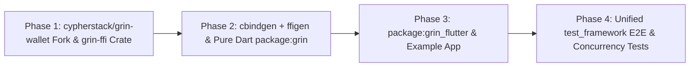

# Grin Rust FFI (`grin-ffi`), Pure Dart (`grin`), & Flutter (`grin_flutter`) Architecture Plan

## 1. Executive Summary & Architectural Decisions

This document defines the clean-room architecture and implementation plan (**Phases 1–4**) for **Grin** in `/home/user/src/grin`, incorporating all review resolutions from Rounds 1 and 2:

1. **Single Monorepo at `/home/user/src/grin`**:
   - Combines a Cargo workspace (`crates/grin-ffi`) and a **native Dart pub workspace** (`workspace: [packages/grin, packages/grin_flutter, packages/grin_flutter/example]`, **no Melos**).
   - All `pubspec.yaml` files declare `publish_to: none`.
2. **Thin `cypherstack/grin-wallet` Fork (`v5.5.1`) with `HttpSlateSender` Split, `tor` Gating, and `ring`+`webpki-roots` `rustls`**:
   - Rather than copying ~2,000 lines of `node_clients/http.rs` (455 lines), `client_utils/` (595 lines), and `lifecycle/` (873 lines) into `grin-ffi` and owning seed encryption forever, we maintain a minimal fork `cypherstack/grin-wallet` (branched from `mimblewimble/grin-wallet` `v5.5.1`, commit `f097811ee953fc81be4e70435d6ef845b6b2e8c9`, on branch `optional-tor-rustls`, fork commit `64d361f2e49fa6d544cf0236417da48a99444b2f`). The fork is a separate repository checked out locally at `/home/user/src/grin-wallet` (outside the monorepo; remote `cypherstack` = `ssh://git@git.cypherstack.com:222/sneurlax/grin-wallet.git`), and `grin-ffi` consumes it as a git dependency pinned by `rev`.
   - **Ungated `HttpSlateSender` Split**: In upstream `v5.5.1`, `TorSlateSender` ([tor.rs](file:///home/user/src/grin-wallet/impls/src/adapters/tor.rs)) was the only `SlateSender`, so gating all of `adapters/tor.rs` would remove HTTP/SOCKS5 slate sending. The fork extracts the `arti`/process-free logic (`check_other_version`, `post` via `Client` with optional `(SocketAddr, "socks5h://")` proxy, and `impl SlateSender`) into an ungated [`HttpSlateSender`](file:///home/user/src/grin-wallet/impls/src/adapters/http.rs) re-exported from `grin_wallet_impls`, while `TorSlateSender` (gated behind `#[cfg(feature = "tor")]`) delegates its HTTP/JSON-RPC logic to `HttpSlateSender`.
   - **Intentional TLS Stack (`reqwest/rustls-no-provider` + `ring` + `webpki-roots`)**: `reqwest` 0.13.4's default `rustls` feature pulls in `aws-lc-rs` (`aws-lc-sys` C/CMake build step on every target) and `rustls-platform-verifier` (which requires Android JNI initialization and bundled Java components); see `reqwest-0.13.4/Cargo.toml` L169-177 in the cargo registry (`rustls = ["__rustls-aws-lc-rs", "dep:rustls-platform-verifier", "__rustls"]`, `rustls-no-provider = ["dep:rustls-platform-verifier", "__rustls"]`). The fork's `rustls` feature enables `reqwest/rustls-no-provider`, `rustls` (`0.23`, `features = ["ring", "std", "tls12"]`), and `webpki-roots` (`1.0`), wired via `ClientBuilder::tls_backend_preconfigured(tls_config)` (`reqwest-0.13.4/src/async_impl/client.rs` L2192) in [`Client::configure_tls`](file:///home/user/src/grin-wallet/impls/src/client_utils/client.rs#L72-L90). Precisely: this drops `aws-lc-rs` from the graph, but `rustls-no-provider` still links `rustls-platform-verifier`; the preconfigured `ClientConfig` means the verifier is never constructed at runtime, which is what matters on Android (comment at `client.rs` L66-70).
   - **Complete `tor` Dependency Gating**: All `tor/`-only dependencies (`arti-client`, `tor-*`, `fs-mistrust`, `fslock-guard`, `sysinfo`, `timer`, `hyper`, `hyper-util`, `http-body-util`, `bytes`, `ed25519-dalek`, `regex`, `base64`, `url`, `sha2`) are gated under the `tor` feature (which stays in `default = ["tor", "native-tls"]` for upstream compatibility).
3. **Single Native-Assets Build Hook in `packages/grin` Using `hooks.user_defines.grin`**:
   - In Dart Native Assets (`code_assets` + `@ffi.Native`), a `@Native` asset (`assetId: 'package:grin/src/ffi/bindings.g.dart'`) **must** be emitted by the `hook/build.dart` of the package that declares it (`input.packageName == 'grin'`).
   - Therefore, **intentionally differing from the original prompt's framing where the Flutter package provides the native build**, the single `hook/build.dart` lives in `packages/grin` (using `native_prebuilt_hook` via git while `publish_to: none`; publishing the kit to `pub.dev` is tracked as a prerequisite before `package:grin` is ever published).
   - Uses the `hooks.user_defines.<package>` contract of `native_prebuilt_hook` at ref `85f7eb097604e5b99db3f90bccbcada3336836b8` (the same kit ref `wt/tor` and `wt/frostdart-kit` pin): a `build` user-define (`prebuilt`, `source`, `dev`, `cargo`; unset lets the hook pick) and prebuilts pinned by a committed `packages/grin/hook/prebuilt_hashes.json` (`dart/native_prebuilt_hook/lib/src/hook.dart` L53-68 and L156-165, `lib/src/prebuilt_hashes.dart` L8-13). Stack Wallet's currently generated pubspec (branch `security/rbf-history-authentication`, commit `b778525f0`, L374-388; `cypherstack/main` has no `pubspec.yaml`, and its `scripts/app_config/templates/pubspec.template.yaml` has no `hooks:` block) still uses the pre-kit keys `native_build`, `prebuilt_manifest_url` and `prebuilt_manifest_sha256` for `tor_ffi_plugin`, `flutter_libepiccash` and `flutter_libmwc`; those keys are not what the pinned kit reads, so `grin` follows the kit (Decision D1 in section 12). `grin` adds one package-specific boolean user-define, `test_utils`, honoured only by its `cargo` mode (`--features test-utils`). No fifth build system.
   - `packages/grin_flutter` holds Flutter-only glue: default platform wallet directory helper (`path_provider`), an app lifecycle observer (`AppLifecycleListener`), and full re-exports of `package:grin/grin.dart`.
4. **v1 Transport Scope (Outbound HTTP/Tor + Offline Slatepacks; No Inbound Listener)**:
   - Stack Wallet's `tor_ffi_plugin` (pinned at `e30ed0d386a40ee4a999aeaf57aafd32921d601e` in its pubspec L68-71; `rust/Cargo.toml` L18 at that ref: `arti-client = { version = "0.47.0", features = ["static", "onion-service-client"] }`) enables only the client side of onion services, not `onion-service-service`, so it cannot host an inbound v3 `.onion` hidden service.
   - Therefore, **inbound synchronous Tor/HTTP receive is out of scope for v1** (no `listener.rs` in `grin-ffi`).
   - v1 supports **outbound synchronous HTTP/Tor send** (`grin_tx_send_http` using `HttpSlateSender` over Stack Wallet's SOCKS5 proxy `socks5h://127.0.0.1:<port>` to `http://<56-char>.onion/v2/foreign` or `http(s)://...`) plus **asynchronous Slatepack send/receive/finalize (`S1 -> S2 -> S3` and `I1 -> I2 -> I3`)**. Inbound `.onion` hidden-service hosting (passing the wallet's `ed25519` Slatepack key to an upgraded `tor_ffi_plugin`) is tracked as a future v2 item.
5. **Implementation Scope**:
   - **Phases 1–4 only** (inside `/home/user/src/grin`). Phase 5 (`stack_wallet` integration) is documented as the target API contract and will be executed later on a separate `stack_wallet` branch.

---

## 2. Summary of Legacy Antipatterns Eliminated by This Design

| # | Legacy Antipattern in `flutter_libepiccash` / `flutter_libmwc` | Evidence | Replacement Design in `grin` |
|---|---|---|---|
| **1** | **Raw Pointer + Plaintext `SecretKey` Serialized in a JSON String Handle** | [ffi.rs](file:///home/user/src/stack_wallet/flutter_libepiccash-claude/rust/src/ffi.rs#L192-L200) (checkout `ceb9738`), [lib.rs](file:///home/user/src/stack_wallet/flutter_libmwc-codex/rust/src/lib.rs#L365) and [L402](file:///home/user/src/stack_wallet/flutter_libmwc-codex/rust/src/lib.rs#L402) (checkout `8acf950`; L98-105 is the related `ensure_wallet!` raw-pointer deref macro) | Monotonic `u64` opaque registry handle (`LazyLock<Mutex<HashMap<u64, Arc<WalletSession>>>>`). `SecretKey` keychain mask stays inside Rust memory (`Drop` zeroizes & closes `WalletBackend`). |
| **2** | **Process-Global `ChainTypes` Mutation Race** | [lib.rs](file:///home/user/src/stack_wallet/flutter_libmwc-codex/rust/src/lib.rs#L1376-L1380), [lib.rs](file:///home/user/src/stack_wallet/flutter_libmwc-codex/rust/src/lib.rs#L1985-L1989) | Per-thread `grin_core::global::set_local_chain_type` on every handle-based FFI entry, on `create`/`open` before `DefaultLCProvider`, on spawned HTTP helper threads, and via explicit `network: u8` on stateless FFI entries. |
| **3** | **Quadruple-Encoded JSON & Stringly-Typed Primitives** | [wallet.rs](file:///home/user/src/stack_wallet/flutter_libepiccash-claude/rust/src/wallet.rs#L195-L206), [lib.dart](file:///home/user/src/stack_wallet/flutter_libmwc-codex/lib/lib.dart#L287-L290) | Native `u64`/`u32`/`i64`/`u8`/`bool` C ABI arguments and flat JSON payloads decoded into strongly typed Dart models inside `package:grin`. |
| **4** | **String-Matched Errors & Uncaught Panics Across `extern "C"`** | [ffi.rs](file:///home/user/src/stack_wallet/flutter_libepiccash-claude/rust/src/ffi.rs), [lib.dart](file:///home/user/src/stack_wallet/flutter_libmwc-codex/lib/lib.dart#L476-L503) | Every `extern "C"` entrypoint wraps its body in `catch_unwind(AssertUnwindSafe(...))` and returns `#[repr(C)] GrinFfiResult { code, data, error }`. |
| **5** | **`CString` Allocator Mismatches & Memory Leaks** | [mwc.dart](file:///home/user/src/stack_wallet/flutter_libmwc-codex/lib/mwc.dart#L121-L474) | Rust exports `grin_ffi_result_free`, `grin_string_free`, and `grin_wallet_close_finalizer`. Dart uses `using((arena) { ... })` and a zeroing arena for secrets. |
| **6** | **IEEE-754 `double` Coin Balances** | [wallet.rs](file:///home/user/src/stack_wallet/flutter_libepiccash-claude/rust/src/wallet.rs#L608-L613) via `nano_to_deci(amount: u64) -> f64` at [wallet.rs L302-306](file:///home/user/src/stack_wallet/flutter_libepiccash-claude/rust/src/wallet.rs#L302-L306) | All monetary values across Rust (`u64`) and Dart (`BigInt` nanogrin, $1\text{ GRIN} = 10^9\text{ nanogrin}$) are exact integers. |
| **7** | **Manual Slate JSON Inspection in `stack_wallet`** | `analyzeSlatepack`: on `cypherstack/main` (`a156253bf`) in `lib/wallets/wallet/impl/mimblewimblecoin_wallet.dart` L397-494; on branch `security/rbf-history-authentication` (`b778525f0`) also in [epiccash_wallet.dart L328-411](file:///home/user/src/stack_wallet/stack_wallet/lib/wallets/wallet/impl/epiccash_wallet.dart#L328-L411) | `grin-ffi` inspects `slate.state` (`S1`/`S2`/`S3`/`I1`/`I2`/`I3`), `amount`, `fee`, `id`, `kernel_excess`, and `Slatepack` addresses in Rust. |
| **8** | **Blocked Worker Isolate Deadlock During Scan** | [epic_wallet.dart](file:///home/user/src/stack_wallet/flutter_libepiccash/flutter_libepiccash/lib/src/wallet/epic_wallet.dart#L392-L439) (checkout `43ff116`, branch `main`: `scanOutputs` polls `_worker.getScanProgress()` on a 500 ms timer) | Lock-free per-wallet `ScanProgressState` atomics in `WalletSession` read via `grin_wallet_scan_progress` while `grin_wallet_scan` runs in `Isolate.run`. |

---

## 3. Repository & Workspace Layout (`/home/user/src/grin`)

```text
/home/user/src/grin/                     (as built; D6 moved the Cargo workspace under packages/grin)
├── pubspec.yaml                        # Root pub workspace (publish_to: none; workspace: [...]; no Melos)
│                                       # hooks.user_defines.grin: build: cargo, test_utils: true for in-repo builds
├── pubspec.lock
├── analysis_options.yaml               # Shared strict lint rules
├── README.md                           # Layout, gates, the local overrides and how to drop them
├── docs/
│   ├── architecture.md                 # This file
│   └── ffi-json.md                     # JSON contract between grin-ffi and package:grin
├── tool/
│   ├── ci.dart                         # Every gate in one command (rust, android, bindings, dart, flutter, nix + nm gate)
│   ├── regen_bindings.dart             # cargo build with GRIN_FFI_WRITE_HEADER=1 -> ffigen -> dart format; --check
│   └── local-fork-env.sh               # git URL rewrite for the unpushed fork (D2)
└── packages/
    ├── grin/                           # Pure Dart package (name: grin, publish_to: none)
    │   ├── pubspec.yaml                # no flutter sdk; native_prebuilt_hook (kit 85f7eb0) + native_toolchain_rust 1.0.6
    │   ├── ffigen.yaml                 # @ffi.Native bindings, asset id package:grin/src/ffi/bindings.g.dart
    │   ├── build-config.json           # Rust 1.94.0, toolchain pins, floors, targets (read by the hook and the flake)
    │   ├── flake.nix, flake.lock       # Reference builds through native-build-kit; the fork is a flake input (D7)
    │   ├── nix/build-apple.sh          # Apple wrapper for the kit's build-apple.sh
    │   ├── hook/
    │   │   ├── build.dart              # runNativeBuildHook + cargo mode (test_utils -> --features test-utils)
    │   │   └── prebuilt_hashes.json    # Pinned native release (none yet)
    │   ├── rust/                       # The grin-ffi crate, a single-crate Cargo workspace
    │   │   ├── Cargo.toml, Cargo.lock, rust-toolchain.toml, .cargo/config.toml
    │   │   ├── build.rs, cbindgen.toml # Header generation
    │   │   ├── include/grin_ffi.h      # The committed C header (the ABI contract)
    │   │   ├── src/                    # lib, error, handle, logging, config, lifecycle, address, balance,
    │   │   │                           # scan, sidecar, slatepack, transaction, proof, test_support
    │   │   └── tests/                  # header_test, ffi_e2e_test, ffi_tx_test
    │   ├── lib/
    │   │   ├── grin.dart, testing.dart
    │   │   └── src/{ffi,errors,internal,models,wallet,testing}/
    │   ├── test/                       # mnemonic_address, bounds_and_panic, wallet_lifecycle, test_chain,
    │   │                               # slatepack_e2e, models, tx_models, memory, arguments, kit_pin
    │   └── README.md
    └── grin_flutter/                   # Flutter glue (name: grin_flutter, publish_to: none)
        ├── pubspec.yaml
        ├── lib/grin_flutter.dart, lib/src/{default_paths,lifecycle_observer}.dart
        ├── test/grin_flutter_test.dart
        ├── README.md
        └── example/                    # flutter create app + integration_test/app_test.dart
```

The `cypherstack/grin-wallet` fork (`v5.5.1` + submodule `grin` `v5.5.2`) is not part of this tree. It lives in its own repository at `/home/user/src/grin-wallet` (branch `optional-tor-rustls`, commit `64d361f2`) and is pulled in by `packages/grin/rust/Cargo.toml` as a `rev`-pinned git dependency (see 4.1) and by `packages/grin/flake.nix` as a flake input (D7).

### 3.1 Why `packages/grin` Owns `hook/build.dart` Instead of `packages/grin_flutter`

> [!IMPORTANT]
> Although the original task description framed the companion Flutter package as providing the native library/build, **Dart Native Assets (`code_assets` + `@ffi.Native`) requires the package that declares `@DefaultAsset('package:grin/src/ffi/bindings.g.dart')` to own `hook/build.dart`**, because a build hook can only emit a `CodeAsset` for its own `input.packageName` (`grin`).
>
> Placing `hook/build.dart` in `packages/grin`:
> - Allows **both** pure Dart (`cd packages/grin && dart test`) and Flutter (`flutter test`, `flutter run`, `flutter build` in `grin_flutter/example` or `stack_wallet`) to automatically invoke `packages/grin/hook/build.dart` and bundle `libgrin_ffi`.
> - Avoids a fifth build system by using the `hooks.user_defines.<package>` contract of `native_prebuilt_hook` at `85f7eb0` (the kit's `build` user-define; the prebuilt release URL and per-file sha256 live in the package's committed `hook/prebuilt_hashes.json`, so the consumer pins nothing but the git ref of `grin` itself):
>   ```yaml
>   hooks:
>     user_defines:
>       grin:
>         build: prebuilt    # or source, dev, cargo; unset lets the hook pick
>         test_utils: false  # grin-specific; true only in this workspace's root pubspec so dart test gets --features test-utils (cargo mode only)
>   ```
> - Leaves `packages/grin_flutter` focused cleanly on Flutter-specific integration (default wallet storage directory via `path_provider`, `AppLifecycleListener` hooks, and re-exporting `package:grin/grin.dart`).

---

## 4. Layer 1: Rust Wrapper Crate (`grin-ffi`) Detailed Design

### 4.1 Thin `cypherstack/grin-wallet` Fork (`v5.5.1`) & Direct Dependencies

We fork `mimblewimble/grin-wallet` (`v5.5.1`, commit `f097811ee953fc81be4e70435d6ef845b6b2e8c9`, with submodule `grin` at `v5.5.2`, commit `dbaff34f7751ee23316fbbfe5806b47c546776ca`) into `cypherstack/grin-wallet`, a separate repository checked out at `/home/user/src/grin-wallet` on branch `optional-tor-rustls` (remote `cypherstack` = `ssh://git@git.cypherstack.com:222/sneurlax/grin-wallet.git`), with a clean, upstreamable diff in `impls/`:

1. **[`impls/Cargo.toml`](file:///home/user/src/grin-wallet/impls/Cargo.toml) (`tor` Feature Gating & Intentional TLS Stack)**:
   - `reqwest` 0.13.4's `rustls` feature pulls in `aws-lc-rs` (`aws-lc-sys` C/CMake cross-compile step) and configures `rustls-platform-verifier` by default (which on Android requires JNI initialization and bundling its Android Java component).
   - Instead, we use `reqwest/rustls-no-provider` combined with `rustls` (`0.23`, `features = ["ring", "std", "tls12"]`—reusing `ring 0.17` already in the dependency graph) and `webpki-roots` (`1.0`), and gate all `tor/`-only dependencies under `tor`:
     ```toml
     [features]
     default = ["tor", "native-tls"]
     native-tls = ["reqwest/native-tls"]
     rustls = ["reqwest/rustls-no-provider", "dep:rustls", "dep:webpki-roots"]
     tor = [
         "dep:ed25519-dalek",
         "dep:regex",
         "dep:timer",
         "dep:sysinfo",
         "dep:base64",
         "dep:url",
         "dep:arti-client",
         "dep:tor-rtcompat",
         "dep:fs-mistrust",
         "dep:fslock-guard",
         "dep:tor-hsservice",
         "dep:tor-hsrproxy",
         "dep:tor-keymgr",
         "dep:tor-llcrypto",
         "dep:tor-hscrypto",
         "dep:sha2",
         "dep:hyper",
         "dep:hyper-util",
         "dep:http-body-util",
         "dep:bytes",
     ]
     ```
2. **Preconfigured `rustls` in [`impls/src/client_utils/client.rs`](file:///home/user/src/grin-wallet/impls/src/client_utils/client.rs#L72-L90)**:
   - When `#[cfg(all(feature = "rustls", not(feature = "native-tls")))]` is active, `Client::configure_tls` constructs a `rustls::ClientConfig` backed by `rustls::crypto::ring::default_provider()` and `webpki_roots::TLS_SERVER_ROOTS`, passing it to `builder.tls_backend_preconfigured(tls_config)`. In `reqwest` 0.13.4, `tls_backend_preconfigured` selects `TlsBackend::BuiltRustls` directly, completely bypassing `rustls_platform_verifier` at runtime on Android/iOS/desktop.
3. **Splitting [`HttpSlateSender`](file:///home/user/src/grin-wallet/impls/src/adapters/http.rs) from [`TorSlateSender`](file:///home/user/src/grin-wallet/impls/src/adapters/tor.rs)**:
   - [`impls/src/adapters/http.rs`](file:///home/user/src/grin-wallet/impls/src/adapters/http.rs) defines the ungated `HttpSlateSender` (`HttpSlateSender::new`, `HttpSlateSender::with_socks_proxy`, `check_other_version`, `post`, and `impl SlateSender for HttpSlateSender`).
   - [`impls/src/adapters/tor.rs`](file:///home/user/src/grin-wallet/impls/src/adapters/tor.rs) (gated behind `#[cfg(feature = "tor")]` in [`adapters/mod.rs`](file:///home/user/src/grin-wallet/impls/src/adapters/mod.rs) and [`lib.rs`](file:///home/user/src/grin-wallet/impls/src/lib.rs)) keeps the `arti` / external Tor process management and delegates its HTTP/JSON-RPC methods to `HttpSlateSender`.
4. **Direct Dependencies in `crates/grin-ffi/Cargo.toml` (No `grin_wallet_controller` Dev-Dependency)**:
   - Because `use grin_core as core;` etc. in [`impls/src/lib.rs`](file:///home/user/src/grin-wallet/impls/src/lib.rs#L27-L31) are private aliases rather than `pub use` re-exports, `crates/grin-ffi/Cargo.toml` depends directly on `grin_wallet_impls` (`default-features = false, features = ["rustls"]`), `grin_wallet_libwallet`, `grin_wallet_config`, `grin_wallet_util`, `grin_core`, `grin_keychain`, `grin_chain`, `grin_store`, and `grin_util` from the exact same fork via one git source pinned by `rev` (Cargo fetches the fork's `grin` submodule for the `grin_*` node crates):
     ```toml
     grin_wallet_impls = { git = "ssh://git@git.cypherstack.com:222/sneurlax/grin-wallet.git", rev = "64d361f2e49fa6d544cf0236417da48a99444b2f", default-features = false, features = ["rustls"] }
     grin_wallet_libwallet = { git = "ssh://git@git.cypherstack.com:222/sneurlax/grin-wallet.git", rev = "64d361f2e49fa6d544cf0236417da48a99444b2f" }
     # ... same git + rev for grin_wallet_config, grin_wallet_util, grin_core, grin_keychain, grin_chain, grin_store, grin_util
     ```
   - No `path` dependencies on the fork are committed. For local iteration against an unpushed fork checkout, an uncommitted `.cargo/config.toml` `[patch."ssh://git@git.cypherstack.com:222/sneurlax/grin-wallet.git"]` may point the same crates at `/home/user/src/grin-wallet`; CI, Nix, and `Cargo.lock` always resolve the pinned `rev`.
   - **No `grin_wallet_controller` dev-dependency**: `grin_wallet_controller` depends on `grin_wallet_impls` with default features, which in `cargo test` would re-enable `tor` and `native-tls` via Cargo feature unification. Because `pub mod test_framework;` is already public in `grin_wallet_impls`, `grin-ffi` needs no wallet dev-dependencies at all.
   - **CI Duplicate Crate Gate (`cargo tree -d`)**: `tool/ci.dart` runs `cargo tree -d` and asserts that zero `grin_*` or `grin_secp256k1zkp` crates are duplicated.

### 4.2 Per-Thread Chain Type Isolation (`set_local_chain_type`)

> [!WARNING]
> In `grin_core::global` ([global.rs](file:///home/user/src/grin-wallet/grin/core/src/global.rs#L165-L207)), `get_chain_type()` checks the thread-local `CHAIN_TYPE: Cell<Option<ChainTypes>>` **first**, falling back to the set-once `GLOBAL_CHAIN_TYPE` only if the thread-local `CHAIN_TYPE` is `None`.
> Because Dart's `Isolate.run` executes closures on arbitrary Dart VM worker-pool threads, and because Stack Wallet can have `Mainnet` and `Floonet` (`Testnet`) wallets open simultaneously in the same process, **`grin-ffi` MUST NOT rely on process-global `GLOBAL_CHAIN_TYPE`**.
>
> Three source facts shape the rules below. `get_chain_type()` panics when neither the thread-local nor the global is set (`global.rs` L198-200), so every FFI entry that can reach consensus code must set the thread-local first. `is_testnet()` is true only for `ChainTypes::Testnet` (`global.rs` L472-477), so `UserTesting` and `AutomatedTesting` derive Mainnet-style keychains. The Slatepack HRP is `grin` for `Mainnet` and `tgrin` for every other chain type (`libwallet/src/slatepack/address.rs` L44-49), and `SlatepackAddress` parsing rejects the other network's HRP (L99-116, L263-265). The `ChainTypes` enum order is `AutomatedTesting, UserTesting, Testnet, Mainnet` (`global.rs` L114-123); the FFI `network: u8` mapping below is our own and does not depend on it.

1. **No Global Chain Type Init in `lib.rs`**:
   - `lib.rs` performs no global chain initialization.
2. **Wallet Creation & Opening Set Thread-Local `CHAIN_TYPE` Before `DefaultLCProvider`**:
   - `grin_wallet_create` and `grin_wallet_open` do not take an existing session handle, and [`DefaultLCProvider::open_wallet`](file:///home/user/src/grin-wallet/impls/src/lifecycle/default.rs#L253-L255) calls `wallet_seed.derive_keychain(global::is_testnet())`.
   - Therefore, both `grin_wallet_create` and `grin_wallet_open` parse `config.network` from `config_json` and call `grin_core::global::set_local_chain_type(chain_type)` **immediately at the start of the function**, before constructing or invoking `DefaultLCProvider`.
3. **Handle-Based Entrypoints Set Thread-Local `CHAIN_TYPE` via `get_session(handle)`**:
   - Every `WalletSession` stores its `pub chain_type: ChainTypes` (`Mainnet`, `Testnet`, `UserTesting`, or `AutomatedTesting`).
   - The registry lookup helper `get_session(handle: u64) -> Result<Arc<WalletSession>, GrinError>` calls `grin_core::global::set_local_chain_type(session.chain_type)` before returning the `Arc<WalletSession>`.
   - During UTXO scans, [`grin_wallet_libwallet::internal::scan::identify_utxo_outputs`](file:///home/user/src/grin-wallet/libwallet/src/internal/scan.rs#L71-L78) captures `let chain_type = global::get_chain_type();` on the caller thread and calls `global::set_local_chain_type(chain_type)` inside its `rayon::par_iter().map(...)` closure, propagating the wallet's `ChainTypes` to all Rayon worker threads.
4. **Spawned HTTP Helper Threads Propagate `CHAIN_TYPE`**:
   - Both [`Client::send_request`](file:///home/user/src/grin-wallet/impls/src/client_utils/client.rs#L292-L311) and [`HTTPNodeClient::get_outputs_from_node`](file:///home/user/src/grin-wallet/impls/src/node_clients/http.rs#L278-L289) spawn helper threads (`std::thread::spawn`) to run `RUNTIME.block_on(...)`. In our fork, both functions capture `let chain_type = crate::core::global::CHAIN_TYPE.with(|c| c.get());` on the calling thread and call `set_local_chain_type(ct)` inside the spawned thread before entering `rt.block_on(...)`.
5. **Stateless Entrypoints Take an Explicit `network: u8` Parameter**:
   - Stateless functions that depend on consensus/address parameters (`grin_address_validate`, `grin_slatepack_decode` when `handle == 0`) take `network: u8` (`0 = Mainnet`, `1 = Floonet/Testnet`, `2 = UserTesting`, `3 = AutomatedTesting`), validate the discriminant, and call `grin_core::global::set_local_chain_type(chain_type)` on the current thread before executing.

### 4.3 Outbound Synchronous HTTP / Tor Send (`grin_tx_send_http`) via `HttpSlateSender`

In v1, `grin_tx_send_http` uses `grin_wallet_impls::HttpSlateSender` (and the `SlateSender` trait) directly rather than hand-rolling JSON-RPC in `grin-ffi`:
1. If `recipient_address` is a `SlatepackAddress` (`grin1...` / `tgrin1...`), convert its Ed25519 public key into a v3 `.onion` URL via `OnionV3Address::from(&recipient_slatepack_addr).to_http_str()` (`"http://<56-char>.onion"`; `impl From<&SlatepackAddress> for OnionV3Address` at `libwallet/src/slatepack/address.rs` L128, `to_http_str` at `util/src/ov3.rs` L90). If it is already an `http://` or `https://` URL, use it directly.
2. Construct `HttpSlateSender`:
   - If the wallet session has `socks_proxy: Some(proxy_addr)`, call `HttpSlateSender::with_socks_proxy(&recipient_url, proxy_addr, timeout)?` (which routes via `socks5h://` so `.onion` resolution happens through Stack Wallet's Tor SOCKS5 proxy).
   - Otherwise (only allowed for clearnet `http(s)://`, never `.onion`), call `HttpSlateSender::new(&recipient_url, timeout)?`.
3. Call `owner::init_send_tx` (`S1`), call `sender.send_tx(&slate_s1, false)` to perform the `check_version` + `receive_tx` JSON-RPC handshake and receive the signed `S2` `Slate`, call `owner::tx_lock_outputs`, call `owner::finalize_tx` (`S3`), and broadcast via `owner::post_tx`.

### 4.4 Trimmed, Fault-Tolerant Sidecar (`crates/grin-ffi/src/sidecar.rs`)

Because `grin_wallet_libwallet::TxLogEntry` already persists `kernel_excess: Option<Commitment>` and `payment_proof: Option<StoredProofInfo>` (which stores `receiver_address` and `sender_address`), the sidecar file `<wallet_dir>/wallet_data/tx_metadata.json` only stores what `TxLogEntry` lacks:
```rust
#[derive(Serialize, Deserialize, Clone, Default)]
pub struct TxSidecarEntry {
    /// Latest armored S1/S2 or I1/I2 Slatepack string so the user can view/re-share
    /// an unfinished interactive transaction from the transaction details screen.
    pub armored_slatepack: Option<String>,
    /// Counterparty address (`grin1...` or `http://...`) for transactions that do not
    /// carry a StoredProofInfo (`payment_proof`).
    pub counterparty_address: Option<String>,
}
```
- **Atomic Rename & Non-Fatal Writes**:
  - Saved by writing to `<wallet_dir>/wallet_data/tx_metadata.json.tmp` (`File::sync_all`) and atomically renaming (`std::fs::rename`) over `tx_metadata.json`.
  - Sidecar reads and writes are best-effort (`if let Err(e) = sidecar.upsert(...) { log::warn!("Sidecar write failed: {e}"); }`) and **never** fail a transaction init, send, receive, or finalize operation.
  - When `grin_txs_get` builds each `GrinTxLogEntry` JSON object, `counterparty_address` is populated from `tx.payment_proof` first, falling back to `sidecar.counterparty_address`.

### 4.5 Session Registry, `Drop`-Based Close & Per-Directory LMDB Guard (`crates/grin-ffi/src/handle.rs`)

1. **Session Registry**:
   - `SESSION_REGISTRY: LazyLock<Mutex<HashMap<u64, Arc<WalletSession>>>>` maps non-zero monotonic `u64` handles (from an `AtomicU64` starting at 1, never reused) to sessions. `get_session(handle)` clones the `Arc<WalletSession>` out of the map, releases the lock, and sets the thread-local `CHAIN_TYPE` (4.2).
   - `grin_wallet_close` / `grin_wallet_close_finalizer` set `cancel_requested`, remove the `Arc` from the map, release the registry lock, and only then drop their `Arc`. `impl Drop for WalletSession` closes the `WalletBackend` (`lc_provider.close_wallet(None)`) and zeroizes `keychain_mask` when the last `Arc` drops (see 5.1). No LMDB work ever runs while the registry lock is held.
2. **Why Close Alone Is Not Enough (LMDB Double-Open)**:
   - Because Dart `Isolate.run` closures do not capture `this`, an orphaned in-flight operation can still hold a cloned `Arc<WalletSession>` after `grin_wallet_close` or `grin_wallet_close_finalizer` returns, so the LMDB environment stays open until that operation finishes.
   - LMDB forbids opening the same environment twice in one process. A `grin_wallet_open`, `grin_wallet_create`, or `grin_wallet_delete` on that directory during this window is unsafe (a second `Environment` on the same files, or `remove_dir_all` under a live mapping).
3. **`OPEN_DIRS` Guard**:
   - `OPEN_DIRS: LazyLock<Mutex<HashSet<DirKey>>>` holds the identity of the wallet data directory (`<wallet_dir>/wallet_data`, which contains `wallet.seed` and the LMDB `db/`) of every wallet whose backend may still be open, whether its session is registered or closed but still draining.
   - Membership is owned by an RAII `DirLease { key: DirKey, path: PathBuf }`. `DirLease::acquire(dir)` reads the identity of `dir`, locks `OPEN_DIRS`, fails with `GrinErrorCode::WalletBusy` if that identity is already present, and otherwise inserts it. The lease is stored in `WalletSession`. At the end of `impl Drop for WalletSession`, after `close_wallet(None)` has returned and the backend's `Environment` has been dropped, the lease is released and the entry removed. If `open`/`create` fails after acquiring the lease (wrong password, corrupt seed, LMDB error), the lease drops on the error path after any partially opened backend.
   - `grin_wallet_open` and `grin_wallet_create` acquire the lease after `set_local_chain_type` and before constructing `DefaultLCProvider` or touching LMDB. `grin_test_create_wallet` (7.1) takes the same lease.
   - `grin_wallet_delete` first closes `handle` if non-zero (rejecting a handle whose session `data_dir` differs from `wallet_dir`), then acquires a lease on the directory itself for the duration of `remove_dir_all`. If the directory is still held (a draining orphaned operation), it returns `WalletBusy` and deletes nothing. Holding the lease during deletion means a concurrent `open`/`create` also gets `WalletBusy`, so there is no check-then-delete race.
   - `OPEN_DIRS` and `SESSION_REGISTRY` are never held at the same time, and both are locked with `lock().unwrap_or_else(PoisonError::into_inner)` because `Drop` may run during unwinding.
4. **Canonicalization**:
   - Paths are `std::fs::canonicalize`d first, and the key is the directory's identity: `(st_dev, st_ino)` from `std::os::unix::fs::MetadataExt` on unix, so `dir`, `dir/`, `dir/./`, symlinked paths, bind mounts and a directory renamed while open all map to one entry, and a directory removed and recreated at the same path is a new entry. On Windows the key is the canonical path (std's file-index API is not stable), which covers the path spellings and symlinks but not other mounts. The canonical path is kept in the lease for `WalletSession::data_dir` and for the `WalletBusy` error's `wallet_dir` detail; on Windows it is a `\\?\` verbatim path, so a Windows caller may see the verbatim form there.
   - `canonicalize` fails on a path that does not exist yet. `grin_wallet_create` therefore calls `std::fs::create_dir_all(<wallet_dir>/wallet_data)` before canonicalizing and acquiring the lease (`DefaultLCProvider` would create it anyway). `grin_wallet_open` maps a missing directory to its existing not-found error, and `grin_wallet_delete` treats a missing directory as already deleted.
5. **`GrinErrorCode::WalletBusy`**:
   - A new `GrinErrorCode` variant with a fresh discriminant appended after the existing codes (discriminants are append-only because Dart maps them by value). There is no separate `WalletAlreadyOpen` code: `WalletBusy` covers both "already open and registered by another client" and "closed but still draining", since in both cases the directory is held by a live `WalletSession` and the caller's only safe action is to wait or reuse the existing client. The error JSON carries `{"wallet_dir": "<canonical path>"}`.
   - Dart maps it to `GrinWalletBusyException` in the sealed `GrinException` hierarchy (5.1).

### 4.6 Complete `grin-ffi` Exported C ABI Surface (35 Standard Functions + 3 `test-utils` Functions)

Every FFI function (except the `void` destructors `grin_ffi_result_free`, `grin_string_free`, and `grin_wallet_close_finalizer`) returns `#[repr(C)] GrinFfiResult { code: i32, data: *mut c_char, error: *mut c_char }` and wraps its body in `ffi_guard!` (`std::panic::catch_unwind`).

| # | Category | C Function Signature | Description |
|---:|---|---|---|
| 1 | **Memory, Logging & Diagnostics** | `grin_ffi_result_free(res: GrinFfiResult)` | Frees `res.data` and `res.error` allocated via `CString::into_raw()`. |
| 2 | | `grin_string_free(ptr: *mut c_char)` | Frees a single Rust-allocated C string. |
| 3 | | `grin_init_logs(log_level: *const c_char) -> GrinFfiResult` | Idempotent (`Once`) Rust logger initialization (`trace`/`debug`/`info`/`warn`/`error`). |
| 4 | **Stateless Utilities** | `grin_mnemonic_generate(word_count: u32) -> GrinFfiResult` | Generates a 12, 15, 18, 21, or 24-word BIP39 mnemonic (`grin_keychain::mnemonic::from_entropy`). |
| 5 | | `grin_mnemonic_validate(mnemonic: *const c_char) -> GrinFfiResult` | Validates BIP39 mnemonic words & checksum (`grin_keychain::mnemonic::to_entropy`). |
| 6 | | `grin_address_validate(address: *const c_char, network: u8) -> GrinFfiResult` | Sets thread-local `ChainTypes` from `network`, validates `grin1...` / `tgrin1...` `SlatepackAddress` (or `.onion` / `http(s)://`), and returns normalized address + v3 `.onion` URL. |
| 7 | | `grin_node_test_connection(node_url: *const c_char, api_secret: *const c_char, socks_proxy: *const c_char) -> GrinFfiResult` | Queries `/v2/foreign` (`get_version` + `get_tip`) over optional `socks5h://host:port`. |
| 8 | **Wallet Lifecycle** | `grin_wallet_create(config_json: *const c_char, mnemonic: *const c_char, password: *const c_char) -> GrinFfiResult` | Sets thread-local `ChainTypes` from `config_json` **before** `DefaultLCProvider`, creates and canonicalizes `<wallet_dir>/wallet_data`, acquires its `OPEN_DIRS` lease (`WalletBusy` if held, 4.5), creates encrypted `wallet.seed` and `WalletBackend`, registers session, returns `{"handle": u64}`. |
| 9 | | `grin_wallet_open(config_json: *const c_char, password: *const c_char) -> GrinFfiResult` | Sets thread-local `ChainTypes` from `config_json` **before** `DefaultLCProvider`, acquires the canonical data directory's `OPEN_DIRS` lease (`WalletBusy` if the directory is held by a registered or still-draining session, 4.5), opens wallet, stores `keychain_mask` in Rust session, returns `{"handle": u64}`. |
| 10 | | `grin_wallet_close(handle: u64) -> GrinFfiResult` | Sets `scan_state.cancel_requested = true` and removes `Arc<WalletSession>` from `SESSION_REGISTRY`. Actual `WalletBackend::close()`, mask zeroization, and release of the `OPEN_DIRS` lease occur in `impl Drop for WalletSession` when the last `Arc<WalletSession>` drops (immediately, on the normal Dart path where the op queue was drained first). |
| 11 | | `grin_wallet_close_finalizer(token: *mut c_void)` | `void (*)(void*)` callback for Dart's `NativeFinalizer`. Casts `token as usize as u64`, cancels any scan, and removes the session from `SESSION_REGISTRY` (dropping the last `Arc<WalletSession>` once no `Isolate.run` call holds it). Until then the directory stays in `OPEN_DIRS`, so a reopen gets `WalletBusy`. |
| 12 | | `grin_wallet_delete(wallet_dir: *const c_char, handle: u64) -> GrinFfiResult` | Closes `handle` if non-zero/open, then acquires the directory's `OPEN_DIRS` lease and deletes `<wallet_dir>/wallet_data` while holding it. Returns `WalletBusy` without deleting anything if an orphaned operation still holds the session. |
| 13 | | `grin_wallet_change_password(handle: u64, old_pw: *const c_char, new_pw: *const c_char) -> GrinFfiResult` | Re-encrypts `wallet.seed` via `DefaultLCProvider::change_password`. |
| 14 | | `grin_wallet_get_mnemonic(handle: u64, password: *const c_char) -> GrinFfiResult` | Decrypts `wallet.seed` and returns the BIP39 recovery phrase. |
| 15 | | `grin_wallet_update_network(handle: u64, node_url: *const c_char, api_secret: *const c_char, socks_proxy: *const c_char) -> GrinFfiResult` | Updates the session's `HTTPNodeClient` (including SOCKS5 proxy) without reopening LMDB. |
| 16 | **Address & Chain** | `grin_wallet_get_address(handle: u64, derivation_index: u32) -> GrinFfiResult` | Returns `{"slatepack_address": "grin1...", "onion_v3_url": "http://...onion", "index": u32}`. |
| 17 | | `grin_wallet_get_chain_height(handle: u64) -> GrinFfiResult` | Queries node tip height via configured proxy, returns `{"height": u64}`. |
| 18 | **Sync, Scan & Balances** | `grin_wallet_get_balance(handle: u64, refresh_from_node: bool, min_confirms: u64) -> GrinFfiResult` | Calls `owner::retrieve_summary_info`, returns the `WalletInfo` fields as exact `u64` nanogrin under libwallet's own names (`total`, `amount_currently_spendable`, `amount_awaiting_confirmation`, `amount_awaiting_finalization`, `amount_immature`, `amount_locked`, `amount_reverted`, `last_confirmed_height`, `minimum_confirmations`) plus `refreshed_from_node` (docs/ffi-json.md section 8). |
| 19 | | `grin_wallet_scan(handle: u64, start_height: u64, delete_unconfirmed: bool) -> GrinFfiResult` | Runs chunked UTXO scan (`internal::scan::scan`) updating `ScanProgressState` atomics and checking `cancel_requested` between batches. Non-destructive to `TxLogEntry` history! |
| 20 | | `grin_wallet_scan_progress(handle: u64) -> GrinFfiResult` | **Lock-free**: reads `ScanProgressState` atomics (`is_scanning`, `scanned_height`, `tip_height`, `progress_pct`). |
| 21 | | `grin_wallet_scan_cancel(handle: u64) -> GrinFfiResult` | **Lock-free**: sets `scan_state.cancel_requested = true`. |
| 22 | **Transactions & Slatepacks** | `grin_tx_estimate_fee(handle: u64, amount: u64, min_confirms: u64, selection_strategy_is_all: bool, amount_includes_fee: bool) -> GrinFfiResult` | Returns `{"fee": u64, "net_amount": u64, "inputs_count": u32}` or `GrinErrorCode::InsufficientFunds` with structured `{"required": u64, "available": u64}`. |
| 23 | | `grin_txs_get(handle: u64, refresh_from_node: bool) -> GrinFfiResult` | Calls `owner::retrieve_txs` + joins sidecar `armored_slatepack` and fallback `counterparty_address`. |
| 24 | | `grin_slatepack_decode(handle: u64, network: u8, armored_slatepack: *const c_char, secret_index: u32) -> GrinFfiResult` | Decodes unencrypted or `age`-encrypted Slatepack, parses `Slate` V4 (`id`, `state`, `amount`, `fee` from `fee_fields`, `kernel_excess` computed with `Slate::calc_excess` (`slate.rs` L631) when the slate carries a kernel, else null, `sender`, `recipient`, `ttl_cutoff_height`). `SlateState` also has an `Unknown` variant for pre-V4 slates (`slate.rs` L138-152), which is reported as `"Unknown"`. Uses `network` when `handle == 0`. |
| 25 | | `grin_tx_init_send(handle: u64, args_json: *const c_char) -> GrinFfiResult` | Calls `owner::init_send_tx` + `owner::tx_lock_outputs` + `owner::create_slatepack_message`, saves sidecar metadata, returns `GrinSlatepack` JSON (`S1`). |
| 26 | | `grin_tx_send_http(handle: u64, args_json: *const c_char) -> GrinFfiResult` | Outbound synchronous send to `grin1...` (`.onion/v2/foreign`) or `http(s)://...` via `HttpSlateSender`: `init_send_tx` -> `HttpSlateSender::send_tx` (`check_version` + `receive_tx`) -> `tx_lock_outputs` -> `finalize_tx` -> `post_tx`. |
| 27 | | `grin_tx_receive_slatepack(handle: u64, armored_s1: *const c_char, message: *const c_char) -> GrinFfiResult` | Verifies `S1`, calls `foreign::receive_tx`, encodes `S2` Slatepack, updates sidecar, returns `GrinSlatepack` JSON (`S2`). |
| 28 | | `grin_tx_finalize_slatepack(handle: u64, armored_s2: *const c_char, broadcast: bool, fluff: bool) -> GrinFfiResult` | Verifies `S2`, calls `owner::finalize_tx` (`S3`), optionally broadcasts via `owner::post_tx`, updates sidecar, returns `GrinSlatepack` JSON (`S3`). |
| 29 | **Invoices, Repost, Cancel & Proofs** | `grin_tx_issue_invoice(handle: u64, args_json: *const c_char) -> GrinFfiResult` | Calls `owner::issue_invoice_tx` (`I1`) + `owner::create_slatepack_message`, saves sidecar, returns `GrinSlatepack` JSON (`I1`). |
| 30 | | `grin_tx_process_invoice(handle: u64, armored_i1: *const c_char, args_json: *const c_char) -> GrinFfiResult` | Verifies `I1`, calls `owner::process_invoice_tx` **followed immediately by `owner::tx_lock_outputs`** (since `process_invoice_tx` does not lock inputs itself) + `owner::create_slatepack_message`, returns `GrinSlatepack` JSON (`I2`). |
| 31 | | `grin_tx_finalize_invoice(handle: u64, armored_i2: *const c_char, broadcast: bool, fluff: bool) -> GrinFfiResult` | Verifies `I2`, calls `foreign::finalize_tx` (`I3`), optionally broadcasts via `owner::post_tx`, returns `GrinSlatepack` JSON (`I3`). |
| 32 | | `grin_tx_repost(handle: u64, tx_id: i64, slate_id: *const c_char, fluff: bool) -> GrinFfiResult` | Calls `owner::get_stored_tx` + `owner::post_tx` to re-broadcast a finalized transaction that hasn't confirmed. |
| 33 | | `grin_tx_cancel(handle: u64, tx_id: i64, slate_id: *const c_char) -> GrinFfiResult` | Calls `owner::cancel_tx` by `tx_id` or `slate_id`, unlocking inputs. |
| 34 | | `grin_payment_proof_export(handle: u64, tx_id: i64, slate_id: *const c_char) -> GrinFfiResult` | Calls `owner::retrieve_payment_proof` and returns `PaymentProof` JSON. |
| 35 | | `grin_payment_proof_verify(handle: u64, proof_json: *const c_char) -> GrinFfiResult` | Calls `owner::verify_payment_proof` and returns `{"is_sender": bool, "is_recipient": bool}`. |

*(Total standard exported C ABI functions: **35**. When compiled with `--features test-utils`, 3 additional test-only functions are exported: `grin_test_panic` (intentionally panics inside `ffi_guard!` so `dart test` can check `GrinErrorCode::InternalPanic`), `grin_test_create_wallet`, and `grin_test_mine_blocks`. They are exported for `dart test`, and the release pipeline verifies via `nm` that the Nix-built artifacts listed in the prebuilt manifest export zero `grin_test_*` symbols (7.2).)*

---

## 5. Layer 2: Pure Dart Package (`packages/grin` -> `GrinWalletClient`)

### 5.1 Naming Convention (`GrinWalletClient`), `this`-Free `Isolate.run` Closures, & Safe Finalization

1. **Consistent Naming**:
   - Following Stack Wallet's convention where `<Coin>Wallet` (`GrinWallet`) is the `stack_wallet` subclass of `Wallet<Grin>`, the client class in `package:grin` is named **`GrinWalletClient`** everywhere (`packages/grin/lib/src/wallet/grin_wallet_client.dart`).
2. **Keeping `Isolate.run` Closures Strictly Free of `this`**:
   - `GrinWalletClient` implements `Finalizable` (with a `static final NativeFinalizer _finalizer = NativeFinalizer(bindings.addresses.grin_wallet_close_finalizer)`) and owns a `final StreamController<GrinWalletEvent> _events = StreamController.broadcast()`.
   - Because Dart `Isolate.run` rejects closures that capture a `Finalizable` instance or a `StreamController`, **every method on `GrinWalletClient` extracts `final int handle = _handle;` into a local variable before invoking a top-level static helper inside `Isolate.run`**:
     ```dart
     Future<GrinBalance> getBalance({bool refreshFromNode = false}) {
       _ensureOpen();
       final int handle = _handle;
       final int minConfirms = _config.minimumConfirmations;
       return _enqueueWalletOp(
         () => Isolate.run(() => _getBalanceInIsolate(handle, refreshFromNode, minConfirms)),
       );
     }

     static GrinBalance _getBalanceInIsolate(int handle, bool refreshFromNode, int minConfirms) {
       final jsonStr = unwrapFfiResult(
         bindings.grin_wallet_get_balance(handle, refreshFromNode, minConfirms),
       );
       return GrinBalance.fromJson(jsonDecode(jsonStr) as Map<String, dynamic>);
     }
     ```
3. **Zero-Allocation `NativeFinalizer` Token & `Drop`-Based Backend Cleanup**:
   - Because session handles are non-zero monotonic `u64`s (which fit in a 64-bit pointer address), no `Box<u64>` heap token is allocated. `GrinWalletClient` attaches `_finalizer.attach(this, Pointer<Void>.fromAddress(handle), detach: this)` directly, and `grin_wallet_close_finalizer(token: *mut c_void)` recovers `let handle = token as usize as u64;`.
   - Because `Isolate.run` closures do not capture `this`, if user code drops its last reference to `GrinWalletClient` without `await`ing an in-flight `Isolate.run` Future, GC could invoke `grin_wallet_close_finalizer` while the worker isolate still holds a cloned `Arc<WalletSession>`.
   - To make this completely race-free:
     - `grin_wallet_close(handle)` and `grin_wallet_close_finalizer(token)` **only** set `session.scan_state.cancel_requested.store(true, Ordering::SeqCst)` and remove the `Arc<WalletSession>` from `SESSION_REGISTRY`.
     - Closing the `WalletBackend` (`lc_provider.close_wallet(None)`) and zeroizing `keychain_mask` happen inside **`impl Drop for WalletSession`**, which runs deterministically when the **last** `Arc<WalletSession>` reference drops!
     - Because the backend can outlive `grin_wallet_close` on this path, the wallet's data directory stays in `OPEN_DIRS` until that `Drop` runs, and `open`/`create`/`delete` on it return `WalletBusy` in the meantime (4.5).
4. **Ordered `close()`: Reject, Drain, Detach, Close**:
   - `GrinWalletClient.close()` is idempotent (a second call returns the same pending `Future`) and runs in this order:
     1. Set `_closed = true`, so `_ensureOpen()` throws `StateError` and no new operation can be enqueued.
     2. Call `grin_wallet_scan_cancel(handle)` directly (lock-free, not queued) so a running scan stops at its next batch boundary.
     3. Await the tail of the serialized `_enqueueWalletOp` queue, ignoring its errors (each caller already received its own result).
     4. `_finalizer.detach(this)`.
     5. Call `grin_wallet_close(handle)` via `Isolate.run` with `handle` as a local (it may run the final `Drop`, which closes LMDB), then close `_events`.
   - Because the queue is drained before step 5, no operation from this client still holds an `Arc<WalletSession>`. The registry's `Arc` is the last one, `Drop` runs inside `grin_wallet_close`, and the `OPEN_DIRS` entry is gone before `close()` completes. A reopen of the same directory after `await client.close()` therefore never sees `WalletBusy`. Only the GC-finalizer path (a client dropped without `close()` while an operation is in flight) can reach the busy state.
5. **`WalletBusy` in Dart (Surfaced, Not Retried)**:
   - `GrinErrorCode::WalletBusy` maps to `GrinWalletBusyException` (carrying `walletDir`) in the sealed `GrinException` hierarchy (`errors/grin_exception.dart`).
   - `GrinWalletClient.open`, `create`, and `delete` surface it to the caller without automatic retry. The orphaned operation that holds the directory may be a long HTTP send or a scan between batches, so a bounded retry would mostly hide a leaked client instead of fixing it. Callers such as `stack_wallet` decide whether to retry, reuse an existing client, or show an error.

---

## 6. Layer 3: Companion Flutter Package (`packages/grin_flutter`)

Because `packages/grin/hook/build.dart` already builds/downloads and bundles `libgrin_ffi` for all Dart and Flutter targets, `packages/grin_flutter` is a lightweight Flutter package (`resolution: workspace`, `publish_to: none`) that provides:
1. **Re-exports**: `export 'package:grin/grin.dart';`
2. **Default Platform Wallet Directory Helper (`GrinFlutter.defaultWalletDirectory(String walletId)`)**:
   - Uses `path_provider` (`getApplicationDocumentsDirectory()` / `getApplicationSupportDirectory()`) to compute the canonical per-wallet directory on Android, iOS, macOS, Linux, and Windows (avoiding persisting absolute iOS container UUID paths in secure storage!).
3. **App Lifecycle Observer (`GrinLifecycleObserver`)**:
   - Wraps Flutter's `AppLifecycleListener` to optionally cancel in-flight background scans (`client.cancelScan()`) when the mobile app transitions to `AppLifecycleState.detached` or `paused`.

---

## 7. Layer 4: Unified End-to-End Testing Strategy (Phase 4)

A wallet with 0 balance cannot initiate an `S1` send (`init_send_tx` fails with `InsufficientFunds`). Rather than maintaining two separate test harnesses, **both Rust integration tests and Dart E2E tests use a single unified harness (`crates/grin-ffi/src/test_support.rs`) built on `grin_wallet_impls::test_framework` (`LocalWalletClient` and `WalletProxy` over a real in-process `grin_chain`)**:

### 7.1 Single Test Harness (`impls::test_framework` Behind `test-utils`)
- `grin_wallet_impls` already exports `pub mod test_framework;` (`LocalWalletClient`, `WalletProxy`, `award_blocks_to_wallet`) as part of our normal dependency on `grin_wallet_impls`.
- In `packages/grin/rust/src/test_support.rs` (compiled under `#[cfg(feature = "test-utils")]` only; the crate's own unit tests do not need it), we manage an in-process `WalletProxy<DefaultLCProvider<LocalWalletClient, ExtKeychain>, LocalWalletClient, ExtKeychain>` backed by a real temporary `grin_chain::Chain` (`ChainTypes::AutomatedTesting`, where `COINBASE_MATURITY = 3` blocks).
- No `MockNodeClient` and no `mock://local` magic URL exist in production code. Instead, test wallets connected to the in-process `WalletProxy` are created exclusively via two `#[cfg(feature = "test-utils")]` FFI exports:
  1. `grin_test_create_wallet(chain_dir: *const c_char, wallet_dir: *const c_char, client_id: *const c_char, network: u8, mnemonic: *const c_char, password: *const c_char) -> GrinFfiResult`: Initializes/attaches to the shared `WalletProxy` in `chain_dir`, registers a `LocalWalletClient` for `client_id`, creates/opens the wallet on the requested `network` (acquiring the same `OPEN_DIRS` lease as `grin_wallet_open`, 4.5), and returns `{"handle": u64}`.
  2. `grin_test_mine_blocks(handle: u64, count: u64) -> GrinFfiResult`: Calls `test_framework::award_blocks_to_wallet` to mine `count` real blocks (with Cuckatoo10 PoW and coinbase rewards) directly to `handle`'s wallet on the shared in-process `Chain`.
- `test_support.rs` also exposes a plain Rust (non-`extern "C"`, so not an exported symbol) helper `retain_session(handle: u64) -> Arc<WalletSession>` that clones a session's `Arc` out of `SESSION_REGISTRY`, letting Rust tests simulate an orphaned in-flight operation deterministically.

### 7.2 How `dart test` Enables `test-utils` & Release Binary Verification
- **Enabling `test-utils` in `dart test`**:
  - `packages/grin/hook/build.dart` reads `input.userDefines['test_utils']` (from `hooks.user_defines.grin.test_utils` in the root workspace `pubspec.yaml`).
  - When `test_utils: true` is set, `hook/build.dart` passes `--features test-utils` to `cargo build`.
  - Because `test_utils: true` is set in the workspace root `pubspec.yaml`, it applies to every package build resolved from this workspace, including `packages/grin_flutter/example` (`flutter run` / `flutter build`), so those binaries export `grin_test_*`. That is acceptable for development: example and workspace builds are never release artifacts. `stack_wallet` consumes `grin` from its own root `pubspec.yaml`, where `hooks.user_defines.grin.test_utils` is unset, so its source builds compile without `test-utils`.
- **Release Binary Symbol Verification (`nm` Gate)**:
  - Release builds (Nix `flake.nix` and `hook/build.dart` when `test_utils` is unset/`false`) compile `grin-ffi` **without** `test-utils`.
  - The authoritative gate is a release-pipeline step that runs `nm -g` / `llvm-nm` on the exact Nix-built `libgrin_ffi.{so,dylib,a,dll}` files the published prebuilt manifest points to (the same files whose sha256 go into `manifest.json`), and asserts **zero `grin_test_*` symbols** in each before the manifest is generated and uploaded. A failure blocks the release.
  - `tool/ci.dart` additionally runs the same check on `hook/build.dart` output built with `test_utils` unset. That catches regressions early but does not replace the release-artifact check, since the hook output is not what `native_build: prebuilt` consumers download.

### 7.3 Test Suites (Rust & Dart)
1. **C/C++ Header Verification (`crates/grin-ffi/tests/header_test.rs`)**:
   - Compiles `target/include/grin_ffi.h` under both C11 and C++11 (`-Wall -Wextra -pedantic`).
2. **Funded `S1 -> S2 -> S3` & `I1 -> I2 -> I3` E2E Tests (`ffi_e2e_test.rs` & `slatepack_e2e_test.dart`)**:
   - Creates Alice and Bob via `grin_test_create_wallet`, mines 5 blocks to Alice via `grin_test_mine_blocks` (maturing coinbase outputs since `AUTOMATED_TESTING_COINBASE_MATURITY = 3`), and runs:
     - Encrypted Slatepack send (`S1 -> S2 -> S3`), broadcast (`post_tx` mines a block in `WalletProxy`), and scan confirmation.
     - Encrypted Invoice flow (`I1 -> I2 -> I3`), verifying that `grin_tx_process_invoice` locks Alice's inputs immediately (attempting a concurrent second spend of the same output before `I3` returns `InsufficientFunds`), followed by `grin_tx_finalize_invoice` and broadcast.
     - Transaction cancellation (`grin_tx_cancel`), repost (`grin_tx_repost`), and payment proof export/verification.
3. **Concurrent Mainnet + Testnet Multi-Wallet Isolation Test**:
   - Opens a `Mainnet` wallet and a `Testnet` (`Floonet`) wallet simultaneously in the same process and runs operations on both concurrently across worker threads / `Isolate.run` futures, verifying that:
     - The `Mainnet` wallet always derives `grin1...` addresses and Mainnet BIP32 keys (`is_testnet() == false`).
     - The `Testnet` wallet always derives `tgrin1...` addresses and Testnet BIP32 keys (`is_testnet() == true`).
     - Concurrent scans, balance refreshes, and Slatepack operations never cross-contaminate thread-local `CHAIN_TYPE`.
4. **LMDB Double-Open Guard (`WalletBusy`) Tests**:
   - Rust (`ffi_e2e_test.rs`): create and open a wallet, take `test_support::retain_session(handle)` to stand in for a long in-flight operation, then call `grin_wallet_close(handle)` (and, in a second case, `grin_wallet_close_finalizer`). Immediately afterwards, `grin_wallet_open`, `grin_wallet_create`, and `grin_wallet_delete` on the same directory (also via a non-normalized `dir/./` path and a symlink, to exercise canonicalization) all return `WalletBusy`, and `wallet_data` still exists. After the retained `Arc` drops, `grin_wallet_open` succeeds with a new handle and the wallet's data is intact, and `grin_wallet_delete` succeeds.
   - Rust: a second `grin_wallet_open` on a directory that is open and registered returns `WalletBusy`, and a failed open (wrong password) leaves no `OPEN_DIRS` entry behind.
   - Dart (`wallet_lifecycle_test.dart`): start a scan or `getBalance`, call `await client.close()` while it is in flight, and verify that `close()` completes only after the operation settles, that new calls throw `StateError`, and that an immediate `GrinWalletClient.open` on the same directory succeeds without `GrinWalletBusyException`.

---

## 8. Phased Implementation Plan (Phases 1–4)



### Phase 1: `cypherstack/grin-wallet` Fork & `grin-ffi` Rust Crate
1. Apply and verify the thin `grin-wallet` `v5.5.1` fork diff in `/home/user/src/grin-wallet/impls` (separate repo, branch `optional-tor-rustls`, pushed to remote `cypherstack`):
   - Split ungated `HttpSlateSender` (`impls/src/adapters/http.rs`) from `#[cfg(feature = "tor")]` `TorSlateSender`.
   - Gate `tor/` and all 20 `tor`-only crates under the `tor` feature.
   - Add `rustls` (`reqwest/rustls-no-provider` + `ring` + `webpki-roots` via `tls_backend_preconfigured`) and propagate thread-local `CHAIN_TYPE` into `client_utils/client.rs` and `node_clients/http.rs` spawned threads.
2. Initialize `/home/user/src/grin` Cargo workspace (`Cargo.toml`, `rust-toolchain.toml`, `crates/grin-ffi/Cargo.toml`) depending directly on `grin_wallet_impls` (`default-features = false, features = ["rustls"]`), `grin_wallet_libwallet`, `grin_wallet_config`, `grin_wallet_util`, `grin_core`, `grin_keychain`, `grin_chain`, `grin_store`, and `grin_util`, all as git dependencies on `ssh://git@git.cypherstack.com:222/sneurlax/grin-wallet.git` pinned to `rev = "64d361f2e49fa6d544cf0236417da48a99444b2f"`.
3. Implement `error.rs` (`GrinErrorCode` including the appended `WalletBusy` discriminant, `GrinFfiResult`, `ffi_guard!`), `handle.rs` (`SESSION_REGISTRY`, `OPEN_DIRS` + `DirLease` keyed by the canonical data directory, `WalletSession` with `Drop` closing `WalletBackend` and then releasing its lease, per-thread `set_local_chain_type`, lock-free `ScanProgressState`), `logging.rs`, and `sidecar.rs`.
4. Implement all **35** standard C ABI functions (plus the 3 `#[cfg(feature = "test-utils")]` exports, including `grin_test_panic`, in `test_support.rs` using `grin_wallet_impls::test_framework`).
5. Configure `build.rs` + `cbindgen.toml` to generate `target/include/grin_ffi.h`.

### Phase 2: Pure Dart Package (`packages/grin`) & Build Hook
1. Create root `pubspec.yaml` (`workspace: [packages/grin, packages/grin_flutter, packages/grin_flutter/example]`, `publish_to: none`, `hooks.user_defines.grin`, no Melos).
2. Create `packages/grin/pubspec.yaml` (`name: grin`, `publish_to: none`, `resolution: workspace`) and `packages/grin/hook/build.dart` supporting `hooks.user_defines.grin` (`native_build: source | prebuilt`, `test_utils`, `prebuilt_manifest_url`, `prebuilt_manifest_sha256`, plus Apple `-DMDB_USE_POSIX_MUTEX=1 -DMDB_USE_ROBUST=0` and Android NDK clang wrapper resolution).
3. Configure `packages/grin/ffigen.yaml` (`ffi-native: asset-id: 'package:grin/src/ffi/bindings.g.dart'`) with `symbol-address` enabled for `grin_wallet_close_finalizer`, and generate `lib/src/ffi/bindings.g.dart`.
4. Implement `memory.dart` (`usingSecretArena`, `unwrapFfiResult`), `grin_exception.dart` (including `GrinWalletBusyException`), typed `BigInt` nanogrin domain models, and `GrinWalletClient` (with `this`-free static `Isolate.run` helpers, `Pointer<Void>.fromAddress(handle)` `NativeFinalizer`, ordered `close()` that rejects new ops, drains the op queue, detaches the finalizer, then calls `grin_wallet_close`, and `Stream<GrinWalletEvent>`).

### Phase 3: Companion Flutter Package (`packages/grin_flutter`) & Example App
1. Create `packages/grin_flutter/pubspec.yaml` (`name: grin_flutter`, `publish_to: none`, `resolution: workspace`).
2. Implement `lib/grin_flutter.dart` (re-exporting `package:grin/grin.dart`, `GrinFlutter.defaultWalletDirectory`, and `GrinLifecycleObserver`).
3. Create `packages/grin_flutter/example/` Flutter app exercising mnemonic generation, wallet creation, address display, and Slatepack encoding/decoding.

### Phase 4: End-to-End Verification (Rust & Dart)
1. Implement `crates/grin-ffi/tests/header_test.rs` and `crates/grin-ffi/tests/ffi_e2e_test.rs` (testing `S1->S3`, `I1->I3` with invoice input-locking verification, Mainnet + Testnet concurrent execution, and the `WalletBusy` double-open guard with a retained session `Arc`).
2. Implement `packages/grin/test/` suites (`mnemonic_address_test.dart`, `bounds_and_panic_test.dart`, `wallet_lifecycle_test.dart` including close-while-in-flight then immediate reopen, and `slatepack_e2e_test.dart` using `grin_test_create_wallet` & `grin_test_mine_blocks`).
3. Run `cargo tree -d`, `cargo test`, `(cd packages/grin && dart test)`, `(cd packages/grin_flutter && flutter test)`, `dart analyze`, `flutter analyze`, and the `tool/ci.dart` `nm` check on `hook/build.dart` output built without `test-utils`.
4. Add the release-pipeline `nm` gate on the Nix-built artifacts referenced by the prebuilt manifest (zero `grin_test_*` symbols, checked before `manifest.json` and its sha256 values are published).

## 9. Stack Wallet integration design (design only; no stack_wallet code changes)

This section is the Phase 5 target contract that [PLAN] §1 item 5 (lines 24-25) leaves for a later stack_wallet branch. It describes how Stack Wallet would consume `grin_flutter` and `grin`, and it changes nothing in stack_wallet. Every stack_wallet fact below was read from refs already present locally with `git show`, `git diff`, `git log`, and one `git merge-tree --write-tree` whose objects went to a scratch object directory outside the repository. No worktree, branch or stash was touched and nothing was fetched. The settled decisions of [PLAN] §1 to §8 are inputs, with the build-hook correction recorded in [PLAN] D1 (lines 458-463).

### Citation keys

| Key | Checkout | Ref |
|---|---|---|
| [SW-main] | /home/user/src/stack_wallet/stack_wallet | `cypherstack/main` at a156253bf (2025-10-24) |
| [SW-stg] | same repository | local `staging` at 7ce7b34f2 (2026-10-19) |
| [SW-uni] | same repository | local `refactor/epic-mwc-unify` at 6fadd8c0a (2026-09-07) |
| [SW-gen] | same repository, working tree | generated, gitignored `pubspec.yaml` (`.gitignore:76`); checkout is on `security/rbf-history-authentication` at b778525f0 |
| [KIT] | /home/user/src/stack_wallet/wt/native-build-kit/dart/native_prebuilt_hook | 85f7eb097604e5b99db3f90bccbcada3336836b8 (clean HEAD) |
| [PLAN] | /home/user/src/grin/docs/architecture.md | commit dfb7f04 on main (492 lines; later commits insert sections 9 to 11 above section 12, so numbers above 450 shift). §4.6 rows are cited as `#N` (row N sits on line 275+N) |
| [GW] | /home/user/src/grin-wallet | fork commit 64d361f2 (grin submodule at v5.5.2, dbaff34f) |

Paths are relative to the checkout named by the key.

### 9.1 Branch baseline

| Ref | Tip | Relationship |
|---|---|---|
| `cypherstack/main` | a156253bf | Ancestor of local `staging`: 1170 commits behind it, 0 ahead |
| `staging` (local) | 7ce7b34f2 | Ancestor of `cypherstack/staging` (d6ca375df, 2026-10-29), which is 34 commits further |
| `refactor/epic-mwc-unify` | 6fadd8c0a | 989 commits ahead of `cypherstack/main`; 5 ahead of and 186 behind local `staging` (220 behind `cypherstack/staging`) |

`git merge-base staging refactor/epic-mwc-unify` is 9517439be, "Merge pull request #1441 from cypherstack/letsexchange-api-inconsistent-return-data-types-fix" (2026-09-04), which is on staging's first-parent chain. The unify branch is therefore staging as of 2026-09-04 plus five commits by sneurlax dated 2026-09-07: 8e8bc9807 (share slatepack and relay server models), 4fc2c7798 (share the native transaction model), eaba50513 (add `MimblewimbleWallet`), 340400c0a (one slatepack UI for Epic Cash and MWC), 6fadd8c0a (MWC genesis time for creation height).

A trial merge of the unify branch into local `staging`, and into `cypherstack/staging`, conflicts in the same five files: `lib/pages/send_view/confirm_transaction_view.dart`, `lib/pages/send_view/send_view.dart`, `lib/pages_desktop_specific/my_stack_view/wallet_view/sub_widgets/desktop_send.dart`, `lib/wallets/wallet/impl/epiccash_wallet.dart` and `lib/wallets/wallet/impl/mimblewimblecoin_wallet.dart`. Staging's own edits to the two wallet files since the merge base are small (`git diff 9517439 staging`: +17/-9 and +10/-7), a shared `calculateRestoreProgress` helper and an epicbox check fix. The unify branch still carries the always-true test `!receiverAddress.startsWith("http://") || !receiverAddress.startsWith("https://")` ([SW-uni] lib/wallets/wallet/impl/epiccash_wallet.dart:643-644) that staging replaced with `shouldCheckEpicbox` in 598898ae8, so the rebase has to keep staging's version.

`cypherstack/main` is unsuitable. It is 1170 staging commits old. Its `EpiccashWallet` extends `Bip39Wallet` with no slatepack code ([SW-main] lib/wallets/wallet/impl/epiccash_wallet.dart:43; "slatepack" does not occur in that file). Only the MWC slatepack screens exist (4 slatepack files under `lib/`, against 8 on staging). Its base `Wallet` lacks the `cancelSend` hook that staging has ([SW-stg] lib/wallets/wallet/wallet.dart:504-506). Its pubspec template has no `NATIVE_PREBUILTS` block ([SW-main] scripts/app_config/templates/pubspec.template.yaml:27-75 holds every marker, ending at `MWEBD`). The unify template lacks that block too (its markers end with `ISAR` at [SW-uni] scripts/app_config/templates/pubspec.template.yaml:356-372 and `MWEBDEXE` at 421-423); only staging has it ([SW-stg] scripts/app_config/templates/pubspec.template.yaml:367-388).

Recommendation: cut the Grin branch from current staging (local `staging`, or `cypherstack/staging` for the newest tip already present locally), land the five unify commits rebased onto it first as their own PR, then add Grin on top. GrinWallet as designed below does not inherit from `MimblewimbleWallet`, so Grin is not blocked if the unify PR stalls. What Grin gains from unify is the single set of slatepack screens from 340400c0a, which would otherwise be forked a third time.

#### What `MimblewimbleWallet` abstracts

Rows cite [SW-uni] lib/wallets/wallet/intermediate/mimblewimble_wallet.dart unless noted.

| Member | Lines | Use for Grin |
|---|---|---|
| `abstract class MimblewimbleWallet extends Bip39Wallet` (raw type, so `cryptoCurrency` is typed `Bip39Currency`) | 29 | Grin wants `Bip39Wallet<Grin>` |
| `syncMutex`, `timer`, `highestPercent` | 32-35 | `highestPercent` is read by the network settings screen (9.1 list below); the rest is unneeded |
| `walletInfoDataKey` and `ExtraMimblewimbleWalletInfo` (receiving/change index, `slatesToAddresses`, `slatesToCommits`, `lastScannedBlock`, `restoreHeight`, `creationHeight`) | 37-56; lib/wallets/wallet/supporting/mimblewimble_wallet_info_extension.dart:8-62 | `slatesToCommits` exists to recover commit id and from/to addresses later. Grin gets `kernel_excess` and `counterparty_address` from `GrinTxLogEntry` ([PLAN] 4.4, lines 232-247). Only the restore height is worth keeping, and `WalletInfo.restoreHeight` already holds it |
| `walletDirName`, `currentWalletDirPath()` = `<app root>/<walletDirName>/<walletId>` | 40-41, 288-294 | Same convention suits Grin |
| `firstBlockTimestamp`, `calculateRestoreHeightFrom` (61 s per block overestimate) | 43-45, 296-307 | Reusable |
| `getSyncPercent`, which fires `RefreshPercentChangedEvent` and `BlocksRemainingEvent` | 58-75 | Grin fires the same events from `grin_wallet_scan_progress` (#20) |
| `cancelPendingTransactionAndPost`, "" on success, else the error text | 83-84 | Kept for UI compatibility |
| `getRelayConfig`, `updateRelayConfig` | 86-88 | No epicbox/mwcmqs equivalent |
| `createSlatepack`, `decodeSlatepack`, `receiveSlatepack`, `finalizeSlatepack`, `isSlatepack` | 92-108 | The UI-facing contract; keep |
| `fullDecodeSlatepack`, `analyzeSlatepack` (count `part_sig` in Dart-parsed slate JSON, fall back to `sta`) | 119-243 | Replaced by the slate state from `grin_slatepack_decode` (#24) |
| `fetchWalletBalances` returning four `double`s | 247-259 | Conflicts with exact `BigInt` nanogrin ([PLAN] §2 row 6, line 38) |
| `scanOutputs(startHeight, numberOfBlocks)` driven by a Dart loop of 10000-block chunks that persists `lastScannedBlock` per chunk | 267-271, 326-373 | `grin_wallet_scan` chunks inside Rust with cancellable progress (#19-#21) |
| `pauseListenerForScan`, `resumeListenerAfterScan` | 273-280 | No listener in v1 ([PLAN] §1 item 4, lines 20-23) |
| `startSync` with hard-coded `minimumConfirmations: 10` | 309-324 | Unneeded |
| `putSendToAddresses` | 375-398 | Unneeded (see `slatesToCommits`) |
| Overrides: `isarTransactionVersion => 2`, address filters, custom `refresh`, `updateBalance` through `Decimal.parse(double.toString())`, `updateUTXOs => false`, constant `fees`, `exit` that cancels the timer | 416-609 | Grin wants the version, the filters and `updateUTXOs => false`; the rest differs |

Decision: `GrinWallet extends Bip39Wallet<Grin> with SlatepackInterface<Grin>`. `SlatepackInterface` is a new mixin in `lib/wallets/wallet/wallet_mixin_interfaces/` (where `spark_interface.dart`, `paynym_interface.dart` and the others live, [SW-stg] lib/wallets/wallet/wallet.dart:60-63; `Bip39Wallet` already mixes in `MnemonicInterface` from there, [SW-stg] lib/wallets/wallet/intermediate/bip39_wallet.dart:6-9). `MimblewimbleWallet` mixes in the same interface. Reasons:

1. Six abstract members of `MimblewimbleWallet` would be stubs or wrong for Grin (the relay pair, the listener pair, chunked `scanOutputs`, `double` balances), and its slate analysis repeats work `grin-ffi` does in Rust.
2. The UI touches only the slatepack members and `cancelPendingTransactionAndPost` ([SW-uni] lib/pages/finalize_view/finalize_view.dart:124-134, lib/pages/receive_view/receive_view.dart:108, lib/pages/receive_view/sub_widgets/slatepack_import_dialog.dart:63, lib/pages/send_view/confirm_transaction_view.dart:168, lib/pages/send_view/send_view.dart:695, lib/pages_desktop_specific/my_stack_view/wallet_view/sub_widgets/desktop_receive.dart:119 and desktop_send.dart:180, lib/pages/wallet_view/transaction_views/tx_v2/transaction_v2_details_view.dart:1508). Relay calls only occur in coin-specific settings screens that cast to the concrete wallet ([SW-uni] lib/pages/settings_views/wallet_settings_view/wallet_settings_view.dart:647-653, 750, 790; lib/pages/settings_views/wallet_settings_view/epicbox_settings/manage_epicbox_view.dart:64).
3. Staging's base `Wallet.refresh` is generic (chain height, transactions, UTXOs, balance, progress events; [SW-stg] lib/wallets/wallet/wallet.dart:554-755), so Grin does not need `MimblewimbleWallet.refresh`.
4. Precedent for a direct subclass over an FFI package: `BitcoinFrostWallet<T extends FrostCurrency> extends Wallet<T>` ([SW-stg] lib/wallets/wallet/impl/bitcoin_frost_wallet.dart:38-41) reaches frostdart only through `frostInterface` from `lib/wl_gen/interfaces/frost_interface.dart` (import at :27, calls at :63-65; direct frostdart imports are commented out at :5-7).

Interface sketch (names proposed; the state enum replaces the string labels the UI matches today):

```dart
enum SlateState { s1, s2, s3, i1, i2, i3, unknown }

mixin SlatepackInterface<T extends CryptoCurrency> on Wallet<T> {
  bool isSlatepack(String data);
  Future<({SlateState state, Amount? amount, Amount? fee, String slateId,
      String? senderAddress, String? recipientAddress, bool wasEncrypted})>
      inspectSlatepack(String slatepack);
  Future<SlatepackResult> createSlatepack({required Amount amount,
      String? recipientAddress, String? message, bool encrypt = false,
      int? minimumConfirmations});
  Future<ReceiveResult> receiveSlatepack(String slatepack);
  Future<FinalizeResult> finalizeSlatepack(String slatepack);
  Future<String> cancelPendingTransactionAndPost(String txSlateId);

  bool get supportsInvoices => false; // GrinWallet overrides with true
  Future<SlatepackResult> issueInvoice({required Amount amount, String? payerAddress}) =>
      throw UnsupportedError("invoices");
  Future<SlatepackResult> processInvoice(String i1) => throw UnsupportedError("invoices");
  Future<FinalizeResult> finalizeInvoice(String i2) => throw UnsupportedError("invoices");
  Future<String?> pendingSlatepackFor(String txid) async => null;
}
```

The result types exist ([SW-uni] lib/models/slatepack_models.dart:1-7, 31-37, 61-68, 94-98). `MimblewimbleWallet` implements `inspectSlatepack` with its current `analyzeSlatepack`. These [SW-uni] sites change from `MimblewimbleWallet` to `SlatepackInterface`: finalize_view.dart:122, receive_view.dart:104, slatepack_import_dialog.dart:58, confirm_transaction_view.dart:154 and 316, send_view.dart:689, lib/pages/wallet_view/wallet_view.dart:1020, transaction_v2_details_view.dart:1483. One more site, lib/pages/settings_views/wallet_settings_view/wallet_network_settings_view/wallet_network_settings_view.dart:357-363, reads `highestPercent`; GrinWallet exposes the same getter and that branch gains a `coin is Grin` case.

### 9.2 Grin coin definition

These refs have no `Coin` enum. `CryptoCurrency.identifier` "should also match the old `Coin` enum name" and keys persistent storage ([SW-stg] lib/wallets/crypto_currency/crypto_currency.dart:46-50). A coin is registered here (all [SW-stg] unless noted):

1. `lib/wallets/crypto_currency/coins/grin.dart`, exported from `lib/wallets/crypto_currency/crypto_currency.dart:5-29`.
2. `case const (Grin): return GrinWallet(net);` in `Wallet._loadWallet` (lib/wallets/wallet/wallet.dart:355-437; Epic at 382-383).
3. `Grin(CryptoCurrencyNetwork.main)` and `Grin(CryptoCurrencyNetwork.test)` in the `_supportedCoins` list written by scripts/app_config/configure_stack_wallet.sh:98-136, and `GRIN` in both marker lists of that script (`process_pubspec_deps.dart` at :23-34, `gen_interfaces.dart` at :36-48). The Campfire and Stack Duo scripts leave it out.
4. A `%%ENABLE_GRIN%%` block in scripts/app_config/templates/pubspec.template.yaml (9.8). `tool/process_pubspec_deps.dart:19-54` uncomments every block whose marker is listed, so one marker can wrap both a `dependencies` block and a `dependency_overrides` block.
5. `lib/wl_gen/interfaces/libgrin_interface.dart` plus `tool/wl_templates/GRIN_libgrin_interface_impl.template.dart`, modelled on `LibEpicCashInterface` ([SW-uni] lib/wl_gen/interfaces/libepiccash_interface.dart:1-134) and its template ([SW-uni] tool/wl_templates/EPIC_libepiccash_interface_impl.template.dart:1-21, whose `//ON` and `//OFF` sections are selected by tool/gen_interfaces.dart:41-83). Only the template imports `package:grin_flutter`. An OFF build has no `package:grin`, so the interface cannot expose `GrinWalletClient`, `GrinBalance`, `GrinTxLogEntry` or `GrinException`. It declares Stack-side mirrors instead, as `MimblewimbleTransaction` does ([SW-uni] lib/wl_gen/interfaces/mimblewimble_transaction.dart:3-42) and as `BadHttpAddressException` does for errors (libepiccash_interface.dart:134), plus a typed facade `abstract class GrinSession` that mirrors the client one to one. That reads better than Epic's `DynamicObject` wrapper (lib/utilities/dynamic_object.dart:11-25; [SW-uni] EPIC template:183-213).
6. A `PriceAPI._coinToIdMap` entry (lib/services/price.dart:28-45; Epic at :36). The CoinGecko id `grin` is an assumption.
7. A `testNodeConnection` case (lib/utilities/test_node_connection.dart:116-170; Epic at :144-146) calling the stateless `grin_node_test_connection` (#7).
8. A `Wallets.deleteWallet` branch (lib/services/wallets.dart:149-171 covers Epic and MWC).
9. Coin icon and theme assets (lib/themes/coin_icon_provider.dart:31 for Epic).
10. An audit of the 108 lines in 24 files on [SW-uni] that test `coin is Epiccash` or `coin is Mimblewimblecoin`. An optional `MimblewimbleCurrency extends Bip39Currency` intermediate would let the shared ones read `coin is MimblewimbleCurrency`, the way `FrostCurrency` ([SW-stg] lib/wallets/crypto_currency/intermediate/frost_currency.dart:6-16) serves [SW-uni] wallet_view.dart:1037.

Field mapping against `Epiccash` ([SW-uni] lib/wallets/crypto_currency/coins/epiccash.dart, same line numbers as [SW-stg]):

| Member | Epiccash (line) | Grin |
|---|---|---|
| base class | `Bip39Currency` (12) | `Bip39Currency` (BIP39 mnemonic, [PLAN] #4, #5) |
| networks | main only, others throw (16-23) | `main` and `test` |
| `identifier` / `mainNetId` | "epicCash" (14) | "grin"; test "grinTestNet" (the pattern of "bitcoinTestNet", [SW-stg] lib/wallets/crypto_currency/coins/bitcoin.dart:24) |
| `prettyName`, `ticker` | "Epic Cash", "EPIC" (19-20) | "Grin", "GRIN"; test "tGrin", "tGRIN" |
| `uriScheme` | "epic" (15) | "grin" |
| `genesisHash` | "not used in epiccash" (46-49) | "not used in grin" |
| `minConfirms` | 3 (51-53) | 10 (grin-wallet's default `minimum_confirmations`, [GW] libwallet/src/api_impl/types.rs:119) |
| `minCoinbaseConfirms` | inherited, equals `minConfirms` (crypto_currency.dart:67) | 1440 (`COINBASE_MATURITY = DAY_HEIGHT`, [GW] grin/core/src/consensus.rs:56-63); synthetic coinbase inputs make `isCoinbase()` true (9.5) |
| `torSupport` | not overridden, so false (crypto_currency.dart:64), which makes Stack show `TorWarningDialog` when Tor is on ([SW-stg] lib/pages/wallets_view/sub_widgets/wallet_list_item.dart:68-83) | true: node traffic and HTTP send use Stack's SOCKS proxy |
| `validateAddress` | http(s) URL, else `libEpic.validateSendAddressSync` (55-69) | `libGrin.validateAddressSync(address, network)` over `grin_address_validate` (#6) |
| `getAddressType` | `mimbleWimble` if valid (170-176) | same |
| `defaultNode` | `https://epic.stackwallet.com`, port 3413, Tor and clearnet enabled (71-93) | main: a Stack-run host on 3413 (grin-wallet's default `check_node_api_http_addr` is `http://127.0.0.1:3413`, [GW] config/src/types.rs:69); test: 13413 (grin's testnet convention; the host is an open item) |
| `defaultSeedPhraseLength` / `possibleMnemonicLengths` | 24 / [24, 12] (95-96, 107-108) | 24 / [24, 12] |
| `fractionDigits` / `satsPerCoin` | 8 / 10^8 (98-99, 113-114) | 9 / 10^9, nanogrin ([PLAN] line 38) |
| `hasBuySupport`, `hasMnemonicPassphraseSupport` | false, false (101-105) | false, false |
| `defaultAddressType` | `AddressType.mimbleWimble` (110-111) | same ([SW-stg] lib/models/isar/models/blockchain_data/address.dart:164) |
| `targetBlockTimeSeconds` | 60 (116-117) | 60 |
| `defaultDerivePathType` | throws (119-122) | throws |
| `defaultBlockExplorer` | throws (124-132) | throws in v1; a kernel explorer URL is an open item |
| helpers | `isSlateJson`, `isEpicboxAddress`, `isHttpAddress`, `getTransactionMethod` (134-168) | `isSlatepack` (armor check), `isHttpAddress`, `getTransactionMethod` returning `slatepack` or the automatic method |

```dart
class Grin extends Bip39Currency {
  Grin(super.network) {
    _idMain = "grin";
    switch (network) {
      case CryptoCurrencyNetwork.main:
        _id = _idMain; _name = "Grin"; _ticker = "GRIN";
      case CryptoCurrencyNetwork.test:
        _id = "grinTestNet"; _name = "tGrin"; _ticker = "tGRIN";
      default:
        throw Exception("Unsupported network: $network");
    }
  }
  // identifier, mainNetId, prettyName, ticker: late finals as in Epiccash.
  @override String get uriScheme => "grin";
  @override String get genesisHash => "not used in grin";
  @override int get minConfirms => 10;
  @override int get minCoinbaseConfirms => 1440;
  @override bool get torSupport => true;
  @override int get fractionDigits => 9;
  @override BigInt get satsPerCoin => BigInt.from(1000000000);
  @override int get targetBlockTimeSeconds => 60;
  @override int get defaultSeedPhraseLength => 24;
  @override List<int> get possibleMnemonicLengths => [24, 12];
  @override bool get hasBuySupport => false;
  @override bool get hasMnemonicPassphraseSupport => false;
  @override AddressType get defaultAddressType => AddressType.mimbleWimble;

  /// 0 = Mainnet, 1 = Testnet ([PLAN] 4.2 item 5).
  int get ffiNetwork => network == CryptoCurrencyNetwork.main ? 0 : 1;

  @override
  bool validateAddress(String address) =>
      libGrin.validateAddressSync(address: address, network: ffiNetwork);
  @override
  AddressType? getAddressType(String address) =>
      validateAddress(address) ? AddressType.mimbleWimble : null;
  @override
  NodeModel defaultNode({required bool isPrimary}) => /* see table */;
  // defaultDerivePathType and defaultBlockExplorer throw, as in Epiccash.
}
```

`CryptoCurrency.validateAddress` is synchronous ([SW-stg] lib/wallets/crypto_currency/crypto_currency.dart:73), so `package:grin` needs a static synchronous wrapper of `grin_address_validate` that runs on the calling isolate. [PLAN] puts handle-based work in `Isolate.run` (§5.1, lines 322-341) and names no synchronous stateless entry point; this is a requirement on Phase 2 (assumption that it is acceptable, since the call is stateless and short).

Restore height: GrinWallet keeps a `firstBlockTimestamp` as `MimblewimbleWallet` does (mimblewimble_wallet.dart:43-45). The Grin mainnet genesis time is 2019-01-15 16:01:26 UTC, 1547568086 ([GW] grin/core/src/genesis.rs:160). The restore screen needs a Grin branch beside Epic and MWC ([SW-uni] lib/pages/add_wallet_views/restore_wallet_view/restore_wallet_view.dart:225-267) that stores only the height.

### 9.3 GrinWallet mapped onto GrinWalletClient

Calls go through `libGrin` and `GrinSession` (9.2 item 5), which forward one to one. The C functions are fixed by [PLAN] §4.6. Dart names other than `open`, `create`, `delete` (line 359), `close` (349-356), `getBalance` (326), `cancelScan` (370) and `updateNetwork` are proposals. In the table, "base" is [SW-stg] lib/wallets/wallet/wallet.dart, "MW" is [SW-uni] mimblewimble_wallet.dart, "E" and "M" are the [SW-uni] Epic and MWC wallet impls.

Storage and configuration. GrinWallet keeps the seed password under `${walletId}_password`, generated with `generatePassword()` as Epic does (E:543-558), and treats its presence as the provisioned marker as MWC does (M:605-611). The mnemonic stays in the `MnemonicInterface` slot that `Wallet.create` writes (base 208-216); it is generated in Dart by `bip39.generateMnemonic` ([SW-uni] lib/pages/add_wallet_views/new_wallet_recovery_phrase_warning_view/new_wallet_recovery_phrase_warning_view.dart:217-223). Nothing else is persisted: no config JSON (MWC stores one at M:618-621 and M:1037-1041 and patches `wallet_dir` on iOS at M:579-591) and no `.api_secret` file (M:411-420). The wallet directory is recomputed on each open as `StackFileSystem.applicationRootDirectory()/grin/<walletId>` (MW `currentWalletDirPath`, 288-294; the root honours the desktop override, [SW-stg] lib/utilities/stack_file_system.dart:21-36). `GrinFlutter.defaultWalletDirectory` ([PLAN] line 367) is for apps without their own root.

| Wallet or UI method | GrinWalletClient call (C function) | Notes |
|---|---|---|
| `init()`, new wallet | `GrinWalletClient.create(config, mnemonic, password)` (`grin_wallet_create`, #8) | `config`: wallet dir, network, node URL, API secret, SOCKS proxy (9.4), min confirms. Restore height = `calculateRestoreHeightFrom(now - 2 days)` as E:577-580. Then `getAddress(0)`, lifecycle observer, Tor subscriptions, `super.init()` (base 802-812) |
| `init()`, existing wallet | `GrinWalletClient.open(config, password)` (#9) | Awaits any pending close first and reuses a live client (9.7). Epic re-opens on every `init()` (E:597-611) and MWC caches its handle (M:80-109); neither closes on exit. `GrinWalletBusyException` per 9.7 |
| `exit()` | `client.close()` (#10) | Order in 9.7. Replaces Epic's listener stop (E:1140-1144) and MW's timer cancel (MW 602-609) |
| `recover(isRescan: false)` | `create`, then `client.scan(startHeight: restoreHeight, deleteUnconfirmed: false)` (#19) polled with `client.scanProgress()` (#20) | Inside `refreshMutex.protect` as E:731. Progress feeds `RefreshPercentChangedEvent` and `BlocksRemainingEvent` as MW 58-75. Then `unawaited(refresh())` |
| `recover(isRescan: true)` | `client.scan(startHeight: restoreHeight, deleteUnconfirmed: false)` | Keeps tx history (#19). No delete-and-recover with rewritten txids (E:732-836), no `deleteWalletBlockchainData` (M:796-806). `deleteUnconfirmed: true` only behind an explicit "clear pending" option, since it would drop in-flight slatepack transactions (assumption about grin-wallet semantics) |
| scan cancel | `client.cancelScan()` (#21, lock-free) | Used by the lifecycle observer and on Tor changes (9.4) |
| `refresh()` | base `refresh()` (554-755), not overridden | Runs the next four rows; periodic timer from `ensurePeriodicRefreshTimer` (599-607) |
| `updateChainHeight()` | `client.getChainHeight()` (#17) | `info.updateCachedChainHeight` as MW 564-571 |
| `updateTransactions()` | `client.getTxs(refreshFromNode: true)` (#23) | The one node refresh per cycle. Builds `TransactionV2` (9.5) and caches `armored_slatepack` by txid for `pendingSlatepackFor` |
| `updateBalance()` | `client.getBalance(refreshFromNode: false)` (#18) | `Amount(rawValue: <BigInt>, fractionDigits: 9)` with no `double`. total = total + awaiting_finalization (as MW presents it, 529-533), spendable = spendable, pendingSpendable = total - spendable, blockedTotal = 0 (MW 539-541). Field semantics follow upstream summary info (assumption) |
| `updateUTXOs()` | none | Returns false (MW 558-562) |
| `estimateFeeFor(amount, feeRate)` | `client.estimateFee(amount, minConfirms, false, false)` (#22) | `feeRate` ignored; Grin fees follow transaction weight |
| `fees` | none | Constant `FeeObject` as MW 582-594 |
| `prepareSend` | `client.estimateFee(amount, minConfirms, selectionStrategyIsAll: false, amountIncludesFee: amount == spendable)` (#22) | Locks nothing. Insufficient funds arrive typed with required and available (#22). Sets `otherData.transactionMethod` as M:771-785. `amount_includes_fee` replaces the "subtract the fee when sending everything" step (E:704-718) |
| `cancelSend` | none | `prepareSend` holds no native resource (base hook 504-506) |
| `confirmSend`, automatic method | `client.sendHttp(args)` (`grin_tx_send_http`, #26) | Recipient is `grin1`/`tgrin1` (onion) or `http(s)://`. Onion needs a proxy (9.4), which Rust also enforces ([PLAN] line 227). Returns `txData.copyWith(txid: slateId)` |
| `createSlatepack`, Slatepack method (S1) | `client.initSend(args)` (`grin_tx_init_send`, #25) | Locks outputs. With a slatepack `recipientAddress`, encrypts to it and requests a payment proof (args field names are an assumption) |
| `inspectSlatepack` | `client.decodeSlatepack(armored)` (#24), or the static form with `network` when no wallet is open | State, amount, fee, id, addresses |
| `receiveSlatepack` (S1 to S2) | `client.receiveSlatepack(s1, message: null)` (#27) | S2 is encrypted back to the sender when S1 named one |
| `finalizeSlatepack` (S2 to S3) | `client.finalizeSlatepack(s2, broadcast: true, fluff: false)` (#28) | A failed broadcast leaves a finalized transaction to repost |
| `issueInvoice` (I1) | `client.issueInvoice(args)` (#29) | |
| `processInvoice` (I1 to I2) | `client.processInvoice(i1, args)` (#30) | Locks the payer's inputs (#30), so the UI confirms amount and fee first |
| `finalizeInvoice` (I2 to I3) | `client.finalizeInvoice(i2, broadcast: true, fluff: false)` (#31) | |
| `cancelPendingTransactionAndPost(slateId)` | `client.cancelTx(txId: <cached log id>, slateId)` (#33) | Returns "" on success to keep the UI contract (MW 83-84; [SW-uni] transaction_v2_details_view.dart:1507-1513) |
| `repostTransaction(txid)` (new) | `client.repost(txId, slateId, fluff: false)` (#32) | For finalized, unconfirmed outgoing transactions |
| `exportPaymentProof(txid)`, `verifyPaymentProof(json)` (new) | #34, #35 | |
| `checkSaveInitialReceivingAddress()` and the receive address | `client.getAddress(0)` (#16) | One slatepack address at index 0, as Epic only uses index 0 (E:391-401). GrinWallet is not a `MultiAddressInterface`, and `generateNewAddress` only acts for those ([SW-uni] receive_view.dart:157-160) |
| `updateNode()` | `client.updateNetwork(nodeUrl, apiSecret, socksProxy)` (#15) | Also on Tor events (9.4); LMDB stays open |
| `pingCheck()` | static `GrinWalletClient.testConnection(nodeUrl, apiSecret, socksProxy)` (#7) | Stateless, so it never waits behind a scan |
| `getMnemonic()` | `MnemonicInterface` (secure storage) | `grin_wallet_get_mnemonic` (#14) only matters for a "verify seed" feature |
| delete via `Wallets.deleteWallet` | `GrinWalletClient.delete(walletDir)` (#12) | Runs after the awaited `exit()` ([SW-stg] lib/services/wallets.dart:117-119) |

GrinWallet opens inside `init()`, as Epic and MWC do, instead of implementing `ExternalWallet.open()` ([SW-stg] lib/wallets/wallet/intermediate/external_wallet.dart:6-12, called for `ExternalWallet` only at lib/widgets/wallet_card.dart:165-168). That split exists "to prevent db lock collision errors"; the `OPEN_DIRS` guard turns such a collision into a typed error, and 9.7 keeps GrinWallet from causing one.

### 9.4 Tor proxy wiring through the event bus

Event classes ([SW-stg]):

- `TorConnectionStatusChangedEvent { TorConnectionStatus newStatus; String message; }` with `enum TorConnectionStatus { disconnected, connecting, connected }` (lib/services/event_bus/events/global/tor_connection_status_changed_event.dart:12-22). It is fired by the Tor service implementation's `_updateStatusAndFireEvent` (tool/wl_templates/TOR_tor_service_impl.template.dart:127-135), from `start()` (connecting, then connected or disconnected, :69-104) and `disable()` (disconnected, :108-125). No class is named `TorConnectionChangedEvent`.
- `TorPreferenceChangedEvent { TorStatus status; String? message; }` with `enum TorStatus { enabled, disabled }` (lib/services/event_bus/events/global/tor_status_changed_event.dart:13-26), fired by the `Prefs.useTor` setter (lib/utilities/prefs.dart:1135-1150).

`TorService` ([SW-stg] lib/services/tor_service.dart:10-37) offers `sharedInstance`, `status`, `getProxyInfo()` returning `({InternetAddress host, int port})` and throwing when not connected (the implementation returns loopback IPv4 and the Tor port, TOR template:44-50), `start()` and `disable()`. The killswitch is `prefs.torKillSwitch` (lib/utilities/prefs.dart:554).

Existing patterns ([SW-stg]). `LibMoneroWallet` subscribes to both events in its constructor (lib/wallets/wallet/intermediate/lib_monero_wallet.dart:55-89), holds a mutex while Tor is connecting (59-78), calls `updateNode()` on a preference change (81-85), and derives the proxy as `AppConfig.hasFeature(AppFeature.tor) && prefs.useTor && !node.forceNoTor ? TorService.sharedInstance.getProxyInfo() : null` (516-519), passed as `"host:port"` (532-536). It never cancels the subscriptions (fields at 1626-1627; `exit()` at 733-742 leaves them). `ElectrumXClient` implements the killswitch: Tor wanted but not connected falls back to clearnet unless the killswitch is set, in which case it throws (lib/electrumx_rpc/electrumx_client.dart:228-248). Neither legacy Mimblewimble wallet passes a proxy; Epic only throws `NodeTorMismatchConfigException` on a node and Tor mismatch ([SW-uni] epiccash_wallet.dart:1146-1168).

GrinWallet:

```dart
// Proxy string for grin-ffi, null for clearnet, or a throw when Tor is
// required and unavailable.
String? _socksProxy(NodeModel node) {
  if (!AppConfig.hasFeature(AppFeature.tor) || !prefs.useTor || node.forceNoTor) {
    return null;
  }
  final tor = TorService.sharedInstance;
  if (tor.status != TorConnectionStatus.connected) {
    if (prefs.torKillSwitch) throw GrinTorRequiredException();
    return null; // node traffic may fall back, as ElectrumXClient does
  }
  final p = tor.getProxyInfo();
  return "${p.host.address}:${p.port}"; // grin-ffi adds socks5h itself
}
```

- The proxy string is `host:port` with an IPv4 literal host (a `socks5h://` or `socks5://` prefix is accepted and ignored); host names and IPv6 are rejected, and grin-ffi always connects with `socks5h`, so onion and DNS resolution stay inside Tor (docs/ffi-json.md, config_json table).
- The proxy goes into the create/open config ([PLAN] #8, #9; `config.rs` carries it, line 68), so the first node call is already proxied.
- Subscriptions are made in `init()` after the client opens and cancelled in `exit()`, unlike `LibMoneroWallet`, because Wallet objects outlive closed wallets.
- `TorPreferenceChangedEvent`, and `TorConnectionStatusChangedEvent` with `connected` or `disconnected`, run `_applyNetwork()`: the Epic-style mismatch guard, then `client.cancelScan()` (lock-free, #21) so the update need not wait behind a whole scan, then `client.updateNetwork(...)` (#15), then `unawaited(refresh())`. `connecting` takes a mutex, as LibMoneroWallet does (59-78), that `confirmSend`, `createSlatepack` and `processInvoice` wait on. The Tor port is re-read on every `connected`, since a restart can change it.
- Killswitch on and Tor down: GrinWallet does not call `updateNetwork` with a null proxy. The session keeps the old proxy, whose port is closed, so node calls fail instead of leaking, and refresh reports `unableToSync` through base refresh's error path (base 569-591).
- Sends: with `useTor` on, `confirmSend` refuses whenever `_socksProxy` is null, for every recipient type, because a clearnet `http(s)://` send would show the user's IP to the recipient. Onion recipients always need a proxy, also enforced in Rust ([PLAN] line 227).

Tor toggled mid-send. Handle-based calls are serialized in the client's op queue ([PLAN] lines 324-341), so `updateNetwork` runs after an in-flight `grin_tx_send_http`, and that send keeps the proxy it read when it started ([PLAN] 4.3, lines 224-227). `updateNetwork` is a queued operation in `GrinWalletClient`; only `scanProgress()` and `cancelScan()` bypass the queue (#20, #21). If Tor stops during the send, the SOCKS connection drops:

- Before S2 returns: per the [PLAN] 4.3 order (line 228) outputs are locked only after `send_tx` returns, so nothing is locked (assumption about grin-wallet's `init_send_tx`). The UI reports the network error.
- During `post_tx`: the transaction is finalized and its inputs locked. GrinWallet reports "finalized, not broadcast" and the details screen offers Repost (#32) once a connection is back.
- Tor turned on while a clearnet `http(s)://` send is in flight: the send completes on clearnet, because it began before the change. The UI copy says so.

### 9.5 TransactionV2 construction

[PLAN] names `GrinTxLogEntry` (line 100) and fixes only the joined fields (`kernel_excess`, `payment_proof`, `armored_slatepack`, `counterparty_address`; 4.4, lines 232-247). The rest of the field list below mirrors upstream `TxLogEntry` and is an assumption. `TransactionV2`'s fields are at [SW-stg] lib/models/isar/models/blockchain_data/v2/transaction_v2.dart:15-58, unique on `(txid, walletId)` (22-23). Bare `transaction_v2.dart` line numbers in this subsection are [SW-stg] and identical on [SW-uni]; "E" and "M" are the [SW-uni] Epic and MWC wallet impls.

| GrinTxLogEntry field (assumed) | TransactionV2 | Notes |
|---|---|---|
| `tx_slate_id` | `txid` (else `"grin-log-<id>"`), `otherData.slateId` | Stable from S1 to confirmation and across non-destructive rescans, so rows upsert by txid via `mainDB.updateOrPutTransactionV2s` (base 536-541). That retires Epic's `_fuzzyEquals` dedupe (E:483-520, E:1028-1092) and MWC's delete-all (M:1014-1019). Local notes already key on `slateId ?? txid` ([SW-uni] transaction_v2_details_view.dart:936-939) |
| `kernel_excess` | `hash` (else txid), `otherData.kernelExcess` | Hex; later an explorer link |
| `tx_type` | `type`, `otherData.grinTxType` | `TxReceived`, `ConfirmedCoinbase`, `TxReceivedCancelled` to incoming; `TxSent`, `TxSentCancelled` to outgoing; `TxReverted` by the sign of credited minus debited; `sentToSelf` when the counterparty is the wallet's own address. `subType` = `none` as E:1024 |
| `confirmed`, a confirmed height, `kernel_lookup_min_height` | `height` | Confirmed: the confirmed height, else `kernel_lookup_min_height`, else 1. Unconfirmed: null. Epic uses `kernelLookupMinHeight ?? 1` (E:1019), a lookup lower bound that overstates confirmations under the non-Monero formula `currentChainHeight - (height - 1)` (transaction_v2.dart:118-123). `GrinTxLogEntry` should carry a confirmed height derived from the transaction's output heights (a request on Phase 2) |
| `creation_ts` | `timestamp` (seconds) | As E:1017-1018 |
| `amount_debited` | one `InputV2`, `walletOwns: true`, addresses `[own address]` | `coinbase` set for `ConfirmedCoinbase`, so `isCoinbase()` (transaction_v2.dart:375-376) applies `minCoinbaseConfirms` |
| `amount_credited` | one owned `OutputV2`, addresses `[own address]` | Receipt or change |
| debited - credited - fee (outgoing only) | one unowned `OutputV2`, addresses `[counterparty]` | Received = credited and sent = debited - credited, so `getAmountSentFromThisWallet(subtractFee: true)` is the amount sent (transaction_v2.dart:183-214), and the details list built from outputs ([SW-uni] transaction_v2_details_view.dart:252-262) shows the recipient with its real amount next to the change. Epic puts the counterparty on its only output and MWC on its only input (E:957-974 against M:918-935), so both list change against the recipient's address |
| `fee` | `otherData.overrideFee` (`Amount.toJsonString()`) | As E:1006-1009; 0 for incoming |
| `counterparty_address` | `otherData.counterpartyAddress` and the address lists above | From `payment_proof`, else the sidecar ([PLAN] line 247) |
| `payment_proof` | `otherData.hasPaymentProof` | Enables "Export payment proof" |
| `armored_slatepack` | `otherData.pendingSlateState` (S1, S2, I1 or I2) | The armored text stays in the sidecar and in GrinWallet's per-refresh cache. Storing 1-2 KB per row would cost a JSON decode on every getter call, since `_getFromOtherData` decodes per access (transaction_v2.dart:367-373) |
| `ttl_cutoff_height` | `otherData.ttlCutoffHeight` | Expiry hint for pending slatepacks |
| cancelled types, `reverted_after` | `otherData.isCancelled` (existing key), `otherData.isReverted` | |
| participant messages | none | Slate v4 has none (assumption), so `numberOfMessages` and `onChainNote` stay unset |

`otherData.isGrinTransaction = true` is a new `TxV2OdKeys.isGrinTransaction` beside the Epic and MWC flags (transaction_v2.dart:405-424).

Fast path. `_isMonero()` (transaction_v2.dart:241-244) changes two things: amounts come from `moneroAmount` (156-170, 183-193), and confirmations drop the `- 1` (118-123). Grin needs neither, because the synthetic inputs and outputs make the generic sums right and Grin heights follow the Bitcoin-style count. Grin does need its own `statusLabel` branch, since the Epic and MWC branches (269-339) key off `numberOfMessages`, which Grin lacks:

| Condition, checked in order | Label |
|---|---|
| incoming and `slateId == null` | "Restored Funds" (as Epic, 269-272) |
| `isCancelled` / `isReverted` | "Cancelled" / "Reverted" |
| confirmed | "Received" / "Sent (confirmed)" |
| outgoing, pending S1 | "Sending (waiting for response)" |
| incoming, pending S2 | "Receiving (waiting for sender to finalize)" |
| incoming, pending I1 | "Invoice issued (waiting for payer)" |
| outgoing, pending I2 | "Paying invoice (waiting for invoicer)" |
| kernel excess set, unconfirmed | "Sending" / "Receiving" plus `prettyConfirms()` |

Caching the decoded `otherData` would help every coin but is out of scope here.

### 9.6 Slatepack and invoice UI flows

Screen paths are [SW-uni].

Receive, Slatepack only ([PLAN] §1 item 4):

1. The receive screen (`lib/pages/receive_view/receive_view.dart`; desktop `lib/pages_desktop_specific/my_stack_view/wallet_view/sub_widgets/desktop_receive.dart`) shows the `grin1` address, with copy that says it lets a sender encrypt a Slatepack and request a payment proof, and that automatic Tor receive is not available in this version. Without that text senders will pick the automatic method and fail, since nothing listens.
2. "Import Slatepack" (shown for Mimblewimble coins at receive_view.dart:763-766) opens `SlatepackEntryDialog`, which pastes or scans a QR code (lib/pages/receive_view/sub_widgets/slatepack_entry_dialog.dart:43-63).
3. `inspectSlatepack` replaces `fullDecodeSlatepack` (receive_view.dart:106-112) and routes on the state. S1 opens `SlatepackImportDialog`, which shows the amount (today parsed from slate JSON at slatepack_import_dialog.dart:116-126) and on accept calls `receiveSlatepack`; S2 appears in `SlatepackResponseDialog` (slatepack_import_dialog.dart:270, opened at receive_view.dart:142-151) for the user to return to the sender. I1 goes to the pay-invoice flow, S2 and I2 go to finalize, S3 and I3 report "already finalized". The string test `slatepackType.contains("S1")` (slatepack_import_dialog.dart:61) becomes a switch on `SlateState`.

Send:

1. `SlatepackMethodToggle` (lib/widgets/slatepack_method_toggle.dart:23-61, "Automatic" or "Slatepack", state in `pSelectedSlatepackMethod`) picks the method. For Grin, "Automatic" means Tor/HTTP and needs a `grin1` address or an `http(s)://` URL; `MimblewimbleTransactionMethod.relay` is documented as the relay server (lib/utilities/enums/mimblewimble_transaction_method.dart:6-7), so either the comment widens or an `http` value is added.
2. Automatic: send view, `prepareSend`, `ConfirmTransactionView`, `confirmSend`, `sendHttp`. The confirm screen checks Tor before calling (9.4).
3. Slatepack: today `createSlatepack` runs from `ConfirmTransactionView._handleSlatepackCreation` (confirm_transaction_view.dart:152-237, chosen when `otherData.transactionMethod == 'slatepack'` at 316-329) and also straight from the mobile send view, skipping the confirm screen (send_view.dart:684-751; desktop desktop_send.dart:180). For Grin both paths go through the confirm screen, because `initSend` locks outputs (#25) and the user should see the fee first. S1 appears in `SlatepackDialog` (lib/pages/send_view/sub_widgets/slatepack_dialog.dart). If the user typed a `grin1` address, S1 is encrypted to it and asks for a payment proof.
4. Finalize: the "Finalize" nav item shown for `MimblewimbleWallet` (wallet_view.dart:1020-1036) opens `FinalizeView` (lib/pages/finalize_view/finalize_view.dart:117-141), which rejects anything but S2 after Dart-side analysis (129-132). For Grin it accepts S2 (`finalizeSlatepack`) and I2 (`finalizeInvoice`), and broadcasts.

Invoice, Grin only (`supportsInvoices`):

1. I1 on the invoicer: a "Request with invoice" action on the receive screen takes an amount and an optional payer `grin1` for encryption, calls `issueInvoice`, and shows I1 in `SlatepackDialog`.
2. I2 on the payer: importing I1 (the receive screen import, or a "Pay invoice" entry on the send screen) shows the amount and an `estimateFee` result; on confirm, `processInvoice` locks inputs (#30) and shows I2.
3. I3 on the invoicer: `FinalizeView` given I2 calls `finalizeInvoice(broadcast: true)` (#31).

Showing a pending slatepack again. `transaction_v2_details_view.dart` gains a "Show Slatepack" action on Grin rows that have `pendingSlateState`. The text comes from `pendingSlatepackFor(txid)`, served from the last `getTxs` result (the sidecar's `armored_slatepack`, [PLAN] lines 236-238 and #23) or from `getTxs(refreshFromNode: false)` on a miss, and opens in `SlatepackDialog`. The existing cancel button for unconfirmed, uncancelled Mimblewimble transactions (transaction_v2_details_view.dart:1450-1530, calling `cancelPendingTransactionAndPost` at 1483-1508) maps to `grin_tx_cancel`. New actions: Repost (finalized, unconfirmed, kernel excess set) and Export payment proof (confirmed outgoing with `hasPaymentProof`). The slate id row (1391-1430) and the local note (908-960) work once their `coin is Epiccash || coin is Mimblewimblecoin` guards include Grin; the on-chain note row (866-900) does not apply.

Copy, QR, share. `SlatepackDialog` already copies (slatepack_dialog.dart:38-48) and renders the whole slatepack as a QR code (153-160); share is a stub that says "Share functionality coming soon" (50-57). `share_plus` ^12.0.2 and `file_picker` ^10.3.3 are already dependencies ([SW-stg] scripts/app_config/templates/pubspec.template.yaml:187, 192), so share can send the text or a file and import can read a file. Armored slatepacks are long (not measured here; roughly 1-2 KB encrypted is an assumption), which makes a single QR code dense, so copy and share stay primary and the QR code secondary. Slatepacks carry no key material, but an unencrypted one shows the amount to anything that reads the clipboard; the dialog states whether the slatepack is encrypted (`wasEncrypted` is already in `SlatepackResult`, slatepack_models.dart:1-7).

### 9.7 Lifecycle

Stack facts ([SW-stg]). One `Wallet` per wallet id lives in `Wallets._wallets` (lib/services/wallets.dart:117). Opening a wallet calls `init()` on that same instance every time (lib/widgets/wallet_card.dart:163-175; also lib/pages/wallets_view/sub_widgets/favorite_card.dart:146-151, wallet_list_item.dart:121-126, lib/pages_desktop_specific/my_stack_view/coin_wallets_table.dart:104-109), inside `showLoading` without `onException`, which logs the error and drops it (lib/utilities/show_loading.dart:62-86). Leaving the wallet view calls `exit()` without awaiting it when sync is "current wallet only" or the wallet is not in the startup list (lib/pages/wallet_view/wallet_view.dart:294-312; desktop lib/pages_desktop_specific/my_stack_view/wallet_view/desktop_wallet_view.dart:111, 119). Base `exit()` only cancels timers (lib/wallets/wallet/wallet.dart:757-800). The app's lifecycle handler does nothing for wallets on `paused` or `detached` (lib/main.dart:600-663).

GrinWallet:

1. `init()`: (a) await `_closing` if an earlier `exit()` is still running; (b) if `_session` is open, refresh the cached address, run `super.init()` and return; (c) build the config (9.3); (d) `create` or `open`; (e) attach a `GrinLifecycleObserver` ([PLAN] lines 369-370); (f) subscribe to the two Tor events; (g) `getAddress(0)`; (h) `super.init()`.
2. Background and foreground: the observer cancels a running scan on `paused` or `detached` (mobile only). The next periodic refresh (150 s, base 599-607) or the next `init()` restarts an unfinished restore scan. Whether `grin_wallet_scan` persists its progress per batch is open; if it does not, GrinWallet stores `scanned_height` from `scanProgress` in `WalletInfo.otherData` and resumes from there.
3. `exit()`: (a) cancel the Tor subscriptions; (b) dispose the observer; (c) set `_closing = _session.close()` and await it; (d) drop the address and slatepack caches; (e) `super.exit()`. `close()` rejects new calls, cancels a scan, drains the queue, detaches the finalizer and calls `grin_wallet_close` ([PLAN] lines 349-356), so `OPEN_DIRS` is clear when it returns and an immediate reopen cannot see `WalletBusy` (line 356).
4. A call that arrives after `exit()` began (a refresh timer that already fired, a late UI action) gets the client's `StateError`. GrinWallet reports "wallet is closed" and does not reopen on its own.

What `WalletBusy` means to the app. The canonical wallet directory is held by a live `WalletSession` ([PLAN] 4.5 item 5, lines 266-268). Inside Stack a wallet id maps to one instance and `init()` awaits that instance's own close, so the remaining causes are a client dropped without `close()` whose orphaned operation is still draining ([PLAN] lines 286, 342-348) or another process using the same directory. Handling follows [PLAN] §5 item 5 (lines 357-359):

- No retry loop. `init()` catches the Stack-side `GrinWalletBusyException`, leaves `_session` null, fires `NodeConnectionStatusChangedEvent(disconnected)` and `WalletSyncStatusChangedEvent(unableToSync)`, and every action then throws a readable "this wallet is still closing; reopen it in a moment" error, which the slatepack and send dialogs already display (for example receive_view.dart:114-123 on [SW-uni]).
- Because `showLoading` drops `init()` errors on the open path, the open handlers should pass `onException` for `SlatepackInterface` wallets, or the wallet view should show a banner from the sync status.
- Delete: `Wallets.deleteWallet` awaits `exit()` and then runs the coin branch (wallets.dart:117-119, 149-171). If `GrinWalletClient.delete` returns busy, the files stay, the error is shown and the user can retry by hand. Dart never removes the directory itself.

Ordering guarantees GrinWallet relies on ([PLAN] #10, #11 at lines 285-286, and 342-356): close and the finalizer only cancel scans and unregister the session; LMDB closes in `Drop` when the last `Arc` goes; the directory lease is released after the backend closes; `close()` is idempotent and returns the same pending future on a second call.

### 9.8 pubspec consumption

Stack Wallet's precedent for two packages from one git repository is `coinlib_flutter` in `dependencies` with `coinlib` pinned in `dependency_overrides` at the same url and ref, under the comment "coinlib_flutter requires this" ([SW-stg] scripts/app_config/templates/pubspec.template.yaml:224-228 and 323-328). The optional ISAR source build overrides three packages from one repository the same way (349-365). `grin_flutter` depends on `grin` ([PLAN] line 112). An override replaces every constraint on `grin`, so it works whatever form `grin_flutter`'s pubspec uses for that dependency (not checked in this task). Template additions, written in the template's commented form; the `dependencies` block sits next to the EPIC and MWC blocks ([SW-stg] pubspec.template.yaml:53-65):

```yaml
dependencies:
  # ...
# %%ENABLE_GRIN%%
#  grin_flutter:
#    git:
#      url: https://github.com/cypherstack/grin.git
#      path: packages/grin_flutter
#      ref: <commit>
# %%END_ENABLE_GRIN%%

dependency_overrides:
  # ...
  # grin_flutter requires this; keep url and ref identical to grin_flutter's
# %%ENABLE_GRIN%%
#  grin:
#    git:
#      url: https://github.com/cypherstack/grin.git
#      path: packages/grin
#      ref: <commit>
# %%END_ENABLE_GRIN%%

# added inside the existing block at pubspec.template.yaml:373-388
# %%ENABLE_NATIVE_PREBUILTS%%
#hooks:
#  user_defines:
#    tor_ffi_plugin:
#      ...unchanged...
#    grin:
#      build: prebuilt   # or source, dev, cargo; unset lets the hook pick
# %%END_ENABLE_NATIVE_PREBUILTS%%
```

Generated result with both markers enabled:

```yaml
dependencies:
  grin_flutter:
    git:
      url: https://github.com/cypherstack/grin.git
      path: packages/grin_flutter
      ref: <commit>
dependency_overrides:
  grin:
    git:
      url: https://github.com/cypherstack/grin.git
      path: packages/grin
      ref: <commit>
hooks:
  user_defines:
    grin:
      build: prebuilt   # or source, dev, cargo; unset lets the hook pick
```

Notes:

- The user-define key is `grin`, the package that owns `hook/build.dart` ([PLAN] §3.1, lines 127-130). The kit reads `input.userDefines[spec.userDefineKey]` with `userDefineKey` defaulting to `build` ([KIT] lib/src/hook.dart:60, 204; documented at :28-35) and accepts `prebuilt`, `source`, `dev`, `cargo` ([KIT] lib/src/build_mode.dart:22-30; README.md:8-24).
- Pins come from `packages/grin/hook/prebuilt_hashes.json` at the git ref ([KIT] lib/src/prebuilt_hashes.dart:43; loaded at lib/src/hook.dart:184-190), so Stack's pubspec carries no manifest URL or sha256. The `tor_ffi_plugin`, `flutter_libepiccash` and `flutter_libmwc` entries in the same block still use the older `native_build` and `prebuilt_manifest_*` keys ([SW-stg] pubspec.template.yaml:374-387; generated at [SW-gen] pubspec.yaml:374-388). The two schemes coexist because each hook reads only its own package's keys.
- With `build` unset the kit picks `prebuilt` when the hashes cover the target, else `dev` (Nix) or `cargo` ([KIT] README.md:26-37); a Windows host without a release falls back to `cargo` (README.md:68-74). The NATIVE_PREBUILTS block is enabled only by `scripts/build_app.sh -d` ([SW-stg] scripts/build_app.sh:38, 112), so local builds run with `build` unset. A developer who wants `cargo` adds it to the generated, gitignored `pubspec.yaml` by hand.
- `test_utils` stays unset in Stack ([PLAN] line 390). Only the `cargo` mode of the `grin` hook reads it ([PLAN] D1, lines 458-463), so Stack never links `grin_test_*`.
- The template already notes that entries for packages outside the dependency graph are ignored ([SW-stg] pubspec.template.yaml:369-370), which covers app configs that leave `GRIN` off.

### 9.9 Breaking changes versus the legacy plugin APIs

Legacy call sites are in [SW-uni] lib/wallets/wallet/impl/epiccash_wallet.dart (E) and lib/wallets/wallet/impl/mimblewimblecoin_wallet.dart (M), against [SW-uni] lib/wl_gen/interfaces/libepiccash_interface.dart (LE) and libmwc_interface.dart (LM). MW is [SW-uni] mimblewimble_wallet.dart.

| # | Legacy | Where | GrinWalletClient |
|---|---|---|---|
| 1 | The wallet handle is a `DynamicObject` around a Dart `EpicWallet` (Epic) or a `String` marked "Process-scoped Rust pointer" (MWC); [PLAN] documents the raw pointer and plaintext key behind it (§2 row 1, line 33) | E:43; M:42-43; LE:14-34; LM:13-20; EPIC template:183-213 | `GrinWalletClient` (Finalizable) holding a u64 registry handle; no secret enters Dart ([PLAN] lines 33, 342-348) |
| 2 | Config is a JSON string built per call, with `"chain": "mainnet"` hard-coded and `api_listen_*` fields | E:252-278 (268); M:422-442 (438) | Typed config with an explicit network; testnet works |
| 3 | MWC persists the config JSON in secure storage and rewrites `wallet_dir` on iOS | M:579-591, 618-621, 1037-1041, 1077-1088 | Nothing persisted; directory recomputed per open |
| 4 | Node API secret written to `<wallet_dir>/.api_secret` | M:411-420 | `api_secret` argument to open, `updateNetwork` and `testConnection` (#7, #15) |
| 5 | Balances are four `double`s, converted with `Decimal.parse(double.toString())` | LE:92-104; LM:120-132; MW:247-259, 529-546 | `BigInt` nanogrin fields (#18) |
| 6 | Amounts and fees as strings through `int.parse`; the fee goes through `Decimal.parse(...).toBigInt().toInt()` and silently becomes 0 on failure | E:947-949, 294-302; M:908-910, 456-464 | `BigInt` fields; the estimate returns `fee`, `net_amount`, `inputs_count` (#22) |
| 7 | Errors as strings: `cancelPendingTransactionAndPost` returns `e.toString()`, slatepack results carry `error: e.toString()`, and the UI string-matches "insufficient funds" and "wallet not open" | MW:83-84; E:86-89, 151-154; M:122-125, 192-195; [SW-uni] confirm_transaction_view.dart:216-220 | Sealed `GrinException` hierarchy, with typed insufficient funds (required, available) and `GrinWalletBusyException` ([PLAN] line 36, #22, lines 357-359) |
| 8 | A `BadEpicHttpAddressException` mapping that cannot fire: the template returns the `Future` from inside `try` without `await` | EPIC template:263-282 | Typed errors thrown from the awaited isolate call |
| 9 | Transaction type is an opaque `Enum` tested through `txTypeIsReceived` and friends | LE:10-12; LM:9-11; E:935-937, 1003-1005 | Typed transaction type in `GrinTxLogEntry` |
| 10 | Relay listeners: epicbox start, stop and health check per wallet; MWC's `stopMwcMqsListener()` takes no wallet, so it is process-global | LE:76-80; E:444-478, 1140-1144; LM:104-109; M:297-318, 555-576 | None in v1, and no callbacks from Rust ([PLAN] §1 item 4) |
| 11 | Addresses depend on relay config (`getAddressInfo(epicboxConfig)`, mwcmqs address) | E:403-408; M:516-540 | Slatepack address from a derivation index (#16) |
| 12 | Slates inspected in Dart (`part_sig` counting, `sta` fallback); Epic exchanges bare slate JSON | MW:159-243; E:119-174, 228-240; M:325-332 | `grin_slatepack_decode` returns state, amounts, id and addresses (#24) |
| 13 | Slate-to-commit bookkeeping (`slatesToCommits`) in `WalletInfo.otherData` to recover commit id and addresses | MW:375-398; E:679-685, 931-945 | `kernel_excess` and `counterparty_address` in `GrinTxLogEntry` ([PLAN] 4.4) |
| 14 | No close on `exit()` (Epic stops its listener, MWC only cancels a timer); Epic re-opens on every `init()`; close happens only before recover or delete | E:1140-1144, 597-611, 817-821, 860-864, 1184; MW:602-609; M:80-109 | Ordered, idempotent `close()`; `WalletBusy` instead of a silent double open ([PLAN] 4.5, 5.1) |
| 15 | Rescan deletes and recovers the wallet and rewrites txids with a rescan counter (Epic), or wipes Isar data (MWC) | E:732-836; M:796-806 | Non-destructive `grin_wallet_scan` with cancel and progress (#19-#21) |
| 16 | Dart-side chunked scan loop with a persisted `lastScannedBlock`; the plugin polls worker progress | MW:326-373; [PLAN] §2 row 8 (line 40) | Lock-free `grin_wallet_scan_progress` during the scan (#20) |
| 17 | Process-global chain type in Rust | [PLAN] §2 row 2 (line 34); config `chain` at E:268, M:438 | Per-thread chain type and `network: u8` on stateless calls ([PLAN] 4.2) |
| 18 | No SOCKS proxy; Tor handled only by a mismatch exception; `torSupport` false | E:1146-1168; [SW-stg] crypto_currency.dart:64 | Proxy at open and through `updateNetwork`; `torSupport => true` |
| 19 | Synchronous address validation in the coin class | [SW-uni] epiccash.dart:68; mimblewimblecoin.dart:56 | `grin_address_validate(address, network)` (#6) behind a synchronous wrapper (9.2) |
| 20 | "Send everything" computed by subtracting the fee estimate from the amount | E:704-718; M:750-769 | `amount_includes_fee` (#22) |

Kept as is on purpose: the generated per-wallet password in secure storage (E:543-558), the mnemonic in `MnemonicInterface`, `TransactionV2` with synthetic inputs and outputs, and the slatepack result models.

### 9.10 Assumptions and open items

1. Dart method names on `GrinWalletClient` beyond those [PLAN] names (9.3).
2. A synchronous `grin_address_validate` wrapper in `package:grin` (9.2).
3. `GrinTxLogEntry` fields beyond [PLAN] 4.4, plus a new confirmed-height field (9.5).
4. Testnet node port 13413 and the absence of participant messages in slate v4 (the other Grin constants in 9.2 are now cited from the fork).
5. A Stack-run default node, and the CoinGecko id `grin`.
6. (resolved: the proxy string is `host:port`, see 9.4.)
7. A failure before `tx_lock_outputs` locks nothing; `refresh_from_node: true` runs grin-wallet's incremental update, so no Dart scan loop is needed for routine sync.
8. Whether `grin_wallet_scan` persists progress per batch (9.7).
9. The contents of `GrinWalletEvent` ([PLAN] lines 103, 323 name it without fields).
10. Armored slatepack sizes for QR codes.
11. How `grin_flutter`'s pubspec declares `grin` (the override covers any form).

### Sources read

- [PLAN] /home/user/src/grin/docs/architecture.md at commit dfb7f04, whole file; [GW] consensus.rs, genesis.rs, libwallet api_impl/types.rs, config/src/types.rs for the constants in 9.2; /home/user/src/grin/docs/ffi-json.md for the proxy format.
- [KIT] README.md; lib/src/hook.dart (1-200, user-define reads); lib/src/build_mode.dart; lib/src/prebuilt_hashes.dart and lib/src/build_settings.dart (default paths).
- [SW-uni] lib/wallets/wallet/intermediate/mimblewimble_wallet.dart; lib/wallets/wallet/supporting/mimblewimble_wallet_info_extension.dart; lib/wallets/wallet/impl/epiccash_wallet.dart; lib/wallets/wallet/impl/mimblewimblecoin_wallet.dart; lib/wallets/crypto_currency/coins/epiccash.dart; lib/wallets/crypto_currency/coins/mimblewimblecoin.dart; lib/wallets/wallet/wallet.dart (diff against staging); lib/wallets/isar/models/wallet_info.dart (WalletInfoKeys); lib/wl_gen/interfaces/libepiccash_interface.dart; lib/wl_gen/interfaces/libmwc_interface.dart; lib/wl_gen/interfaces/mimblewimble_transaction.dart; tool/wl_templates/EPIC_libepiccash_interface_impl.template.dart; tool/wl_templates/MWC_libmwc_interface_impl.template.dart; lib/models/slatepack_models.dart; lib/utilities/slatepack_terms.dart; lib/utilities/enums/mimblewimble_transaction_method.dart; lib/widgets/slatepack_method_toggle.dart; lib/pages/receive_view/receive_view.dart; lib/pages/receive_view/sub_widgets/slatepack_entry_dialog.dart; lib/pages/receive_view/sub_widgets/slatepack_import_dialog.dart; lib/pages/send_view/send_view.dart; lib/pages/send_view/confirm_transaction_view.dart; lib/pages/send_view/sub_widgets/slatepack_dialog.dart; lib/pages/finalize_view/finalize_view.dart; lib/pages/epic_finalize_view/epic_finalize_view.dart; lib/pages/wallet_view/wallet_view.dart; lib/pages/wallet_view/transaction_views/tx_v2/transaction_v2_details_view.dart; lib/pages/settings_views/wallet_settings_view/wallet_settings_view.dart; lib/pages/settings_views/wallet_settings_view/wallet_network_settings_view/wallet_network_settings_view.dart; lib/pages/add_wallet_views/new_wallet_recovery_phrase_warning_view/new_wallet_recovery_phrase_warning_view.dart; lib/pages/add_wallet_views/restore_wallet_view/restore_wallet_view.dart; lib/services/wallets.dart; lib/pages_desktop_specific/my_stack_view/wallet_view/sub_widgets/desktop_receive.dart and desktop_send.dart (grep); lib/pages/settings_views/wallet_settings_view/epicbox_settings/manage_epicbox_view.dart (grep); lib/pages/wallet_view/transaction_views/all_transactions_view.dart (grep); scripts/app_config/templates/pubspec.template.yaml; `git diff --name-status 9517439 refactor/epic-mwc-unify`; `git grep` over lib/ for Mimblewimble predicates and slatepack files.
- [SW-stg] lib/wallets/wallet/wallet.dart; lib/wallets/wallet/intermediate/bip39_wallet.dart; lib/wallets/wallet/intermediate/external_wallet.dart; lib/wallets/wallet/intermediate/cryptonote_wallet.dart; lib/wallets/wallet/intermediate/lib_monero_wallet.dart; lib/wallets/wallet/impl/bitcoin_frost_wallet.dart; lib/wallets/wallet/impl/stellar_wallet.dart; lib/wallets/wallet/impl/epiccash_wallet.dart and mimblewimblecoin_wallet.dart (exit, diff against 9517439); lib/wallets/crypto_currency/crypto_currency.dart; lib/wallets/crypto_currency/coins/epiccash.dart, mimblewimblecoin.dart, bitcoin.dart, bitcoin_frost.dart; lib/wallets/crypto_currency/intermediate/bip39_currency.dart and frost_currency.dart; lib/wallets/isar/models/wallet_info.dart; lib/models/isar/models/blockchain_data/v2/transaction_v2.dart; lib/models/isar/models/blockchain_data/address.dart; lib/models/node_model.dart; lib/services/tor_service.dart; lib/services/event_bus/events/global/tor_connection_status_changed_event.dart; lib/services/event_bus/events/global/tor_status_changed_event.dart; tool/wl_templates/TOR_tor_service_impl.template.dart; tool/wl_templates/FROST_frost_interface_impl.template.dart; lib/wl_gen/interfaces/frost_interface.dart; lib/electrumx_rpc/electrumx_client.dart; lib/utilities/prefs.dart; lib/utilities/tor_plain_net_option_enum.dart; lib/utilities/dynamic_object.dart; lib/utilities/stack_file_system.dart; lib/utilities/show_loading.dart; lib/utilities/test_node_connection.dart; lib/services/price.dart; lib/services/wallets.dart; lib/widgets/wallet_card.dart; lib/pages/wallet_view/wallet_view.dart; lib/pages/wallets_view/sub_widgets/wallet_list_item.dart; lib/pages/wallets_view/sub_widgets/favorite_card.dart, lib/pages_desktop_specific/my_stack_view/coin_wallets_table.dart, lib/pages_desktop_specific/my_stack_view/wallet_view/desktop_wallet_view.dart and lib/themes/coin_icon_provider.dart (grep); lib/main.dart; lib/app_config.dart; scripts/app_config/templates/pubspec.template.yaml; scripts/app_config/configure_stack_wallet.sh; tool/process_pubspec_deps.dart; tool/gen_interfaces.dart; scripts/build_app.sh (grep); `git grep` for exit callers, `cancelSend`, Tor listeners, killswitch, `torSupport`.
- [SW-main] lib/wallets/wallet/impl/epiccash_wallet.dart; lib/wallets/wallet/impl/mimblewimblecoin_wallet.dart; lib/models/isar/models/blockchain_data/v2/transaction_v2.dart (diff against unify); lib/wallets/wallet/wallet.dart (`cancelSend` check); scripts/app_config/templates/pubspec.template.yaml; `git ls-tree` for slatepack files and lib/wl_gen.
- [SW-gen] pubspec.yaml lines 1-80 and 360-400 (generated working-tree file, read only).
- Ref metadata: `git rev-parse`, `git merge-base`, `git rev-list --count`, `git log` for cypherstack/main, staging, cypherstack/staging, refactor/epic-mwc-unify; `git merge-tree --write-tree` of unify into staging and into cypherstack/staging with a scratch object directory.

---

## 10. Epic/MWC migration foundation

This section decides how the grin monorepo becomes a foundation that Epic Cash and MWC can move onto later, with each coin isolated. It takes the settled decisions as given: one monorepo per coin with a Rust FFI crate, a pure Dart package that owns the single build hook, and a Flutter companion package ([PLAN] lines 7-19, 46-123); the C ABI conventions of `GrinFfiResult`, `ffi_guard!`, u64 handles, per-thread chain type and drop-based close with `OPEN_DIRS`/`DirLease` ([PLAN] lines 199-268, 270-312); and the native-build-kit hook at 85f7eb09 with the `build` user-define and a committed `hook/prebuilt_hashes.json` ([PLAN] line 18).

The plan records the kit contract at [PLAN] line 18, section 3.1 (lines 135-142) and decision D1 (lines 458-463). Only the tree comment at [PLAN] line 86 still names the pre-kit keys `native_build`/`prebuilt_*`, which the kit ports reject ([EP-kit] hook/build.dart:132-147). Every [PLAN] line number below is against commit dfb7f04 of that file.

### Citation keys

Every `path:line` below is prefixed with one of these keys. Git refs were read with `git show`/`git diff`/`git log` only; no worktree was changed.

| Key | Checkout | Ref |
|---|---|---|
| [PLAN] | /home/user/src/grin/docs/architecture.md | commit dfb7f04 on main (the 492-line version this section was written against; later commits add sections 9 to 11 above section 12, so numbers above 450 shift) |
| [EP] | /home/user/src/stack_wallet/wt/flutter_libepiccash (also present in flutter_libepiccash-claude-main) | d5cfb763fa62928a6e6265e1f4412738772151eb, the Stack Wallet pin, tag native-0.3.0-1 |
| [EP-kit] | /home/user/src/stack_wallet/wt/flutter_libepiccash working tree | feat/native-build-kit at 67df07760ba10005c87bffcf34fa55f3319c8c1f (clean) |
| [EP-main] | /home/user/src/grin/.research/flutter_libepiccash | origin/main at 3fb216a49d07a90dcacf97ba02d36ccd7e46a831 |
| [MW] | /home/user/src/stack_wallet/wt/flutter_libmwc | d8c5d5488cb00e21d0dc04ad306a65e2d54c4d3c, the Stack Wallet pin, tag native-0.1.7 |
| [MW-kit] | /home/user/src/stack_wallet/wt/flutter_libmwc working tree | feat/native-build-kit at 0fe2b1c4e50fc327b80bcba327a56e813d494847 (clean) |
| [MW-main] | /home/user/src/grin/.research/flutter_libmwc | origin/main at 8ce99d6e73d399189f7750a316d1631802b2593a |
| [EW] | ~/.cargo/git/checkouts/epic-wallet-8d7c6395dfbec4ef/56eabdd (cypherstack/epic-wallet) | 56eabddd34acba6ef3f4f360909242ed96f4e7ae, the rev locked in [EP] rust/Cargo.lock:1488-1490 |
| [EW-fix] | /home/user/src/stack_wallet/epic_wallet/epic-wallet | fix-listener-cancellation at 0cc9b2c7ca1e83c20881bcf325557450b30696b1 (equals local ref cypherstack/fix-listener-cancellation) |
| [EN] | ~/.cargo/git/checkouts/epic-283b1aeb3816429f/c592407 (cypherstack/epic, branch fix/randomx-v0.2.0-api) | c592407af7000c0105cf83a0bc7ec7849b9356f4, locked in [EP] rust/Cargo.lock:1269-1271 |
| [MWW] | ~/.cargo/git/checkouts/mwc-wallet-75eeacad364e57a8/651603d (cypherstack/mwc-wallet, branch silent) | 651603d4647fa46c9bf22f067afa0a0150e0048f, locked in [MW] rust/Cargo.lock:3888-3890 |
| [MN] | ~/.cargo/git/checkouts/mwc-node-3b54ed9982831964/0dae1d5 (cypherstack/mwc-node tag 5.3.7) | 0dae1d5a4a1a8665bad432f774ca0f0f5277ec7e, locked in [MW] rust/Cargo.lock:3653-3655 |
| [ESECP] | ~/.cargo/git/checkouts/rust-secp256k1-zkp-a579ae94bd3f266d/e5ee752 (EpicCash/rust-secp256k1-zkp) | e5ee7524f144b9d5fbc6c8a11c0f4967d474ec40 |
| [MSECP] | ~/.cargo/git/checkouts/rust-secp256k1-zkp-d7bf542edf5c80dc/d922c6f (mwcproject/rust-secp256k1-zkp tag 0.7.16) | d922c6fd88ac9af865b216ca7e7f2a97fe8d421d |
| [GSECP] | ~/.cargo/registry/src/index.crates.io-1949cf8c6b5b557f/grin_secp256k1zkp-0.8.0 | crates.io 0.8.0 |
| [KIT] | /home/user/src/stack_wallet/wt/native-build-kit | feat/native-build-kit at 85f7eb097604e5b99db3f90bccbcada3336836b8 |
| [TOR], [FROST] | /home/user/src/stack_wallet/wt/tor, /home/user/src/stack_wallet/wt/frostdart-kit | feat/native-build-kit at d8c0fd61b0d838dea9212a1fdb591d1565e1b3ba and 580f1ed595f69fb36e7836dbd07636c45ce57776 |
| [SW] | /home/user/src/stack_wallet/stack_wallet | security/rbf-history-authentication at b778525f0007268093e062be1a9075fbb3ef22f3 |
| [BUILT] | /home/user/src/stack_wallet/stack_wallet-pr1479-eth/build/native_assets/linux | build output of a worktree (bdee51e811be2f9b6afe52f2ec5aa8723e2c5055) whose pubspec.yaml:54-64 pins the same d5cfb763 and d8c5d548 |

### 10.1 Per-coin layout vs a shared core

#### 10.1.1 Which grin pieces are coin-neutral

Against the file list in [PLAN] lines 58-122:

| Plan file | Coin-neutral part | Coin-specific part | Reason |
|---|---|---|---|
| crates/grin-ffi/src/error.rs ([PLAN] line 65) | `ffi_guard!` (catch_unwind, panic payload to message); the `{code, data, error}` result shape; CString ownership and free helpers; JSON error-body builder | `GrinErrorCode` variants and discriminants; the C type name `GrinFfiResult` and the exported `grin_ffi_result_free`/`grin_string_free` | cbindgen writes the type name into each coin's header and ffigen binds it per package, so each coin needs its own prefixed type and free symbols |
| handle.rs ([PLAN] lines 66, 249-268) | u64 registry (AtomicU64 from 1, `Mutex<HashMap<u64, Arc<S>>>`, clone-out then unlock, `PoisonError::into_inner`); `OPEN_DIRS` + `DirLease` with canonicalization | `WalletSession` contents; the `set_local_chain_type` call in `get_session` ([PLAN] line 214) | chain-type storage differs per fork (10.1.2) |
| logging.rs (line 67) | a `Once`-guarded init over the `log` crate | the backend | [PLAN] does not name the backend; treated as coin-side until written (assumption) |
| config.rs, lifecycle.rs, address.rs, balance.rs, slatepack.rs, transaction.rs, proof.rs, test_support.rs (lines 68-77) | none | all | each wraps its own wallet family's API |
| scan.rs (line 72) | the `ScanProgressState` atomics and cancel flag | the scanner | |
| sidecar.rs (line 73) | atomic tmp + `sync_all` + rename JSON file with best-effort writes ([PLAN] lines 244-246) | `TxSidecarEntry` schema and path | |
| build.rs, cbindgen.toml, tests/header_test.rs | the header-test template | prefixes, header names | |
| packages/grin/lib/src/ffi/memory.dart (line 92) | zeroing `SecretArena`, `usingSecretArena`, the unwrap algorithm | the ffigen-generated `GrinFfiResult` struct and the `grin_ffi_result_free` binding | ffigen emits the struct type into each package's bindings |
| errors/grin_exception.dart (line 94) | a non-sealed base class (code, message, details) | the sealed hierarchy | Dart only allows subtypes of a sealed class in the same library, so a shared sealed root cannot be extended by coin packages |
| models/*.dart (lines 95-103) | none | all | units differ: nanogrin 1e9 ([PLAN] line 38), `EPIC_BASE = 100_000_000` ([EN] core/src/consensus.rs:31), `MWC_BASE = 1_000_000_000` ([MN] core/src/consensus.rs:30) |
| wallet/grin_wallet_client.dart (line 105) | the serialized op queue and the ordered close algorithm ([PLAN] lines 349-356); the handle-as-finalizer-token technique ([PLAN] line 343) | the method surface and bindings | |
| bindings.g.dart, ffigen.yaml, hook/build.dart | none | all | asset id rule (below) |
| grin_flutter default_paths.dart, lifecycle_observer.dart | generic logic | the client type | small enough to copy (assumption: sizes not yet known) |
| tool/ci.dart | the runner | crate names in the `cargo tree -d` gate ([PLAN] line 197), symbol prefix in the `nm` gate | |

The neutral set is roughly four Rust files' worth of mechanism (guard, result plumbing, registry, dir lease, plus two small helpers) and three small Dart helpers. Everything that touches a wallet crate is coin-specific.

#### 10.1.2 Facts that constrain the choice

1. The three families diverge below the API level. Chain type: [MN] core/src/global.rs:199-232 has grin's thread-local `CHAIN_TYPE` with `set_local_chain_type`, so MWC can follow [PLAN] 4.2 as written. [EN] core/src/global.rs:159-161 has only a process-global `RwLock<ChainTypes>` defaulting to Mainnet, set by `set_mining_mode` (:340-343). In [EW] only the CLI binary calls it outside test helpers ([EW] src/bin/epic-wallet.rs:163, src/cmd/wallet_args.rs:1292), and the plugin never does (grep of [EP] rust/src), so every Epic wallet in Stack Wallet runs on the Mainnet global and the parsed chain only reaches the config struct ([EP] rust/src/config.rs:35-47). Storage: Epic's `LMDBBackend` opens SQLite ([EW] impls/src/backends/lmdb.rs:128, impls/src/backends/db.rs:24,38-40). So the registry's "enter" hook and the dir lease's justification are per coin, while their mechanism is shared.
2. Crate names. The node crates differ (`grin_core`, `epic_core`, `mwc_core`), so they could coexist in one graph. The secp crates are the trap:

   | Coin | Package | Source | `[lib] name` | C archive and symbols |
   |---|---|---|---|---|
   | Epic | `grin_secp256k1zkp` 0.8.0 | git EpicCash/rust-secp256k1-zkp ([EP] rust/Cargo.lock:1945-1947) | `secp256k1zkp` ([ESECP] Cargo.toml:20-22) | `libsecp256k1.a` ([ESECP] build.rs:50), unprefixed `secp256k1_*` ([ESECP] src/ffi.rs:157) |
   | MWC | `mwc_secp256k1zkp` 0.7.16 | git mwcproject tag 0.7.16 ([MW] rust/Cargo.lock:3757-3759) | `secp256k1zkp` ([MSECP] Cargo.toml:20-22) | same ([MSECP] build.rs:50, src/ffi.rs:154) |
   | Grin | `grin_secp256k1zkp` 0.8.0 | crates.io (/home/user/src/grin/Cargo.lock:1428-1430, `source = "registry+https://github.com/rust-lang/crates.io-index"`) | `secp256k1zkp` ([GSECP] Cargo.toml:48) | same ([GSECP] build.rs:49, src/ffi.rs:145) |

   Epic's fork keeps the package name `grin_secp256k1zkp`. None of the three declares `links`. In one Cargo graph, Grin and Epic would resolve two packages with the same name from different sources, both compiling unprefixed `secp256k1_*` C symbols into one binary. That is a duplicate-symbol link failure at best and silent first-definition-wins at worst. The epic monorepo's duplicate gate therefore has to check `epic_*` and `grin_secp256k1zkp` (expecting exactly the EpicCash source), the MWC one `mwc_*` and `mwc_secp256k1zkp`.
3. Linking. Each coin ships its own cdylib, and the kit only ships dynamic libraries: `DynamicLoadingBundled()` for every target ([KIT] dart/native_prebuilt_hook/lib/src/hook.dart:192-197), refusal of static link requests in prebuilt/source/dev modes (hook.dart:308-320, dart/native_prebuilt_hook/README.md:58-66), and dynamic-only outputs in the plugin flakes ([MW-kit] flake.nix:38-46; [KIT] README.md:378-381). The pinned Epic hook already bundled a dylib on iOS ([EP] hook/build.dart:126-129, 283-296). The shipped Linux libraries keep their C internals local: `nm -D` on [BUILT] libepic_cash_wallet.so and libmwc_wallet.so shows 0 exported `secp256k1_*`, `mdb_*` or `sqlite3_*` symbols, while the full symbol tables contain 140/143 local `secp256k1_*` and 270 local `sqlite3_*`. Collisions between C internals only matter if someone static-links two coins (iOS static frameworks, or the `staticlib` crate type in [PLAN] line 60). Rust `#[no_mangle]` symbols from dependencies are exported, though: libmwc_wallet.so exports `rustsecp256k1_v0_2_0_*` and `rustsecp256k1_v0_4_1_*`, and libepic_cash_wallet.so exports unprefixed `wallet_init`, `get_mnemonic`, `listener_spawn`, `listener_poll` and friends (from `export_task!`, [EP] rust/src/listener.rs:65-74). Rule for any shared code: it exports no `#[no_mangle]` symbol; each coin writes its own prefixed exports as thin shims (10.1.5).
4. Native asset ids. A hook can only emit a `CodeAsset` for its own package ([KIT] hook.dart:294-301 uses `package: input.packageName`; [PLAN] lines 127-130). [BUILT] native_assets.json maps `package:flutter_libepiccash/src/epic_cash_wallet_bindings.g.dart` and `package:flutter_libmwc/mwc.dart` to separate libraries. Every kit plugin's hook is one spec naming its own package ([TOR] hook/build.dart:8-28, [FROST] hook/build.dart:14-27, [MW-kit] hook/build.dart:10-29). A shared Dart package cannot hold `@Native` bindings for any coin and must stay pure Dart.
5. Resolution scope differs by language. Rust: each coin repo builds its own cdylib against its own committed Cargo.lock (`lockFile`, `--locked`, [KIT] README.md:88), so two coins can sit on different revs of a shared crate in the same app. Dart: pub resolves one version of each package for the whole app. If `grin`, `epic` and `mwc` each depended on a shared Dart package by git ref, Stack Wallet's pubspec would have to agree on one ref for all three, and a breaking change would force lockstep releases of every coin package before Stack Wallet could bump any of them.
6. Publishing. Everything is `publish_to: none` ([PLAN] line 9; [EP-kit] pubspec.yaml:7; [MW-kit] pubspec.yaml:5). Git dependencies work now; a shared Dart package would join native_prebuilt_hook on the list of things to publish before any coin package goes to pub.dev ([PLAN] line 17).

#### 10.1.3 Options

| Criterion | (A) copy per coin | (B) shared Rust crate + shared Dart package |
|---|---|---|
| Isolation at runtime | full | full (separate dylibs, statics per dylib, no exported shared symbols) |
| Release coupling | none | Rust: none (per-repo Cargo.lock). Dart: one ref per app (fact 5) |
| Fixes to subtle code (panic guard, close/drop ordering, canonicalized lease, poison handling) | applied three times | applied once |
| Generic API quality | n/a | designed against one consumer if extracted now; Epic's global chain type and MWC's listener singleton would reshape it |
| Cargo unification and duplicate crates | none | none, provided the core depends on nothing but std and serde_json; one coin dependency would reintroduce fact 2 |
| Dart sharing value | n/a | small: sealed roots cannot be shared, the result struct is per package, models are per coin |
| Repos to maintain | three | four |

#### 10.1.4 Recommendation

Defer extraction. v1 is grin only in layout (A), with the coin-neutral Rust and Dart code kept in marked directories under rules that make extraction mechanical. At the start of the Epic port (the moment a second consumer exists), extract the Rust core into its own git crate, and keep the Dart helpers as per-coin copies.

Justification: the Rust core holds the code where bugs are expensive and identical across coins, it can be generic over a session trait without touching any wallet crate, and Cargo lets each coin pin its own rev, so sharing it costs no runtime or release coupling. The Dart helpers are a few small files, Dart's sealed-class rule and ffigen's per-package struct types shrink what can be shared, and pub's single-version resolution would tie the coins' release cadence together inside Stack Wallet, which is the coupling the "each coin isolated" requirement exists to avoid. Extracting now would freeze a generic API designed against one consumer; Epic needs a network-conflict guard in the registry hook (fact 1) and both Epic and MWC need listener scaffolding (10.3), so the second consumer should shape it.

#### 10.1.5 What v1 does

The grin tree in [PLAN] section 3 gains two marked directories. Names are proposals.

```text
crates/grin-ffi/src/ffi_core/      # coin-neutral, extracted later as the shared Rust crate
├── mod.rs
├── result.rs        # trait FfiResultRepr (from_parts); ok/err builders; free_result(), free_string() as plain Rust fns
├── guard.rs         # ffi_guard!; trait FfiError { code, message, details, panic(), busy(dir), invalid_handle(h) }
├── registry.rs      # Registry<S: Session>; Session::enter() (grin: set_local_chain_type), Session::request_cancel()
├── dir_lease.rs     # OPEN_DIRS + DirLease; acquire() returns E::busy(dir)
├── progress.rs      # ProgressState atomics + cancel flag (from scan.rs)
└── atomic_json.rs   # AtomicJsonFile<T>: tmp, sync_all, rename, best-effort (from sidecar.rs)

packages/grin/lib/src/ffi/core/    # coin-neutral, stays a per-coin copy
├── secret_arena.dart     # zeroing allocator, usingSecretArena
├── unwrap.dart           # unwrapResultParts(code, data, error, free: () => ..., mapError: ...)
├── op_queue.dart         # serialized op queue + drain used by close()
└── ffi_exception_base.dart  # abstract base class extended by the sealed GrinException
```

Anything cbindgen must see stays written out in the coin crate: the three-field `#[repr(C)] pub struct GrinFfiResult` and every `extern "C"` function, including `grin_ffi_result_free`/`grin_string_free` as two-line shims over `free_result()`/`free_string()`. cbindgen parses source without expanding `macro_rules!` unless `[parse.expand]` is configured, which needs a nightly rustc, so macro-generated ABI items would vanish from grin_ffi.h. `ffi_guard!` is fine because it only appears inside function bodies.

The coin side keeps the plan's files: error.rs holds `GrinErrorCode`, `impl FfiError`, the struct and its `impl FfiResultRepr`; handle.rs holds `WalletSession`, `impl Session`, and `static SESSIONS: Registry<WalletSession>`; sidecar.rs holds `TxSidecarEntry` on `AtomicJsonFile`; memory.dart wraps `unwrapResultParts` around the generated struct and `bindings.grin_ffi_result_free`. The 35-function ABI and every name in it are unchanged.

Rules, enforced by a `tool/ci.dart` check:

- `src/ffi_core/` contains no `grin_`, no `crate::` path (only `super::`/`self::`), no `#[no_mangle]`, no `extern "C"`, no `#[repr(C)]`. Macros refer to `$crate::ffi_core::` so extraction is a single path rewrite.
- Unit tests for `ffi_core` sit in the same files under `#[cfg(test)]`, so they move with it. The `WalletBusy` end-to-end tests ([PLAN] lines 409-412) stay in grin.
- `ffi_core` uses only std and serde_json. It must never gain a wallet or node crate dependency (fact 2).
- `lib/src/ffi/core/` imports only `dart:` libraries, `package:ffi`, and its own siblings; never `bindings.g.dart`.

#### 10.1.6 Extraction steps (first task of the Epic port)

1. Split history: `git filter-repo --path crates/grin-ffi/src/ffi_core` into a new repository holding one crate (name placeholder `mw-ffi-core`, `publish = false`).
2. In grin: delete `src/ffi_core/`, add the crate as a git dependency pinned by `rev`, rewrite `crate::ffi_core::` and `$crate::ffi_core::` to the crate name, and run the unchanged tests, the `cargo tree -d` gate and the `nm` gate. The export list must not change, since the core exports nothing.
3. epic-ffi and mwc-ffi depend on the same crate at whatever rev each needs.
4. Copy `packages/grin/lib/src/ffi/core/` into each coin's Dart package. Revisit a shared Dart package only if those files stop changing.

### 10.2 Legacy comparison

#### 10.2.1 Refs compared

| | flutter_libepiccash | flutter_libmwc |
|---|---|---|
| Stack Wallet pin ([SW] pubspec.yaml:53-65) | d5cfb763 (2026-10-19, tag native-0.3.0-1; prebuilt manifest native-0.3.0-1 at [SW] pubspec.yaml:380-383) | d8c5d548 (2026-10-19, tag native-0.1.7; manifest at [SW] pubspec.yaml:384-387) |
| Local origin/main and origin/HEAD in the wt repos | equal to the pin | equal to the pin |
| wt feat/native-build-kit tip | 67df0776 (2026-10-21) | 0fe2b1c4 (2026-10-21) |
| cypherstack refs present locally | gitea/feat/native-build-kit = manymath/feat/native-build-kit = 67df0776 (gitea is git.cypherstack.com) | gitea/feat/native-build-kit = manymath/feat/native-build-kit = 0fe2b1c4 |
| GitHub default branch (.research clone, 2026-11-01) | main = 3fb216a4 (2026-10-30, tag native-ccc49989ad00) | main = 8ce99d6e (2026-10-30, tag native-41ce961e0a4b) |
| GitHub tags | v0.1.0-v0.1.6, native-0.0.1, native-0.2.0, native-0.3.0, native-0.3.0-1, native-ccc49989ad00 | flutter_libepiccash, v0.1.0-v0.1.6, native-0.1.0, native-0.1.0-1, native-0.1.0-2, native-0.1.7, native-41ce961e0a4b |
| `rev-list --left-right --count pin...wt` (wt repo) | 2 / 3, merge-base 920ac94c (native-0.3.0) | 3 / 3, merge-base eec0f5ae |
| `rev-list --left-right --count pin...origin/main` (clone) | 0 / 12 | 0 / 10 |
| wt tip vs GitHub main (different repos; counted from the shared merge-base) | wt 3 ahead of 920ac94c, main 14 ahead | wt 3 ahead of eec0f5ae, main 13 ahead |

How they diverge:

- Pin-only commits, absent from the wt branches: the Rust 1.99.1 pin "so Apple dylibs load on iOS 27 and macOS 27" (a940489 and merge d5cfb76 for Epic; 4959e9a, 987805e and the CI fix d8c5d54 for MWC). The wt branches pin 1.89.0 ([EP-kit] rust/rust-toolchain.toml:2) and 1.90.0 ([MW-kit] rust/rust-toolchain.toml:2).
- wt-only commits move the build onto native-build-kit 85f7eb09. They change no Rust source, Dart `lib/`, or Cargo.lock: `git diff --stat pin feat/native-build-kit -- rust/src lib rust/Cargo.lock` is empty for both. The Cargo.toml changes are a target-scoped vendored OpenSSL and an explicit release profile. Neither branch has a native release yet: both `hook/prebuilt_hashes.json` files have `"nativeVersion": null` and no files.
- GitHub main went a third way. Both repos merged a "dnix" build on 2026-10-30: pubspec depends on `cypherstack/dnix` at e91763ef, and the hook is three lines ([EP-main] hook/build.dart:1-3). Rust changes are limited to Cargo.toml target gating of OpenSSL (Linux and Android only) and, for Epic, 8 lines of Cargo.lock. The pin, the kit port and the dnix port therefore carry the same Rust and Dart code with three different build systems. The migration starts from that common code; reconciling kit vs dnix is outside this section.
- Consumer side: Stack Wallet still passes the pre-kit user-defines `native_build`, `prebuilt_manifest_url` and `prebuilt_manifest_sha256` for both plugins ([SW] pubspec.yaml:375-387). The kit ports reject those keys ([EP-kit] hook/build.dart:132-147), so moving Stack Wallet to the kit branches also means switching it to `build:`.
- Non-canonical evidence worktrees (flutter_libepiccash-claude at ceb97388, -claude-main at 51e00f62, flutter_libmwc-codex at 8acf950b, -claude and -kimi at 360a31fa, -antigravity at 1da3c7fc, the -repro checkouts on feat/stagex) have origin or manymath remotes only; none has cypherstack refs.

#### 10.2.2 Current architecture: Epic ([EP])

- Rust crate: `epic-cash-wallet`, lib `epic_cash_wallet`, crate-type staticlib + cdylib ([EP] rust/Cargo.toml:2, 63-65). Files: lib.rs (1318 lines), ffi.rs (1239), wallet.rs (858), mnemonic.rs (212), listener.rs (74), config.rs (67). Depends on epic node crates from EpicCash master patched to cypherstack's fix/randomx-v0.2.0-api branch, and on cypherstack/epic-wallet with no rev in Cargo.toml (rust/Cargo.toml:32-41, 73-76), so the lock is the only pin (56eabddd). Also tokio 0.2, three websocket crates, `ffi_helpers` and an unconditional vendored OpenSSL (rust/Cargo.toml:24, 45-50).
- FFI style: every export returns `*const c_char` text with errors as `"Error ..."` strings; header [EP] rust/include/epic_cash_wallet.h:9-76. Names are unprefixed (`wallet_init`, `get_mnemonic`, `_listener_cancel`). The wallet handle is a JSON tuple of a `Box::into_raw` pointer and the plaintext keychain mask ([EP] rust/src/ffi.rs:196-198). ffi.rs has no `catch_unwind` (grep count 0), so with the pinned 1.99.1 toolchain a panic aborts the process, which the crate's own tests acknowledge ([EP] rust/src/lib.rs:1113-1114). A free function exists ([EP] rust/src/ffi.rs:52-53).
- Dart: ffigen `ffi-native` bindings ([EP] ffigen.yaml:36) that rename `_listener_*` ([EP] ffigen.yaml:33-35). Two parallel APIs: static `LibEpiccash` with a per-wallet `ListenerManager` map ([EP] lib/lib.dart:24-47, 679-711), and an `EpicWallet` class with one long-lived worker isolate per wallet ([EP] lib/epic_wallet.dart:13-18; lib/src/epic_worker.dart:35-37).
- Hook at the pin: native_toolchain_rust plus a hand-written prebuilt manifest path ([EP] hook/build.dart:7, 17), `DynamicLoadingBundled` on every OS including iOS ([EP] hook/build.dart:126-129, 283-296). At [EP-kit]: `NativeLibrarySpec`s for the library and, on Android, `libc++_shared.so` because RandomX links the shared C++ runtime ([EP-kit] hook/build.dart:31-61, 73-109).

#### 10.2.3 Current architecture: MWC ([MW])

- Rust crate: `mwc-wallet`, lib `mwc_wallet`, staticlib + cdylib ([MW] rust/Cargo.toml:2, 58-60). Files: lib.rs (2577 lines), slatepack.rs (304), strings.rs (33). Depends on cypherstack/mwc-node tag 5.3.7 and cypherstack/mwc-wallet branch `silent` (rust/Cargo.toml:29-38), with seven `[patch]` sections redirecting mwcproject forks of libp2p, ethereum, bch and zcash crates (rust/Cargo.toml:62-91).
- FFI style: `mwc_`-prefixed exports returning C strings, mostly via `CString` + `mem::forget` + `as_ptr` (for example [MW] rust/src/lib.rs:2066-2069). The only free function covers the open-wallet result ([MW] rust/src/strings.rs:4-15). Handle is the same pointer-plus-mask JSON ([MW] rust/src/lib.rs:365-367). One `catch_unwind`, in scan ([MW] rust/src/lib.rs:530). A panic hook writes to `$HOME/.stackwallet/flutter_libmwc-panic.log` ([MW] rust/src/lib.rs:112-125). Chain type is set both globally and thread-locally on open ([MW] rust/src/lib.rs:1376-1380).
- Dart: hand-written `@Native` declarations whose default asset id is the library URI `package:flutter_libmwc/mwc.dart` ([MW] lib/mwc.dart:1-60, 191-210), called through Flutter `compute()` per operation ([MW] lib/lib.dart:59-80), and one process-wide listener pointer ([MW] lib/lib.dart:21-23).
- Hook at the pin: prebuilt-or-RustBuilder with asset name `mwc.dart` ([MW] hook/build.dart:9-12, 68-72). At [MW-kit]: one `runNativeBuildHook` spec plus a cargo-mode callback ([MW-kit] hook/build.dart:10-29).

#### 10.2.4 Wallet crates and their local checkouts

Neither wallet family is checked out at its locked rev under /home/user/src/stack_wallet (`find -maxdepth 3` for `name = "epic_wallet_impls"|"mwc_wallet_impls"|"grin_wallet_impls"` found nothing). The exact locked revs are in the cargo git cache ([EW], [MWW], [EN], [MN]). One deeper checkout exists: [EW-fix] at /home/user/src/stack_wallet/epic_wallet/epic-wallet (found at depth 4, inside a stack_wallet clone), branch fix-listener-cancellation. It is 5 behind and 55 ahead of 56eabddd and contains Epicbox listener cancellation work (fc6a9710 "Support cancelling listener via AtomicBool"; 45a38005 "release listener locks before error cleanup"). /home/user/src/stack_wallet/cypherstack-mwc-node (58dc0301) and mwcproject-mwc-node (4e712689) are node repos at other revs and were not used.

### 10.3 Where the Epicbox and MWCMQS listeners go

#### 10.3.1 How the legacy plugins do it

Epic:
- `rust_epicbox_listener_start` builds a `Listener` task from the wallet JSON and config and spawns it with `ffi_helpers::export_task!` ([EP] rust/src/ffi.rs:943-961; rust/src/listener.rs:13-18, 65-74). `ffi_helpers` 0.3.0 (locked at [EP] rust/Cargo.lock:1642-1643) runs the task on a detached `thread::spawn`, and cancel and `Drop` only set a flag (~/.cargo/registry/src/index.crates.io-1949cf8c6b5b557f/ffi_helpers-0.3.0/src/task.rs:376, 421, 430-432).
- The task checks the cancel token once, before connecting ([EP] rust/src/listener.rs:36), then blocks in `EpicboxListenChannel::listen` with `is_node_synced = true` and `TorConfig::default()` ([EP] rust/src/listener.rs:41-50). At [EW] the subscriber loop blocks in `client.sender.lock().read()` with no cancel check and holds the socket mutex while blocked ([EW] impls/src/adapters/epicbox.rs:752-760). `_listener_cancel` therefore cannot stop a connected listener ([EP] rust/src/ffi.rs:967-987). The detached thread keeps using the wallet it reached through the raw pointer ([EP] rust/src/listener.rs:26-33), and nothing ties that pointer's lifetime to the thread.
- Incoming slates never reach Dart. `EpicboxController::process_incoming_slate` runs `foreign::receive_tx` for new slates and `owner::finalize_tx` + `post_tx` for returning ones, under the wallet lock ([EW] impls/src/adapters/epicbox.rs:502-560). It then polls the mempool for up to 240 one-second attempts on the listener thread ([EW] :565-570). Stack Wallet learns of results through its 150-second refresh timer ([SW] lib/wallets/wallet/impl/epiccash_wallet.dart:1289) and restarts a dead listener after scans ([SW] epiccash_wallet.dart:733-756).
- [EW-fix] adds a `stopping: Arc<AtomicBool>` parameter to `listen` ([EW-fix] impls/src/adapters/epicbox.rs:229-237), a 1-second read timeout on `Plain` and `NativeTls` streams that errors for any other TLS backend (:84-100), and `WouldBlock`/`TimedOut` handling that loops back to the stop check (:1250-1262, 1216-1222). It still connects directly with `tungstenite::connect` (:282, 652) and still runs the mempool wait (:958).

MWC:
- `mwc_rust_mwcmqs_listener_start` spawns an `export_task!` task ([MW] rust/src/lib.rs:2030-2050) that forces Mainnet for its thread whatever the wallet's network ([MW] rust/src/lib.rs:1985-1989) and calls `controller::init_start_mwcmqs_listener(..., true)` ([MW] rust/src/lib.rs:1998-2003). The final `true` is `wait_for_thread`, so the task spawns the `mwcmqs-broker` thread and joins it ([MWW] controller/src/controller.rs:682-698, 768-784).
- The broker is a process-global singleton (`MWCMQS_BROKER`, [MWW] impls/src/adapters/mwcmq.rs:53-70); a second start fails ([MWW] controller.rs:713-717). The loop is HTTPS long-polling with a 120-second timeout that checks a `running` flag between polls ([MWW] mwcmq.rs:781-786). `stop()` posts a wake-up message to its own address with a 60-second timeout, then resets the global ([MWW] mwcmq.rs:321-342). `mwc_listener_cancel` stops whatever subscriber is global, regardless of handle ([MW] rust/src/lib.rs:2052-2070).
- Slates are handled inside the wallet controller (`on_slate` -> `process_incoming_slate`, [MWW] controller.rs:424-436, 609-636). Dart holds one pointer for the process ([MW] lib/lib.dart:21-23, 691-707), and the start binding leaks its two argument strings ([MW] lib/mwc.dart:197-202).

#### 10.3.2 Placement

The listener lives in each coin's ffi crate (`crates/epic-ffi/src/listener.rs`, `crates/mwc-ffi/src/listener.rs`), as a background thread owned by the wallet session and addressed by the wallet handle. Grin v1 gets no listener ([PLAN] lines 20-23), but the coin-neutral scaffolding (state atomic, cancel flag, bounded event queue, drain to JSON) goes into the shared Rust core at extraction time, since Epic and MWC both need it. Grin's future v2 onion listener can reuse it.

C ABI, same shape for both coins (shown for Epic):

| Function | Behaviour |
|---|---|
| `epic_listener_start(handle: u64, config_json: *const c_char) -> EpicFfiResult` | Validates config (`{"domain","port","insecure"}` for Epicbox, `{"domain","port"}` for MWCMQS), spawns the thread, returns `{"state":"starting"}` immediately. Errors: invalid handle, `ListenerAlreadyRunning`, and for MWC `ListenerBusy` with `{"owner_handle": u64}` while another session owns the singleton. |
| `epic_listener_poll(handle: u64, max_events: u32) -> EpicFfiResult` | Drains up to `max_events` from the queue: `{"state":"connected","events":[...],"dropped":0,"reconnects":2,"last_error":null}`. Locks only the in-memory queue, never the wallet. |
| `epic_listener_stop(handle: u64) -> EpicFfiResult` | Sets the cancel flag and runs the coin's waker, returns `{"state":"stopping"}` or `{"state":"stopped"}` without blocking. |

All three run inside `ffi_guard!` and return the coin's result type, matching [PLAN] line 272.

Events carry ids and amounts, never slate bodies or keys: `{"seq":41,"kind":"slate_received","slate_id":"<uuid>","counterparty":"<address>","amount":100000000}`. Kinds: `connecting`, `connected`, `disconnected` (with reason), `slate_received` (we signed and replied), `slate_finalized` (with `posted: bool`), `error` (code and message), `stopped`. The queue is bounded (proposed 256) with drop-oldest and a `dropped` counter, so a Dart side that stops polling cannot grow Rust memory.

#### 10.3.3 Rust threading model

- `start` clones `Arc<Session>` through the registry, which runs `Session::enter()`, and moves it into a named thread `epic-listener-<handle>`. The thread sets its chain type first: MWC calls `set_local_chain_type(session.chain_type)`, fixing the forced-Mainnet bug. Epic has only the process-global chain type, so until the Epic node fork gains a thread-local one (10.4), epic-ffi sets it with `set_mining_mode` when the first session opens, returns a `NetworkConflict` error from open/create for a different network while any session is live, and the listener thread asserts that the global matches its session.
- Loop: while not cancelled, connect (through SOCKS if configured), run the subscriber with the cancel flag and an event sink, push `disconnected` on return, and back off 1 s doubling to 60 s in 250 ms slices that check the flag. On exit set `stopped`, push the event, drop the `Arc`.
- Cancel sources: `*_listener_stop`; `*_wallet_close` and `*_wallet_close_finalizer`, through a `Session::request_cancel()` hook that the registry calls on removal next to the existing scan cancel ([PLAN] lines 253, 346).
- The thread's `Arc` keeps the backend open, so the session's `DirLease` stays held and `open`/`create`/`delete` on that directory return `WalletBusy` until the thread exits ([PLAN] lines 257-261). That is the intended guard. `impl Drop for Session` may run on the listener thread and must never join it.
- The listener processes slates under the wallet mutex ([EW] epicbox.rs:514, 536; [MWW] controller.rs:431-433), so Dart operations wait behind it inside Rust. Neither side holds the registry or `OPEN_DIRS` locks while doing so, so there is no deadlock.
- Epic: start from [EW-fix]'s stop flag and read timeout. The fork must also add a `Rustls` arm to the read-timeout helper if 10.4's rustls switch lands, make `subscribe`/`start` accept an event sink (today `EpicboxSubscriber::start` is private and takes a concrete `EpicboxController`, [EW] epicbox.rs:671), and pass the stop flag into the mempool wait or skip that wait in FFI mode, otherwise a close can stay `WalletBusy` for up to 4 minutes.
- MWC needs no fork for events. `MWCMQPublisher::new` takes `Box<dyn SubscriptionHandler + Send>` ([MWW] mwcmq.rs:208-214; trait at impls/src/adapters/types.rs:54-61), so mwc-ffi can reimplement the roughly 80 lines of `start_mwcmqs_listener` ([MWW] controller.rs:701-786) with a handler that forwards to the wallet's `Controller` (public: controller.rs:353, 381, 420; `SubscriptionHandler` impl at :598) and pushes events. The one private piece, `controller_derive_address_key` (controller.rs:337-350), is a four-line wrapper over the public `proofaddress::payment_proof_address_secret` ([MWW] libwallet/src/proof/proofaddress.rs:206). It keeps `init_mwcmqs_access_data` so MWCMQS sends still find the broker, and enforces one owning handle with a static `Mutex<Option<u64>>`. Because `stop()` can take 60 s, the MWC waker runs it on a short-lived helper thread so `mwc_listener_stop` returns at once.

#### 10.3.4 Dart surface

Consistent with [PLAN] 5.1, there are no callbacks into Dart:

- `startListener(config)` and `stopListener()` call start/stop directly on the client's isolate, like `scan_cancel` in [PLAN] line 352, because neither blocks. `startListener` begins a `Timer.periodic` that calls `*_listener_poll(handle, 64)` directly: 1 s while starting or reconnecting, 3 s while connected (initial values, to tune).
- Polled events go out as listener subtypes on the client's existing broadcast stream ([PLAN] lines 103, 323). On `slate_received` or `slate_finalized` the app refreshes transactions through the normal queued call, replacing the 150-second wait.
- `close()` keeps the plan's order ([PLAN] lines 349-356) with two additions. Step 2 also calls `*_listener_stop`. After the queue drains, the client polls until `stopped` for a bounded time (proposed 10 s). On timeout it proceeds, and a reopen then reports `WalletBusy`, the designed failure mode ([PLAN] lines 357-359).
- `updateNetwork(...)` with a running listener stops it, awaits `stopped`, and restarts it so the new proxy applies.

#### 10.3.5 Tor and SOCKS

- Source: Stack Wallet's tor_ffi_plugin SOCKS port, `socks5h://127.0.0.1:<port>` ([PLAN] line 23). Epicbox and MWCMQS are outbound client connections, so an arti client with only `onion-service-client` is enough ([PLAN] line 21); no hidden service is involved.
- Plumbing: the session's `socks_proxy`, set at create/open and by `*_wallet_update_network` (the analogues of [PLAN] functions 7 and 15, lines 282 and 290), is read at every (re)connect. When a proxy is configured the listener never falls back to a direct connection, matching [PLAN] line 227.
- Epicbox: today `tungstenite::connect(url)` opens a direct `TcpStream` ([EW] epicbox.rs:174; [EW-fix] :282). The fork adds `connect_epicbox(url, socks)`: TCP to the proxy, a SOCKS5 CONNECT with a domain-name address so DNS resolves through Tor, then `tungstenite::client_tls_with_config` over that stream, then the read-timeout helper on the inner `TcpStream`. The Epic lock has no synchronous SOCKS crate (grep of [EP] rust/Cargo.lock). Options are `socks` 0.3, already in MWC's graph ([MW] rust/Cargo.lock:5928, via tor-stream and mwc_p2p), or a 40-line handshake. Do not reuse [EW] impls/src/client_utils/socksv5.rs: it is not in `client_utils/mod.rs` and uses tokio 0.1-era APIs.
- MWCMQS: the five `reqwest::blocking::Client::builder()` calls build without a proxy ([MWW] mwcmq.rs:322, 485, 582, 702, 786), although reqwest 0.10's `socks` feature is already on ([MWW] impls/Cargo.toml:26; tokio-socks 0.3.0 under reqwest 0.10.10 at [MW] rust/Cargo.lock:6475). The fork stores `Option<SocketAddr>` in the broker and adds `.proxy(Proxy::all("socks5h://..."))` at each site.
- Today Stack Wallet only checks that the Tor setting and node preference agree for Epic ([SW] epiccash_wallet.dart:1652-1672). Neither legacy listener routes through Tor.

### 10.4 tor/rustls gating in the epic and mwc wallet crates

#### 10.4.1 What the locked crates pull

| | Epic ([EW] 56eabddd, [EN] c592407a) | MWC ([MWW] 651603d4, [MN] 0dae1d5a) |
|---|---|---|
| arti / tor-* crates | none: 0 packages named `arti*` or `tor-*` in [EP] rust/Cargo.lock (657 packages) | none; only `tor-stream` 0.2.0, a SOCKS wrapper (deps `lazy_static`, `socks`) used by `mwc_p2p` ([MW] rust/Cargo.lock:6661-6668) |
| `[features]` in impls | none ([EW] impls/Cargo.toml:1-53) | none ([MWW] impls/Cargo.toml:1-49) |
| Tor code | external process spawned from `<exe dir>/tor/tor` ([EW] impls/src/tor/process.rs:64, 164-167); process-global `TOR_MANAGER` ([EW] impls/src/tor/tor_manager.rs:13) read by `Client::new` for its SOCKS address ([EW] impls/src/client_utils/client.rs:59-72) | external `tor` process ([MWW] impls/src/tor/process.rs:67, 179); `HttpDataSender` owns a `TorProcess` ([MWW] impls/src/adapters/http.rs:47-116); tor imports in the controller ([MWW] controller/src/controller.rs:50-58) |
| reqwest | 0.12 with `rustls-tls`, `socks`, `blocking` and default features ([EW] impls/Cargo.toml:46); resolved 0.12.28 depends on both native-tls/hyper-tls and rustls/webpki-roots ([EP] rust/Cargo.lock:4205-4248) | 0.10 with `rustls-tls`, `socks`, `blocking` and defaults ([MWW] impls/Cargo.toml:26); 0.10.10 depends on both hyper-tls/native-tls and rustls 0.18 on ring 0.16 ([MW] rust/Cargo.lock:5110-5147); the node API crate adds rustls 0.17 on ring 0.16 |
| Other TLS | tungstenite `native-tls` ([EW] impls/Cargo.toml:44, libwallet/Cargo.toml:35, controller/Cargo.toml:35); direct `rustls` 0.23 and `hyper-rustls` 0.27 with default features ([EW] impls/Cargo.toml:32-33) and in the node API crate, plus `hyper-tls` 0.6 ([EN] api/Cargo.toml:35-38). The lock resolves `aws-lc-rs`/`aws-lc-sys` under rustls 0.23.35 ([EP] rust/Cargo.lock:212, 222), and [EP-kit] flake.nix:65-68 builds aws-lc-sys from source | `native-tls` as a direct libwallet dependency ([MWW] libwallet/Cargo.toml:42), used by the atomic-swap code ([MWW] libwallet/src/swap/bitcoin/rpc.rs:16) |
| OpenSSL | vendored for native-tls (unconditional at [EP] rust/Cargo.toml:24; non-Windows at [EP-kit]; Linux and Android at [EP-main]) | vendored on non-Windows ([MW] rust/Cargo.toml:55-56) |

#### 10.4.2 Do they need the same gating?

- `tor`: the grin fork gates `tor` to drop arti and roughly 20 tor-only crates ([PLAN] lines 14, 156-181). Neither Epic nor MWC links arti, so that reason does not apply. Both should still gate their tor modules, for a different reason: the code assumes a desktop process model (spawning an executable next to `current_exe`) and a process-global proxy, which conflicts with a per-session SOCKS proxy and cannot work in the iOS sandbox. The deps to gate are few (`sysinfo`, `timer`: [EW] impls/Cargo.toml:41-42, [MWW] impls/Cargo.toml:36-37), so the diff is smaller than grin's.
- `rustls`: Epic needs it more than grin did. It compiles three TLS stacks today (OpenSSL through native-tls, ring through reqwest's rustls, aws-lc through rustls/hyper-rustls defaults), including a C build of aws-lc-sys. MWC's rustls is ring 0.16 with no aws-lc. Its native-tls comes from reqwest defaults, the swap code, and the legacy plugin's own reqwest 0.11 ([MW] rust/Cargo.toml:23, gone in a new mwc-ffi). A `rustls` feature plus a `swap` gate would let MWC drop vendored OpenSSL on Linux and Android. That is lower priority than Epic, and the larger MWC win is gating `swap`, which pulls the ethereum, zcash and bch forks patched at [MW] rust/Cargo.toml:65-82.

#### 10.4.3 Equivalent fork diffs

Epic, cypherstack/epic-wallet (best based on [EW-fix]):

1. impls/Cargo.toml: `[features] default = ["tor", "native-tls"]`; `tor = ["dep:sysinfo", "dep:timer"]`; `native-tls = ["reqwest/default-tls", "tungstenite/native-tls"]`; `rustls = ["reqwest/rustls-tls-webpki-roots", "tungstenite/rustls-tls-webpki-roots"]`; reqwest `default-features = false`. Drop the direct `hyper-rustls`, `hyper-timeout` and `rustls` dependencies, which nothing in impls/src uses (grep).
2. libwallet/Cargo.toml:35 and controller/Cargo.toml:35: the same tungstenite feature passthrough. epic-ffi should avoid `epic_wallet_controller`, as grin-ffi avoids its controller ([PLAN] line 196).
3. impls/src/lib.rs:45: `#[cfg(feature = "tor")] pub mod tor;`. Move `complete_tor_address` (a string helper at impls/src/tor/config.rs:290) out of the gated module for impls/src/adapters/mod.rs:32.
4. impls/src/client_utils/client.rs:59-72, 83: the `TOR_MANAGER` lookup under `cfg(feature = "tor")`, a public `Client::with_socks_proxy(SocketAddr)`, TLS backend chosen per feature. Proxy-aware constructors in impls/src/node_clients/http.rs:62-63, 177 and impls/src/adapters/http.rs:116.
5. impls/src/adapters/epicbox.rs: the 10.3.3 and 10.3.5 changes (SOCKS connect, event sink, `Rustls` read-timeout arm, cancellable mempool wait).
6. cypherstack/epic node fork: api/Cargo.toml:35-38 with `rustls`/`hyper-rustls` at `default-features = false` on ring and `hyper-tls` behind a feature; core/src/global.rs: thread-local chain type on [MN]'s pattern (global.rs:199-232).

MWC, cypherstack/mwc-wallet branch silent:

1. impls/Cargo.toml: `default = ["tor", "native-tls"]`; `tor = ["dep:sysinfo", "dep:timer"]`; `native-tls = ["reqwest/default-tls"]`; reqwest `default-features = false` at :26.
2. impls/src/lib.rs:48 gated `pub mod tor;`. Split `HttpDataSender` ([MWW] impls/src/adapters/http.rs:22-37, 47-116) into an ungated SOCKS sender and a `cfg(feature = "tor")` wrapper that owns the `TorProcess`, the same shape as grin's `HttpSlateSender`/`TorSlateSender` split ([PLAN] lines 12, 185-187). impls/src/adapters/mod.rs:29 loses its tor import.
3. impls/src/adapters/mwcmq.rs: the proxy at the five builder sites; optionally replace the `MWCMQS_BROKER` singleton (:53-70) with per-wallet state, which would lift the one-listener-per-process limit.
4. impls/src/node_clients/http.rs:105-109: a proxy-aware constructor. `Client::with_socks_proxy` already exists ([MWW] impls/src/client_utils/client.rs:52), but `client_utils` is private (impls/src/lib.rs:43).
5. libwallet/Cargo.toml:42 and the swap dependencies behind a `swap` feature (libwallet/src/swap/*). A larger follow-up that is independent of tor and rustls.

#### 10.4.4 Verified and not verified

- Verified from the locked sources and lockfiles: no arti in either family, the TLS crates present and who depends on them, the tor module contents, the absence of `[features]` tables, and that aws-lc-sys is actually compiled for Epic (the [EP-kit] flake configures its build).
- Not verified: which optional features Cargo activates for each dependency (a lockfile records packages, not features), except where build configuration shows it; whether the proposed feature sets compile (no build was attempted); the current tips of cypherstack/epic-wallet, cypherstack/epic and cypherstack/mwc-wallet beyond the locked revs and [EW-fix] (no network access to those repos was used); the tungstenite rustls stream accessor for the read-timeout arm; symbol visibility on Apple, Android and Windows builds (the `nm` evidence is Linux x86_64 only); and the provenance of the [BUILT] libraries beyond their worktree's pins and prebuilt user-defines (no hashes compared).

### Sources read

- /home/user/src/grin/docs/architecture.md at commit dfb7f04 (492 lines, sections 1 to 8 and 12)
- https://github.com/cypherstack/flutter_libepiccash.git cloned to /home/user/src/grin/.research/flutter_libepiccash: default branch main at 3fb216a49d07a90dcacf97ba02d36ccd7e46a831; read `git log`, tags, `git diff d5cfb763 origin/main`, origin/main:pubspec.yaml, origin/main:hook/build.dart, origin/main:rust/Cargo.toml
- https://github.com/cypherstack/flutter_libmwc.git cloned to /home/user/src/grin/.research/flutter_libmwc: default branch main at 8ce99d6e73d399189f7750a316d1631802b2593a; same set of reads
- /home/user/src/stack_wallet/wt/flutter_libepiccash at d5cfb763fa62928a6e6265e1f4412738772151eb: rust/Cargo.toml, rust/Cargo.lock, rust/src/{lib,ffi,listener,config}.rs (wallet.rs grep only), rust/include/epic_cash_wallet.h, ffigen.yaml, pubspec.yaml, hook/build.dart, lib/{lib,epic_cash,epic_wallet}.dart, lib/src/{epic_worker,epic_task,epic_cash_wallet_bindings.g}.dart, `git ls-tree`
- /home/user/src/stack_wallet/wt/flutter_libepiccash feat/native-build-kit at 67df07760ba10005c87bffcf34fa55f3319c8c1f: pubspec.yaml, hook/build.dart, hook/prebuilt_hashes.json, flake.nix, rust/rust-toolchain.toml, `git diff --stat` against the pin, refs gitea/ and manymath/feat/native-build-kit, origin/*, tags
- /home/user/src/stack_wallet/wt/flutter_libmwc at d8c5d5488cb00e21d0dc04ad306a65e2d54c4d3c: rust/Cargo.toml, rust/Cargo.lock, rust/src/{lib,strings}.rs, pubspec.yaml, hook/build.dart, lib/{lib,mwc}.dart, `git ls-tree`
- /home/user/src/stack_wallet/wt/flutter_libmwc feat/native-build-kit at 0fe2b1c4e50fc327b80bcba327a56e813d494847: pubspec.yaml, hook/build.dart, hook/prebuilt_hashes.json, flake.nix, rust/rust-toolchain.toml, `git diff` against the pin, refs
- /home/user/src/stack_wallet/flutter_libepiccash-claude-main (51e00f62, refs only), flutter_libepiccash-claude (ceb97388), flutter_libepiccash-repro (4bc3358), flutter_libmwc-{antigravity,claude,codex,codex-legacy,codex-retest,kimi,repro,reproducible-native-prebuilts} (branch, HEAD and remote refs only)
- /home/user/src/stack_wallet/flutter_libepiccash-claude-review.md, flutter_libmwc-codex-review.md (grep for listener, chain type, linking)
- /home/user/src/stack_wallet/wt/native-build-kit at 85f7eb097604e5b99db3f90bccbcada3336836b8: README.md, dart/native_prebuilt_hook/README.md, dart/native_prebuilt_hook/lib/src/hook.dart
- /home/user/src/stack_wallet/wt/tor at d8c0fd61b0d838dea9212a1fdb591d1565e1b3ba: hook/build.dart, hook/prebuilt_hashes.json, build-config.json
- /home/user/src/stack_wallet/wt/frostdart-kit at 580f1ed595f69fb36e7836dbd07636c45ce57776: hook/build.dart, pubspec.yaml
- /home/user/src/stack_wallet/stack_wallet at b778525f0007268093e062be1a9075fbb3ef22f3: pubspec.yaml:45-70, 375-388; lib/wallets/wallet/impl/epiccash_wallet.dart:725-756, 1289, 1648-1672; lib/wallets/wallet/impl/mimblewimblecoin_wallet.dart:352-375, 808-820, 1227
- /home/user/src/stack_wallet/stack_wallet-pr1479-eth at bdee51e811be2f9b6afe52f2ec5aa8723e2c5055: pubspec.yaml:53-64, 380-387; build/native_assets/linux/{libepic_cash_wallet.so, libmwc_wallet.so, native_assets.json} via `nm` / `nm -D`
- ~/.cargo/git/checkouts/epic-wallet-8d7c6395dfbec4ef/56eabdd: impls/Cargo.toml, impls/src/lib.rs, impls/src/adapters/{epicbox,http,mod}.rs, impls/src/client_utils/{client,mod,socksv5}.rs, impls/src/tor/{process,tor_manager,config}.rs, impls/src/backends/{mod,lmdb,db}.rs, impls/src/node_clients/http.rs, libwallet/Cargo.toml, controller/Cargo.toml; grep only: src/bin/epic-wallet.rs, src/cmd/wallet_args.rs, api/src/{owner_rpc,foreign_rpc}.rs for `set_mining_mode`
- /home/user/src/stack_wallet/epic_wallet/epic-wallet fix-listener-cancellation at 0cc9b2c7ca1e83c20881bcf325557450b30696b1 (also ref cypherstack/fix-listener-cancellation): impls/src/adapters/epicbox.rs, `git log`, `git diff --stat` against 56eabddd
- ~/.cargo/git/checkouts/epic-283b1aeb3816429f/c592407: core/src/global.rs, core/src/consensus.rs, api/Cargo.toml
- ~/.cargo/git/checkouts/mwc-wallet-75eeacad364e57a8/651603d: impls/Cargo.toml, impls/src/lib.rs, impls/src/adapters/{mwcmq,http,mod,types}.rs, impls/src/client_utils/{client,mod}.rs, impls/src/tor/process.rs, impls/src/node_clients/http.rs, controller/src/controller.rs, libwallet/Cargo.toml, libwallet/src/swap/bitcoin/rpc.rs, libwallet/src/proof/proofaddress.rs
- ~/.cargo/git/checkouts/mwc-node-3b54ed9982831964/0dae1d5: core/src/global.rs, core/src/consensus.rs
- ~/.cargo/git/checkouts/rust-secp256k1-zkp-a579ae94bd3f266d/e5ee752 and rust-secp256k1-zkp-d7bf542edf5c80dc/d922c6f: Cargo.toml, build.rs, src/ffi.rs
- ~/.cargo/registry/src/index.crates.io-1949cf8c6b5b557f/grin_secp256k1zkp-0.8.0: Cargo.toml, build.rs, src/ffi.rs; ffi_helpers-0.3.0/src/task.rs
- /home/user/src/stack_wallet/cypherstack-mwc-node (58dc0301), mwcproject-mwc-node (4e712689), mwcproject-rust-libp2p (9b7d8016): HEAD and remote only

---

## 11. Research provenance

Every repository, ref and checkout this plan and its implementation rely on, as of 2026-11-01. Paths are on the build machine. Nothing was fetched from git.cypherstack.com; the cypherstack refs listed are remote-tracking refs that were already present locally.

### 11.1 Repositories this project changes

| Repository | Location | Ref | Role |
|---|---|---|---|
| grin monorepo | /home/user/src/grin | branch `main` (docs), branch `grin-v1` (implementation); remote `cypherstack` = ssh://git@git.cypherstack.com:222/sneurlax/grin.git, never pushed | this repository |
| grin-wallet fork | /home/user/src/grin-wallet | branch `optional-tor-rustls`, commit `64d361f2e49fa6d544cf0236417da48a99444b2f`, one commit on top of upstream `v5.5.1` (`f097811ee953fc81be4e70435d6ef845b6b2e8c9`); submodule `grin` at `v5.5.2` (`dbaff34f7751ee23316fbbfe5806b47c546776ca`, https://github.com/mimblewimble/grin); remotes `cypherstack` (ssh, never pushed) and `origin` = https://github.com/mimblewimble/grin-wallet.git | the wallet library grin-ffi wraps (sections 4.1, D2) |

### 11.2 Build tooling

| Item | Location | Ref or version | Used for |
|---|---|---|---|
| native-build-kit | /home/user/src/stack_wallet/wt/native-build-kit | branch `feat/native-build-kit` at `85f7eb097604e5b99db3f90bccbcada3336836b8` (HEAD of that checkout); pinned by `packages/grin/pubspec.yaml` and `packages/grin/flake.lock` (narHash `sha256-PbHR2lx+BZ6Zr04H6AbpY0lWdPFoKn44x4gHYSmua5c=`) | `native_prebuilt_hook` (the build hook), `lib.mkCargoLibrary` (the Nix reference build), D1, D6 |
| kit flake inputs | from the kit's flake.lock | nixpkgs `09063bd1f2b36fd9fd793c36dfade7bd40a93dfc`, rust-overlay `5424e1e6dda30b0626935d2a03a6526db4858d60`, zig-overlay `808bad711d9ffe83fe4f92411c43471c839b1658`, systems `da67096a3b9bf56a91d16901293e51ba5b49a27e`, flake-compat `0f9255e01c2351cc7d116c072cb317785dd33b33` | followed by `packages/grin/flake.nix` |
| tor plugin, kit port | /home/user/src/stack_wallet/wt/tor | `feat/native-build-kit` at `d8c0fd61b0d838dea9212a1fdb591d1565e1b3ba` | model for `hook/build.dart`, `pubspec.yaml`, `flake.nix`, `build-config.json`, `nix/build-apple.sh`, `test/kit_pin_test.dart` (section 3.1, D1, D6) |
| frostdart, kit port | /home/user/src/stack_wallet/wt/frostdart-kit | `feat/native-build-kit` at `580f1ed595f69fb36e7836dbd07636c45ce57776` | model for the cargo-mode callback (NDK API-level clang, Linux cc/ar) and the README's "Native library" section |
| tor plugin as shipped | /home/user/src/stack_wallet/tor (checkout at `e36c899`) | Stack Wallet pins `e30ed0d386a40ee4a999aeaf57aafd32921d601e`; `rust/Cargo.toml` L18 there: `arti-client 0.47.0`, features `static` and `onion-service-client` | the v1 transport decision (section 1 item 4) |
| native_toolchain_rust | ~/.pub-cache/hosted/pub.dev/native_toolchain_rust-1.0.6 | 1.0.6 (1.0.7 needs code_assets ^2, which the kit excludes) | `RustBuilder` in the cargo mode |
| reqwest | ~/.cargo/registry/src/index.crates.io-1949cf8c6b5b557f/reqwest-0.13.4 | 0.13.4 | the TLS feature analysis in section 1 item 2 and 4.1 |
| Toolchains on the build machine | | Rust 1.94.0 (rustup; `rust-toolchain.toml`), cargo-ndk 4.1.2, cbindgen 0.29.2, Dart 3.13.2, Flutter 3.47.2, Android NDK 28.2.13676358 (also 26.3, 27.0, 28.0, 28.1, 29.0 installed), Determinate Nix 3.17.0 (Nix 2.33.3), llvm-nm, gcc and clang, xvfb-run | gates in sections 7 and 8 |

### 11.3 Stack Wallet refs read for section 9

All in /home/user/src/stack_wallet/stack_wallet (a checkout on `security/rbf-history-authentication` at `b778525f0007268093e062be1a9075fbb3ef22f3`, read only; other refs read with `git show`):

| Ref | Commit | Why |
|---|---|---|
| `cypherstack/main` | `a156253bf3494e094efffd332ee53ee65489157e` (2025-10-24) | the brief's "main"; 1170 commits behind staging, no Epic slatepack code |
| local `staging` | `7ce7b34f2` (2026-10-19) | the recommended baseline (9.1) |
| `cypherstack/staging` | `d6ca375df` (2026-10-29) | newest staging tip present locally |
| `refactor/epic-mwc-unify` | `6fadd8c0a` (2026-09-07), merge base with staging `9517439be` | `MimblewimbleWallet` and the shared slatepack UI |
| generated working-tree `pubspec.yaml` | gitignored, from `scripts/app_config/templates/pubspec.template.yaml` | the `hooks.user_defines` block (L374-388) and the legacy plugin pins (L53-71) |

### 11.4 Legacy plugins and wallet crates read for sections 2 and 10

| Item | Location | Ref |
|---|---|---|
| flutter_libepiccash, Stack Wallet pin | /home/user/src/stack_wallet/wt/flutter_libepiccash (also flutter_libepiccash-claude-main) | `d5cfb763fa62928a6e6265e1f4412738772151eb`, tag `native-0.3.0-1` |
| flutter_libepiccash, kit port | /home/user/src/stack_wallet/wt/flutter_libepiccash working tree | `feat/native-build-kit` at `67df07760ba10005c87bffcf34fa55f3319c8c1f` |
| flutter_libepiccash, GitHub | /home/user/src/grin/.research/flutter_libepiccash (clone of https://github.com/cypherstack/flutter_libepiccash.git, gitignored) | `main` at `3fb216a49d07a90dcacf97ba02d36ccd7e46a831` (2026-10-30) |
| flutter_libmwc, Stack Wallet pin | /home/user/src/stack_wallet/wt/flutter_libmwc | `d8c5d5488cb00e21d0dc04ad306a65e2d54c4d3c`, tag `native-0.1.7` |
| flutter_libmwc, kit port | /home/user/src/stack_wallet/wt/flutter_libmwc working tree | `feat/native-build-kit` at `0fe2b1c4e50fc327b80bcba327a56e813d494847` |
| flutter_libmwc, GitHub | /home/user/src/grin/.research/flutter_libmwc (clone of https://github.com/cypherstack/flutter_libmwc.git) | `main` at `8ce99d6e73d399189f7750a316d1631802b2593a` (2026-10-30) |
| review worktrees (evidence only, not canonical) | /home/user/src/stack_wallet/flutter_libepiccash-claude (`ceb9738`, `native-assets-review`), flutter_libmwc-codex (`8acf950`, `sneurlax/native-assets`), flutter_libepiccash/flutter_libepiccash (`43ff116`, `main`) | section 2 evidence links |
| cypherstack/epic-wallet | ~/.cargo/git/checkouts/epic-wallet-8d7c6395dfbec4ef/56eabdd; branch `fix-listener-cancellation` at /home/user/src/stack_wallet/epic_wallet/epic-wallet (`0cc9b2c7`) | `56eabddd34acba6ef3f4f360909242ed96f4e7ae`, the rev locked by the Epic plugin |
| cypherstack/epic (node) | ~/.cargo/git/checkouts/epic-283b1aeb3816429f/c592407 | `c592407af7000c0105cf83a0bc7ec7849b9356f4`, branch `fix/randomx-v0.2.0-api` |
| cypherstack/mwc-wallet | ~/.cargo/git/checkouts/mwc-wallet-75eeacad364e57a8/651603d | `651603d4647fa46c9bf22f067afa0a0150e0048f`, branch `silent` |
| cypherstack/mwc-node | ~/.cargo/git/checkouts/mwc-node-3b54ed9982831964/0dae1d5 | `0dae1d5a4a1a8665bad432f774ca0f0f5277ec7e`, tag `5.3.7` |
| secp256k1-zkp forks | ~/.cargo/git/checkouts/rust-secp256k1-zkp-a579ae94bd3f266d/e5ee752 (EpicCash, package name `grin_secp256k1zkp` 0.8.0), rust-secp256k1-zkp-d7bf542edf5c80dc/d922c6f (mwcproject, `mwc_secp256k1zkp` 0.7.16); grin uses crates.io `grin_secp256k1zkp` 0.8.0 | the duplicate-crate analysis in 10.1.2 |

### 11.5 Documents

- The implementation plan this file grew from: /home/user/.gemini/antigravity-cli/brain/dd32207c-5b42-482e-9559-f3754168ced0/implementation_plan.md (three review rounds; imported as commit `dfb7f04`).
- The hand-off brief: /home/user/src/grin-handoff.md.
- docs/ffi-json.md in this repository: the JSON contract between grin-ffi and package:grin.

---

## 12. Decisions made during implementation

Each entry records a choice made while building, the evidence behind it, and how to reverse it. The settled decisions from the review rounds (sections 1 to 8) are not reopened here.

### D1. The build hook follows the kit's user-define contract (`build`, `prebuilt_hashes.json`), plus a `grin`-specific `test_utils`

- The brief named the keys `native_build`, `prebuilt_manifest_url` and `prebuilt_manifest_sha256`, and in the same decision required modelling the hook on `wt/tor` and pinning `native_prebuilt_hook` at `85f7eb097604e5b99db3f90bccbcada3336836b8`. Those two halves cannot both hold: the kit at that ref reads a `build` user-define (`dart/native_prebuilt_hook/lib/src/hook.dart` L60, L94-100; `lib/src/build_mode.dart` L22-30) and loads the release URL and per-file sha256 from the package's own `hook/prebuilt_hashes.json` (`lib/src/prebuilt_hashes.dart` L8-13, L36-43; `hook.dart` L184-190). It has no notion of a manifest URL in the consumer's pubspec.
- The older keys come from Stack Wallet's generated pubspec on a staging-derived branch (`b778525f0`, L374-388), which still consumes the pre-kit versions of `tor_ffi_plugin`, `flutter_libepiccash` and `flutter_libmwc`. The kit versions of those plugins (`wt/tor` at `d8c0fd6`, `wt/frostdart-kit` at `580f1ed`) all use `build`.
- Decision: `grin` follows the kit, so that Stack Wallet configures `grin`, `tor_ffi_plugin` and `frostdart` the same way once it moves to the kit versions. The pinning intent of the old keys (a release URL plus sha256) is preserved, moved into `packages/grin/hook/prebuilt_hashes.json` where the kit verifies it. `test_utils` is the one `grin`-specific boolean user-define; only the `cargo` mode reads it, because prebuilt, source and dev artifacts are release-shaped by definition.
- To reverse: `NativeLibrarySpec.userDefineKey` can be set to `native_build` in `packages/grin/hook/build.dart` without touching the kit; the manifest-URL keys would need a hook that bypasses the kit's prebuilt path, which this design rejects.

### D2. Local wiring to the unpushed fork uses a git URL rewrite, not a Cargo `[patch]`

- The brief proposed an uncommitted `.cargo/config.toml` `[patch."ssh://git@git.cypherstack.com:222/sneurlax/grin-wallet.git"]` pointing every fork crate at `/home/user/src/grin-wallet`. Measured on this machine with cargo 1.94.0: cargo still fetches the patched-over git source before resolving (`cargo generate-lockfile` failed with "failed to load source for dependency `grin_chain` ... Unable to update ssh://git@git.cypherstack.com:222/sneurlax/grin-wallet.git" even though all nine crates were patched). A `[source.*] replace-with` to a `file://` git source fails earlier still: "the source requires a lock file to be present first before it can be used against vendored source code". Neither can bootstrap a lock file for a repository that is not reachable.
- What works: let cargo believe it is fetching the cypherstack URL while git rewrites it to the local clone. With `git-fetch-with-cli = true` in `.cargo/config.toml` (committed; it is also what the kit's hook environment passes through) and these environment variables on any cargo command that has to resolve or update the fork:

  ```sh
  export CARGO_NET_GIT_FETCH_WITH_CLI=true
  export GIT_CONFIG_COUNT=1
  export GIT_CONFIG_KEY_0=url.file:///home/user/src/grin-wallet.insteadOf
  export GIT_CONFIG_VALUE_0=ssh://git@git.cypherstack.com:222/sneurlax/grin-wallet.git
  export GIT_SSH_COMMAND=/bin/false   # hard guard: any real ssh attempt fails
  ```

  `Cargo.lock` then records `source = "git+ssh://git@git.cypherstack.com:222/sneurlax/grin-wallet.git?rev=<rev>#<rev>"`, exactly what it will record after the push, and cargo's git database under `~/.cargo/git/db/grin-wallet-<hash>` holds the fork's commits under the cypherstack URL. Once the lock file exists and the pinned `rev` is present in that database, cargo does not fetch again, so ordinary `cargo build`, `cargo test`, `dart test` and `flutter build` need none of the variables. Only `cargo update` or a lock regeneration needs them until the push. The variables are set by `tool/local-fork-env.sh`, which is committed as documentation and is a no-op once the fork is public.
- Consequence for the committed files: `crates/grin-ffi/Cargo.toml` names the cypherstack URL and `rev` as the brief requires; `Cargo.lock` is already in its final form; there is no `[patch]` section anywhere; the `.cargo/config.toml` that is committed contains only `[net] git-fetch-with-cli = true`.
- The `grin` submodule inside the fork resolves to `https://github.com/mimblewimble/grin` (`.gitmodules` in the fork), which cargo fetches over https; no cypherstack access is involved.

### D3. Toolchain pin

- `rust-toolchain.toml` pins `1.94.0` (the active toolchain on the build machine; `rustup toolchain list`), with the target list the kit builds (`armv7-linux-androideabi`, `aarch64-linux-android`, `x86_64-linux-android`, `aarch64-apple-ios`, `aarch64-apple-ios-sim`, `x86_64-apple-ios`, `x86_64-pc-windows-msvc`, `aarch64-pc-windows-msvc`, `aarch64-unknown-linux-gnu`, `x86_64-unknown-linux-gnu`, `aarch64-apple-darwin`, `x86_64-apple-darwin`). `build-config.json` names the same version, and the flake fails evaluation when the two disagree (the `wt/tor` flake pattern).

### D4. Package names

- The assignment calls the pure Dart package `grin_dart`. That is how it refers to "the pure Dart package", and the settled decision is that the pub package name is `grin` (in `packages/grin`), with the Flutter package `grin_flutter`. The name `grin_dart` is not used anywhere in code or pubspecs.

### D5. Fork test runtime flavor

- The `HttpSlateSender` unit tests in the fork run under `#[tokio::test(flavor = "multi_thread", worker_threads = 2)]`. The default current-thread test runtime deadlocks: the test body calls the synchronous `SlateSender::send_tx`, which detects an active runtime and blocks the test thread on a helper thread (`client.rs` L292-311), while the mock server task needs that same test thread to make progress.

### D6. The Cargo workspace lives at `packages/grin/rust`, not at the repository root

- The kit's hook resolves the Nix flake from the package root: `flakeReference(packageRoot)` in `dart/native_prebuilt_hook/lib/src/nix_build.dart` L114-121 is what `nix build <flake>#<target>` is run against (L59-64), and `build-config.json`, `hook/prebuilt_hashes.json` and `nix/build-apple.sh` are read relative to it (`hook.dart` L63-65). A flake cannot reference files outside its own directory, and a `path:` input pointing at the repository root would copy every untracked file (including `target/`) into the store. So everything the Nix build reads has to sit under `packages/grin`.
- Layout: `packages/grin/rust/` is the `grin-ffi` crate and its own single-crate Cargo workspace (`Cargo.toml` with `[package]` and an empty `[workspace]`, `Cargo.lock`, `rust-toolchain.toml`, `.cargo/config.toml`, `build.rs`, `cbindgen.toml`, `include/grin_ffi.h`, `src/`, `tests/`), and `packages/grin/` holds `flake.nix`, `flake.lock`, `nix/build-apple.sh`, `build-config.json` and `hook/`, mirroring `wt/tor` (`rust/` inside the plugin). The crate sits directly in `rust/` rather than in a `rust/grin-ffi/` member because `native_toolchain_rust`'s `RustBuilder` reads `rust-toolchain.toml` from the crate directory it is pointed at. Section 3's tree, which showed `crates/grin-ffi` and a root `Cargo.toml`, is superseded by this; decision 1 (one monorepo with a Cargo workspace and a pub workspace) is unchanged.
- The pub workspace root (`/home/user/src/grin/pubspec.yaml`) stays at the repository root with `tool/` and `docs/`.

### D7. The grin-wallet fork is a flake input, handed to importCargoLock through a fetchgit overlay

- `importCargoLock` vendors a git dependency with `fetchgit`, a fixed-output derivation that runs inside the sandbox without the user's ssh credentials, so it cannot reach a private ssh remote. The fork is therefore an input of `packages/grin/flake.nix` (`grin-wallet`, `flake = false`, `git+ssh://...?ref=optional-tor-rustls&rev=<rev>&submodules=1`), which Nix fetches at evaluation time with the user's ssh setup and pins by rev and narHash in `flake.lock`. An overlay on the kit's `pkgs` replaces `fetchgit` for that one URL with the input's tree (keeping `fetchgit`'s attributes, since it is an overridable function); `cargoLock.outputHashes` carries the input's narHash under `grin_wallet_impls-5.5.1`, which `importCargoLock` keys by commit.
- Evaluation fails when the input's rev differs from the rev `rust/Cargo.lock` records for `grin_wallet_impls`, so the vendored tree always matches the lock, and when `build-config.json` and `rust-toolchain.toml` disagree on the Rust version.
- From a checkout the flake must be referenced as `git+file://<repo>?dir=packages/grin` (a `path:` reference would copy `rust/target` into the store), and until the kit and fork are pushed both inputs are overridden with local `git+file` references (README, `tool/ci.dart --local-inputs`). The kit's hook uses `path:` for a package without a `.git` directory, which is why in-repo builds select `build: cargo` in the workspace pubspec and leave Nix to `tool/ci.dart`.

### D8. Scan cancellation runs the batch loop in grin-ffi

- The first implementation called `owner::scan`, which has no hook between its 10,000-block batches, so a cancel could only stop the next scan from starting. The independent review flagged that `close`, `delete` and the finalizer path then waited for a whole scan (review finding F5).
- `grin_wallet_libwallet::scan`, `refresh_outputs`, `WalletBackend::batch` and `save_last_scanned_block` are all public in the fork, so `scan.rs` now runs the same steps as `owner::scan` itself: refresh outputs, read the tip, then scan in batches of 10,001 heights, saving the last scanned block after each batch and checking one atomic (running, cancel requested, closed) before the next. A cancel or a close makes the call return `Cancelled` with `{"scanned_height", "tip_height"}`; a batch that has started runs to its end, so a cancel can wait for one batch. A cancel with no scan running is a no-op, and every scan starts with the flag cleared, so the lifecycle observer's cancel on every pause cannot fail the next scan.
- Dart: `GrinWalletClient.close()` cancels directly, drains the queue, and a scan that was still queued when `close()` ran throws `StateError` instead of starting. Section 4.6 rows 19 to 21 and 7.3 item 4 now describe what is built.

---

## 13. Verification record (2026-11-01, Linux x86_64 build machine)

What ran, through `dart run tool/ci.dart --local-inputs` on the final tree (commit `534a9f8`), plus the fork gates. Lines are the tools' own output.

| Gate | Output |
|---|---|
| fork: `cargo test -p grin_wallet_impls --no-default-features --features rustls` | `test result: ok. 12 passed; 0 failed` |
| fork: `cargo test -p grin_wallet_impls` (defaults) | `test result: ok. 16 passed; 0 failed` |
| fork: `cargo check --workspace --all-targets` | exit 0 |
| fork: `cargo check -p grin_wallet_impls --no-default-features` | `error: grin_wallet_impls needs a TLS backend: enable the `rustls` or `native-tls` feature` (expected) |
| rust-dups (`cargo tree -d`) | `no duplicated grin or secp crates` |
| rust-fmt, rust-clippy (with and without test-utils, `-D warnings`) | ok |
| rust-test (`cargo test -p grin-ffi --features test-utils --locked`) | `42 passed` (unit), `14 passed` (ffi_e2e_test), `8 passed` (ffi_tx_test), `4 passed` (header_test: C11 and C++11 with -Wall -Wextra -pedantic, committed header equals the generated one) |
| rust-release (host) | `nm libgrin_ffi.so: 35 standard, 0 test symbols` |
| android (cargo-ndk, NDK 28.2.13676358, API 24; aarch64, armv7, x86_64) | `nm libgrin_ffi.so: 35 standard, 0 test symbols` for each |
| bindings (`tool/regen_bindings.dart --check`) | `regen_bindings --check: no diff` |
| dart-analyze (`--fatal-infos`), dart-format | `No issues found!`, `Formatted 51 files (0 changed)` |
| dart-test (`packages/grin`, test_utils on) | `00:18 +120: All tests passed!` |
| flutter-analyze (package and example), flutter-test | `No issues found!`, `00:00 +8: All tests passed!` |
| flutter-build | `Built build/linux/x64/release/bundle/grin_flutter_example`, `Built build/app/outputs/flutter-apk/app-release.apk (28.0MB)` |
| example integration test (`xvfb-run -a flutter test integration_test -d linux`) | `All tests passed!` (mnemonic and address through the real library) |
| nix (six targets through the kit, local inputs) + nm gate | `35 standard, 0 test symbols` for x86_64 and aarch64 Linux, aarch64/armv7/x86_64 Android, and the Windows DLL; candidate hashes in `build/nix/prebuilt_hashes.candidate.json` |

Known notices: the hooks runner prints `File modified during build. Build must be rerun.` once per cargo-mode build and then rebuilds successfully; it also appears in a single-process run, so it is not a concurrency artifact. The cause has not been pinned down (build.rs no longer writes into the source tree); it does not affect the result.

Apple hosts, run on m3max-mbp (macOS 26, Xcode 27.0.1, rustup 1.94.0) with `tool/verify-apple.sh` from a clone of this repository at the commits named below, authorized by the user and reached through the Herdr fleet:

| Gate | Output |
|---|---|
| cargo release builds with the host toolchain (commit `2f0a9e1`) | `nm aarch64-apple-darwin: 35 standard, 0 test symbols`, `nm x86_64-apple-darwin: 35 standard, 0 test symbols`, `nm aarch64-apple-ios: 35 standard, 0 test symbols`, `nm aarch64-apple-ios-sim: 35 standard, 0 test symbols`, `nm x86_64-apple-ios: 35 standard, 0 test symbols` |
| example through the hook's cargo mode (commit `dc3e37c`) | `flutter build macos`: `Built build/macos/Build/Products/Release/grin_flutter_example.app (62.0MB)`; `flutter build ios --no-codesign`: `Built build/ios/iphoneos/Runner.app (25.7MB)` |

Two things were learned there and fixed: the iOS device link needs the deployment floors (`IPHONEOS_DEPLOYMENT_TARGET=13.0`, which the hook already passes; the script now does too), and inside an Xcode build the hook's cargo mode must build with `strip = none` on Apple, because under Xcode's PATH the stripped host proc-macro dylibs stop loading (reproduced with that PATH alone; `CARGO_PROFILE_RELEASE_STRIP=none` in `hook/build.dart`). The flake's Apple shell (`nix develop .#apple` in dev mode) started building but failed in `libz-sys`'s build script with `'stddef.h' file not found`, a kit-side Apple environment problem that the kit's own README also lists as unrechecked; the reference Apple dylibs therefore remain unverified.

Windows host, run on desktop-pmacb92 (Windows 10, rustup with the MSVC toolchain; Rust 1.94.0 installed by rust-toolchain.toml) with `tool/verify-windows.ps1` from a clone made out of git bundles copied over scp (git over ssh from that host prompts for a key passphrase):

| Gate | Output |
|---|---|
| cargo release build with the host toolchain (commit `99349ba` plus the script fix `eead835`) | `exports grin_ffi.dll: 35 standard, 0 test symbols` |
| `flutter build windows` (example, through the hook's cargo mode) | `Built build\windows\x64\runner\Release\grin_flutter_example.exe`, with `grin_ffi.dll` in the bundle. That machine's installed Flutter has a Dart SDK below the `^3.13.0` the workspace requires, so a scratch Flutter stable checkout (Dart 3.13.7) was used, with the kit cloned from a bundle and the usual `pubspec_overrides.yaml` |

Live node smoke test: no public Grin testnet node answered, so a grin 5.5.2 node was built from the fork's own `grin` submodule and run locally on testnet (foreign API on 127.0.0.1:13413; 8 connected peers and chain height 0 at test time, since the node had only just started syncing testnet; so this exercises the HTTP node client against a live node, not a populated chain). `packages/grin/test/live_node_test.dart`, run with `GRIN_NODE_URL=http://127.0.0.1:13413`, passed: `00:00 +1: All tests passed!` (connection test, wallet create, chain height, scan, balance refreshed from the node, reopen, delete). Without the variable the test is skipped.

Private chain (regtest) run, on this machine: the node's usernet mode (`ChainTypes::UserTesting`) with its test miner, a grin-wallet CLI wallet (built from the fork) owning the mined coins and running a foreign API listener, and a local SOCKS5 proxy; all set up by `tool/regtest.sh`. `packages/grin/test/regtest_test.dart` passed, both from the hand-run setup (`00:18 +1: All tests passed!`) and from a clean `tool/regtest.sh` run that builds everything into a temp dir (`tip: 22`, `00:56 +1: All tests passed!`, `proxy connections: 3`), and covered: a scan over a populated chain (tip above 100), a Slatepack exchange with another implementation (S1 from grin-wallet, S2 from this library, finalized and posted by grin-wallet, confirmed by the miner), a real HTTP send from this library to grin-wallet's listener (`init_send_tx`, `receive_tx` over HTTP, lock, finalize, post), and the same send through the SOCKS5 proxy (the proxy log shows the CONNECTs to the node and to the listener). What this does not cover is Tor itself (an onion address through a real Tor daemon) and mainnet.

Not verified here: an onion-address send through a real Tor daemon, a mainnet or testnet sync of a populated public chain (the local testnet node was still header-syncing when stopped), the kit's Nix Apple reference build (above). Root cause, from the failing build script's own output: it ran with `TARGET=x86_64-unknown-linux-musl`, the fixed host the kit's rustc wrapper reports to cargo so that builds do not depend on the build host. On Linux the kit supplies a zig-based compiler for that fake host; in the Apple shell there is none, so any host-side C build (here `libz-sys`, which `grin_util`'s `built` build-dependency pulls in through `git2`) is compiled by Xcode's clang for a Linux musl target with no sysroot, hence `'stddef.h' file not found`. A plugin whose host build scripts compile no C (frostdart, tor) does not hit this. The fix belongs in the kit (give the Apple shell a compiler for its fixed host, or stop faking the host for Apple script builds) or upstream in grin (drop `built`'s `git2` feature); it is not addressable from this flake, a send against a real node, the Tor path of `grin_tx_send_http` beyond its proxy checks, and the GC-finalizer path of `GrinWalletClient` beyond the Rust-side simulation with a retained session.

Process note: while testing the brief's Cargo `[patch]` wiring, one command ran without the ssh guard and cargo opened an ssh connection to git.cypherstack.com, which answered that `sneurlax/grin-wallet` does not exist there. Nothing was fetched or pushed. Every later cargo, pub and nix command ran with `GIT_SSH_COMMAND=/bin/false`, and tool/local-fork-env.sh sets it as well.

Independent review: two Opus reviewers read grin-ffi and GrinWalletClient without the authors' conclusions. grin-ffi: no blockers, six should-fix items (sidecar overwrite on read errors, password error mapping, a self-comparing header test, `null` optional args, scan cancellation, a secret-leaking reallocation), all fixed in `4accb74` together with most of the nits; the rest followed in `3bf7bac`. GrinWalletClient: one blocker (`close()` could hang behind a paused `events` listener), seven should-fix items, all fixed in `dc67ca9` and `4accb74`, and the nits in `3bf7bac`. The items left unchanged on purpose are listed in D9.

### D9. Review items left as they are, and why

Of the review nits (section 13), three were deliberately not changed:

- F17 (fork): `grin_store::Store::new` can leave an open cached environment behind after a setup failure, and its drop refcount is not atomic. That is in the fork's `grin` submodule (the grin node repository, pinned at v5.5.2), outside both this crate and the wallet fork; the directory lease keeps the FFI from depending on it. A fix belongs upstream.
- N7: a mnemonic returned to Dart leaves copies on the Dart heap that cannot be wiped; this is inherent to Dart strings and is stated on `getMnemonic`.
- F26: an embedded NUL cannot cross the C boundary; the Dart side rejects it with `ArgumentError`.

Every other finding, nits included, was fixed: F18 (the lease is keyed by device and inode on unix, so bind mounts and renamed parents share one key), F21 (the pointer-taking `extern "C"` functions are `unsafe` in Rust; the C header is unchanged), F24 and F25 (the test proxy cannot hang a caller indefinitely and mining restores the thread's chain type on a panic), N3 (a Dart `Finalizer` over a weak reference closes the `events` stream on the GC path; the native close stays with the `NativeFinalizer`), and N10 (the hook warns when `test_utils` is set with a build mode other than `cargo`).
