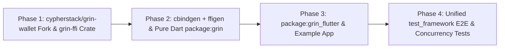

# Grin Rust FFI (`grin-ffi`), Pure Dart (`grin`), & Flutter (`grin_flutter`) Architecture Plan

## 1. Executive Summary & Architectural Decisions

This document defines the clean-room architecture and implementation plan (**Phases 1–4**) for **Grin** in `/home/user/src/grin`, incorporating all review resolutions from Rounds 1 and 2:

1. **Single Monorepo at `/home/user/src/grin`**:
   - Combines a Cargo workspace (`crates/grin-ffi`) and a **native Dart pub workspace** (`workspace: [packages/grin, packages/grin_flutter, packages/grin_flutter/example]`, **no Melos**).
   - All `pubspec.yaml` files declare `publish_to: none`.
2. **Thin `cypherstack/grin-wallet` Fork (`v5.5.1`) with `HttpSlateSender` Split, `tor` Gating, and `ring`+`webpki-roots` `rustls`**:
   - Rather than copying ~2,000 lines of `node_clients/http.rs` (455 lines), `client_utils/` (595 lines), and `lifecycle/` (873 lines) into `grin-ffi` and owning seed encryption forever, we maintain a minimal fork `cypherstack/grin-wallet` (branched from `mimblewimble/grin-wallet` `v5.5.1`, commit `f097811ee953fc81be4e70435d6ef845b6b2e8c9`, on branch `optional-tor-rustls`, fork commit `64d361f2e49fa6d544cf0236417da48a99444b2f`). The fork is a separate repository checked out locally at `/home/user/src/grin-wallet` (outside the monorepo; remote `cypherstack` = `ssh://git@git.cypherstack.com:222/sneurlax/grin-wallet.git`), and `grin-ffi` consumes it as a git dependency pinned by `rev`.
   - **Ungated `HttpSlateSender` Split**: In upstream `v5.5.1`, `TorSlateSender` ([tor.rs](file:///home/user/src/grin-wallet/impls/src/adapters/tor.rs)) was the only `SlateSender`, so gating all of `adapters/tor.rs` would remove HTTP/SOCKS5 slate sending. The fork extracts the `arti`/process-free logic (`check_other_version`, `post` via `Client` with optional `(SocketAddr, "socks5h://")` proxy, and `impl SlateSender`) into an ungated [`HttpSlateSender`](file:///home/user/src/grin-wallet/impls/src/adapters/http.rs) re-exported from `grin_wallet_impls`, while `TorSlateSender` (gated behind `#[cfg(feature = "tor")]`) delegates its HTTP/JSON-RPC logic to `HttpSlateSender`.
   - **Intentional TLS Stack (`reqwest/rustls-no-provider` + `ring` + `webpki-roots`)**: `reqwest` 0.13.4's default `rustls` feature pulls in `aws-lc-rs` (`aws-lc-sys` C/CMake build step on every target) and `rustls-platform-verifier` (which requires Android JNI initialization and bundled Java components); see `reqwest-0.13.4/Cargo.toml` L169-177 in the cargo registry (`rustls = ["__rustls-aws-lc-rs", "dep:rustls-platform-verifier", "__rustls"]`, `rustls-no-provider = ["dep:rustls-platform-verifier", "__rustls"]`). The fork's `rustls` feature enables `reqwest/rustls-no-provider`, `rustls` (`0.23`, `features = ["ring", "std", "tls12"]`), and `webpki-roots` (`1.0`), wired via `ClientBuilder::tls_backend_preconfigured(tls_config)` (`reqwest-0.13.4/src/async_impl/client.rs` L2192) in [`Client::configure_tls`](file:///home/user/src/grin-wallet/impls/src/client_utils/client.rs#L72-L90). Precisely: this drops `aws-lc-rs` from the graph, but `rustls-no-provider` still links `rustls-platform-verifier`; the preconfigured `ClientConfig` means the verifier is never constructed at runtime, which is what matters on Android (comment at `client.rs` L66-70).
   - **Complete `tor` Dependency Gating**: All `tor/`-only dependencies (`arti-client`, `tor-*`, `fs-mistrust`, `fslock-guard`, `sysinfo`, `timer`, `hyper`, `hyper-util`, `http-body-util`, `bytes`, `ed25519-dalek`, `regex`, `base64`, `url`, `sha2`) are gated under the `tor` feature (which stays in `default = ["tor", "native-tls"]` for upstream compatibility).
3. **Single Native-Assets Build Hook in `packages/grin` Using `hooks.user_defines.grin`**:
   - In Dart Native Assets (`code_assets` + `@ffi.Native`), a `@Native` asset (`assetId: 'package:grin/src/ffi/bindings.g.dart'`) **must** be emitted by the `hook/build.dart` of the package that declares it (`input.packageName == 'grin'`).
   - Therefore, **intentionally differing from the original prompt's framing where the Flutter package provides the native build**, the single `hook/build.dart` lives in `packages/grin` (using `native_prebuilt_hook` via git while `publish_to: none`; publishing the kit to `pub.dev` is tracked as a prerequisite before `package:grin` is ever published).
   - Uses the `hooks.user_defines.<package>` contract of `native_prebuilt_hook` at ref `85f7eb097604e5b99db3f90bccbcada3336836b8` (the same kit ref `wt/tor` and `wt/frostdart-kit` pin): a `build` user-define (`prebuilt`, `source`, `dev`, `cargo`; unset lets the hook pick) and prebuilts pinned by a committed `packages/grin/hook/prebuilt_hashes.json` (`dart/native_prebuilt_hook/lib/src/hook.dart` L53-68 and L156-165, `lib/src/prebuilt_hashes.dart` L8-13). Stack Wallet's currently generated pubspec (branch `security/rbf-history-authentication`, commit `b778525f0`, L374-388; `cypherstack/main` has no `pubspec.yaml`, and its `scripts/app_config/templates/pubspec.template.yaml` has no `hooks:` block) still uses the pre-kit keys `native_build`, `prebuilt_manifest_url` and `prebuilt_manifest_sha256` for `tor_ffi_plugin`, `flutter_libepiccash` and `flutter_libmwc`; those keys are not what the pinned kit reads, so `grin` follows the kit (Decision D1 in section 12). `grin` adds one package-specific boolean user-define, `test_utils`, honoured only by its `cargo` mode (`--features test-utils`). No fifth build system.
   - `packages/grin_flutter` holds Flutter-only glue: default platform wallet directory helper (`path_provider`), an app lifecycle observer (`AppLifecycleListener`), and full re-exports of `package:grin/grin.dart`.
4. **v1 Transport Scope (Outbound HTTP/Tor + Offline Slatepacks; No Inbound Listener)**:
   - Stack Wallet's `tor_ffi_plugin` (pinned at `e30ed0d386a40ee4a999aeaf57aafd32921d601e` in its pubspec L68-71; `rust/Cargo.toml` L18 at that ref: `arti-client = { version = "0.47.0", features = ["static", "onion-service-client"] }`) enables only the client side of onion services, not `onion-service-service`, so it cannot host an inbound v3 `.onion` hidden service.
   - Therefore, **inbound synchronous Tor/HTTP receive is out of scope for v1** (no `listener.rs` in `grin-ffi`).
   - v1 supports **outbound synchronous HTTP/Tor send** (`grin_tx_send_http` using `HttpSlateSender` over Stack Wallet's SOCKS5 proxy `socks5h://127.0.0.1:<port>` to `http://<56-char>.onion/v2/foreign` or `http(s)://...`) plus **asynchronous Slatepack send/receive/finalize (`S1 -> S2 -> S3` and `I1 -> I2 -> I3`)**. Inbound `.onion` hidden-service hosting (passing the wallet's `ed25519` Slatepack key to an upgraded `tor_ffi_plugin`) is tracked as a future v2 item.
5. **Implementation Scope**:
   - **Phases 1–4 only** (inside `/home/user/src/grin`). Phase 5 (`stack_wallet` integration) is documented as the target API contract and will be executed later on a separate `stack_wallet` branch.

---

## 2. Summary of Legacy Antipatterns Eliminated by This Design

| # | Legacy Antipattern in `flutter_libepiccash` / `flutter_libmwc` | Evidence | Replacement Design in `grin` |
|---|---|---|---|
| **1** | **Raw Pointer + Plaintext `SecretKey` Serialized in a JSON String Handle** | [ffi.rs](file:///home/user/src/stack_wallet/flutter_libepiccash-claude/rust/src/ffi.rs#L192-L200) (checkout `ceb9738`), [lib.rs](file:///home/user/src/stack_wallet/flutter_libmwc-codex/rust/src/lib.rs#L365) and [L402](file:///home/user/src/stack_wallet/flutter_libmwc-codex/rust/src/lib.rs#L402) (checkout `8acf950`; L98-105 is the related `ensure_wallet!` raw-pointer deref macro) | Monotonic `u64` opaque registry handle (`LazyLock<Mutex<HashMap<u64, Arc<WalletSession>>>>`). `SecretKey` keychain mask stays inside Rust memory (`Drop` zeroizes & closes `WalletBackend`). |
| **2** | **Process-Global `ChainTypes` Mutation Race** | [lib.rs](file:///home/user/src/stack_wallet/flutter_libmwc-codex/rust/src/lib.rs#L1376-L1380), [lib.rs](file:///home/user/src/stack_wallet/flutter_libmwc-codex/rust/src/lib.rs#L1985-L1989) | Per-thread `grin_core::global::set_local_chain_type` on every handle-based FFI entry, on `create`/`open` before `DefaultLCProvider`, on spawned HTTP helper threads, and via explicit `network: u8` on stateless FFI entries. |
| **3** | **Quadruple-Encoded JSON & Stringly-Typed Primitives** | [wallet.rs](file:///home/user/src/stack_wallet/flutter_libepiccash-claude/rust/src/wallet.rs#L195-L206), [lib.dart](file:///home/user/src/stack_wallet/flutter_libmwc-codex/lib/lib.dart#L287-L290) | Native `u64`/`u32`/`i64`/`u8`/`bool` C ABI arguments and flat JSON payloads decoded into strongly typed Dart models inside `package:grin`. |
| **4** | **String-Matched Errors & Uncaught Panics Across `extern "C"`** | [ffi.rs](file:///home/user/src/stack_wallet/flutter_libepiccash-claude/rust/src/ffi.rs), [lib.dart](file:///home/user/src/stack_wallet/flutter_libmwc-codex/lib/lib.dart#L476-L503) | Every `extern "C"` entrypoint wraps its body in `catch_unwind(AssertUnwindSafe(...))` and returns `#[repr(C)] GrinFfiResult { code, data, error }`. |
| **5** | **`CString` Allocator Mismatches & Memory Leaks** | [mwc.dart](file:///home/user/src/stack_wallet/flutter_libmwc-codex/lib/mwc.dart#L121-L474) | Rust exports `grin_ffi_result_free`, `grin_string_free`, and `grin_wallet_close_finalizer`. Dart uses `using((arena) { ... })` and a zeroing arena for secrets. |
| **6** | **IEEE-754 `double` Coin Balances** | [wallet.rs](file:///home/user/src/stack_wallet/flutter_libepiccash-claude/rust/src/wallet.rs#L608-L613) via `nano_to_deci(amount: u64) -> f64` at [wallet.rs L302-306](file:///home/user/src/stack_wallet/flutter_libepiccash-claude/rust/src/wallet.rs#L302-L306) | All monetary values across Rust (`u64`) and Dart (`BigInt` nanogrin, $1\text{ GRIN} = 10^9\text{ nanogrin}$) are exact integers. |
| **7** | **Manual Slate JSON Inspection in `stack_wallet`** | `analyzeSlatepack`: on `cypherstack/main` (`a156253bf`) in `lib/wallets/wallet/impl/mimblewimblecoin_wallet.dart` L397-494; on branch `security/rbf-history-authentication` (`b778525f0`) also in [epiccash_wallet.dart L328-411](file:///home/user/src/stack_wallet/stack_wallet/lib/wallets/wallet/impl/epiccash_wallet.dart#L328-L411) | `grin-ffi` inspects `slate.state` (`S1`/`S2`/`S3`/`I1`/`I2`/`I3`), `amount`, `fee`, `id`, `kernel_excess`, and `Slatepack` addresses in Rust. |
| **8** | **Blocked Worker Isolate Deadlock During Scan** | [epic_wallet.dart](file:///home/user/src/stack_wallet/flutter_libepiccash/flutter_libepiccash/lib/src/wallet/epic_wallet.dart#L392-L439) (checkout `43ff116`, branch `main`: `scanOutputs` polls `_worker.getScanProgress()` on a 500 ms timer) | Lock-free per-wallet `ScanProgressState` atomics in `WalletSession` read via `grin_wallet_scan_progress` while `grin_wallet_scan` runs in `Isolate.run`. |

---

## 3. Repository & Workspace Layout (`/home/user/src/grin`)

```text
/home/user/src/grin/
├── pubspec.yaml                        # Root Dart workspace (publish_to: none; workspace: [...]; NO melos)
├── analysis_options.yaml               # Shared strict lint rules
├── Cargo.toml                          # Root Rust workspace (members = ["crates/grin-ffi"])
├── Cargo.lock                          # Committed & locked (--locked enforced in CI and hooks)
├── rust-toolchain.toml                 # Pinned Rust toolchain (matching CI/Nix baseline)
├── flake.nix                           # Reproducible Nix build for release artifacts
├── flake.lock
├── tool/
│   ├── ci.dart                         # Pure-Dart workspace runner (cargo tree -d, analyze, format, test, nm check)
│   └── regen_bindings.dart             # Runs cargo build -> cbindgen -> dart run ffigen
├── crates/
│   └── grin-ffi/                       # Rust FFI wrapper crate (`libgrin_ffi.so` / `.dylib` / `.a` / `.dll`)
│       ├── Cargo.toml                  # name = "grin-ffi", crate-type = ["staticlib", "cdylib", "lib"]
│       ├── cbindgen.toml               # C header generation config
│       ├── build.rs                    # Emits target/include/grin_ffi.h via cbindgen
│       ├── src/
│       │   ├── lib.rs                  # Module exports (NO process-global chain_type init)
│       │   ├── error.rs                # GrinErrorCode enum, GrinFfiResult #[repr(C)], ffi_guard! (catch_unwind)
│       │   ├── handle.rs               # Session registry (u64 -> Arc<WalletSession>), OPEN_DIRS LMDB guard, Drop closes LMDB, set_local_chain_type
│       │   ├── logging.rs              # Idempotent grin_init_logs
│       │   ├── config.rs               # Wallet, Node, and SOCKS5 Proxy configuration
│       │   ├── lifecycle.rs            # create, open, close, close_finalizer, delete, change_password, mnemonic
│       │   ├── address.rs              # SlatepackAddress (grin1/tgrin1) <-> OnionV3Address (.onion)
│       │   ├── balance.rs              # Summary info (nanogrin u64) & chain tip height
│       │   ├── scan.rs                 # Cancellable chunked UTXO scanner + per-wallet atomic ScanProgressState
│       │   ├── sidecar.rs              # Atomic temp-rename JSON store for armored_slatepack & fallback counterparty_address
│       │   ├── slatepack.rs            # Armored Slatepack encode/decode (age X25519) & Slate V4 metadata extraction
│       │   ├── transaction.rs          # init_send, send_http (HttpSlateSender), receive, finalize, issue/process/finalize_invoice, repost, cancel, fee
│       │   ├── proof.rs                # Payment proof export & verification
│       │   └── test_support.rs         # #[cfg(any(test, feature = "test-utils"))] In-process test_framework (LocalWalletClient + WalletProxy)
│       └── tests/
│           ├── header_test.rs          # Verifies cbindgen header compiles under C11 & C++11 (-Wall -Wextra -pedantic)
│           └── ffi_e2e_test.rs         # Rust E2E & Mainnet+Testnet concurrency tests via test_support (impls::test_framework)
└── packages/
    ├── grin/                           # Pure Dart package (`name: grin`, publish_to: none, targets pub.dev/packages/grin)
    │   ├── pubspec.yaml                # Pure Dart (no flutter sdk); owns hook/build.dart & native_prebuilt_hook
    │   ├── ffigen.yaml                 # Generates @ffi.Native bindings with assetId: 'package:grin/src/ffi/bindings.g.dart'
    │   ├── hook/
    │   │   └── build.dart              # Single build hook using hooks.user_defines.grin (native_build, test_utils, prebuilt_*)
    │   ├── lib/
    │   │   ├── grin.dart               # Public barrel export
    │   │   └── src/
    │   │       ├── ffi/
    │   │       │   ├── bindings.g.dart # ffigen @ffi.Native generated bindings
    │   │       │   └── memory.dart     # Arena helpers, zeroing SecretArena, GrinFfiResult unwrapper
    │   │       ├── errors/
    │   │       │   └── grin_exception.dart # Sealed GrinException hierarchy mapped from GrinErrorCode
    │   │       ├── models/
    │   │       │   ├── grin_network.dart
    │   │       │   ├── grin_wallet_config.dart
    │   │       │   ├── grin_balance.dart
    │   │       │   ├── grin_slatepack.dart
    │   │       │   ├── grin_tx_log_entry.dart
    │   │       │   ├── grin_fee_estimate.dart
    │   │       │   ├── grin_payment_proof.dart
    │   │       │   └── grin_wallet_event.dart
    │   │       └── wallet/
    │   │           └── grin_wallet_client.dart # High-level GrinWalletClient (this-free Isolate.run + NativeFinalizer + streams)
    │   └── test/
    │       ├── mnemonic_address_test.dart
    │       ├── bounds_and_panic_test.dart
    │       ├── wallet_lifecycle_test.dart
    │       └── slatepack_e2e_test.dart # Funded S1->S2->S3, I1->I2->I3, & Mainnet+Testnet concurrency E2E test via test_framework
    └── grin_flutter/                   # Companion Flutter integration package (`name: grin_flutter`, publish_to: none)
        ├── pubspec.yaml                # resolution: workspace; depends on flutter, grin, path_provider
        ├── lib/
        │   ├── grin_flutter.dart       # Re-exports `package:grin/grin.dart` + GrinFlutter helpers
        │   └── src/
        │       ├── default_paths.dart  # Platform wallet directory resolution via path_provider
        │       └── lifecycle_observer.dart # AppLifecycleListener to cancel active scans on app detach/background
        ├── test/
        │   └── grin_flutter_test.dart
        └── example/
            ├── pubspec.yaml            # resolution: workspace; publish_to: none
            └── lib/main.dart           # Minimal Flutter smoke-test app
```

The `cypherstack/grin-wallet` fork (`v5.5.1` + submodule `grin` `v5.5.2`) is not part of this tree. It lives in its own repository at `/home/user/src/grin-wallet` (branch `optional-tor-rustls`) and is pulled in by `crates/grin-ffi/Cargo.toml` as a `rev`-pinned git dependency (see 4.1).

### 3.1 Why `packages/grin` Owns `hook/build.dart` Instead of `packages/grin_flutter`

> [!IMPORTANT]
> Although the original task description framed the companion Flutter package as providing the native library/build, **Dart Native Assets (`code_assets` + `@ffi.Native`) requires the package that declares `@DefaultAsset('package:grin/src/ffi/bindings.g.dart')` to own `hook/build.dart`**, because a build hook can only emit a `CodeAsset` for its own `input.packageName` (`grin`).
>
> Placing `hook/build.dart` in `packages/grin`:
> - Allows **both** pure Dart (`cd packages/grin && dart test`) and Flutter (`flutter test`, `flutter run`, `flutter build` in `grin_flutter/example` or `stack_wallet`) to automatically invoke `packages/grin/hook/build.dart` and bundle `libgrin_ffi`.
> - Avoids a fifth build system by using the `hooks.user_defines.<package>` contract of `native_prebuilt_hook` at `85f7eb0` (the kit's `build` user-define; the prebuilt release URL and per-file sha256 live in the package's committed `hook/prebuilt_hashes.json`, so the consumer pins nothing but the git ref of `grin` itself):
>   ```yaml
>   hooks:
>     user_defines:
>       grin:
>         build: prebuilt    # or source, dev, cargo; unset lets the hook pick
>         test_utils: false  # grin-specific; true only in this workspace's root pubspec so dart test gets --features test-utils (cargo mode only)
>   ```
> - Leaves `packages/grin_flutter` focused cleanly on Flutter-specific integration (default wallet storage directory via `path_provider`, `AppLifecycleListener` hooks, and re-exporting `package:grin/grin.dart`).

---

## 4. Layer 1: Rust Wrapper Crate (`grin-ffi`) Detailed Design

### 4.1 Thin `cypherstack/grin-wallet` Fork (`v5.5.1`) & Direct Dependencies

We fork `mimblewimble/grin-wallet` (`v5.5.1`, commit `f097811ee953fc81be4e70435d6ef845b6b2e8c9`, with submodule `grin` at `v5.5.2`, commit `dbaff34f7751ee23316fbbfe5806b47c546776ca`) into `cypherstack/grin-wallet`, a separate repository checked out at `/home/user/src/grin-wallet` on branch `optional-tor-rustls` (remote `cypherstack` = `ssh://git@git.cypherstack.com:222/sneurlax/grin-wallet.git`), with a clean, upstreamable diff in `impls/`:

1. **[`impls/Cargo.toml`](file:///home/user/src/grin-wallet/impls/Cargo.toml) (`tor` Feature Gating & Intentional TLS Stack)**:
   - `reqwest` 0.13.4's `rustls` feature pulls in `aws-lc-rs` (`aws-lc-sys` C/CMake cross-compile step) and configures `rustls-platform-verifier` by default (which on Android requires JNI initialization and bundling its Android Java component).
   - Instead, we use `reqwest/rustls-no-provider` combined with `rustls` (`0.23`, `features = ["ring", "std", "tls12"]`—reusing `ring 0.17` already in the dependency graph) and `webpki-roots` (`1.0`), and gate all `tor/`-only dependencies under `tor`:
     ```toml
     [features]
     default = ["tor", "native-tls"]
     native-tls = ["reqwest/native-tls"]
     rustls = ["reqwest/rustls-no-provider", "dep:rustls", "dep:webpki-roots"]
     tor = [
         "dep:ed25519-dalek",
         "dep:regex",
         "dep:timer",
         "dep:sysinfo",
         "dep:base64",
         "dep:url",
         "dep:arti-client",
         "dep:tor-rtcompat",
         "dep:fs-mistrust",
         "dep:fslock-guard",
         "dep:tor-hsservice",
         "dep:tor-hsrproxy",
         "dep:tor-keymgr",
         "dep:tor-llcrypto",
         "dep:tor-hscrypto",
         "dep:sha2",
         "dep:hyper",
         "dep:hyper-util",
         "dep:http-body-util",
         "dep:bytes",
     ]
     ```
2. **Preconfigured `rustls` in [`impls/src/client_utils/client.rs`](file:///home/user/src/grin-wallet/impls/src/client_utils/client.rs#L72-L90)**:
   - When `#[cfg(all(feature = "rustls", not(feature = "native-tls")))]` is active, `Client::configure_tls` constructs a `rustls::ClientConfig` backed by `rustls::crypto::ring::default_provider()` and `webpki_roots::TLS_SERVER_ROOTS`, passing it to `builder.tls_backend_preconfigured(tls_config)`. In `reqwest` 0.13.4, `tls_backend_preconfigured` selects `TlsBackend::BuiltRustls` directly, completely bypassing `rustls_platform_verifier` at runtime on Android/iOS/desktop.
3. **Splitting [`HttpSlateSender`](file:///home/user/src/grin-wallet/impls/src/adapters/http.rs) from [`TorSlateSender`](file:///home/user/src/grin-wallet/impls/src/adapters/tor.rs)**:
   - [`impls/src/adapters/http.rs`](file:///home/user/src/grin-wallet/impls/src/adapters/http.rs) defines the ungated `HttpSlateSender` (`HttpSlateSender::new`, `HttpSlateSender::with_socks_proxy`, `check_other_version`, `post`, and `impl SlateSender for HttpSlateSender`).
   - [`impls/src/adapters/tor.rs`](file:///home/user/src/grin-wallet/impls/src/adapters/tor.rs) (gated behind `#[cfg(feature = "tor")]` in [`adapters/mod.rs`](file:///home/user/src/grin-wallet/impls/src/adapters/mod.rs) and [`lib.rs`](file:///home/user/src/grin-wallet/impls/src/lib.rs)) keeps the `arti` / external Tor process management and delegates its HTTP/JSON-RPC methods to `HttpSlateSender`.
4. **Direct Dependencies in `crates/grin-ffi/Cargo.toml` (No `grin_wallet_controller` Dev-Dependency)**:
   - Because `use grin_core as core;` etc. in [`impls/src/lib.rs`](file:///home/user/src/grin-wallet/impls/src/lib.rs#L27-L31) are private aliases rather than `pub use` re-exports, `crates/grin-ffi/Cargo.toml` depends directly on `grin_wallet_impls` (`default-features = false, features = ["rustls"]`), `grin_wallet_libwallet`, `grin_wallet_config`, `grin_wallet_util`, `grin_core`, `grin_keychain`, `grin_chain`, `grin_store`, and `grin_util` from the exact same fork via one git source pinned by `rev` (Cargo fetches the fork's `grin` submodule for the `grin_*` node crates):
     ```toml
     grin_wallet_impls = { git = "ssh://git@git.cypherstack.com:222/sneurlax/grin-wallet.git", rev = "64d361f2e49fa6d544cf0236417da48a99444b2f", default-features = false, features = ["rustls"] }
     grin_wallet_libwallet = { git = "ssh://git@git.cypherstack.com:222/sneurlax/grin-wallet.git", rev = "64d361f2e49fa6d544cf0236417da48a99444b2f" }
     # ... same git + rev for grin_wallet_config, grin_wallet_util, grin_core, grin_keychain, grin_chain, grin_store, grin_util
     ```
   - No `path` dependencies on the fork are committed. For local iteration against an unpushed fork checkout, an uncommitted `.cargo/config.toml` `[patch."ssh://git@git.cypherstack.com:222/sneurlax/grin-wallet.git"]` may point the same crates at `/home/user/src/grin-wallet`; CI, Nix, and `Cargo.lock` always resolve the pinned `rev`.
   - **No `grin_wallet_controller` dev-dependency**: `grin_wallet_controller` depends on `grin_wallet_impls` with default features, which in `cargo test` would re-enable `tor` and `native-tls` via Cargo feature unification. Because `pub mod test_framework;` is already public in `grin_wallet_impls`, `grin-ffi` needs no wallet dev-dependencies at all.
   - **CI Duplicate Crate Gate (`cargo tree -d`)**: `tool/ci.dart` runs `cargo tree -d` and asserts that zero `grin_*` or `grin_secp256k1zkp` crates are duplicated.

### 4.2 Per-Thread Chain Type Isolation (`set_local_chain_type`)

> [!WARNING]
> In `grin_core::global` ([global.rs](file:///home/user/src/grin-wallet/grin/core/src/global.rs#L165-L207)), `get_chain_type()` checks the thread-local `CHAIN_TYPE: Cell<Option<ChainTypes>>` **first**, falling back to the set-once `GLOBAL_CHAIN_TYPE` only if the thread-local `CHAIN_TYPE` is `None`.
> Because Dart's `Isolate.run` executes closures on arbitrary Dart VM worker-pool threads, and because Stack Wallet can have `Mainnet` and `Floonet` (`Testnet`) wallets open simultaneously in the same process, **`grin-ffi` MUST NOT rely on process-global `GLOBAL_CHAIN_TYPE`**.
>
> Three source facts shape the rules below. `get_chain_type()` panics when neither the thread-local nor the global is set (`global.rs` L198-200), so every FFI entry that can reach consensus code must set the thread-local first. `is_testnet()` is true only for `ChainTypes::Testnet` (`global.rs` L472-477), so `UserTesting` and `AutomatedTesting` derive Mainnet-style keychains. The Slatepack HRP is `grin` for `Mainnet` and `tgrin` for every other chain type (`libwallet/src/slatepack/address.rs` L44-49), and `SlatepackAddress` parsing rejects the other network's HRP (L99-116, L263-265). The `ChainTypes` enum order is `AutomatedTesting, UserTesting, Testnet, Mainnet` (`global.rs` L114-123); the FFI `network: u8` mapping below is our own and does not depend on it.

1. **No Global Chain Type Init in `lib.rs`**:
   - `lib.rs` performs no global chain initialization.
2. **Wallet Creation & Opening Set Thread-Local `CHAIN_TYPE` Before `DefaultLCProvider`**:
   - `grin_wallet_create` and `grin_wallet_open` do not take an existing session handle, and [`DefaultLCProvider::open_wallet`](file:///home/user/src/grin-wallet/impls/src/lifecycle/default.rs#L253-L255) calls `wallet_seed.derive_keychain(global::is_testnet())`.
   - Therefore, both `grin_wallet_create` and `grin_wallet_open` parse `config.network` from `config_json` and call `grin_core::global::set_local_chain_type(chain_type)` **immediately at the start of the function**, before constructing or invoking `DefaultLCProvider`.
3. **Handle-Based Entrypoints Set Thread-Local `CHAIN_TYPE` via `get_session(handle)`**:
   - Every `WalletSession` stores its `pub chain_type: ChainTypes` (`Mainnet`, `Testnet`, `UserTesting`, or `AutomatedTesting`).
   - The registry lookup helper `get_session(handle: u64) -> Result<Arc<WalletSession>, GrinError>` calls `grin_core::global::set_local_chain_type(session.chain_type)` before returning the `Arc<WalletSession>`.
   - During UTXO scans, [`grin_wallet_libwallet::internal::scan::identify_utxo_outputs`](file:///home/user/src/grin-wallet/libwallet/src/internal/scan.rs#L71-L78) captures `let chain_type = global::get_chain_type();` on the caller thread and calls `global::set_local_chain_type(chain_type)` inside its `rayon::par_iter().map(...)` closure, propagating the wallet's `ChainTypes` to all Rayon worker threads.
4. **Spawned HTTP Helper Threads Propagate `CHAIN_TYPE`**:
   - Both [`Client::send_request`](file:///home/user/src/grin-wallet/impls/src/client_utils/client.rs#L292-L311) and [`HTTPNodeClient::get_outputs_from_node`](file:///home/user/src/grin-wallet/impls/src/node_clients/http.rs#L278-L289) spawn helper threads (`std::thread::spawn`) to run `RUNTIME.block_on(...)`. In our fork, both functions capture `let chain_type = crate::core::global::CHAIN_TYPE.with(|c| c.get());` on the calling thread and call `set_local_chain_type(ct)` inside the spawned thread before entering `rt.block_on(...)`.
5. **Stateless Entrypoints Take an Explicit `network: u8` Parameter**:
   - Stateless functions that depend on consensus/address parameters (`grin_address_validate`, `grin_slatepack_decode` when `handle == 0`) take `network: u8` (`0 = Mainnet`, `1 = Floonet/Testnet`, `2 = UserTesting`, `3 = AutomatedTesting`), validate the discriminant, and call `grin_core::global::set_local_chain_type(chain_type)` on the current thread before executing.

### 4.3 Outbound Synchronous HTTP / Tor Send (`grin_tx_send_http`) via `HttpSlateSender`

In v1, `grin_tx_send_http` uses `grin_wallet_impls::HttpSlateSender` (and the `SlateSender` trait) directly rather than hand-rolling JSON-RPC in `grin-ffi`:
1. If `recipient_address` is a `SlatepackAddress` (`grin1...` / `tgrin1...`), convert its Ed25519 public key into a v3 `.onion` URL via `OnionV3Address::from(&recipient_slatepack_addr).to_http_str()` (`"http://<56-char>.onion"`; `impl From<&SlatepackAddress> for OnionV3Address` at `libwallet/src/slatepack/address.rs` L128, `to_http_str` at `util/src/ov3.rs` L90). If it is already an `http://` or `https://` URL, use it directly.
2. Construct `HttpSlateSender`:
   - If the wallet session has `socks_proxy: Some(proxy_addr)`, call `HttpSlateSender::with_socks_proxy(&recipient_url, proxy_addr, timeout)?` (which routes via `socks5h://` so `.onion` resolution happens through Stack Wallet's Tor SOCKS5 proxy).
   - Otherwise (only allowed for clearnet `http(s)://`, never `.onion`), call `HttpSlateSender::new(&recipient_url, timeout)?`.
3. Call `owner::init_send_tx` (`S1`), call `sender.send_tx(&slate_s1, false)` to perform the `check_version` + `receive_tx` JSON-RPC handshake and receive the signed `S2` `Slate`, call `owner::tx_lock_outputs`, call `owner::finalize_tx` (`S3`), and broadcast via `owner::post_tx`.

### 4.4 Trimmed, Fault-Tolerant Sidecar (`crates/grin-ffi/src/sidecar.rs`)

Because `grin_wallet_libwallet::TxLogEntry` already persists `kernel_excess: Option<Commitment>` and `payment_proof: Option<StoredProofInfo>` (which stores `receiver_address` and `sender_address`), the sidecar file `<wallet_dir>/wallet_data/tx_metadata.json` only stores what `TxLogEntry` lacks:
```rust
#[derive(Serialize, Deserialize, Clone, Default)]
pub struct TxSidecarEntry {
    /// Latest armored S1/S2 or I1/I2 Slatepack string so the user can view/re-share
    /// an unfinished interactive transaction from the transaction details screen.
    pub armored_slatepack: Option<String>,
    /// Counterparty address (`grin1...` or `http://...`) for transactions that do not
    /// carry a StoredProofInfo (`payment_proof`).
    pub counterparty_address: Option<String>,
}
```
- **Atomic Rename & Non-Fatal Writes**:
  - Saved by writing to `<wallet_dir>/wallet_data/tx_metadata.json.tmp` (`File::sync_all`) and atomically renaming (`std::fs::rename`) over `tx_metadata.json`.
  - Sidecar reads and writes are best-effort (`if let Err(e) = sidecar.upsert(...) { log::warn!("Sidecar write failed: {e}"); }`) and **never** fail a transaction init, send, receive, or finalize operation.
  - When `grin_txs_get` builds each `GrinTxLogEntry` JSON object, `counterparty_address` is populated from `tx.payment_proof` first, falling back to `sidecar.counterparty_address`.

### 4.5 Session Registry, `Drop`-Based Close & Per-Directory LMDB Guard (`crates/grin-ffi/src/handle.rs`)

1. **Session Registry**:
   - `SESSION_REGISTRY: LazyLock<Mutex<HashMap<u64, Arc<WalletSession>>>>` maps non-zero monotonic `u64` handles (from an `AtomicU64` starting at 1, never reused) to sessions. `get_session(handle)` clones the `Arc<WalletSession>` out of the map, releases the lock, and sets the thread-local `CHAIN_TYPE` (4.2).
   - `grin_wallet_close` / `grin_wallet_close_finalizer` set `cancel_requested`, remove the `Arc` from the map, release the registry lock, and only then drop their `Arc`. `impl Drop for WalletSession` closes the `WalletBackend` (`lc_provider.close_wallet(None)`) and zeroizes `keychain_mask` when the last `Arc` drops (see 5.1). No LMDB work ever runs while the registry lock is held.
2. **Why Close Alone Is Not Enough (LMDB Double-Open)**:
   - Because Dart `Isolate.run` closures do not capture `this`, an orphaned in-flight operation can still hold a cloned `Arc<WalletSession>` after `grin_wallet_close` or `grin_wallet_close_finalizer` returns, so the LMDB environment stays open until that operation finishes.
   - LMDB forbids opening the same environment twice in one process. A `grin_wallet_open`, `grin_wallet_create`, or `grin_wallet_delete` on that directory during this window is unsafe (a second `Environment` on the same files, or `remove_dir_all` under a live mapping).
3. **`OPEN_DIRS` Guard**:
   - `OPEN_DIRS: LazyLock<Mutex<HashSet<PathBuf>>>` holds the canonicalized wallet data directory (`<wallet_dir>/wallet_data`, which contains `wallet.seed` and the LMDB `db/`) of every wallet whose backend may still be open, whether its session is registered or closed but still draining.
   - Membership is owned by an RAII `DirLease(PathBuf)`. `DirLease::acquire(dir)` locks `OPEN_DIRS`, fails with `GrinErrorCode::WalletBusy` if `dir` is already present, and otherwise inserts it. The lease is stored in `WalletSession`. At the end of `impl Drop for WalletSession`, after `close_wallet(None)` has returned and the backend's `Environment` has been dropped, the lease is released and the entry removed. If `open`/`create` fails after acquiring the lease (wrong password, corrupt seed, LMDB error), the lease drops on the error path after any partially opened backend.
   - `grin_wallet_open` and `grin_wallet_create` acquire the lease after `set_local_chain_type` and before constructing `DefaultLCProvider` or touching LMDB. `grin_test_create_wallet` (7.1) takes the same lease.
   - `grin_wallet_delete` first closes `handle` if non-zero (rejecting a handle whose session `data_dir` differs from `wallet_dir`), then acquires a lease on the directory itself for the duration of `remove_dir_all`. If the directory is still held (a draining orphaned operation), it returns `WalletBusy` and deletes nothing. Holding the lease during deletion means a concurrent `open`/`create` also gets `WalletBusy`, so there is no check-then-delete race.
   - `OPEN_DIRS` and `SESSION_REGISTRY` are never held at the same time, and both are locked with `lock().unwrap_or_else(PoisonError::into_inner)` because `Drop` may run during unwinding.
4. **Canonicalization**:
   - Keys are `std::fs::canonicalize`d so `dir`, `dir/`, `dir/./`, and symlinked paths map to one entry. On Windows this yields `\\?\` verbatim paths, which is fine because the key is only compared, never displayed.
   - `canonicalize` fails on a path that does not exist yet. `grin_wallet_create` therefore calls `std::fs::create_dir_all(<wallet_dir>/wallet_data)` before canonicalizing and acquiring the lease (`DefaultLCProvider` would create it anyway). `grin_wallet_open` maps a missing directory to its existing not-found error, and `grin_wallet_delete` treats a missing directory as already deleted.
5. **`GrinErrorCode::WalletBusy`**:
   - A new `GrinErrorCode` variant with a fresh discriminant appended after the existing codes (discriminants are append-only because Dart maps them by value). There is no separate `WalletAlreadyOpen` code: `WalletBusy` covers both "already open and registered by another client" and "closed but still draining", since in both cases the directory is held by a live `WalletSession` and the caller's only safe action is to wait or reuse the existing client. The error JSON carries `{"wallet_dir": "<canonical path>"}`.
   - Dart maps it to `GrinWalletBusyException` in the sealed `GrinException` hierarchy (5.1).

### 4.6 Complete `grin-ffi` Exported C ABI Surface (35 Standard Functions + 3 `test-utils` Functions)

Every FFI function (except the `void` destructors `grin_ffi_result_free`, `grin_string_free`, and `grin_wallet_close_finalizer`) returns `#[repr(C)] GrinFfiResult { code: i32, data: *mut c_char, error: *mut c_char }` and wraps its body in `ffi_guard!` (`std::panic::catch_unwind`).

| # | Category | C Function Signature | Description |
|---:|---|---|---|
| 1 | **Memory, Logging & Diagnostics** | `grin_ffi_result_free(res: GrinFfiResult)` | Frees `res.data` and `res.error` allocated via `CString::into_raw()`. |
| 2 | | `grin_string_free(ptr: *mut c_char)` | Frees a single Rust-allocated C string. |
| 3 | | `grin_init_logs(log_level: *const c_char) -> GrinFfiResult` | Idempotent (`Once`) Rust logger initialization (`trace`/`debug`/`info`/`warn`/`error`). |
| 4 | **Stateless Utilities** | `grin_mnemonic_generate(word_count: u32) -> GrinFfiResult` | Generates a 12, 15, 18, 21, or 24-word BIP39 mnemonic (`grin_keychain::mnemonic::from_entropy`). |
| 5 | | `grin_mnemonic_validate(mnemonic: *const c_char) -> GrinFfiResult` | Validates BIP39 mnemonic words & checksum (`grin_keychain::mnemonic::to_entropy`). |
| 6 | | `grin_address_validate(address: *const c_char, network: u8) -> GrinFfiResult` | Sets thread-local `ChainTypes` from `network`, validates `grin1...` / `tgrin1...` `SlatepackAddress` (or `.onion` / `http(s)://`), and returns normalized address + v3 `.onion` URL. |
| 7 | | `grin_node_test_connection(node_url: *const c_char, api_secret: *const c_char, socks_proxy: *const c_char) -> GrinFfiResult` | Queries `/v2/foreign` (`get_version` + `get_tip`) over optional `socks5h://host:port`. |
| 8 | **Wallet Lifecycle** | `grin_wallet_create(config_json: *const c_char, mnemonic: *const c_char, password: *const c_char) -> GrinFfiResult` | Sets thread-local `ChainTypes` from `config_json` **before** `DefaultLCProvider`, creates and canonicalizes `<wallet_dir>/wallet_data`, acquires its `OPEN_DIRS` lease (`WalletBusy` if held, 4.5), creates encrypted `wallet.seed` and `WalletBackend`, registers session, returns `{"handle": u64}`. |
| 9 | | `grin_wallet_open(config_json: *const c_char, password: *const c_char) -> GrinFfiResult` | Sets thread-local `ChainTypes` from `config_json` **before** `DefaultLCProvider`, acquires the canonical data directory's `OPEN_DIRS` lease (`WalletBusy` if the directory is held by a registered or still-draining session, 4.5), opens wallet, stores `keychain_mask` in Rust session, returns `{"handle": u64}`. |
| 10 | | `grin_wallet_close(handle: u64) -> GrinFfiResult` | Sets `scan_state.cancel_requested = true` and removes `Arc<WalletSession>` from `SESSION_REGISTRY`. Actual `WalletBackend::close()`, mask zeroization, and release of the `OPEN_DIRS` lease occur in `impl Drop for WalletSession` when the last `Arc<WalletSession>` drops (immediately, on the normal Dart path where the op queue was drained first). |
| 11 | | `grin_wallet_close_finalizer(token: *mut c_void)` | `void (*)(void*)` callback for Dart's `NativeFinalizer`. Casts `token as usize as u64`, cancels any scan, and removes the session from `SESSION_REGISTRY` (dropping the last `Arc<WalletSession>` once no `Isolate.run` call holds it). Until then the directory stays in `OPEN_DIRS`, so a reopen gets `WalletBusy`. |
| 12 | | `grin_wallet_delete(wallet_dir: *const c_char, handle: u64) -> GrinFfiResult` | Closes `handle` if non-zero/open, then acquires the directory's `OPEN_DIRS` lease and deletes `<wallet_dir>/wallet_data` while holding it. Returns `WalletBusy` without deleting anything if an orphaned operation still holds the session. |
| 13 | | `grin_wallet_change_password(handle: u64, old_pw: *const c_char, new_pw: *const c_char) -> GrinFfiResult` | Re-encrypts `wallet.seed` via `DefaultLCProvider::change_password`. |
| 14 | | `grin_wallet_get_mnemonic(handle: u64, password: *const c_char) -> GrinFfiResult` | Decrypts `wallet.seed` and returns the BIP39 recovery phrase. |
| 15 | | `grin_wallet_update_network(handle: u64, node_url: *const c_char, api_secret: *const c_char, socks_proxy: *const c_char) -> GrinFfiResult` | Updates the session's `HTTPNodeClient` (including SOCKS5 proxy) without reopening LMDB. |
| 16 | **Address & Chain** | `grin_wallet_get_address(handle: u64, derivation_index: u32) -> GrinFfiResult` | Returns `{"slatepack_address": "grin1...", "onion_v3_url": "http://...onion", "index": u32}`. |
| 17 | | `grin_wallet_get_chain_height(handle: u64) -> GrinFfiResult` | Queries node tip height via configured proxy, returns `{"height": u64}`. |
| 18 | **Sync, Scan & Balances** | `grin_wallet_get_balance(handle: u64, refresh_from_node: bool, min_confirms: u64) -> GrinFfiResult` | Calls `owner::retrieve_summary_info`, returns exact `u64` nanogrin fields (`total`, `spendable`, `awaiting_confirmation`, `awaiting_finalization`, `immature`, `locked`, `reverted`, `last_confirmed_height`). |
| 19 | | `grin_wallet_scan(handle: u64, start_height: u64, delete_unconfirmed: bool) -> GrinFfiResult` | Runs chunked UTXO scan (`internal::scan::scan`) updating `ScanProgressState` atomics and checking `cancel_requested` between batches. Non-destructive to `TxLogEntry` history! |
| 20 | | `grin_wallet_scan_progress(handle: u64) -> GrinFfiResult` | **Lock-free**: reads `ScanProgressState` atomics (`is_scanning`, `scanned_height`, `tip_height`, `progress_pct`). |
| 21 | | `grin_wallet_scan_cancel(handle: u64) -> GrinFfiResult` | **Lock-free**: sets `scan_state.cancel_requested = true`. |
| 22 | **Transactions & Slatepacks** | `grin_tx_estimate_fee(handle: u64, amount: u64, min_confirms: u64, selection_strategy_is_all: bool, amount_includes_fee: bool) -> GrinFfiResult` | Returns `{"fee": u64, "net_amount": u64, "inputs_count": u32}` or `GrinErrorCode::InsufficientFunds` with structured `{"required": u64, "available": u64}`. |
| 23 | | `grin_txs_get(handle: u64, refresh_from_node: bool) -> GrinFfiResult` | Calls `owner::retrieve_txs` + joins sidecar `armored_slatepack` and fallback `counterparty_address`. |
| 24 | | `grin_slatepack_decode(handle: u64, network: u8, armored_slatepack: *const c_char, secret_index: u32) -> GrinFfiResult` | Decodes unencrypted or `age`-encrypted Slatepack, parses `Slate` V4 (`id`, `state`, `amount`, `fee` from `fee_fields`, `kernel_excess` computed with `Slate::calc_excess` (`slate.rs` L631) when the slate carries a kernel, else null, `sender`, `recipient`, `ttl_cutoff_height`). `SlateState` also has an `Unknown` variant for pre-V4 slates (`slate.rs` L138-152), which is reported as `"Unknown"`. Uses `network` when `handle == 0`. |
| 25 | | `grin_tx_init_send(handle: u64, args_json: *const c_char) -> GrinFfiResult` | Calls `owner::init_send_tx` + `owner::tx_lock_outputs` + `owner::create_slatepack_message`, saves sidecar metadata, returns `GrinSlatepack` JSON (`S1`). |
| 26 | | `grin_tx_send_http(handle: u64, args_json: *const c_char) -> GrinFfiResult` | Outbound synchronous send to `grin1...` (`.onion/v2/foreign`) or `http(s)://...` via `HttpSlateSender`: `init_send_tx` -> `HttpSlateSender::send_tx` (`check_version` + `receive_tx`) -> `tx_lock_outputs` -> `finalize_tx` -> `post_tx`. |
| 27 | | `grin_tx_receive_slatepack(handle: u64, armored_s1: *const c_char, message: *const c_char) -> GrinFfiResult` | Verifies `S1`, calls `foreign::receive_tx`, encodes `S2` Slatepack, updates sidecar, returns `GrinSlatepack` JSON (`S2`). |
| 28 | | `grin_tx_finalize_slatepack(handle: u64, armored_s2: *const c_char, broadcast: bool, fluff: bool) -> GrinFfiResult` | Verifies `S2`, calls `owner::finalize_tx` (`S3`), optionally broadcasts via `owner::post_tx`, updates sidecar, returns `GrinSlatepack` JSON (`S3`). |
| 29 | **Invoices, Repost, Cancel & Proofs** | `grin_tx_issue_invoice(handle: u64, args_json: *const c_char) -> GrinFfiResult` | Calls `owner::issue_invoice_tx` (`I1`) + `owner::create_slatepack_message`, saves sidecar, returns `GrinSlatepack` JSON (`I1`). |
| 30 | | `grin_tx_process_invoice(handle: u64, armored_i1: *const c_char, args_json: *const c_char) -> GrinFfiResult` | Verifies `I1`, calls `owner::process_invoice_tx` **followed immediately by `owner::tx_lock_outputs`** (since `process_invoice_tx` does not lock inputs itself) + `owner::create_slatepack_message`, returns `GrinSlatepack` JSON (`I2`). |
| 31 | | `grin_tx_finalize_invoice(handle: u64, armored_i2: *const c_char, broadcast: bool, fluff: bool) -> GrinFfiResult` | Verifies `I2`, calls `foreign::finalize_tx` (`I3`), optionally broadcasts via `owner::post_tx`, returns `GrinSlatepack` JSON (`I3`). |
| 32 | | `grin_tx_repost(handle: u64, tx_id: i64, slate_id: *const c_char, fluff: bool) -> GrinFfiResult` | Calls `owner::get_stored_tx` + `owner::post_tx` to re-broadcast a finalized transaction that hasn't confirmed. |
| 33 | | `grin_tx_cancel(handle: u64, tx_id: i64, slate_id: *const c_char) -> GrinFfiResult` | Calls `owner::cancel_tx` by `tx_id` or `slate_id`, unlocking inputs. |
| 34 | | `grin_payment_proof_export(handle: u64, tx_id: i64, slate_id: *const c_char) -> GrinFfiResult` | Calls `owner::retrieve_payment_proof` and returns `PaymentProof` JSON. |
| 35 | | `grin_payment_proof_verify(handle: u64, proof_json: *const c_char) -> GrinFfiResult` | Calls `owner::verify_payment_proof` and returns `{"is_sender": bool, "is_recipient": bool}`. |

*(Total standard exported C ABI functions: **35**. When compiled with `--features test-utils`, 3 additional test-only functions are exported: `grin_test_panic` (intentionally panics inside `ffi_guard!` so `dart test` can check `GrinErrorCode::InternalPanic`), `grin_test_create_wallet`, and `grin_test_mine_blocks`. They are exported for `dart test`, and the release pipeline verifies via `nm` that the Nix-built artifacts listed in the prebuilt manifest export zero `grin_test_*` symbols (7.2).)*

---

## 5. Layer 2: Pure Dart Package (`packages/grin` -> `GrinWalletClient`)

### 5.1 Naming Convention (`GrinWalletClient`), `this`-Free `Isolate.run` Closures, & Safe Finalization

1. **Consistent Naming**:
   - Following Stack Wallet's convention where `<Coin>Wallet` (`GrinWallet`) is the `stack_wallet` subclass of `Wallet<Grin>`, the client class in `package:grin` is named **`GrinWalletClient`** everywhere (`packages/grin/lib/src/wallet/grin_wallet_client.dart`).
2. **Keeping `Isolate.run` Closures Strictly Free of `this`**:
   - `GrinWalletClient` implements `Finalizable` (with a `static final NativeFinalizer _finalizer = NativeFinalizer(bindings.addresses.grin_wallet_close_finalizer)`) and owns a `final StreamController<GrinWalletEvent> _events = StreamController.broadcast()`.
   - Because Dart `Isolate.run` rejects closures that capture a `Finalizable` instance or a `StreamController`, **every method on `GrinWalletClient` extracts `final int handle = _handle;` into a local variable before invoking a top-level static helper inside `Isolate.run`**:
     ```dart
     Future<GrinBalance> getBalance({bool refreshFromNode = false}) {
       _ensureOpen();
       final int handle = _handle;
       final int minConfirms = _config.minimumConfirmations;
       return _enqueueWalletOp(
         () => Isolate.run(() => _getBalanceInIsolate(handle, refreshFromNode, minConfirms)),
       );
     }

     static GrinBalance _getBalanceInIsolate(int handle, bool refreshFromNode, int minConfirms) {
       final jsonStr = unwrapFfiResult(
         bindings.grin_wallet_get_balance(handle, refreshFromNode, minConfirms),
       );
       return GrinBalance.fromJson(jsonDecode(jsonStr) as Map<String, dynamic>);
     }
     ```
3. **Zero-Allocation `NativeFinalizer` Token & `Drop`-Based Backend Cleanup**:
   - Because session handles are non-zero monotonic `u64`s (which fit in a 64-bit pointer address), no `Box<u64>` heap token is allocated. `GrinWalletClient` attaches `_finalizer.attach(this, Pointer<Void>.fromAddress(handle), detach: this)` directly, and `grin_wallet_close_finalizer(token: *mut c_void)` recovers `let handle = token as usize as u64;`.
   - Because `Isolate.run` closures do not capture `this`, if user code drops its last reference to `GrinWalletClient` without `await`ing an in-flight `Isolate.run` Future, GC could invoke `grin_wallet_close_finalizer` while the worker isolate still holds a cloned `Arc<WalletSession>`.
   - To make this completely race-free:
     - `grin_wallet_close(handle)` and `grin_wallet_close_finalizer(token)` **only** set `session.scan_state.cancel_requested.store(true, Ordering::SeqCst)` and remove the `Arc<WalletSession>` from `SESSION_REGISTRY`.
     - Closing the `WalletBackend` (`lc_provider.close_wallet(None)`) and zeroizing `keychain_mask` happen inside **`impl Drop for WalletSession`**, which runs deterministically when the **last** `Arc<WalletSession>` reference drops!
     - Because the backend can outlive `grin_wallet_close` on this path, the wallet's data directory stays in `OPEN_DIRS` until that `Drop` runs, and `open`/`create`/`delete` on it return `WalletBusy` in the meantime (4.5).
4. **Ordered `close()`: Reject, Drain, Detach, Close**:
   - `GrinWalletClient.close()` is idempotent (a second call returns the same pending `Future`) and runs in this order:
     1. Set `_closed = true`, so `_ensureOpen()` throws `StateError` and no new operation can be enqueued.
     2. Call `grin_wallet_scan_cancel(handle)` directly (lock-free, not queued) so a running scan stops at its next batch boundary.
     3. Await the tail of the serialized `_enqueueWalletOp` queue, ignoring its errors (each caller already received its own result).
     4. `_finalizer.detach(this)`.
     5. Call `grin_wallet_close(handle)` via `Isolate.run` with `handle` as a local (it may run the final `Drop`, which closes LMDB), then close `_events`.
   - Because the queue is drained before step 5, no operation from this client still holds an `Arc<WalletSession>`. The registry's `Arc` is the last one, `Drop` runs inside `grin_wallet_close`, and the `OPEN_DIRS` entry is gone before `close()` completes. A reopen of the same directory after `await client.close()` therefore never sees `WalletBusy`. Only the GC-finalizer path (a client dropped without `close()` while an operation is in flight) can reach the busy state.
5. **`WalletBusy` in Dart (Surfaced, Not Retried)**:
   - `GrinErrorCode::WalletBusy` maps to `GrinWalletBusyException` (carrying `walletDir`) in the sealed `GrinException` hierarchy (`errors/grin_exception.dart`).
   - `GrinWalletClient.open`, `create`, and `delete` surface it to the caller without automatic retry. The orphaned operation that holds the directory may be a long HTTP send or a scan between batches, so a bounded retry would mostly hide a leaked client instead of fixing it. Callers such as `stack_wallet` decide whether to retry, reuse an existing client, or show an error.

---

## 6. Layer 3: Companion Flutter Package (`packages/grin_flutter`)

Because `packages/grin/hook/build.dart` already builds/downloads and bundles `libgrin_ffi` for all Dart and Flutter targets, `packages/grin_flutter` is a lightweight Flutter package (`resolution: workspace`, `publish_to: none`) that provides:
1. **Re-exports**: `export 'package:grin/grin.dart';`
2. **Default Platform Wallet Directory Helper (`GrinFlutter.defaultWalletDirectory(String walletId)`)**:
   - Uses `path_provider` (`getApplicationDocumentsDirectory()` / `getApplicationSupportDirectory()`) to compute the canonical per-wallet directory on Android, iOS, macOS, Linux, and Windows (avoiding persisting absolute iOS container UUID paths in secure storage!).
3. **App Lifecycle Observer (`GrinLifecycleObserver`)**:
   - Wraps Flutter's `AppLifecycleListener` to optionally cancel in-flight background scans (`client.cancelScan()`) when the mobile app transitions to `AppLifecycleState.detached` or `paused`.

---

## 7. Layer 4: Unified End-to-End Testing Strategy (Phase 4)

A wallet with 0 balance cannot initiate an `S1` send (`init_send_tx` fails with `InsufficientFunds`). Rather than maintaining two separate test harnesses, **both Rust integration tests and Dart E2E tests use a single unified harness (`crates/grin-ffi/src/test_support.rs`) built on `grin_wallet_impls::test_framework` (`LocalWalletClient` and `WalletProxy` over a real in-process `grin_chain`)**:

### 7.1 Single Test Harness (`impls::test_framework` Behind `test-utils`)
- `grin_wallet_impls` already exports `pub mod test_framework;` (`LocalWalletClient`, `WalletProxy`, `award_blocks_to_wallet`) as part of our normal dependency on `grin_wallet_impls`.
- In `crates/grin-ffi/src/test_support.rs` (compiled under `#[cfg(any(test, feature = "test-utils"))]`), we manage an in-process `WalletProxy<DefaultLCProvider<LocalWalletClient, ExtKeychain>, LocalWalletClient, ExtKeychain>` backed by a real temporary `grin_chain::Chain` (`ChainTypes::AutomatedTesting`, where `COINBASE_MATURITY = 3` blocks).
- No `MockNodeClient` and no `mock://local` magic URL exist in production code. Instead, test wallets connected to the in-process `WalletProxy` are created exclusively via two `#[cfg(feature = "test-utils")]` FFI exports:
  1. `grin_test_create_wallet(chain_dir: *const c_char, wallet_dir: *const c_char, client_id: *const c_char, network: u8, mnemonic: *const c_char, password: *const c_char) -> GrinFfiResult`: Initializes/attaches to the shared `WalletProxy` in `chain_dir`, registers a `LocalWalletClient` for `client_id`, creates/opens the wallet on the requested `network` (acquiring the same `OPEN_DIRS` lease as `grin_wallet_open`, 4.5), and returns `{"handle": u64}`.
  2. `grin_test_mine_blocks(handle: u64, count: u64) -> GrinFfiResult`: Calls `test_framework::award_blocks_to_wallet` to mine `count` real blocks (with Cuckatoo10 PoW and coinbase rewards) directly to `handle`'s wallet on the shared in-process `Chain`.
- `test_support.rs` also exposes a plain Rust (non-`extern "C"`, so not an exported symbol) helper `retain_session(handle: u64) -> Arc<WalletSession>` that clones a session's `Arc` out of `SESSION_REGISTRY`, letting Rust tests simulate an orphaned in-flight operation deterministically.

### 7.2 How `dart test` Enables `test-utils` & Release Binary Verification
- **Enabling `test-utils` in `dart test`**:
  - `packages/grin/hook/build.dart` reads `input.userDefines['test_utils']` (from `hooks.user_defines.grin.test_utils` in the root workspace `pubspec.yaml`).
  - When `test_utils: true` is set, `hook/build.dart` passes `--features test-utils` to `cargo build`.
  - Because `test_utils: true` is set in the workspace root `pubspec.yaml`, it applies to every package build resolved from this workspace, including `packages/grin_flutter/example` (`flutter run` / `flutter build`), so those binaries export `grin_test_*`. That is acceptable for development: example and workspace builds are never release artifacts. `stack_wallet` consumes `grin` from its own root `pubspec.yaml`, where `hooks.user_defines.grin.test_utils` is unset, so its source builds compile without `test-utils`.
- **Release Binary Symbol Verification (`nm` Gate)**:
  - Release builds (Nix `flake.nix` and `hook/build.dart` when `test_utils` is unset/`false`) compile `grin-ffi` **without** `test-utils`.
  - The authoritative gate is a release-pipeline step that runs `nm -g` / `llvm-nm` on the exact Nix-built `libgrin_ffi.{so,dylib,a,dll}` files the published prebuilt manifest points to (the same files whose sha256 go into `manifest.json`), and asserts **zero `grin_test_*` symbols** in each before the manifest is generated and uploaded. A failure blocks the release.
  - `tool/ci.dart` additionally runs the same check on `hook/build.dart` output built with `test_utils` unset. That catches regressions early but does not replace the release-artifact check, since the hook output is not what `native_build: prebuilt` consumers download.

### 7.3 Test Suites (Rust & Dart)
1. **C/C++ Header Verification (`crates/grin-ffi/tests/header_test.rs`)**:
   - Compiles `target/include/grin_ffi.h` under both C11 and C++11 (`-Wall -Wextra -pedantic`).
2. **Funded `S1 -> S2 -> S3` & `I1 -> I2 -> I3` E2E Tests (`ffi_e2e_test.rs` & `slatepack_e2e_test.dart`)**:
   - Creates Alice and Bob via `grin_test_create_wallet`, mines 5 blocks to Alice via `grin_test_mine_blocks` (maturing coinbase outputs since `AUTOMATED_TESTING_COINBASE_MATURITY = 3`), and runs:
     - Encrypted Slatepack send (`S1 -> S2 -> S3`), broadcast (`post_tx` mines a block in `WalletProxy`), and scan confirmation.
     - Encrypted Invoice flow (`I1 -> I2 -> I3`), verifying that `grin_tx_process_invoice` locks Alice's inputs immediately (attempting a concurrent second spend of the same output before `I3` returns `InsufficientFunds`), followed by `grin_tx_finalize_invoice` and broadcast.
     - Transaction cancellation (`grin_tx_cancel`), repost (`grin_tx_repost`), and payment proof export/verification.
3. **Concurrent Mainnet + Testnet Multi-Wallet Isolation Test**:
   - Opens a `Mainnet` wallet and a `Testnet` (`Floonet`) wallet simultaneously in the same process and runs operations on both concurrently across worker threads / `Isolate.run` futures, verifying that:
     - The `Mainnet` wallet always derives `grin1...` addresses and Mainnet BIP32 keys (`is_testnet() == false`).
     - The `Testnet` wallet always derives `tgrin1...` addresses and Testnet BIP32 keys (`is_testnet() == true`).
     - Concurrent scans, balance refreshes, and Slatepack operations never cross-contaminate thread-local `CHAIN_TYPE`.
4. **LMDB Double-Open Guard (`WalletBusy`) Tests**:
   - Rust (`ffi_e2e_test.rs`): create and open a wallet, take `test_support::retain_session(handle)` to stand in for a long in-flight operation, then call `grin_wallet_close(handle)` (and, in a second case, `grin_wallet_close_finalizer`). Immediately afterwards, `grin_wallet_open`, `grin_wallet_create`, and `grin_wallet_delete` on the same directory (also via a non-normalized `dir/./` path and a symlink, to exercise canonicalization) all return `WalletBusy`, and `wallet_data` still exists. After the retained `Arc` drops, `grin_wallet_open` succeeds with a new handle and the wallet's data is intact, and `grin_wallet_delete` succeeds.
   - Rust: a second `grin_wallet_open` on a directory that is open and registered returns `WalletBusy`, and a failed open (wrong password) leaves no `OPEN_DIRS` entry behind.
   - Dart (`wallet_lifecycle_test.dart`): start a scan or `getBalance`, call `await client.close()` while it is in flight, and verify that `close()` completes only after the operation settles, that new calls throw `StateError`, and that an immediate `GrinWalletClient.open` on the same directory succeeds without `GrinWalletBusyException`.

---

## 8. Phased Implementation Plan (Phases 1–4)



### Phase 1: `cypherstack/grin-wallet` Fork & `grin-ffi` Rust Crate
1. Apply and verify the thin `grin-wallet` `v5.5.1` fork diff in `/home/user/src/grin-wallet/impls` (separate repo, branch `optional-tor-rustls`, pushed to remote `cypherstack`):
   - Split ungated `HttpSlateSender` (`impls/src/adapters/http.rs`) from `#[cfg(feature = "tor")]` `TorSlateSender`.
   - Gate `tor/` and all 20 `tor`-only crates under the `tor` feature.
   - Add `rustls` (`reqwest/rustls-no-provider` + `ring` + `webpki-roots` via `tls_backend_preconfigured`) and propagate thread-local `CHAIN_TYPE` into `client_utils/client.rs` and `node_clients/http.rs` spawned threads.
2. Initialize `/home/user/src/grin` Cargo workspace (`Cargo.toml`, `rust-toolchain.toml`, `crates/grin-ffi/Cargo.toml`) depending directly on `grin_wallet_impls` (`default-features = false, features = ["rustls"]`), `grin_wallet_libwallet`, `grin_wallet_config`, `grin_wallet_util`, `grin_core`, `grin_keychain`, `grin_chain`, `grin_store`, and `grin_util`, all as git dependencies on `ssh://git@git.cypherstack.com:222/sneurlax/grin-wallet.git` pinned to `rev = "64d361f2e49fa6d544cf0236417da48a99444b2f"`.
3. Implement `error.rs` (`GrinErrorCode` including the appended `WalletBusy` discriminant, `GrinFfiResult`, `ffi_guard!`), `handle.rs` (`SESSION_REGISTRY`, `OPEN_DIRS` + `DirLease` keyed by the canonical data directory, `WalletSession` with `Drop` closing `WalletBackend` and then releasing its lease, per-thread `set_local_chain_type`, lock-free `ScanProgressState`), `logging.rs`, and `sidecar.rs`.
4. Implement all **35** standard C ABI functions (plus the 3 `#[cfg(feature = "test-utils")]` exports, including `grin_test_panic`, in `test_support.rs` using `grin_wallet_impls::test_framework`).
5. Configure `build.rs` + `cbindgen.toml` to generate `target/include/grin_ffi.h`.

### Phase 2: Pure Dart Package (`packages/grin`) & Build Hook
1. Create root `pubspec.yaml` (`workspace: [packages/grin, packages/grin_flutter, packages/grin_flutter/example]`, `publish_to: none`, `hooks.user_defines.grin`, no Melos).
2. Create `packages/grin/pubspec.yaml` (`name: grin`, `publish_to: none`, `resolution: workspace`) and `packages/grin/hook/build.dart` supporting `hooks.user_defines.grin` (`native_build: source | prebuilt`, `test_utils`, `prebuilt_manifest_url`, `prebuilt_manifest_sha256`, plus Apple `-DMDB_USE_POSIX_MUTEX=1 -DMDB_USE_ROBUST=0` and Android NDK clang wrapper resolution).
3. Configure `packages/grin/ffigen.yaml` (`ffi-native: asset-id: 'package:grin/src/ffi/bindings.g.dart'`) with `symbol-address` enabled for `grin_wallet_close_finalizer`, and generate `lib/src/ffi/bindings.g.dart`.
4. Implement `memory.dart` (`usingSecretArena`, `unwrapFfiResult`), `grin_exception.dart` (including `GrinWalletBusyException`), typed `BigInt` nanogrin domain models, and `GrinWalletClient` (with `this`-free static `Isolate.run` helpers, `Pointer<Void>.fromAddress(handle)` `NativeFinalizer`, ordered `close()` that rejects new ops, drains the op queue, detaches the finalizer, then calls `grin_wallet_close`, and `Stream<GrinWalletEvent>`).

### Phase 3: Companion Flutter Package (`packages/grin_flutter`) & Example App
1. Create `packages/grin_flutter/pubspec.yaml` (`name: grin_flutter`, `publish_to: none`, `resolution: workspace`).
2. Implement `lib/grin_flutter.dart` (re-exporting `package:grin/grin.dart`, `GrinFlutter.defaultWalletDirectory`, and `GrinLifecycleObserver`).
3. Create `packages/grin_flutter/example/` Flutter app exercising mnemonic generation, wallet creation, address display, and Slatepack encoding/decoding.

### Phase 4: End-to-End Verification (Rust & Dart)
1. Implement `crates/grin-ffi/tests/header_test.rs` and `crates/grin-ffi/tests/ffi_e2e_test.rs` (testing `S1->S3`, `I1->I3` with invoice input-locking verification, Mainnet + Testnet concurrent execution, and the `WalletBusy` double-open guard with a retained session `Arc`).
2. Implement `packages/grin/test/` suites (`mnemonic_address_test.dart`, `bounds_and_panic_test.dart`, `wallet_lifecycle_test.dart` including close-while-in-flight then immediate reopen, and `slatepack_e2e_test.dart` using `grin_test_create_wallet` & `grin_test_mine_blocks`).
3. Run `cargo tree -d`, `cargo test`, `(cd packages/grin && dart test)`, `(cd packages/grin_flutter && flutter test)`, `dart analyze`, `flutter analyze`, and the `tool/ci.dart` `nm` check on `hook/build.dart` output built without `test-utils`.
4. Add the release-pipeline `nm` gate on the Nix-built artifacts referenced by the prebuilt manifest (zero `grin_test_*` symbols, checked before `manifest.json` and its sha256 values are published).

---

## 12. Decisions made during implementation

Each entry records a choice made while building, the evidence behind it, and how to reverse it. The settled decisions from the review rounds (sections 1 to 8) are not reopened here.

### D1. The build hook follows the kit's user-define contract (`build`, `prebuilt_hashes.json`), plus a `grin`-specific `test_utils`

- The brief named the keys `native_build`, `prebuilt_manifest_url` and `prebuilt_manifest_sha256`, and in the same decision required modelling the hook on `wt/tor` and pinning `native_prebuilt_hook` at `85f7eb097604e5b99db3f90bccbcada3336836b8`. Those two halves cannot both hold: the kit at that ref reads a `build` user-define (`dart/native_prebuilt_hook/lib/src/hook.dart` L60, L94-100; `lib/src/build_mode.dart` L22-30) and loads the release URL and per-file sha256 from the package's own `hook/prebuilt_hashes.json` (`lib/src/prebuilt_hashes.dart` L8-13, L36-43; `hook.dart` L184-190). It has no notion of a manifest URL in the consumer's pubspec.
- The older keys come from Stack Wallet's generated pubspec on a staging-derived branch (`b778525f0`, L374-388), which still consumes the pre-kit versions of `tor_ffi_plugin`, `flutter_libepiccash` and `flutter_libmwc`. The kit versions of those plugins (`wt/tor` at `d8c0fd6`, `wt/frostdart-kit` at `580f1ed`) all use `build`.
- Decision: `grin` follows the kit, so that Stack Wallet configures `grin`, `tor_ffi_plugin` and `frostdart` the same way once it moves to the kit versions. The pinning intent of the old keys (a release URL plus sha256) is preserved, moved into `packages/grin/hook/prebuilt_hashes.json` where the kit verifies it. `test_utils` is the one `grin`-specific boolean user-define; only the `cargo` mode reads it, because prebuilt, source and dev artifacts are release-shaped by definition.
- To reverse: `NativeLibrarySpec.userDefineKey` can be set to `native_build` in `packages/grin/hook/build.dart` without touching the kit; the manifest-URL keys would need a hook that bypasses the kit's prebuilt path, which this design rejects.

### D2. Local wiring to the unpushed fork uses a git URL rewrite, not a Cargo `[patch]`

- The brief proposed an uncommitted `.cargo/config.toml` `[patch."ssh://git@git.cypherstack.com:222/sneurlax/grin-wallet.git"]` pointing every fork crate at `/home/user/src/grin-wallet`. Measured on this machine with cargo 1.94.0: cargo still fetches the patched-over git source before resolving (`cargo generate-lockfile` failed with "failed to load source for dependency `grin_chain` ... Unable to update ssh://git@git.cypherstack.com:222/sneurlax/grin-wallet.git" even though all nine crates were patched). A `[source.*] replace-with` to a `file://` git source fails earlier still: "the source requires a lock file to be present first before it can be used against vendored source code". Neither can bootstrap a lock file for a repository that is not reachable.
- What works: let cargo believe it is fetching the cypherstack URL while git rewrites it to the local clone. With `git-fetch-with-cli = true` in `.cargo/config.toml` (committed; it is also what the kit's hook environment passes through) and these environment variables on any cargo command that has to resolve or update the fork:

  ```sh
  export CARGO_NET_GIT_FETCH_WITH_CLI=true
  export GIT_CONFIG_COUNT=1
  export GIT_CONFIG_KEY_0=url.file:///home/user/src/grin-wallet.insteadOf
  export GIT_CONFIG_VALUE_0=ssh://git@git.cypherstack.com:222/sneurlax/grin-wallet.git
  export GIT_SSH_COMMAND=/bin/false   # hard guard: any real ssh attempt fails
  ```

  `Cargo.lock` then records `source = "git+ssh://git@git.cypherstack.com:222/sneurlax/grin-wallet.git?rev=<rev>#<rev>"`, exactly what it will record after the push, and cargo's git database under `~/.cargo/git/db/grin-wallet-<hash>` holds the fork's commits under the cypherstack URL. Once the lock file exists and the pinned `rev` is present in that database, cargo does not fetch again, so ordinary `cargo build`, `cargo test`, `dart test` and `flutter build` need none of the variables. Only `cargo update` or a lock regeneration needs them until the push. The variables are set by `tool/local-fork-env.sh`, which is committed as documentation and is a no-op once the fork is public.
- Consequence for the committed files: `crates/grin-ffi/Cargo.toml` names the cypherstack URL and `rev` as the brief requires; `Cargo.lock` is already in its final form; there is no `[patch]` section anywhere; the `.cargo/config.toml` that is committed contains only `[net] git-fetch-with-cli = true`.
- The `grin` submodule inside the fork resolves to `https://github.com/mimblewimble/grin` (`.gitmodules` in the fork), which cargo fetches over https; no cypherstack access is involved.

### D3. Toolchain pin

- `rust-toolchain.toml` pins `1.94.0` (the active toolchain on the build machine; `rustup toolchain list`), with the target list the kit builds (`armv7-linux-androideabi`, `aarch64-linux-android`, `x86_64-linux-android`, `aarch64-apple-ios`, `aarch64-apple-ios-sim`, `x86_64-apple-ios`, `x86_64-pc-windows-msvc`, `aarch64-pc-windows-msvc`, `aarch64-unknown-linux-gnu`, `x86_64-unknown-linux-gnu`, `aarch64-apple-darwin`, `x86_64-apple-darwin`). `build-config.json` names the same version, and the flake fails evaluation when the two disagree (the `wt/tor` flake pattern).

### D4. Package names

- The assignment calls the pure Dart package `grin_dart`. That is how it refers to "the pure Dart package", and the settled decision is that the pub package name is `grin` (in `packages/grin`), with the Flutter package `grin_flutter`. The name `grin_dart` is not used anywhere in code or pubspecs.

### D5. Fork test runtime flavor

- The `HttpSlateSender` unit tests in the fork run under `#[tokio::test(flavor = "multi_thread", worker_threads = 2)]`. The default current-thread test runtime deadlocks: the test body calls the synchronous `SlateSender::send_tx`, which detects an active runtime and blocks the test thread on a helper thread (`client.rs` L292-311), while the mock server task needs that same test thread to make progress.
